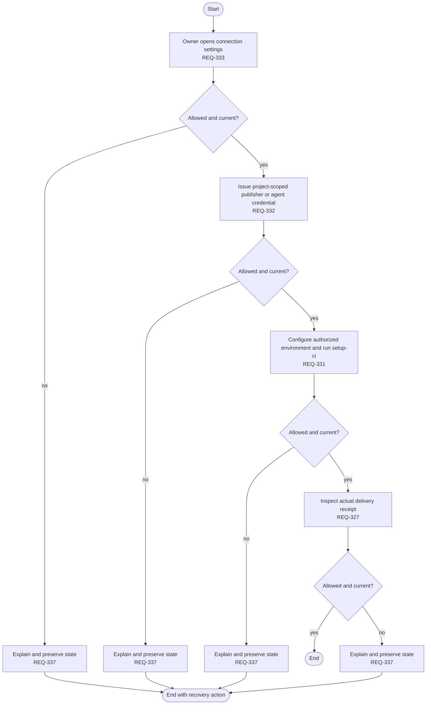

# FL-135 Set up and revoke publication access

[한국어](FL-135.ko.md)

Serves: REQ-326, REQ-330, REQ-331, REQ-332, REQ-333, REQ-350, REQ-327, REQ-328

Status: authored under the design-continuation instruction; distinct from an actual NEXUS pass or product execution evidence.

| Failure or alternative | User-visible result |
| --- | --- |
| gh missing or not signed in | Skip with one safe line; keep the manual documented path. |
| GitHub Secrets access denied | Show permission required without credential values; do not report configured. |
| Credential revoked | Next use is refused; previous receipts and audit history stay intact. |

Every path ends with success or an explicit recovery action. A retried write reuses its request key. Only the real human session decides a checkpoint. Stage 07 attaches screen IDs; stage 08 defines each visible outcome.
