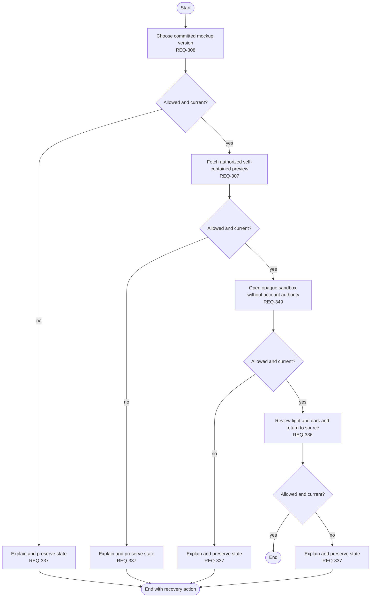

# FL-136 격리된 HTML 목업 열기

[English](FL-136.md)

연결: REQ-307, REQ-308, REQ-336, REQ-338, REQ-349, REQ-337

상태: 사용자님의 설계 진행 지시에 따라 작성했습니다. 실제 NEXUS 통과와 별개이며 제품 실행 증거가 아닙니다.

| 실패 조건 | 사용자가 확인하는 결과 |
| --- | --- |
| HTML의 탐색·네트워크·자격 증명 접근 시도 | sandbox·CSP로 차단하고 계정 쓰기나 부모 메시지를 신뢰하지 않습니다. |
| 외부 자산·차단 스크립트 | 격리 미리보기의 제한과 인증된 소스·다운로드 경로를 안내합니다. |

모든 경로는 성공 또는 복구 동작을 제공하는 종료에 도달합니다. 재시도는 동일한 요청 키를 재사용합니다. 체크포인트 결정은 실제 사용자 세션만 수행합니다. 07에서 화면 ID를 연결하고 08에서 각 결과를 상태로 정의합니다.
