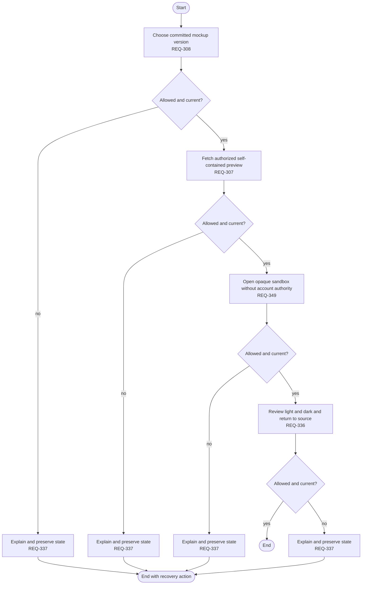

# FL-136 Open an isolated HTML mockup

[한국어](FL-136.ko.md)

Serves: REQ-307, REQ-308, REQ-336, REQ-338, REQ-349, REQ-337

Status: authored under the design-continuation instruction; distinct from an actual NEXUS pass or product execution evidence.

| Failure or alternative | User-visible result |
| --- | --- |
| HTML attempts navigation, network or credential access | Sandbox/CSP refuse the effect; no account write or parent message is trusted. |
| Unsupported external asset or blocked script | Explain the isolated preview limit and offer source/download through an authorized route. |

Every path ends with success or an explicit recovery action. A retried write reuses its request key. Only the real human session decides a checkpoint. Stage 07 attaches screen IDs; stage 08 defines each visible outcome.
