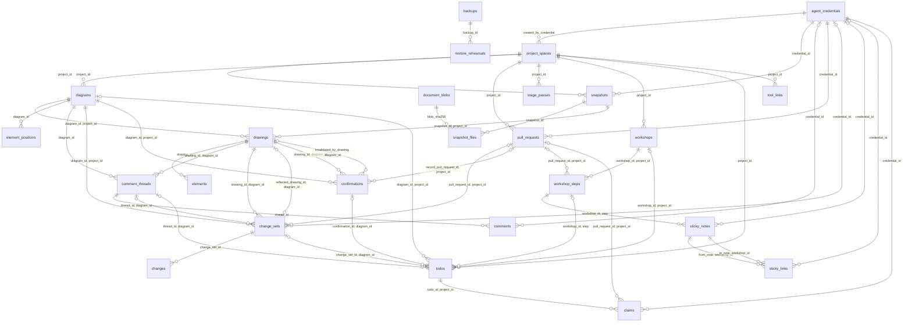

# NEXUS v3: 데이터 스키마

[English](README.md)

이 문서는 [README.md](README.md)의 한국어 사본입니다. 원본은 영어입니다.

상태: 2026-11-23 통과. API 계약 전에 스키마를 동결했습니다.

입력: 2026-11-23 통과하고 고친 기능 명세([spec.ko.md](../04-functional-spec/spec.ko.md)), 도메인 설계의 애그리거트 규칙, 이름은 용어집. 원본은 [db/nexus.sql](../../db/nexus.sql)이고, 표마다 TBL ID, 컨텍스트, 명세 행, 용어가 있습니다. [db/migrations/](../../db/migrations/)가 빈 데이터베이스에서 다시 만들고, NEXUS가 여기서 ERD를 그립니다.

## 1. 테이블

테이블 26개, TBL-146~TBL-171. 보관한 v2가 TBL-145까지 썼습니다.

| 테이블 | 컨텍스트 | 담는 것 |
| --- | --- | --- |
| TBL-146 `agent_credentials` | CTX-043 접근 | 에이전트 자격. 다이제스트로만 두고, 지우지 않고 폐기만 함 |
| TBL-147 `project_spaces` | CTX-037 그림 | 프로젝트 공간. 이름, 저장소, 들고 있는 커밋 |
| TBL-148 `snapshots` | CTX-037 그림 | 에이전트가 보낸 스냅숏. 커밋마다 하나, 리비전 번호와 함께 |
| TBL-149 `document_blobs` | CTX-037 그림 | 단계 문서의 내용. SHA-256으로 한 번만 둠 |
| TBL-150 `snapshot_files` | CTX-037 그림 | 스냅숏이 담은 문서와 그 경로 |
| TBL-151 `diagrams` | CTX-037 그림 | 단계의 그림과 항목 표 |
| TBL-152 `drawings` | CTX-037 그림 | 스냅숏 하나에서 그린 그림. 문서 버전 하나의 그림 |
| TBL-153 `elements` | CTX-037 그림 | 그림의 요소. 추적 ID와 이름 |
| TBL-154 `element_positions` | CTX-037 그림 | 사용자가 옮긴 요소의 위치. 레이아웃이고 Git에 두지 않음 |
| TBL-155 `comment_threads` | CTX-038 검토 | 그림, 요소, 행에 단 댓글 스레드와 기다리는 쪽 |
| TBL-156 `comments` | CTX-038 검토 | 스레드의 댓글과 답글, 순서대로 |
| TBL-157 `pull_requests` | CTX-038 검토 | 에이전트가 알린 PR. 반영, 기록, 도메인 문서 |
| TBL-158 `change_sets` | CTX-038 검토 | AI 제안과 직접 편집. 제안부터 반영까지 |
| TBL-159 `changes` | CTX-038 검토 | 변경안의 단계. 이름 바꾸기, 잇기, 더하기, 빼기 |
| TBL-160 `confirmations` | CTX-039 확정 | 사용자가 그림 하나를 확정한 것과 그 기록 |
| TBL-161 `stage_passes` | CTX-039 확정 | 통과한 단계 체크포인트. 기록에 남음 |
| TBL-162 `workshops` | CTX-040 워크숍 | 워크숍. 프로젝트마다 열린 것은 하나까지 |
| TBL-163 `workshop_steps` | CTX-040 워크숍 | 워크숍의 이벤트 스토밍 스텝. 확정과 문서 반영 |
| TBL-164 `sticky_notes` | CTX-040 워크숍 | 워크숍 보드의 스티키 노트와 신뢰도 레이블 |
| TBL-165 `sticky_links` | CTX-040 워크숍 | 스티키 노트 사이의 선 |
| TBL-166 `todos` | CTX-041 할 일 | 사용자와 에이전트의 할 일 |
| TBL-167 `claims` | CTX-041 할 일 | 어느 에이전트 세션이 할 일을 점유했는지 |
| TBL-168 `tool_links` | CTX-042 연결 | Notion과 Jira 연결과 마지막 상태 |
| TBL-169 `request_keys` | 운영 | 요청 키마다 처음 답. 24시간 |
| TBL-170 `backups` | 운영 | 매일 백업과 다시 하기 |
| TBL-171 `restore_rehearsals` | 운영 | 릴리스 전에 연습한 복원 |

## 2. 데이터베이스가 지키는 규칙

도메인 설계의 다른 규칙, 예를 들어 에이전트가 사람이 만든 스티키 노트를 지우지 않는 것은 코드가 지킵니다.

- `project_spaces`: 프로젝트 공간 이름은 소문자, 숫자, 하이픈 1~64자이고 겹치지 않습니다.
- `snapshots`: 프로젝트는 커밋마다 스냅숏 하나만 가지므로, 같은 커밋이 다시 오면 같은 리비전입니다(SPEC-001).
- `drawings`, `comment_threads`, `change_sets`, `confirmations`, `workshop_steps`, `todos`, `claims`: 프로젝트의 다른 행을 가리키는 행은 그 프로젝트 안만 가리키고, 스레드, 변경안, 확정, 할 일은 그 그림 안만 가리킵니다. 키마다 프로젝트나 그림을 함께 담기 때문입니다(SPEC-013).
- `document_blobs`: 문서는 소문자 16진수 SHA-256으로 한 번만 둡니다.
- `drawings`: 그림 하나는 스냅숏 하나에서만 그리고, 실패한 그림만 실패한 곳을 적습니다.
- `comment_threads`: 열린 스레드는 한쪽만 기다리고, 닫힌 스레드는 언제 누가 닫았는지 적습니다.
- `comments`: 에이전트의 댓글은 자격을 적고, 사용자의 댓글은 적지 않습니다.
- `change_sets`: 제안에는 스레드와 에이전트가 있고, 직접 편집에는 에이전트도 제안 상태도 없습니다. 반영된 변경안은 그것을 보여 주는 같은 그림의 그리기를 적습니다.
- `changes`: 요소를 자기 자신에 잇지 않습니다.
- `confirmations`: 그림마다 살아 있는 확정은 하나까지이고, 확정만은 사용자가 하므로 자격을 적는 확정은 없습니다.
- `workshops`: 프로젝트마다 열린 워크숍은 하나까지입니다.
- `sticky_notes`: 에이전트의 스티키 노트에는 신뢰도 레이블과 자격이 있습니다.
- `sticky_links`: 선은 같은 워크숍의 노트 둘을 잇고, 에이전트의 선은 자격을 적습니다.
- `todos`: 할 일의 종류마다 한쪽에 속하고, 무엇에 대한 일인지 적습니다.
- `claims`: 할 일마다 살아 있는 점유는 하나까지이고, 점유는 자격을 적으므로 자격을 폐기하면 그 점유를 풉니다(SPEC-050).
- `tool_links`: 연결은 지우기 전까지 프로젝트나 단계마다 하나만 둡니다.
- `backups`: 백업과 그 다시 하기는 같은 이름의 행 두 개, 시도 1과 2입니다.

## 3. 이 단계가 정한 것

- SQLite 3가 돌리는 SQL(D1도 같음). 한 사람의 데이터이고 v2도 같은 엔진을 썼습니다. 어디서 돌릴지는 11단계에서 정합니다.
- 키는 모두 AUTOINCREMENT 정수라 프로젝트 공간을 지운 뒤에도 같은 ID를 다시 주지 않습니다. 시각은 ISO 8601 UTC 텍스트입니다.
- 명세의 한도는 제약이 아니라 코드가 확인합니다. v2처럼 한도를 바꿔도 마이그레이션이 필요 없게.
- 스냅숏은 모두 두되 문서는 해시로 한 번만 두고, 그림마다 요소를 둡니다. 마지막 확정 이후의 차이와 스레드의 문서 버전을 언제나 보여 줄 수 있게.
- 레이아웃은 NEXUS에 둡니다(element_positions). 01단계 핫스팟 7과 REQ-015대로.
- 양쪽 할 일을 행으로 두어, 점유가 할 일 하나를 가리키고 확정을 취소하면 그 항목을 거둡니다.
- pull_requests 표 하나가 반영, 확정 기록, 도메인 문서 PR을 모두 담습니다. 점유가 그 일에 열린 PR이 있는지 알 수 있게(SPEC-045).
- 거절한 요청은 데이터베이스가 아니라 서버 로그에 남깁니다(규칙 8).
- 프로젝트 공간을 지우면 그 안의 것만 모두 함께 지워집니다. 에이전트 자격은 지우지 않고 폐기만 합니다.
- 외래 키마다 그 열에 색인을 두어 지울 때 테이블 전체를 읽지 않습니다. 에이전트 자격은 지우지 않으므로 자격을 가리키는 키에는 색인이 없습니다.
- 원본은 db/schema.sql이 아니라 db/nexus.sql입니다. hub가 이름이 nexus로 시작하는 파일에만 part nexus를 붙이기 때문입니다.

## 4. 덮은 범위

데이터를 읽거나 쓰는 명세 행은 모두 테이블을 가리킵니다(52개 중 51개). SPEC-048(사용자 들이기)은 없습니다. 로그인은 로그인 게이트가 맡습니다. 테이블마다 속한 도메인 설계의 애그리거트를 적거나 none으로 두고, 애그리거트는 모두 테이블이 있어서 NEXUS가 테이블과 DDD 보드 사이에서 차이를 찾지 않습니다. 테이블을 읽는 화면인 읽기 모델은 테이블이 없습니다: TERM-222, TERM-223, TERM-224, TERM-225, TERM-226.

## 5. 관계

선 하나가 외래 키 하나이고, 이름은 그 열입니다. 열이 두 개인 키는 행을 한 프로젝트나 한 그림 안에 묶기도 합니다. 열까지 담은 전체 ERD는 NEXUS가 원본에서 그립니다.

## 6. 체크포인트

API 계약을 쓰기 전의 스키마 동결. 이 단계가 없애거나 미루거나 바꾸는 승인된 항목: 없음.

2026-11-23 통과. 관리자가 체크포인트를 맡긴 대리인을 거쳐 추천안을 모두 승인했습니다. 답은 프로젝트 기록에 있습니다.

### 리뷰 수정

이 단계 PR의 리뷰에서 다른 프로젝트의 행을 가리킬 수 있는 행, 틀린 행이 들어오는 작은 제약, 색인 없는 외래 키가 나왔습니다. 스키마를 어디에도 적용하기 전인 2026-11-23에 두 번째 체크포인트가 같은 대리인을 거쳐 수정을 승인했고, 마이그레이션 0001에 담았습니다.

- 프로젝트나 그림을 함께 담은 키로 그리기, 스레드, 변경안, 확정, 워크숍 스텝, 할 일, 점유를 한 프로젝트, 한 그림 안에 묶습니다. 반영된 변경안과 무효가 된 확정은 스냅숏 대신 같은 그림의 그리기를 가리킵니다.
- 문서 해시는 소문자 16진수이고, 실패한 그리기만 실패한 곳을 적고, 스티키 선은 한 워크숍의 노트를 잇고 에이전트의 선은 자격을 적고, 백업의 다시 하기는 따로 한 행이고, 외래 키마다 색인이 있습니다.
- 테스트가 두 프로젝트로 모든 테이블을 채우고 하나를 지운 뒤 그 프로젝트의 것은 남지 않고 다른 프로젝트는 그대로인지 확인합니다. 위 관계 그림은 열이 두 개인 키를 선 하나로 그립니다.

수정이 없애거나 미루거나 바꾸는 승인된 항목: 없음. 테이블 26개, 엔진, 스냅숏 보관 방식은 승인된 그대로입니다.

### 추적 수정

스키마를 NEXUS에 처음 올렸을 때 테이블과 DDD 보드 사이의 차이가 22건 열렸습니다. 테이블 주석에 테이블이 담는 용어집 용어를 모두 적었는데, 단계 계약은 테이블이 나타내는 애그리거트만 적고 NEXUS는 그것을 보드와 비교합니다. 2026-11-23 세 번째 체크포인트가 같은 대리인을 거쳐 테이블마다 애그리거트를 적거나 none으로 두는 것을 승인했고, 이제 테스트가 확인합니다. 테이블, 열, 제약은 바뀌지 않았습니다.

### API 수정

고정한 hub에 맞춰 API 계약을 쓰다가, hub가 보내는데 담을 열이 없는 필드와 hub가 커밋 없이 보고하는 병합을 찾았습니다. 2026-11-23 06단계 체크포인트가 같은 대리인을 거쳐 세 가지 변경을 하나씩 승인했습니다. 스키마는 아직 어디에도 적용하지 않았으므로 마이그레이션 0001에 담았습니다.

- comments.detail: hub가 항목과 함께 보내지만 담을 열이 없는 quote, asks, look_first, 결정 링크를 담는 JSON 객체.
- change_sets.detail: hub가 보내는 제안의 reason, 변경 글, 항목, 추가한 ID, 제안 문서를 담는 JSON 객체.
- pull_requests는 merge_commit 없이도 merged가 될 수 있습니다. hub는 반영할 때만 커밋을 보고하고, 기록 PR의 병합에는 커밋이 필요 없습니다.

더하거나 뺀 테이블은 없고, 다른 열과 제약은 바뀌지 않았습니다.

#### PR 104 세 번째 리뷰 뒤

승인된 항목 1개가 바뀌었고, 하나씩 여쭈어 같은 대리인을 통해 승인했습니다. TBL-151은 그 단계를 싣는 형식의 스냅숏이 더는 그 그림을 지니지 않을 때만 removed_at을 적습니다(네 번째 리뷰 뒤 단계의 그림으로 고쳐 적음, 아래). 그래서 corthex-hub/0.2 스냅숏은 03·08·09단계 그림을 그대로 둡니다(SPEC-005). 테이블, 열, 제약은 바뀌지 않았습니다. 이 몫은 2026-11-23에 같은 대리인을 통해 따로 체크포인트를 통과했습니다.

#### PR 104 네 번째 리뷰 뒤

승인된 항목 1개가 바뀌었고, 하나씩 여쭈어 같은 대리인을 통해 승인했습니다. TBL-151은 스냅숏이 더는 그 그림을 지니지 않을 때 removed_at을 적습니다. 다만 스냅숏 형식이 그 단계의 그림을 싣지 않으면 그 단계의 그림은 마지막으로 그린 대로 둡니다(SPEC-005). corthex-hub/0.2는 03·08·09단계를 싣지만(그 항목이 항목 표를 만듦) 그 그림은 싣지 않으므로, 예외를 그림으로 적었습니다. 테이블, 열, 제약은 바뀌지 않았습니다. 이 몫은 2026-11-23에 같은 대리인을 통해 따로 체크포인트를 통과했습니다.

#### PR 104 다섯 번째 리뷰 뒤

승인된 항목 1개가 바뀌었고, 하나씩 여쭈어 같은 대리인을 통해 승인했습니다. TBL-151은 단계의 그림이 처음 그려질 때 그 단계의 항목 표에도 removed_at을 적습니다. 그 스냅숏도 단계의 항목은 싣기 때문입니다(SPEC-005). removed_at이 있는 그림도 열린 스레드가 있는 동안 목록에 남습니다(SPEC-027). 테이블, 열, 제약은 바뀌지 않았습니다. 이 몫은 2026-11-23에 같은 대리인을 통해 따로 체크포인트를 통과했습니다.

#### PR 104 여섯 번째 리뷰 뒤

승인된 항목 1개가 바뀌었고, 하나씩 여쭈어 같은 대리인을 통해 승인했습니다. 스냅숏이 지운 그림의 원본을 다시 지니면 TBL-151은 removed_at을 지웁니다. UNIQUE (project_id, stage, source_key) 때문에 그 원본은 같은 행으로 돌아옵니다. 단계의 그림에 자리를 내준 항목 표는 빼는데, corthex-hub/0.2가 그 항목을 계속 싣기 때문입니다. 지운 그림은 그 단계의 그림이 아닙니다(SPEC-027). 테이블, 열, 제약은 바뀌지 않았습니다. 이 몫은 2026-11-23에 같은 대리인을 통해 따로 체크포인트를 통과했습니다.

### 쓰기 오퍼레이션의 추적 목록

06단계의 테이블 번호 수정에서, 어떤 쓰기 오퍼레이션이 바꾸는 테이블의 추적 목록에 그 오퍼레이션의 명세 행이 빠진 것을 찾았습니다. 승인된 항목 1개가 바뀌었고, 하나씩 여쭈어 같은 대리인을 통해 승인했으며, 리뷰 뒤 그 답을 다시 여쭈었습니다. 명세 행 9개가 테이블 4개의 추적 목록에 들어갑니다. TBL-155 comment_threads에 SPEC-018, TBL-163 workshop_steps에 SPEC-036, TBL-166 todos에 SPEC-018, SPEC-020, SPEC-021, SPEC-028, TBL-167 claims에 SPEC-017, SPEC-018, SPEC-032가 들어갑니다. 테이블, 열, 제약은 그대로입니다. 이 몫은 2026-11-23에 같은 대리인을 통해 따로 체크포인트를 통과했습니다.

### 지운 프로젝트의 블롭

TASK-448을 만들다가, 프로젝트 공간 지우기(API-278, SPEC-013)가 TBL-149 document_blobs의 행을 지우는데 그 추적 목록에 SPEC-013이 없는 것을 찾았습니다. 블롭은 SHA-256으로 한 번만 두고 여러 프로젝트의 스냅숏이 함께 가리킬 수 있어서, 어떤 연쇄 삭제도 블롭에 닿지 않습니다. 테이블 주석이 이미 말하듯, 지우기는 남은 스냅숏 파일이 가리키지 않는 그 프로젝트의 블롭을 같은 트랜잭션에서 지우고, 다른 프로젝트가 아직 가리키는 블롭은 남깁니다. 서버의 테이블 검사(WBS 메모 23)는 쓰기가 바꾸는 테이블마다 그 쓰기의 명세 행이 채우는 테이블이게 합니다. 승인된 항목 1개가 바뀌고, 따로 여쭙니다. TBL-149의 추적 줄 `-- TBL-149 document_blobs (CTX-037) ← SPEC-001 | terms: TERM-189`가 `-- TBL-149 document_blobs (CTX-037) ← SPEC-001, SPEC-013 | terms: TERM-189`가 됩니다. 테이블, 열, 제약은 바뀌지 않았습니다. 이 몫은 2026-11-24에 같은 대리인을 통해 따로 체크포인트를 통과했어요.
