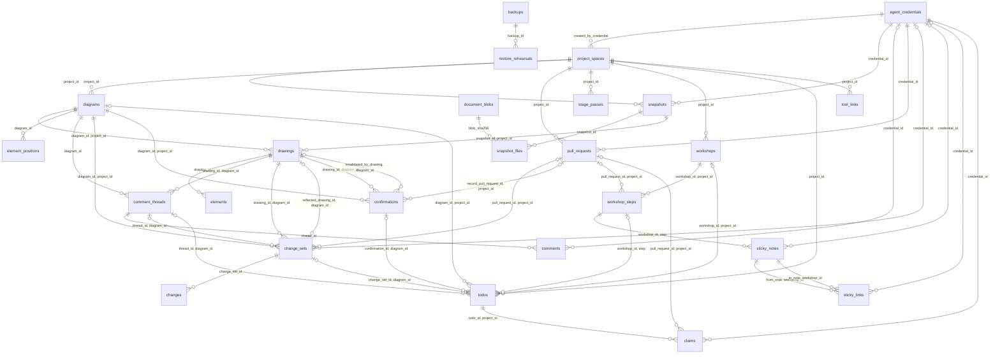

# NEXUS v3: data schema

[한국어](README.ko.md)

Status: passed on 2026-11-23; the schema is frozen before the API contract.

Inputs: the functional spec ([spec.md](../04-functional-spec/spec.md)), passed and corrected on 2026-11-23, the aggregate rules of the domain design and its glossary for names. The source is [db/nexus.sql](../../db/nexus.sql), where each table has its TBL ID, context, spec rows and terms; [db/migrations/](../../db/migrations/) rebuilds it from an empty database, and NEXUS draws the ERD from it.

## 1. Tables

Twenty-six tables, TBL-146 to TBL-171; the archived v2 used IDs up to TBL-145.

| Table | Context | What it holds |
| --- | --- | --- |
| TBL-146 `agent_credentials` | CTX-043 Access | Agent credentials, kept only as digests; revoked, never deleted |
| TBL-147 `project_spaces` | CTX-037 Diagram | One project's space: its name, repository and held commit |
| TBL-148 `snapshots` | CTX-037 Diagram | Each snapshot an agent sent, one per commit, with its revision |
| TBL-149 `document_blobs` | CTX-037 Diagram | The text of each stage document, kept once by its SHA-256 |
| TBL-150 `snapshot_files` | CTX-037 Diagram | Which documents, by path, a snapshot holds |
| TBL-151 `diagrams` | CTX-037 Diagram | Each picture or item table of a stage |
| TBL-152 `drawings` | CTX-037 Diagram | Each drawing of a diagram from one snapshot: the diagram at a document version |
| TBL-153 `elements` | CTX-037 Diagram | The elements of a drawing, with their trace IDs and names |
| TBL-154 `element_positions` | CTX-037 Diagram | Where the owner put each element: the layout, never in Git |
| TBL-155 `comment_threads` | CTX-038 Review | Comment threads on a diagram, an element or a row, and which side they wait on |
| TBL-156 `comments` | CTX-038 Review | Each comment and reply of a thread, in order |
| TBL-157 `pull_requests` | CTX-038 Review | Pull requests agents report: reflections, records and domain documents |
| TBL-158 `change_sets` | CTX-038 Review | AI proposals and direct edits, from proposed to reflected |
| TBL-159 `changes` | CTX-038 Review | The steps of a change set: rename, connect, add, remove |
| TBL-160 `confirmations` | CTX-039 Confirmation | The owner's confirmation of a diagram at a drawing, and its record |
| TBL-161 `stage_passes` | CTX-039 Confirmation | Each stage checkpoint passed, kept in the record |
| TBL-162 `workshops` | CTX-040 Workshop | Workshops; at most one open per project |
| TBL-163 `workshop_steps` | CTX-040 Workshop | The event storming steps of a workshop, confirmed and written |
| TBL-164 `sticky_notes` | CTX-040 Workshop | Sticky notes on a workshop board, with confidence labels |
| TBL-165 `sticky_links` | CTX-040 Workshop | Lines between sticky notes |
| TBL-166 `todos` | CTX-041 To-do | Every to-do of the owner and the agents |
| TBL-167 `claims` | CTX-041 To-do | Which agent session holds a to-do |
| TBL-168 `tool_links` | CTX-042 Tool link | Notion and Jira links with their last status |
| TBL-169 `request_keys` | Operations | The first answer to each request key, for 24 hours |
| TBL-170 `backups` | Operations | Each daily backup and its retry |
| TBL-171 `restore_rehearsals` | Operations | Each restore rehearsed before a release |

## 2. Rules the database holds

The other rules of the domain design, such as an agent never removing a sticky note a person made, are the code's.

- `project_spaces`: A project space's name is 1 to 64 lowercase letters, digits and hyphens, and unique.
- `snapshots`: A project holds each commit once, so the same commit again is the same revision (SPEC-001).
- `drawings`, `comment_threads`, `change_sets`, `confirmations`, `workshop_steps`, `todos`, `claims`: A row that points at other rows of a project points only within that project, and a thread, change set, confirmation or to-do only within its diagram, because each key includes the project or the diagram (SPEC-013).
- `document_blobs`: A document is kept by its SHA-256 in lowercase hex, once.
- `drawings`: A drawing comes from one snapshot only, and only a failed one says where it failed.
- `comment_threads`: An open thread waits on exactly one side; a closed one says when and by whom.
- `comments`: An agent's comment names its credential; the owner's names none.
- `change_sets`: A proposal has a thread and an agent; a direct edit has neither an agent nor a proposed state; a reflected change set names the drawing of its diagram that shows it.
- `changes`: A connection never joins an element to itself.
- `confirmations`: At most one live confirmation per diagram, and no confirmation names a credential, since only the owner confirms.
- `workshops`: At most one open workshop per project.
- `sticky_notes`: An agent's sticky note carries a confidence label and names its credential.
- `sticky_links`: A line joins two notes of the same workshop, and an agent's line names its credential.
- `todos`: Each to-do kind belongs to one side and names what it is about.
- `claims`: At most one live claim per to-do, and each claim names its credential, so revoking it releases its claims (SPEC-050).
- `tool_links`: A link is kept once per project or stage while it is not removed.
- `backups`: A backup and its retry are two rows of one name, attempts 1 and 2.

## 3. Choices this stage makes

- SQL that SQLite 3 runs, which D1 also runs: one person's data, and v2 ran on the same engine. Where it runs is left to stage 11.
- Every key is an INTEGER with AUTOINCREMENT, so an ID is never given out twice, even after a project space is deleted. Times are UTC text in ISO 8601.
- The spec's limits are checked by the code, not by constraints, so changing one needs no migration, as in v2.
- Every snapshot is kept, its documents once each by hash, and the elements of every drawing, so the diff since the last confirmation and a thread's document version can always be shown.
- The layout lives in NEXUS (element_positions), as stage-01 hotspot 7 and REQ-015 decided.
- To-dos of both sides are rows, so a claim points at one to-do and a cancelled confirmation withdraws its entry.
- One pull_requests table covers reflections, confirmation records and domain documents, so a claim knows whether its work has an open pull request (SPEC-045).
- Refused requests go to the server's log, not to the database (rule 8).
- Deleting a project space cascades to everything in it and nothing else; agent credentials are only revoked, never deleted.
- Every foreign key has an index on its columns, so a delete never reads a whole table; keys to agent credentials need none, since credentials are never deleted.
- The source is db/nexus.sql rather than db/schema.sql, because the hub gives the part nexus only to files whose names start with it.

## 4. Coverage

Every spec row that reads or writes data names its tables, 51 of 52. SPEC-048 (admitting the owner) has none: the sign-in gate keeps the sign-in. Each table names the aggregate of the domain design it belongs to, or none, and every aggregate has a table, so NEXUS finds no difference between the tables and the DDD board. The read models, the screens that read the tables, have none: TERM-222, TERM-223, TERM-224, TERM-225, TERM-226.

## 5. Relations

Each line is a foreign key, labelled with its columns; a key of two columns also keeps the row within one project or diagram. NEXUS draws the full ERD with columns from the source.

## 6. Checkpoint

The schema freeze before the API contract is written. Approved items that this stage removes, defers or changes: none.

Passed on 2026-11-23. The maintainer approved every recommendation through the delegate they named for checkpoints; the answer is in the project's records.

### Review corrections

The review of the stage's pull request found rows that could point at another project's rows, small constraints that let wrong rows in and foreign keys without an index. A second checkpoint on 2026-11-23 approved the fixes, through the same delegate, before the schema was applied anywhere, so migration 0001 holds them:

- Keys that include the project or the diagram keep drawings, threads, change sets, confirmations, workshop steps, to-dos and claims within one project and one diagram. A reflected change set and an invalidated confirmation name a drawing of their diagram rather than a snapshot.
- A document hash is lowercase hex; only a failed drawing says where it failed; a sticky line joins notes of one workshop and an agent's line names its credential; a backup's retry is its own row; every foreign key has an index.
- A test fills every table for two projects, deletes one and checks that nothing of it is left and the other is whole; the relations above draw a key of two columns as one line.

Approved items that the corrections remove, defer or change: none; the 26 tables, the engine and how snapshots are kept stay as approved.

### Trace correction

The first push of the schema to NEXUS opened 22 differences between the tables and the DDD board: the table comments named every glossary term a table holds, while the stage contract names only the aggregates it represents, and NEXUS compares those with the board. A third checkpoint on 2026-11-23 approved naming each table's aggregate, or none, through the same delegate; a test now checks it. No table, column or constraint changed.

### API corrections

Writing the API contract against the pinned hub found fields the hub sends that have no column, and a merge the hub reports without its commit. The stage-06 checkpoint on 2026-11-23 approved three changes, each on its own, through the same delegate. The schema has not been applied anywhere, so migration 0001 holds them:

- comments.detail, a JSON object for what the hub sends with an entry and no column holds: its quote, asks, look_first and a decision's link.
- change_sets.detail, a JSON object for a proposal as the hub sends it: its reason, change text, items, added IDs and proposed document.
- pull_requests may be merged without merge_commit: the hub reports a commit only with a reflection, and a record's merge needs none.

No table was added or removed, and no other column or constraint changed.

#### After the third review of pull request 104

One approved item changed, asked on its own and approved through the same delegate: TBL-151 sets removed_at only when a snapshot whose format carries the stage no longer holds the diagram (worded by the stage's pictures after the fourth review, below), so a corthex-hub/0.2 snapshot leaves the pictures of stages 03, 08 and 09 as they are (SPEC-005). No table, column or constraint changed. This part passed its own checkpoint on 2026-11-23 through the same delegate.

#### After the fourth review of pull request 104

One approved item changed, asked on its own and approved through the same delegate: TBL-151 sets removed_at when a snapshot no longer holds the diagram, except that a picture of a stage whose pictures the snapshot's format does not carry stays as last drawn (SPEC-005). corthex-hub/0.2 carries stages 03, 08 and 09, whose items feed the item tables, but not their pictures, so the exception is worded by the pictures. No table, column or constraint changed. This part waits for its own checkpoint.
