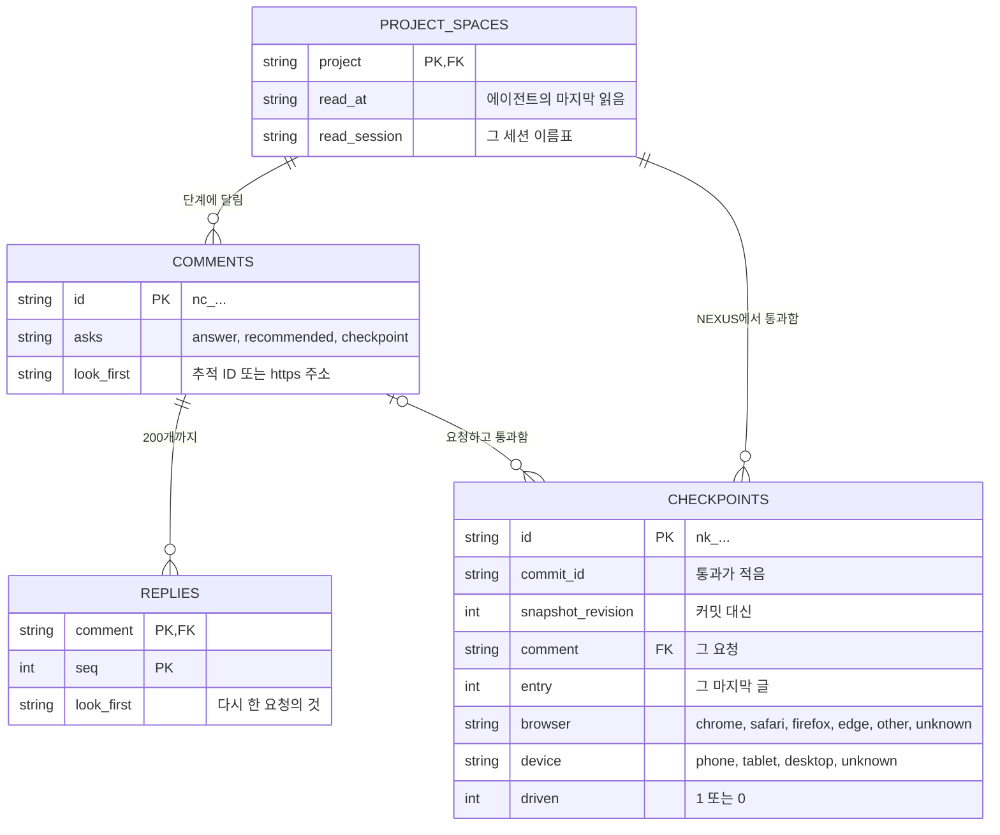
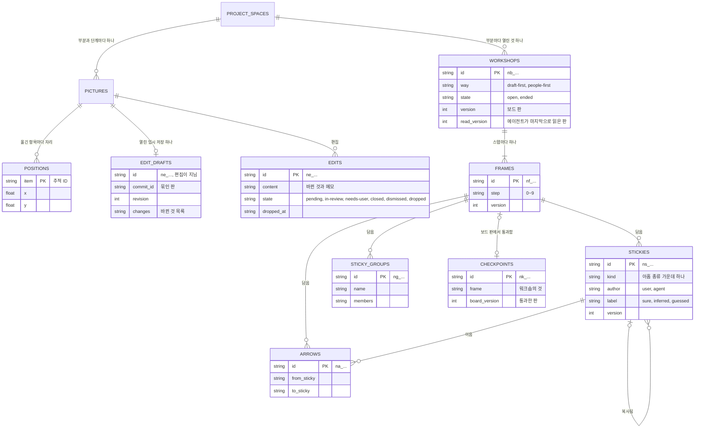
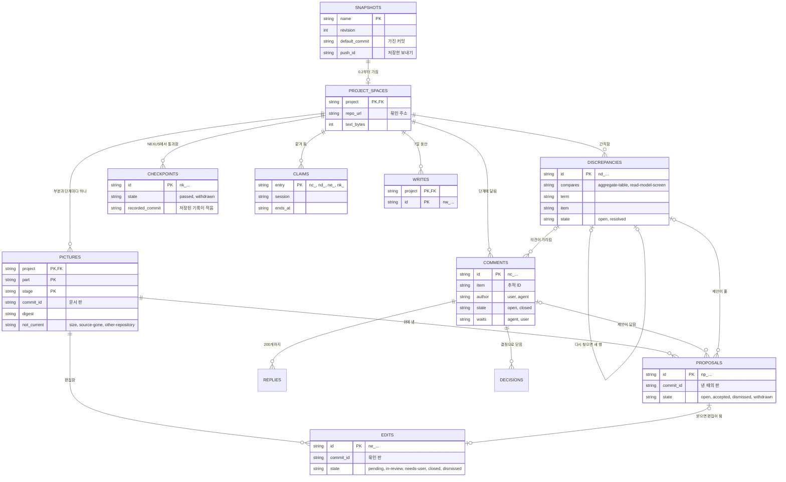

# NEXUS: 서버의 자료와 파일

[English](nexus.md)

CORTHEX 자신의 프로젝트에서 NEXUS 0.2의 05단계입니다: [nexus.sql](nexus.sql)에 있는 NEXUS 서버의 표, 그리고 그것과 함께 가는 파일, 곧 프로젝트를 서버로 싣고 가는 스냅샷, 프로젝트 저장소의 단계 기록, 기기에 있는 허브의 보낼 편지함입니다. 상태: 2026-11-02에 관리자가 그날 고른 대로 기억 플러그인을 만드는 동안, 사용자 흐름과 기능 명세의 추천을 따라 초안을 썼습니다. 관리자가 2026-11-03에 03·04단계, 06\~08단계와 함께 이 파일의 확인 지점을 통과시켜, NEXUS 0.2의 스키마는 고정되었습니다. 이제 호환되지 않는 변경을 하려면 관리자의 결정과 새 스키마 버전이 필요합니다. 2026-11-03에 관리자가 01단계 이벤트 스토밍을 NEXUS에서 하기로 고르면서 DDD 보드의 그림 자료에 타임라인을 더했고, 이것은 표를 바꾸지 않습니다. ② 차례의 작업 보드는 그 차례에 맡겼습니다. 둘 다 관리자가 같은 날 통과시켰습니다([확인할 것](#확인할-것)). 2026-11-06 관리자의 다시 디자인은 그 확인 지점 1의 선택 ② A대로 모든 단계의 항목에 대화를 남기도록 의견(TBL-105)과 확인 지점(TBL-110)을 바꾸며, 2026-11-08 그 확인 지점 3이 통과한 뒤 다시 디자인을 만들면서 nexus.sql과 변환 4가 그 변경을 받아들였습니다([다시 디자인의 변경](#다시-디자인의-변경)). ② 차례, 곧 PC에서 고치기와 01단계 워크숍은 그 01\~04단계가 2026-11-06과 2026-11-07에 통과했으며, 표 TBL-118\~TBL-124와 0.2 표 여섯의 변경을 계획하고, ② 차례를 만들 때 다시 디자인 뒤에 nexus.sql과 ② 차례의 변환이 그것을 받아들입니다([② 차례의 표](#②-차례의-표)). 이 단계의 ② 차례 확인 지점이 06단계의 것과 함께 2026-11-08 09:33(KST)에 이것들을 통과시켰습니다([확인할 것](#확인할-것)). 그날의 검토에 답하는 2026-11-11의 설계 수정은 기능 명세의 행 SPEC-187\~SPEC-210을 위해 TBL-102의 열 둘, TBL-105와 TBL-106의 열 하나씩, TBL-110의 열 다섯, 색인 하나, 기기의 파일 하나(TBL-125)를 계획하고, ② 차례를 위해 변경 다섯을 더 계획합니다. 그 확인 지점은 2026-11-12에 통과했고, 2026-11-13에 그것을 만들면서 열 아홉 개와 색인이 nexus.sql과 변환 5에 들어갔으며, 이것을 담은 릴리스는 아직 없습니다([2026-11-11의 설계 수정](#2026-11-11의-설계-수정)). 이 번역과 영어 원문이 다르면 영어 원문이 원본입니다.

입력: [docs/04-functional-spec/nexus.ko.md](../04-functional-spec/nexus.ko.md)의 기능 명세(SPEC-101\~SPEC-156, ② 차례는 SPEC-170\~SPEC-186, 2026-11-11의 설계 수정은 SPEC-187\~SPEC-210), 특히 그 [05단계를 위한 메모](../04-functional-spec/nexus.ko.md#05단계-서버의-자료와-파일); [docs/02-prd/nexus.ko.md](../02-prd/nexus.ko.md)의 요구사항 가운데 자료를 가장 많이 정하는 REQ-116, REQ-118, REQ-120, REQ-123, REQ-124; [docs/01-domain/nexus.ko.md](../01-domain/nexus.ko.md)의 용어집과 DDD 보드(이 파일은 그 말을 그 뜻으로 쓰고, 표는 그 보드의 애그리거트를 적습니다); [nexus/src/store.js](../../nexus/src/store.js)에 있는 1차의 표. Cloudflare의 D1 문서는 2026-11-02에 읽었습니다: [한도](https://developers.cloudflare.com/d1/platform/limits/), [요금](https://developers.cloudflare.com/d1/platform/pricing/), [외래 키](https://developers.cloudflare.com/d1/sql-api/foreign-keys/), [JSON 함수](https://developers.cloudflare.com/d1/sql-api/query-json/), [배치](https://developers.cloudflare.com/d1/worker-api/d1-database/).

## 승인된 실행 위치 (2026-11-04)

기본 서버는 기존 VPS의 Node와 SQLite 파일입니다. Worker 호환 경로는 D1을 계속 씁니다. 두 연결부는 배치마다 트랜잭션 하나로 실행하고, 자료의 SQL은 store.js에만 둡니다. 아래의 표, DDL, 상태 전이, 상한은 그대로이고, 이전의 D1 설명은 Worker 경로의 설명으로 남습니다. 서버에서 매일, 그리고 변환과 배포마다 그 직전에 백업하고 실제 복구를 비교합니다. 실제 경로, 접속값, 데이터베이스, 백업은 Git 밖, 서버에 둡니다. 2026-11-11의 설계 수정부터: 서버와 다른 기계에도 하루 안의 백업 사본을 두고 날마다 그 나이를 확인하며(REQ-291), 그 사본도 Git 밖에 둡니다.

## 이 파일을 읽는 법

- 서버의 표는 빈 데이터베이스의 스키마인 [nexus.sql](nexus.sql)에 있습니다. 표마다 주석에 TBL ID, 컨텍스트, 그 표가 간직하는 DDD 보드 애그리거트의 용어(없으면 `terms: none`), 그 표를 읽거나 쓰는 동작(SPEC)을 적습니다. 프로젝트 허브는 이 주석을 읽고, NEXUS 0.2부터는 그 파일에서 `nexus` 부분의 ERD 그림을 그립니다(SPEC-107). 이 파일은 표를 설명하고, 나머지 저장 단위, 곧 [저장 단위](#저장-단위)의 파일을 정합니다.
- `근거` 열과 표의 주석에는 그 저장 단위를 읽거나 쓰는 동작을 모두 적고, [동작마다 읽고 쓰는 자료](#동작마다-읽고-쓰는-자료)는 같은 것을 반대 방향으로 적습니다.
- 상태: 지금 도는 1차 그대로인 것(스냅샷 표, 저장한 스냅샷, 진행 기록 파일)은 `built`, NEXUS 0.2가 더하거나 바꾸는 것은 `active`, ② 차례가 더하거나 바꾸는 것, 곧 PC에서 고치기와 작업 보드는 `later (phase ②)`입니다([② 차례의 표](#②-차례의-표)). 2026-11-11의 설계 수정은 기능 명세의 두 가지를 더합니다: 명세는 했지만 아직 어느 릴리스에도 없는 것은 `planned`, 열려 있던 02단계 결정의 추천을 따르던 것은 `open (Dn)`이었으며, D16–D18이 2026-11-12에 추천대로 정해진 뒤로는 어느 행도 그렇게 적지 않습니다([2026-11-11의 설계 수정](#2026-11-11의-설계-수정)).
- 필드 표는 열과 필드를 쓰는 순서대로 적습니다. 값이 없는 열은 NULL이고, 파일의 선택 필드는 값이 없으면 뺍니다.
- 표는 보드 애그리거트의 용어만 적습니다. 어느 애그리거트에도 없는 용어를 적으면 NEXUS가 자기 그림을 점검할 때 어긋남이 열리기 때문입니다(SPEC-121). 허브의 컨텍스트 CTX-006, CTX-008, CTX-009는 보드에 애그리거트가 없으므로, 그 자료를 간직하거나 쓰기의 순서를 지키는 표는 `terms: none`이라고 적습니다. ③ 차례의 애그리거트인 연결은 `without a table:` 뒤에 적으며, ② 차례의 애그리거트인 자리, 워크숍, 스티커도 ② 차례가 그 표를 만들 때까지 거기에 적습니다.
- 이 파일은 Worker와 그 D1 데이터베이스를 두고 썼습니다. 2026-11-04의 결정부터 관리자의 서버는 독립 서버로 돌므로, 아래 문장이 Worker가 검사한다거나 D1이 배치를 실행한다고 적은 곳은 서버와 그 데이터베이스로 읽습니다. 무료 요금제의 한도는 Worker 빌드에만 걸립니다([두 실행 환경과 무료 요금제의 한도](#두-실행-환경과-무료-요금제의-한도)).

## 자료가 있는 곳

```txt
NEXUS 서버: SQLite 파일을 쓰는 독립 서버, 또는 D1 데이터베이스를 쓰는 Worker 빌드 (nexus.sql)
├─ snapshots                  TBL-101 프로젝트마다 가장 새 스냅샷
│  └─ project_spaces          TBL-102 프로젝트마다 공간 하나
│     ├─ pictures             TBL-103 부분과 그림이 있는 단계마다 하나
│     │  ├─ proposals         TBL-108
│     │  └─ edits             TBL-109 닫힐 때까지는 반영 대기
│     ├─ comments             TBL-105 부분의 어느 단계에나
│     │  ├─ replies           TBL-106
│     │  └─ decisions         TBL-107
│     ├─ discrepancies        TBL-104
│     ├─ checkpoints          TBL-110 NEXUS에서 통과한 것
│     ├─ claims               TBL-111
│     └─ writes               TBL-112 7일 동안 둠
└─ migrations                 TBL-113

프로젝트의 저장소, 기본 브랜치의 커밋에서
└─ .corthex/stages/<part>.json 또는 .corthex/stages.json    TBL-115 단계 기록

기기: ~/.corthex/hub/
├─ snapshots/<project>.json                 TBL-114 스냅샷
├─ status/<project>.json                    TBL-116 진행 기록 파일
├─ outbox/<project>/<time>.<write>.json     TBL-117 보낼 편지함, 쓰기마다 파일 하나
├─ outbox/<project>.lock
├─ reads/<project>.json                     TBL-125 세션의 읽음, planned
└─ index.html                               허브 페이지
```

서버의 나무는 지우기가 무엇을 지우는지도 보여 줍니다: 프로젝트의 스냅샷을 지우면 그 공간이 지워지고, 외래 키가 공간 안의 모든 것을 함께 지웁니다(SPEC-115). 2026-11-11의 설계 수정부터: 나무는 의견을 변환 4가 옮긴 대로 공간 아래에 그리고, 두 실행 환경을 적으며, 세션의 읽음(TBL-125)을 더합니다.

## 저장 단위

| ID | 저장 단위 | 컨텍스트 | 있는 곳 | 구별하는 값 | 보관 | 근거 | 상태 |
| --- | --- | --- | --- | --- | --- | --- | --- |
| TBL-114 | 스냅샷 | CTX-006 | 기기의 `snapshots/<project>.json`, 그리고 보내기마다의 본문 | 프로젝트마다 하나 | 그 프로젝트의 다음 스냅샷까지 | SPEC-103, SPEC-104, SPEC-105, SPEC-106, SPEC-107, SPEC-108, SPEC-109, SPEC-110, SPEC-111, SPEC-122, SPEC-125 | active |
| TBL-115 | 단계 기록 | CTX-007 | 프로젝트 저장소에서 부분마다 `.corthex/stages/<part>.json`, 부분이 없는 프로젝트는 `.corthex/stages.json` | 부분마다 하나 | Git에, 저장소가 있는 동안 | SPEC-109, SPEC-137, SPEC-140 | active |
| TBL-116 | 진행 기록 파일 | CTX-007 | 기기의 `status/<project>.json` | 프로젝트마다 하나 | 사용자가 지울 때까지 | SPEC-109 | built |
| TBL-117 | 보낼 편지함 | CTX-014 | 기기의 `outbox/<project>/<time>.<write>.json` | 그 쓰기 ID | 서버가 받거나 끝내 거절할 때까지, 길어야 7일 | SPEC-128, SPEC-129, SPEC-135 | active |
| TBL-118 | 자리 | CTX-012 | ② 차례가 더하는 서버의 표 `positions` | 프로젝트, 부분, 단계, 항목 | 그 항목이 그림에 있는 동안 | SPEC-134, SPEC-174, SPEC-175 | later (phase ②) |
| TBL-125 | 세션의 읽음 | CTX-007 | 2026-11-11의 설계 수정이 더하는 기기의 `reads/<project>.json` | 프로젝트마다 하나, 세션마다 그 안에 하나 | 저마다 읽은 뒤 7일 | SPEC-191 | planned |

서버의 표는 [nexus.sql](nexus.sql)에 있습니다:

| 표 | 이름 | 담는 것 | 보관 | 상태 |
| --- | --- | --- | --- | --- |
| TBL-101 | `snapshots` | 프로젝트마다 가장 새 스냅샷(그림 자료는 뺌)과, 그것을 가져온 기본 브랜치 커밋 | 다음 스냅샷이나 지우기까지 | built; 0.2가 `default_commit`과 `push_id`를 더함 |
| TBL-102 | `project_spaces` | 프로젝트마다 공간 하나, 그 저장소의 주소에 묶임 | 지우기까지 | active; 2026-11-11의 설계 수정이 변환 5로 `read_at`과 `read_session`을 더함, planned |
| TBL-103 | `pictures` | 부분과 그림이 있는 단계마다 마지막 그림, 현재 그림이든 아니든 | 지우기까지 | active |
| TBL-104 | `discrepancies` | 점검이 찾은 것, 열린 것과 풀린 것 | 지우기까지 | active |
| TBL-105 | `comments` | 모든 단계의 항목이나 단계 전체에 단 의견 | 지우기까지 | active; 다시 디자인이 공간에 묶고 `asks`를 더함; 2026-11-11의 설계 수정이 변환 5로 `look_first`와 색인 `comments_request`를 더함, planned |
| TBL-106 | `replies` | 의견마다 그 아래의 답글 | 지우기까지 | active; 2026-11-11의 설계 수정이 변환 5로 `look_first`를 더함, planned |
| TBL-107 | `decisions` | 의견에 기록한 결정과 그 링크 | 지우기까지 | active |
| TBL-108 | `proposals` | 에이전트의 제안과 그 결과 | 지우기까지 | active |
| TBL-109 | `edits` | 편집. 닫힐 때까지는 반영 대기 | 지우기까지 | active |
| TBL-110 | `checkpoints` | NEXUS에서 통과한 확인 지점, 그 기록의 PR, 단계 기록이 그것을 적는지 | 지우기까지 | active; 다시 디자인이 `comment`를 더함; 2026-11-11의 설계 수정이 변환 5로 `snapshot_revision`, `entry`, `browser`, `device`, `driven`을 더함, planned |
| TBL-111 | `claims` | 어느 에이전트 세션이 AI 할 일의 어느 것을 언제까지 맡았는지 | 맡음이 이어지는 동안 | active |
| TBL-112 | `writes` | 서버가 받은 쓰기의 ID와 그 첫 응답 | 7일 | active |
| TBL-113 | `migrations` | 데이터베이스에 적용한 스키마 버전 | 데이터베이스가 있는 동안 | active |

## 모든 표와 파일

- 글은 UTF-8입니다. 글자 수로 적은 길이는 기억에서처럼 유니코드 코드 포인트를 셉니다. 그림 보기는 저장된 글을 모두 글로만 보여 줍니다(REQ-148).
- 시각은 `2026-11-02T12:05:12.345Z`처럼 밀리초까지 적은 UTC이고, 서버의 시계에서 옵니다. 세 가지는 다른 곳에서 와서 자기 시간대를 지닙니다: 기기에서 오는 스냅샷의 `generated_at`, Git에서 오는 커밋의 시각, 그것을 쓴 기기에서 오는 단계 기록의 `updated`. 날짜는 `2026-11-02`처럼 적습니다.
- 서버는 의견, 어긋남, 제안, 편집, 확인 지점의 ID를 만듭니다: `n`, 종류를 나타내는 글자 하나, `_`, 그리고 Crockford base32 소문자로 된 무작위 글자 12개(무작위 60비트)입니다. `nc_`는 의견, `nd_`는 어긋남, `np_`는 제안, `ne_`는 편집, `nk_`는 확인 지점이며, 예를 들면 `nc_7f3k2m9q4x1v`입니다. 페이지와 허브는 쓰기 ID를 같은 방법으로 `nw_`를 붙여 만듭니다. 이 ID들은 추적 ID처럼 보이지 않으므로 허브는 어느 것도 읽지 않고, 맡음은 맡은 것의 종류를 접두사로 압니다. 답글과 결정은 의견 안에서 1부터 번호를 매깁니다. 어떤 ID도 다시 쓰지 않습니다.
- 프로젝트와 부분의 이름은 프로젝트 목록이 프로젝트를 부르듯 소문자, 숫자, 하이픈으로 씁니다. 빈 부분 `''`은 프로젝트 전체입니다: 부분이 없는 프로젝트, 또는 어느 부분에도 들지 않는 프로젝트의 문서(SPEC-105).
- 단계는 `05-erd`처럼 13단계의 키이며, 그림이 있는 단계는 `01-domain`, `05-erd`, `07-sitemap`뿐입니다. 커밋은 Git이 주는 대로의 전체 커밋 ID입니다.
- JSON 열에는 서버가 쓴, 빈칸 없이 줄인 JSON을 담습니다. 예와 아니요는 INTEGER 열의 `1`과 `0`입니다.
- 상한은 [상한](#상한)에 적은 대로 코드가 검사합니다. 표의 제약에는 열이 가질 수 있는 상태처럼 늘 참인 것만 두어, 상한을 바꿀 때 변환이 필요 없게 합니다.
- 서버는 쓴 쪽의 종류 말고는 신원을 간직하지 않으며(SPEC-116), 어떤 표나 파일도 서비스 토큰을 담지 않습니다(REQ-109, REQ-110).

## 표마다의 필드

### 스냅샷 (TBL-101)

1차의 표에 열 두 개를 더했습니다. 보내기는 [보내기](#보내기)에 적은 대로 행을 바꾸고, 지우기는 행을 지우며 그와 함께 프로젝트의 공간도 지웁니다.

| 열 | 값 | 뜻 |
| --- | --- | --- |
| `name` | 프로젝트 이름 | 프로젝트의 등록된 이름(SPEC-101) |
| `revision` | 1부터의 정수 | 서버 리비전: 서버가 그 프로젝트의 스냅샷을 몇 번 저장했는지(TERM-081) |
| `generated_ms` | 정수 | 비교하려고 1970년부터의 밀리초로 적은 `generated_at` |
| `generated_at` | 시간대가 있는 시각 | 허브가 스냅샷을 만든 때 |
| `received_at` | 시각 | 서버가 저장한 때 |
| `bytes` | 정수 | 보낸 그대로의 스냅샷 크기, 많아야 1 MiB(SPEC-114) |
| `body` | JSON | `pictures`를 뺀 스냅샷(TBL-114). 그림 자료는 그림이 간직합니다(TBL-103). 허브 페이지가 모든 본문을 읽으므로 본문은 1차만큼 작게 둡니다 |
| `default_commit` | 커밋, 또는 NULL | 스냅샷의 그림과 단계 기록을 가져온 기본 브랜치 커밋(SPEC-105, SPEC-109), 곧 가진 커밋. 0.1의 스냅샷이나 기본 브랜치가 없는 스냅샷이면 NULL |
| `push_id` | 무작위 12글자, 또는 NULL | Worker가 서버 ID의 무작위 부분을 만들듯 그 스냅샷을 저장한 보내기에 만들어 준 ID. 그 보내기의 뒤 문장들은 스냅샷이 이것을 가지고 있을 때만 씁니다([보내기](#보내기)). 1차의 서버가 저장한 스냅샷이면 NULL |

### 프로젝트 공간 (TBL-102)

프로젝트에 공간이 없을 때 그 스냅샷을 저장하는 요청 안에서 만듭니다: 0.2의 첫 스냅샷, 또는 지우기 뒤의 첫 스냅샷(SPEC-117). 2026-11-11의 설계 수정은 에이전트의 마지막 읽음을 위해 열 둘, `read_at`과 `read_session`을 더합니다: 변환 5가 그것을 만들고, 이 수정의 릴리스까지는 `planned`입니다([표의 변경](#표의-변경)).

| 열 | 값 | 뜻 |
| --- | --- | --- |
| `project` | 프로젝트 이름 | 그 프로젝트. 프로젝트마다 공간 하나이고, 그 스냅샷과 함께 갑니다 |
| `repo_url` | 주소, 또는 NULL | 프로젝트 설정이 있는 저장소의 `origin` 원격 주소, 스냅샷이 주는 대로. 그 저장소에 원격이 없으면 NULL. 다른 주소의 스냅샷은 `409`로 거절합니다(SPEC-117). 주소에 묶이지 않은 공간은 뒤의 스냅샷이 주는 첫 주소에 묶습니다 |
| `created_at` | 시각 | 공간을 만든 때 |
| `text_bytes` | 정수 | 공간의 의견, 답글, 결정, 제안, 편집에 든 글의 UTF-8 바이트 수. 이것을 8 MiB 넘게 만들 쓰기는 거절합니다([상한](#상한)) |
| `unopened` | JSON 객체 | 마지막 점검이 공간이 열어 둘 수 있는 것보다 많은 어긋남을 찾은 부분마다, 열지 못한 수. 예: `{"nexus": 12}`. 보내기의 응답과 단계 현황이 보여 줍니다(SPEC-121) |
| `read_at` | 시각, 또는 NULL | 에이전트가 서비스 토큰으로 프로젝트의 AI 할 일을 마지막으로 읽은 때, 서버의 시계로(SPEC-187). 그런 첫 읽음까지는 NULL |
| `read_session` | 1\~100자의 이름표, 또는 NULL | 그 읽음이 밝힌 세션 이름표. 밝히지 않았으면 NULL(SPEC-187) |

### 그림 (TBL-103)

공간의 부분과 그림이 있는 단계마다 행 하나, 곧 현재 그림이든 아니든 마지막 그림입니다. 새 문서 판이 그것을 바꾸고, 지우기만 그것을 지웁니다(SPEC-118). 의견, 제안, 편집은 자기가 만들어진 그림의 커밋을 간직하므로, 그것들을 보여 주는 데 예전 그림이 필요하지 않습니다.

| 열 | 값 | 뜻 |
| --- | --- | --- |
| `project` | 프로젝트 이름 | |
| `part` | 부분 이름, 또는 `''` | |
| `stage` | `01-domain`, `05-erd`, `07-sitemap` | DDD 보드, ERD, 사이트맵 |
| `commit_id` | 커밋 | 그림을 그린 문서 판(REQ-139) |
| `committed_at` | 시간대가 있는 시각 | 그 커밋의 시각(REQ-139) |
| `source` | JSON | 스냅샷이 싣고 온 그대로의 그림 자료([그림 자료](#그림-자료)). 그림 보기가 이것을 배치합니다(SPEC-119) |
| `digest` | 16진수 64글자 | `source`의 SHA-256. 보내기는 그림 자료마다 그 다이제스트를 이것과 비교하고, 다른 곳에서만 그림을 그립니다 |
| `drawn_at` | 시각 | 서버가 이 문서 판의 그림을 저장한 때 |
| `not_current` | `size`, `source-gone`, `other-repository`, 또는 NULL | 그림이 현재 그림이 아닌 까닭: 스냅샷이 크기 때문에 뺐거나(REQ-192), 그린 문서가 단계별 원본에서 없어졌거나, 그 단계별 원본이 이제 다른 저장소에 있음(REQ-144). 현재 그림인 동안은 NULL |

저장된 그림과 같은 그림 자료는 아무것도 바꾸지 않습니다. 다만 현재 그림이 아니던 그림은 다시 현재 그림이 됩니다(SPEC-118). 의견, 제안, 어긋남의 항목이 아직 그림에 있는지는 그림을 읽을 때 알아내므로(SPEC-119), 다시 그리기는 자기 그림의 행 말고는 아무 행도 바꾸지 않습니다.

#### 그림 자료

그림 자료는 저마다 `format`(NEXUS 0.2에서 `1`)으로 시작하고, 그 요소마다 그 커밋에서의 파일과 줄인 `where`가 있어, 그림 보기가 요소를 단계별 원본으로 이을 수 있습니다. 이름은 06단계가 허브의 양식과 함께 정합니다. 서버는 그림 자료를 온 그대로 간직하고, 그 안에서 형식과, 점검을 위해 용어, 컨텍스트, 삭제 표시만 읽습니다.

| 단계 | 그림 자료가 담는 것 |
| --- | --- |
| `01-domain` | 컨텍스트: 저마다 ID, 이름, 유형, 목적, 명령 줄(줄마다 주는 쪽, 읽기 모델, 명령, 애그리거트, 사건, 정책인지), 바깥 시스템. 애그리거트와 읽기 모델: 저마다 이름, 컨텍스트, 용어, 그 용어가 삭제로 표시됐는지. 의존: 두 컨텍스트, 종류, 까닭, 자료. 핫스팟: 컨텍스트, 상태, 답, 그리고 글이 번호로 시작하면 그 번호. 그리고 문서에 있으면 타임라인: 흐름(레인)을 차례대로, 저마다 왼쪽에서 오른쪽으로의 자리와 자리마다 쌓인 사건(SPEC-106) |
| `05-erd` | 표: 저마다 ID, 이름, 컨텍스트, 용어나 `none`, 열과 그 유형과 비어도 되는지, 기본 키, 유일 규칙, 외래 키와 저마다 가리키는 표와 지울 때 하는 일. 그리고 `without a table:` 뒤에 적은 용어(SPEC-107) |
| `07-sitemap` | 화면: 저마다 ID, 이름, 경로, 볼 수 있는 사람, 흐름, 부모, 컨텍스트, 용어나 `none`. 그리고 `# without a screen:` 뒤에 적은 용어(SPEC-108) |

### 어긋남 (TBL-104)

보내기의 점검만 씁니다(SPEC-120, SPEC-121). 점검이 더는 찾지 않는 어긋남은 풀리며, 지워지지 않습니다. 그 뒤에 다시 찾은 것은 새 행이 되고, 예전 것을 가리킵니다.

| 열 | 값 | 뜻 |
| --- | --- | --- |
| `id` | `nd_` ID | |
| `project` | 프로젝트 이름 | |
| `part` | 부분 이름, 또는 `''` | 그림을 맞춰 본 부분 |
| `compares` | `aggregate-table` 또는 `read-model-screen` | 짝의 종류: DDD 보드의 애그리거트와 ERD의 표, 또는 읽기 모델과 사이트맵의 화면(SPEC-120) |
| `term` | TERM ID, 또는 `''` | 짝의 용어: 애그리거트나 읽기 모델의 용어, 또는 표나 화면이 적은 용어. 아무것도 적지 않은 표나 화면이면 비어 있음 |
| `item` | 추적 ID, 이름, 또는 `''` | 짝의 표나 화면. ID로, ID가 없으면 이름으로. 표나 화면이 없는 용어면 비어 있음 |
| `reasons` | JSON 목록 | 맞지 않는 것. 까닭마다 종류와 해당하는 것: `no-term`, `not-on-board`, `no-table`, `no-screen`, 두 컨텍스트와 함께 `other-context`, 삭제로 표시된 쪽과 함께 `removed`(기능 명세의 7번) |
| `level` | `warn` 또는 `info` | 가장 무거운 까닭의 수준(REQ-155) |
| `state` | `open` 또는 `resolved` | |
| `waiting` | `1` 또는 `0` | 해당 그림이 현재 그림이 아닌 동안 `1`. 그래서 현재 그림을 기다립니다(SPEC-120) |
| `opened_commit` | 커밋 | 그것을 연 보내기의 기본 브랜치 커밋 |
| `opened_at` | 시각 | |
| `resolved_commit` | 커밋, 또는 NULL | 점검이 그것을 더는 찾지 않은 보내기의 커밋(REQ-157) |
| `resolved_at` | 시각, 또는 NULL | |
| `earlier` | `nd_` ID, 또는 NULL | 이것이 뒤따르는, 같은 짝의 풀린 어긋남(SPEC-121) |

짝에 건 유일 색인이 짝마다 열린 어긋남을 하나로 지킵니다(REQ-156). 애그리거트와 표를 맞춰 보는 어긋남은 DDD 보드와 ERD에, 읽기 모델과 화면을 맞춰 보는 것은 DDD 보드와 사이트맵에 해당하며, 그 단계마다의 현황이 그것을 보여 줍니다(SPEC-138).

### 의견 (TBL-105)

사용자가 보기에서, 또는 에이전트가 허브를 거쳐 부분의 13단계 어디에나, 그림이 있든 없든 남깁니다(SPEC-126, SPEC-128, SPEC-151). 의견은 그 공간과 함께만 지워집니다. 닫히고, 다시 열릴 수 있습니다(SPEC-127). 2026-11-11의 설계 수정은 변환 5로 `look_first`와 부분의 단계마다 하나뿐인 열린 확인 요청의 색인을 더하고, `asks`의 `checkpoint`가 뜻하는 것을 바꿉니다. 셋 다 그 릴리스까지는 `planned`입니다([표의 변경](#표의-변경)).

| 열 | 값 | 뜻 |
| --- | --- | --- |
| `id` | `nc_` ID | |
| `project`, `part`, `stage` | | 의견이 달린 부분의 단계, 13단계 어디나. `project`가 공간으로 가는 외래 키라서 의견에 그림이 필요 없습니다(SPEC-151) |
| `item` | 추적 ID, 또는 `''` | 의견이 붙은 항목(REQ-160): 고른 항목, 자기 ID가 없는 부분을 담은 항목, 또는 어긋남의 첫 항목. 단계 전체나 그 그림 자체에 단 의견이면 비어 있음(SPEC-126, REQ-231) |
| `quote` | 300자까지, 또는 NULL | 의견을 남긴 부분. 예: 사건, 열, ID가 없는 표(REQ-161) |
| `discrepancy` | `nd_` ID, 또는 NULL | 의견이 달린 어긋남 |
| `commit_id` | 커밋 | 쓴 쪽이 본 판. 에이전트가 사용자가 본 것을 알 수 있게 합니다: 그림 단계에서는 그림의 문서 판, 다른 단계에서는 의견을 남길 때 저장된 스냅샷의 기본 브랜치 커밋 |
| `author` | `user` 또는 `agent` | 로그인의 종류에서(SPEC-116) |
| `text` | 4,000자까지 | |
| `state` | `open` 또는 `closed` | |
| `closed_as` | `answered`, `decided`, 또는 NULL | 어떻게 닫혔는지: 사용자나 에이전트가 답이 났다고 표시함(REQ-166), 또는 결정으로(REQ-165) |
| `waits` | `agent`, `user`, 또는 NULL | 열린 의견이 누구를 기다리는지: 사용자가 쓴 것이나 버린 제안 뒤에는 에이전트, 에이전트가 쓴 것 뒤에는 사용자(SPEC-135). 닫힌 동안은 NULL |
| `asks` | `answer`, `recommended`, `checkpoint`, 또는 NULL | 의견이 사용자를 기다리는 동안 에이전트의 마지막 글이 사용자에게 묻는 것: 답, 추천을 따르기, 또는 단계의 확인 지점을 추천대로 통과시키기. 에이전트의 의견이나 답글이 정하고 다른 글은 모두 비우므로, 에이전트를 기다리거나 닫힌 동안은 NULL(SPEC-143) |
| `settled` | `1` 또는 `0` | 사용자의 마지막 답글이 의견을 정했고 에이전트가 아직 결정을 기록하지 않은 동안 `1`(SPEC-127, SPEC-132) |
| `dismissed` | `1` 또는 `0` | 그것에 답한 제안이 버려졌고 그 뒤 에이전트가 거기에 아무것도 쓰지 않은 동안 `1`(SPEC-131) |
| `made_at` | 시각 | |
| `last_at` | 시각 | 그것에 마지막으로 쓴 때: 답글, 결정, 그것에 낸 제안, 버리기, 표시, 다시 열기. AI 할 일은 이것으로 의견을 오래된 것부터 나열합니다 |
| `look_first` | 추적 ID나 `https` 주소, 또는 NULL | 확인 요청인 의견에서 먼저 볼 것(SPEC-197). 다른 의견은 NULL |

### 답글 (TBL-106)

| 열 | 값 | 뜻 |
| --- | --- | --- |
| `comment` | `nc_` ID | |
| `seq` | 1부터의 정수 | 의견 아래에서 답글의 차례. 많아야 200(SPEC-127) |
| `author` | `user` 또는 `agent` | |
| `text` | 4,000자까지 | |
| `settles` | `1` 또는 `0` | 의견을 정하는 사용자의 답글이면 `1` |
| `made_at` | 시각 | |
| `look_first` | 추적 ID나 `https` 주소, 또는 NULL | 단계의 열린 요청에서 확인 지점을 다시 부탁하는 에이전트의 답글이 먼저 볼 것(SPEC-197). 다른 답글은 NULL |

닫힌 의견에 단 사용자의 답글은 의견을 다시 열고, 닫힌 의견에 단 에이전트의 답글은 거절합니다(SPEC-127). 2026-11-11의 설계 수정은 확인 지점을 다시 부탁하는 에이전트의 답글을 위해 변환 5로 `look_first`를 더하며, 그 릴리스까지는 `planned`입니다([표의 변경](#표의-변경)).

### 결정 (TBL-107)

| 열 | 값 | 뜻 |
| --- | --- | --- |
| `comment` | `nc_` ID | |
| `seq` | 1부터의 정수 | |
| `link` | 2,000자까지의 주소 | 결정을 쓴 곳: 프로젝트 기록이나 병합된 PR(REQ-164) |
| `text` | 4,000자까지, 또는 NULL | 에이전트의 말로 적은 결정 |
| `made_at` | 시각 | |

결정은 그 의견을 `decided`로 닫거나, 닫힌 의견에 더해지며 의견은 닫힌 채입니다(SPEC-132). 결정은 에이전트만 기록합니다(SPEC-116).

### 제안 (TBL-108)

| 열 | 값 | 뜻 |
| --- | --- | --- |
| `id` | `np_` ID | |
| `project`, `part`, `stage` | | 제안을 낸 그림 |
| `commit_id` | 커밋 | 제안을 낼 때 그 그림의 문서 판. 받은 제안의 편집은 이것에 묶입니다(REQ-169) |
| `items` | 추적 ID 1\~50개의 JSON 목록 | 해당 항목. 변경이 더하는 항목이 아니면 그림에 있어야 합니다(SPEC-130) |
| `reason` | 2,000자까지 | |
| `change` | 4,000자까지 | 말로 적은 변경 |
| `source_text` | 20,000자까지, 또는 NULL | 단계별 원본에 쓸 글 |
| `comment` | `nc_` ID, 또는 NULL | 제안이 답하는 의견 |
| `discrepancy` | `nd_` ID, 또는 NULL | 제안이 풀 어긋남 |
| `state` | `open`, `accepted`, `dismissed`, `withdrawn` | 사용자가 받거나 버림(SPEC-131), 에이전트가 철회함(SPEC-130) |
| `made_at` | 시각 | |
| `closed_at` | 시각, 또는 NULL | 열려 있기를 그친 때 |

제안은 에이전트만 내므로 쓴 쪽을 간직하지 않습니다(SPEC-116).

### 편집 (TBL-109)

받은 제안이 받기와 같은 쓰기에서 편집 하나를 만듭니다(SPEC-131). ② 차례에는 사용자의 임시 저장도 보낼 때 그렇습니다(SPEC-171). `closed`도 `dismissed`도 `dropped`도 아닌 편집이 반영 대기입니다(TERM-117). ② 차례는 버리기(`dropped`)와 그 열을 더합니다([② 차례의 표](#②-차례의-표)).

| 열 | 값 | 뜻 |
| --- | --- | --- |
| `id` | `ne_` ID | |
| `project`, `part`, `stage` | | 편집하는 그림 |
| `commit_id` | 커밋 | 편집이 묶인 문서 판: 그 제안의 것, ② 차례에는 사용자가 고친 그림의 것. 더 새 문서 판이 생기면 편집 충돌이 됩니다(REQ-130) |
| `proposal` | `np_` ID, 또는 NULL | 받은 제안. 그 항목, 변경, 글이 곧 편집입니다 |
| `content` | JSON, 또는 NULL | ② 차례: 편집기에서 보낸 편집의 바뀐 것 목록과 메모. 받은 제안이면 NULL |
| `state` | `pending`, `in-review`, `needs-user`, `closed`, `dismissed` | 대기, 보고된 PR이 열린 동안 검토 중, 변경이 더는 단계별 원본에 맞지 않으면 사용자가 필요, 반영되면 닫힘, 사용자가 버리면 버림(SPEC-133) |
| `pull_request` | 주소, 또는 NULL | 에이전트가 보고한 PR: 편집이 검토 중인 동안 열려 있고, 닫히면 병합된 것. PR이 병합되지 않고 닫혀 편집이 다시 대기가 되면 다시 NULL |
| `closed_commit` | 커밋, 또는 NULL | 에이전트가 PR 대신 그것을 보고했을 때, 단계별 원본이 이미 그 변경을 담고 있던 커밋 |
| `made_at` | 시각 | |
| `changed_at` | 시각 | 상태가 마지막으로 바뀐 때 |
| `last_report` | JSON 또는 NULL | 마지막 보고의 사건·PR·커밋을 담는 내부 메타데이터입니다. PR 필드를 지운 뒤의 같은 `closed` 재보고와 처음부터 유효하지 않았던 `closed`를 구별하며 API에는 응답하지 않습니다 |

### 확인 지점 (TBL-110)

사용자가 단계 현황에서 통과시키며(SPEC-139), 에이전트는 절대 통과시키지 않습니다(REQ-179). 통과된 확인 지점은 저장된 단계 기록이 그것을 적을 때까지 AI 할 일에 남습니다. 철회된 것은 열린 PR이나 저장된 단계 기록이 아직 그것을 적는 동안 남아, 에이전트가 그 PR을 닫거나 기록을 고치게 하고, 둘 다 적지 않으면 빠집니다(SPEC-135, SPEC-140). 2026-11-11의 설계 수정은 변환 5로 통과에 실리는 것, 곧 사용자가 본 커밋이나 스냅샷의 리비전과 요청과 그 마지막 글, 그리고 브라우저와 기기의 종류를 더하며, 그 릴리스까지는 `planned`입니다([표의 변경](#표의-변경)).

| 열 | 값 | 뜻 |
| --- | --- | --- |
| `id` | `nk_` ID | 단계 기록이 적는 ID(SPEC-140) |
| `project` | 프로젝트 이름 | |
| `part` | 부분 이름, 또는 `''` | |
| `stage` | 단계 키 | 13단계 가운데 어느 것이든 |
| `commit_id` | 커밋, 또는 NULL | 통과시킬 때 저장된 스냅샷의 기본 브랜치 커밋(REQ-178). 그 스냅샷에 없었으면 NULL |
| `words` | 2,000자까지, 또는 NULL | 사용자가 승인하는 것, 사용자 자신의 말로 |
| `state` | `passed` 또는 `withdrawn` | 저장된 단계 기록이 그것을 적지 않는 동안 사용자가 철회할 수 있습니다(SPEC-139) |
| `passed_at` | 시각 | 사용자가 통과시킨 때. 사람의 로그인만 통과시킬 수 있으므로 통과시킨 쪽은 늘 사용자입니다(SPEC-116) |
| `withdrawn_at` | 시각, 또는 NULL | |
| `pull_request` | 주소, 또는 NULL | 에이전트가 보고한 기록의 PR(SPEC-140) |
| `pr_state` | `open`, `merged`, `closed`, 또는 NULL | `open`인 동안은 그 PR이 확인 지점을 맡으며(SPEC-136), 그것을 위해 보고한 두 번째 PR은 거절합니다 |
| `recorded_commit` | 커밋, 또는 NULL | 단계 기록이 그 확인 지점을 적는 저장된 스냅샷의 기본 브랜치 커밋. 보내기마다 이것을 정하고, 기록이 더는 그 확인 지점을 적지 않으면 비웁니다. 기록된 커밋이 있는 철회된 확인 지점은 그 단계에 `checkpoint-withdrawn` 경고를 줍니다(SPEC-140) |
| `comment` | `nc_` ID, 또는 NULL | 사용자가 추천대로 통과시킨 확인 지점을 물은 에이전트의 의견. 무엇을 승인했는지 담습니다(SPEC-143, REQ-090). 사용자가 그 의견에서 추천을 따를 때(API-159) 정하고, 다른 길로 통과시킨 확인 지점은 NULL |
| `browser` | `chrome`, `safari`, `firefox`, `edge`, `other`, `unknown`, 또는 NULL | 통과를 보낸 브라우저의 계열. 서버가 요청에서 읽은 것입니다(SPEC-195). 이 수정 전에 통과한 확인 지점만 NULL |
| `device` | `phone`, `tablet`, `desktop`, `unknown`, 또는 NULL | 같은 방법으로 읽은 기기의 종류(SPEC-195) |
| `driven` | `1`, `0`, 또는 NULL | 소프트웨어가 브라우저를 움직인다고 페이지가 알렸는지. 아무것도 알리지 않았으면 NULL(SPEC-195) |
| `snapshot_revision` | 정수, 또는 NULL | 스냅샷이 커밋을 적지 않는 프로젝트에서, `commit_id` 대신 통과가 적은 스냅샷의 서버 리비전(SPEC-194) |
| `entry` | 0부터의 정수, 또는 NULL | 통과가 적은 요청의 마지막 글: 의견 자체의 글은 `0`, 그 밖에는 그 답글의 `seq`(SPEC-194). `comment`가 NULL이면 NULL |

### 맡음 (TBL-111)

| 열 | 값 | 뜻 |
| --- | --- | --- |
| `entry` | `nc_`, `nd_`, `ne_`, `nk_` ID | 맡은 의견, 어긋남, 편집, 확인 지점 |
| `project` | 프로젝트 이름 | |
| `session` | 1\~100자의 이름표 | 그것을 맡은 에이전트 세션. 그 세션이 지니는 이름표로 적으며, 이름표에는 개인적인 것이 없습니다(SPEC-128) |
| `claimed_at` | 시각 | |
| `ends_at` | 시각 | 그 세션이 그것에 마지막으로 쓴 뒤 60분(SPEC-136) |

맡음이 이어지는 동안 서버는 다른 세션이 그것에 하는 에이전트의 쓰기를 거절하고, AI 할 일은 그 세션들에게 그것을 `ends_at`까지 맡겨진 것으로 보여 줍니다. 맡음은 `ends_at`에, 그것이 닫힐 때, 또는 그 세션이 놓을 때 끝납니다. 끝난 맡음은 없는 것으로 치고, 공간의 다음 쓰기가 지웁니다. 사용자의 쓰기는 맡음 때문에 거절하지 않습니다.

### 쓰기 (TBL-112)

| 열 | 값 | 뜻 |
| --- | --- | --- |
| `project` | 프로젝트 이름 | |
| `id` | `nw_` ID | 페이지나 허브가 쓰기 하나를 위해 만들고, 그 쓰기를 보낼 때마다 함께 보냄(SPEC-126, SPEC-128) |
| `request` | 요청의 이름 | 그 쓰기를 받은 요청. 예: `reply`, `accept`, 이름은 06단계가 정함. 같은 ID로 다른 요청을 보내면 거절합니다 |
| `result` | JSON | 첫 응답의 상태·본문과 요청 시도마다 새로 만드는 내부 트랜잭션 토큰을 담는 봉투입니다. 토큰은 응답하지 않으며, 다시 보낸 쓰기는 같은 상태·본문을 받고 아무것도 바꾸지 않습니다(SPEC-128) |
| `received_at` | 시각 | 이로부터 7일이 지나면 공간의 다음 쓰기가 행을 지웁니다. 보낼 편지함은 쓰기를 만든 지 7일 뒤에 버리므로, ID가 없어진 쓰기를 다시 보내는 일은 없습니다 |

서버가 받은 쓰기만 간직합니다. 거절한 쓰기는 행을 남기지 않으므로, 그 까닭이 없어지면 다시 보낼 수 있습니다.

트랜잭션 토큰은 시각의 밀리초와 응답이 같은 재시도에서도 새로 받은 쓰기와 기존 ID를 구별합니다. 뒤 문장이 모두 이 토큰을 확인하므로 ID가 충돌한 묶음이 첫 쓰기의 변경을 다시 실행할 수 없습니다. 토큰은 저장소 내부 메타데이터이며 API 응답·보낼 편지함에 넣지 않고 스키마 열도 바꾸지 않습니다.

### 변환 (TBL-113)

| 열 | 값 | 뜻 |
| --- | --- | --- |
| `version` | 정수 | store.js가 적용한 스키마 버전: 1차의 표는 1, NEXUS 0.2는 2, 재보고의 내부 메타데이터는 3, 다시 디자인의 의견은 4, 설계 수정의 열과 색인은 5 |
| `applied_at` | 시각 | |

## 파일마다의 필드

### 스냅샷 (TBL-114)

1차의 형식 `corthex-hub/0.1`은 허브의 [snapshot.md](https://github.com/kodonghui/corthex/blob/76508243558abaedcc15bb422c454341845fcabd/plugins/corthex-nexus/skills/corthex-hub/references/snapshot.md)에 적혀 있습니다. NEXUS 0.2는 아래 필드를 `corthex-hub/0.2`로 더하며, 06단계가 그 파일에 더합니다. 허브는 스냅샷을 기기에 저장하고 보내기마다 새로 만든 것을 보냅니다(SPEC-111). 서버는 `pictures` 없이 간직합니다(TBL-101). 그 안의 모든 것은 SPEC-104대로 가립니다.

| 필드 | 값 | 뜻 |
| --- | --- | --- |
| `schema` | `corthex-hub/0.2` | 형식. 서버는 0.1과 0.2를 받습니다(SPEC-114) |
| `project.parts` | (선택) 부분 이름의 목록 | 프로젝트 설정이 적은 부분, 그 차례대로(SPEC-105) |
| `repos.".".url` | (선택) 주소 | 프로젝트 설정이 있는 저장소의 `origin` 원격 주소. 사용자 이름과 비밀번호는 뺌. 공간이 묶이는 주소입니다(SPEC-117) |
| `repos.".".default` | (선택) 객체: `branch`, `commit`, `time` | 기본 브랜치, 체크아웃이 마지막으로 가져온 그 브랜치의 커밋, 그 커밋의 시각(SPEC-105). 없으면 빼고 `pictures-not-sent` 점검 결과를 냅니다 |
| `replaces` | (선택) 커밋 | 허브가 물었을 때 서버가 가진 기본 브랜치 커밋. 이 스냅샷이 그것을 대신합니다(SPEC-111). 서버가 가진 것이 없으면 뺌 |
| `records` | 객체: `from`, (선택) `commit`, `time` | 단계 기록을 가져온 곳: 그 커밋의 `repository`, 또는 `status-file`(SPEC-109) |
| `stages.<stage>.checkpoints` | (선택) 목록 | 부분이 없는 프로젝트에서, 단계 기록이 담은 그대로의 그 단계의 확인 지점(TBL-115). `checkpoint`와 `checkpoint_date`는 0.1처럼 마지막 것을 지닙니다 |
| `stages.<stage>.parts.<part>` | (선택) 객체: `state`, `checkpoints`, `next`, `updated` | 부분이 있는 프로젝트에서, 부분마다 그 단계의 기록(SPEC-109, SPEC-123) |
| `checks[].part` | (선택) 부분 이름 | 점검 결과가 해당하는 부분. 예: 한 부분의 기록에 있는 검토 결과 |
| `pictures` | 객체의 목록: `part`, `stage`, `commit`, `time`, `source` | 그림이 있는 단계의 부분마다 그림 자료 하나와 그 문서 판(SPEC-105). `source`는 [그림 자료](#그림-자료)에 적었습니다 |
| `left_out` | (선택) 객체의 목록: `part`, `stage`, `why` | 스냅샷이 싣지 않는 그림과 그 까닭: `size`(REQ-192) 또는 `other-repository`(REQ-144) |
| `ask_before` | 객체: `entries`, `source`, `left_out` | 먼저 물을 일: 30개까지의 값, 그 출처(`project`, `profile`, `default`), 그리고 프로젝트의 목록이 빼는 프로필 목록이나 기본 목록의 값(SPEC-110) |

### 단계 기록 (TBL-115)

에이전트가 단계 작업의 PR(SPEC-137)이나 통과한 확인 지점의 PR(SPEC-140)에서 씁니다. NEXUS는 절대 쓰지 않습니다(REQ-122). 허브는 기본 브랜치의 커밋에서 읽습니다(SPEC-109). 진행 기록 파일(TBL-116)의 형식을 따르되, 확인 지점은 목록입니다:

```json
{
  "format": 1,
  "project": "acme-shop",
  "part": "orders",
  "stages": {
    "05-erd": {
      "state": "done",
      "checkpoints": [
        {
          "approved": "초안대로의 주문 표",
          "by": "관리자",
          "where": "https://github.com/example/acme-shop/pull/12",
          "date": "2026-11-03",
          "nexus": "nk_7f3k2m9q4x1v"
        }
      ],
      "next": "API 계약 쓰기",
      "checks": [{ "level": "warn", "message": "주문 표에 날짜로 찾기 위한 색인이 없음", "at": "2026-11-03" }],
      "updated": "2026-11-03T10:00:00+09:00"
    }
  }
}
```

| 필드 | 값 | 뜻 |
| --- | --- | --- |
| `format` | 정수, `1` | 단계 기록의 형식 |
| `project` | 프로젝트 이름 | 등록된 이름 |
| `part` | 부분 이름 | 그 부분. `.corthex/stages.json`에서는 뺌 |
| `stages` | 단계 키별 객체 | 기록이 있는 단계마다 기록 하나 |
| `stages.<stage>.state` | `done`, `in_progress`, `not_started`, `skipped` | 기록한 대로(REQ-084). `done`은 확인 지점과 그 날짜가 있을 때만(REQ-085) |
| `stages.<stage>.checkpoints` | 목록 | 확인 지점마다: `approved`는 승인한 것이며 사용자가 말을 주었으면 그 말로, `by`는 `관리자` 같은 역할이며 이름이나 이메일 주소는 절대 쓰지 않음, 선택 필드 `where`는 승인한 곳의 안전한 HTTPS 링크, `date`, 그리고 NEXUS에서 통과했으면 선택 필드 `nexus`에 그 확인 지점의 ID(SPEC-137, SPEC-140). 안전하지 않은 링크는 SPEC-109대로 빼며, 링크가 없다는 이유로 승인을 버리지 않음 |
| `stages.<stage>.next` | 글 | 다음 행동 |
| `stages.<stage>.checks` | (선택) 목록 | 검토 결과. 저마다 `level`, `message`, (선택) `refs`, `at`(REQ-087) |
| `stages.<stage>.updated` | 시간대가 있는 시각 | 기록을 쓴 때 |

파일은 두 칸 들여 쓴 JSON이고, 필드는 이 순서대로 적고 끝에 LF를 두어, PR이 바뀐 것만 보여 주게 합니다. 부분마다 자기 파일이 있으므로 서로 다른 부분의 기록을 바꾸는 두 PR은 충돌하지 않습니다(SPEC-137). 저장소는 이 저장소처럼 공개일 수 있으므로, 기록에는 역할과 링크만 담고 개인 정보는 절대 담지 않습니다. 허브가 모르는 형식의 파일은, SPEC-109가 올바른 JSON이 아닌 파일에 대해 말하듯 올바르지 않은 것으로 칩니다.

저장소 진행 기록은 파일마다 읽기·수정·교체 전체를 직렬화합니다. 프로세스가 끝나면 운영체제가 풀어 주는 짧은 네이티브 잠금을 저장소 밖, 사용자의 `~/.corthex/hub/record-locks/`에 둡니다. 기록 디렉터리의 파일 시스템 식별자와 정해진 파일 이름으로 키를 만들므로, `--home` 프로필이나 경로 별칭이 다른 세션도 같은 잠금을 씁니다. Windows에서는 Python판마다 장치 번호의 폭이 다를 수 있어, 고정된 네이티브 파일 정보 API로 식별자를 읽습니다. Windows 정션을 포함하여 다른 곳으로 연결된 잠금 디렉터리는 거절합니다. 연 잠금 파일은 초기화하기 전에 링크가 하나인 일반 파일인지 확인합니다. 잠금이 바쁘면 기록을 교체하지 않고 실패하며 재시도는 최신 파일을 다시 읽습니다. 잠금이나 새 데이터 필드는 커밋하거나 보내지 않습니다.

### 진행 기록 파일 (TBL-116)

허브의 [snapshot.md](https://github.com/kodonghui/corthex/blob/76508243558abaedcc15bb422c454341845fcabd/plugins/corthex-nexus/skills/corthex-hub/references/snapshot.md)가 적은 대로 `hub.py status`가 기기마다 쓰는 1차의 파일입니다: 단계마다 상태, 마지막 확인 지점과 그 날짜, 다음 행동, 검토 결과, 쓴 때. NEXUS 0.2부터 허브는 저장소에 단계 기록이 없는 프로젝트에서만 이것을 읽고, `records-in-status-file` 점검 결과를 냅니다(SPEC-109).

### 보낼 편지함 (TBL-117)

허브가 보내지 못한 에이전트의 쓰기이며(SPEC-129), 쓰기마다 파일 하나입니다: `outbox/<project>/<time>.<write>.json`. `<time>`은 `20261102T120512345Z`처럼 쓰기를 만든 때여서, 이름이 쓰기의 순서대로 정렬됩니다. 허브는 다른 파일을 쓸 때처럼 임시 파일에 쓰고 옮기는 방법으로 파일마다 쓰고, 서버가 그 쓰기를 받거나 끝내 거절하면 지웁니다.

| 필드 | 값 | 뜻 |
| --- | --- | --- |
| `format` | 정수, `1` | |
| `write` | `nw_` ID | 보낼 때마다 함께 보냄(TBL-112) |
| `project` | 프로젝트 이름 | |
| `request` | 요청의 이름 | 어떤 쓰기인지. 예: `reply`, `proposal`, `decision`, 또는 반영이나 기록 PR의 보고 |
| `path` | 요청의 경로 | 쓰기가 가는 곳. 예: `/api/spaces/corthex/comments/nc_3a6d9g2j5m8r/replies`. 시도마다 첫 시도가 간 곳으로 갑니다 |
| `session` | 세션 이름표 | 그것을 만든 세션. 그 세션의 맡음에 대해 셉니다 |
| `made` | 시각 | 에이전트가 만든 때. 허브는 7일 뒤 그것을 버리고, 그렇다고 알립니다 |
| `body` | 객체 | 허브가 보내는 그대로의 쓰기. 이미 가린 것(SPEC-128) |
| `tries` | 정수 | 보내기가 몇 번 실패했는지 |
| `failure` | (선택) 글 | 마지막 실패의 종류. 예: `no network`, `no service token` |

한 기기의 허브들은 잠금 `outbox/<project>.lock`으로 프로젝트의 보낼 편지함을 차례로 씁니다. 이 잠금은 배타적 생성으로 만드는 파일이며 Linux, macOS, Windows에서 됩니다(REQ-083). 허브의 프로세스 ID와 시각을 담습니다. 잠금을 가진 쪽은 보낸 쓰기마다 그 뒤에 잠금을 새로 하고, 보내기 하나는 많아야 30초 기다리며, 2분보다 오래된 잠금은 낡은 것으로 보고 넘겨받습니다. 맡음은 절대 보낼 편지함에서 기다리지 않습니다: 나중에 보내면 이미 다른 일로 넘어간 세션을 위해 그것을 맡아 두게 되므로, 보내지 못한 맡음은 그것을 맡지 않은 채로 두고 허브가 그렇다고 알립니다. 보낼 편지함은 절대 서비스 토큰을 담지 않습니다(REQ-109).

`outbox/<project>.guard`의 짧은 운영체제 잠금으로 위 잠금의 생성·갱신·넘겨받기를 차례로 처리합니다. 글이나 토큰을 담지 않고 네트워크 요청을 기다리는 동안 잡고 있지 않습니다. 보내는 쪽은 대기 파일을 고치기 전에 임의로 만든 소유 표시를 확인하여, 이전 소유자가 새 소유자의 대기열을 바꾸지 못하게 합니다. 잠금이 사용 중이면 다른 허브는 짧은 잠금 아래 새 고유 쓰기를 `tries: 0`으로 더할 수 있습니다. 다음 보내기까지 기다리며 대기열 맨 앞을 앞질러 보내지 않습니다. 기기 안의 동기화 세부이며 `OutboxFile`에 필드를 더하지 않습니다.

에이전트 쓰기는 처음 보내기 전에 원래 ID로 원자적으로 보관하고, 같은 대기열 보내기에서 오래된 쓰기 뒤에 보냅니다. 대기열이 비었다고 확인한 뒤 새 글을 보내기 전의 틈을 없애고, 프로세스가 잠금을 잃어도 글을 남깁니다. `outbox/<project>.order`는 같은 짧은 잠금 아래 들어온 순서대로 쓰기 ID만 담아, 같은 밀리초의 글도 실제 `made` 시각을 바꾸지 않고 순서를 지킵니다. 새 대기 파일을 공개하기 전에 순서 항목을 쓰며, 없는 파일은 건너뜁니다. 순서 자료가 없는 기존 파일은 파일 이름 순서를 따릅니다. 재시도는 위치를 바꾸지 않고, 이전 소유자는 새 소유자의 파일을 덮어쓰지 않으며 원래 ID의 파일이 사라졌을 때만 고유 추가 경로로 복구합니다. 저장 실패 시 SPEC-129대로 가린 복구 사본을 에이전트에게 한 번 보여 주고 로그에는 저장하지 않습니다.

### 자리 (TBL-118), ② 차례

② 차례는 사용자가 PC에서 그림의 항목을 옮겨 남기는 자리를 위해 ② 차례의 변환과 함께 표 `positions`를 더합니다(REQ-172, SPEC-174). 단계별 원본과 임시 저장은 자리를 담지 않습니다.

| 열 | 값 | 뜻 |
| --- | --- | --- |
| `project`, `part`, `stage` | | 그 그림. `pictures`로 가는 외래 키여서 자리는 그 공간과 함께 갑니다 |
| `item` | 추적 ID | 사용자가 옮긴 항목: DDD 보드의 컨텍스트나 애그리거트, ERD의 표, 사이트맵의 화면. 열처럼 자기 ID가 없는 부분은 그 항목과 함께 움직입니다 |
| `x`, `y` | 수 | 그림 안의 자리 |
| `moved_at` | 시각 | 사용자가 그것을 거기 둔 때. 두 창이면 나중 저장이 이깁니다 |

- 저장은 지금의 그림에 있는 ID만, 부분의 단계마다 자리 2,000개까지 받습니다(SPEC-174).
- 다시 그리기는 앞 그림에 있고 새 그림에 없는 항목의 자리를 지우고(REQ-246), 배치는 남은 자리에서 시작합니다(SPEC-119).
- 보낸 편집이 더하는 항목의 자리는 그 편집의 바뀐 것 목록 안에서 임시 이름 아래 기다리며, 다시 그리기는 그것을 건드리지 않습니다. 에이전트가 단계별 원본이 그 항목에 준 ID와 함께 편집이 병합되었다고 보고하면, 같은 쓰기가 자리마다 새 ID 아래에 둡니다. 그 ID에 더 새 자리가 이미 있으면 그대로 둡니다(REQ-247, SPEC-175). 편집이 다르게 닫히면 그 자리도 함께 갑니다.

② 차례는 임시 저장과 01단계 워크숍의 작업 보드, 곧 TBL-119\~TBL-124도 더하며, [② 차례의 표](#②-차례의-표)에 있습니다. NEXUS 0.2에는 작업 보드가 없고, DDD 보드의 스텝별 보기(SPEC-141)는 그림만 읽습니다.

## 서버가 쓰는 방법

### 보내기

보내기는 스냅샷, 공간, 그림, 점검이 찾은 어긋남, 단계 기록이 적는 확인 지점을 모두 저장하거나 아무것도 저장하지 않으며(SPEC-114), 배치 두 번으로 합니다:

1. 읽기 배치 하나: 저장된 스냅샷의 리비전, 만든 시각, 기본 커밋; 공간의 주소; 그림의 다이제스트와 표시; 부분들의 열린 어긋남; AI 할 일이 아직 나열하거나 기록이 적는 공간의 확인 지점.
2. Worker가 커밋 규칙(SPEC-114)과 주소(SPEC-117)를 검사합니다. 그릴 그림, 다시 현재 그림으로 할 그림, 현재 그림이 아니라고 표시할 그림을 찾고(SPEC-118), 그림이 바뀌었거나 다시 현재 그림이 된 부분을 점검하며(SPEC-120, SPEC-121), 단계 기록이 적는 확인 지점을 찾습니다.
3. D1이 트랜잭션 하나로 실행하는 쓰기 배치 하나. 첫 문장은 저장된 리비전과 기본 커밋이 아직 읽기에서 찾은 그대로일 때만, 그리고 새 프로젝트이면 서버의 프로젝트가 30개보다 적을 때만, 보내기마다 무작위인 새 `push_id`와 함께 스냅샷을 저장합니다. 뒤의 문장은 모두 스냅샷이 그 `push_id`를 가지고 있을 때만 씁니다. 리비전으로는 안 되는데, 같은 리비전을 읽은 두 보내기는 같은 다음 리비전을 주기 때문입니다. 그래서 두 배치 사이에 다른 보내기에 앞질린 보내기는 아무것도 쓰지 않고, Worker는 첫 문장이 바꾼 행이 없음을 보고 SPEC-114가 두 보내기 가운데 두 번째를 거절하듯 `409`로 거절합니다.

D1은 배치 하나를 무료 요금제의 요청마다 50개인 질의 가운데 하나로 세지만, 문장마다 바인딩 매개변수 100개 같은 자기 한도가 있습니다([D1 한도](https://developers.cloudflare.com/d1/platform/limits/), 2026-11-02에 읽음). 그래서 문장마다 자기 행을 JSON 매개변수 하나로 받고 SQLite가 `json_each`로 읽으므로, 보내기는 크기와 상관없이 두 한도 안에 머뭅니다. 무료 요금제는 하루에 행 100,000개를 쓰고 색인마다의 행도 세므로([D1 요금](https://developers.cloudflare.com/d1/platform/pricing/)), 보내기는 바뀌는 행만 씁니다: 같은 스냅샷을 두 번 보낸 것처럼 스냅샷 말고는 아무것도 바꾸지 않는 보내기는 행 하나를 씁니다.

### 사용자와 에이전트의 쓰기

쓰기는 저마다 D1이 트랜잭션 하나로 실행하는 배치 하나이므로, 동시에 온 두 쓰기는 하나씩 차례로 받습니다(SPEC-127, SPEC-136). 첫 문장은 쓰기가 맡음, 공간의 상한, 그것이 바꾸는 상태의 검사를 통과할 때만 쓰기 ID를 기록하고, 뒤의 문장은 모두 그 ID가 기록되어 있을 때만 씁니다. 공간이 이미 그 ID를 가진 쓰기는 그 첫 문장에서 실패하므로 그 배치가 아무것도 바꾸지 않고, 첫 응답을 받습니다. 다른 세션이 맡은 것에 하는 에이전트의 쓰기는 거절하고, 맡은 세션의 쓰기는 맡음이 끝나는 때를 60분 뒤로 옮깁니다. 글을 더하는 쓰기는 그 UTF-8 바이트 수를 공간의 `text_bytes`에 더하며, 그러면 8 MiB를 넘을 때는 거절합니다. 같은 배치가 공간의 끝난 맡음과 7일보다 오래된 쓰기 ID를 지워, 필요한 동안만 간직합니다(REQ-118).

### 지우기

문장 하나 `DELETE FROM snapshots WHERE name = ?`가 스냅샷을 지우고, 외래 키가 공간과 모든 표에 있는 그 프로젝트의 행을 모두 지웁니다(REQ-120). 그 앞의 시험 실행은 SPEC-115가 적은 개수와 ID를 읽습니다. 2026-11-11의 설계 수정부터: 서버는 사용자 자신의 로그인으로 온 요청에만 이 문장을 실행하고 서비스 토큰이 실린 요청은 `403`으로 거절하며, 시험 실행은 프로젝트 자료에도 쓰입니다([이 수정이 읽고 쓰는 방법](#이-수정이-읽고-쓰는-방법)).

### 읽기

- 허브 페이지는 배치 하나로 모든 스냅샷의 본문과, 프로젝트마다 열린 의견, 열린 제안, 열린 어긋남, 기록을 기다리는 확인 지점의 개수를 읽습니다(SPEC-123).
- 그림 보기는 그림; 그 열린 의견과 의견마다의 답글 수와 마지막 답글; 단계별 원본 글을 뺀 열린 제안; 닫히지 않은 편집과 그 제안; 그 부분의 열린 어긋남을 읽습니다(SPEC-119). 의견 자신의 읽기가 그 모든 답글과 결정을, 제안 자신의 읽기가 그 단계별 원본 글을 주므로, 그림의 답이 작게 머뭅니다(06단계).
- AI 할 일은 자기 차례대로 에이전트를 기다리는 열린 의견, 열린 어긋남, 닫히지도 버려지지도 않은 편집, 확인 지점을 읽습니다: 저장된 기록이 적지 않은 통과된 것과, 열린 PR이나 저장된 기록이 아직 적는 철회된 것입니다. 목록마다 50개까지 전체 개수와 함께 읽고, 공간의 맡음도 읽습니다(SPEC-135). 2026-11-11의 설계 수정부터: 서비스 토큰으로 읽으면 먼저 읽은 시각과 세션 이름표를 공간에 기록하고, 페이지는 그 시각을 마지막 보내기의 시각과 함께 읽습니다([이 수정이 읽고 쓰는 방법](#이-수정이-읽고-쓰는-방법)).
- 단계 현황은 한 부분과 단계에 대해 같은 것을 스냅샷의 기록, 점검 결과와 함께 읽습니다(SPEC-138).

## 형식 버전과 변환

- 스키마의 버전은 `migrations`(TBL-113)에 있습니다. 1차의 버전 없는 `snapshots`가 버전 1이고, 버전 2가 NEXUS 0.2의 공간 표를 더합니다. 버전 3은 SPEC-133의 재보고를 구별할 내부 `edits.last_report`를 더하고, 버전 4는 다시 디자인을 위해 `comments`를 다시 만들고 `checkpoints.comment`를 더하며([다시 디자인의 변경](#다시-디자인의-변경)), 버전 5는 2026-11-11 설계 수정의 열 아홉 개와 색인을 더합니다([이 수정의 변환](#이-수정의-변환)). 공개된 변환 1\~3은 바꾸지 않습니다. [nexus.sql](nexus.sql)은 최신 스키마의 비교용 원본이고 버전을 기록하지 않으며, 서버 DB는 늘 store.js가 차립니다.
- store.js가 변환을 모두 간직합니다. 데이터베이스를 처음 쓸 때 nexus.sql의 `migrations` 문장을 실행해 그 표가 없을 때만 만들고, 그 표에 없는 버전의 변환을 차례로, 저마다 그것을 기록하는 행과 함께 배치 하나로 실행합니다. 다른 인스턴스가 같은 버전을 먼저 적용했을 때처럼 실패한 배치는 아무것도 바꾸지 않고, store.js는 버전을 다시 읽습니다.
- 변환 1은 1차의 문장이며, 이미 그 표가 있는 데이터베이스에서는 아무것도 바꾸지 않습니다:

  ```sql
  CREATE TABLE IF NOT EXISTS snapshots (
    name TEXT PRIMARY KEY,
    revision INTEGER NOT NULL,
    generated_ms INTEGER NOT NULL,
    generated_at TEXT NOT NULL,
    received_at TEXT NOT NULL,
    bytes INTEGER NOT NULL,
    body TEXT NOT NULL
  );
  ```

- 변환 2는 `snapshots`에 기본 브랜치 커밋과 보내기 ID를 더한 뒤, nexus.sql의 `CREATE TABLE project_spaces`부터 끝까지의 문장을 거기 있는 그대로 써서 나머지 표와 그 색인을 만듭니다:

  ```sql
  ALTER TABLE snapshots ADD COLUMN default_commit TEXT;
  ALTER TABLE snapshots ADD COLUMN push_id TEXT;
  ```

  그 문장들 가운데 마지막인 `migrations`의 문장은 store.js가 만든 표를 찾고 아무것도 바꾸지 않습니다. 그래서 1차의 데이터베이스는 프로젝트마다 다음 보내기까지 리비전과 본문은 있고 기본 커밋과 보내기 ID는 없는 스냅샷을 그대로 간직합니다. store.js가 차리는 빈 데이터베이스는 nexus.sql의 스키마를 가집니다: 2026-11-02에 SQLite로 확인한 바, 빈 데이터베이스에서도 1차의 표에서도 이 단계는 nexus.sql과 같은 표, 열, 키, 외래 키, 색인을 내고, 스냅샷을 지우면 그 프로젝트의 행이 하나도 남지 않습니다.
- 한 번 출시한 변환은 절대 바꾸지 않습니다. 스키마의 변경은 새 버전이며, 그 변환과 nexus.sql의 같은 변경이 함께 갑니다. 변환은 그 릴리스를 만들 때 다음 빈 버전을 받으므로, 2026-11-11의 설계 수정은 ② 차례의 변환을 번호가 아니라 그 차례로 부릅니다([이 수정의 변환](#이-수정의-변환)).
- 파일에는 저마다 형식이 있습니다: 스냅샷의 `schema`, 그리고 그림 자료, 단계 기록, 보낼 편지함 파일의 `format`. 서버는 자기가 아는 스냅샷 형식을 받습니다(SPEC-114). 그림은 그림 자료의 형식을 간직하고, 그림 보기는 자기가 아는 형식을 저마다 그립니다.
- 확인 지점 뒤에 표나 파일을 호환되지 않게 바꾸려면, 단계 계약이 말하듯 관리자의 결정이 필요합니다.

## 다시 디자인의 변경

2026-11-06 다시 디자인과 함께 계획했으며, 그 확인 지점 1은 모든 단계의 항목에 대화를 남기기로 골랐습니다(선택 ② A). 그 확인 지점 3이 2026-11-08에 통과했고, 그날 다시 디자인을 만들면서 변경을 넣었습니다: [nexus.sql](nexus.sql), store.js, 변환 4가 그것을 담고, 위의 표가 그것을 설명합니다.

| 표 | 열이나 키 | 0.2 | 다시 디자인 |
| --- | --- | --- | --- |
| TBL-105 `comments` | `project`, `part`, `stage` | 의견이 있는 그림, `pictures`로 가는 외래 키 | 의견이 있는 부분의 단계, 13단계 어디나. 키는 `project_spaces (project)`로 가서, 의견에 그림이 필요 없고 지우기는 여전히 공간과 함께 지웁니다(SPEC-151) |
| TBL-105 `comments` | `item` | 그림의 추적 ID, 그림 자체면 `''` | 단계 항목의 추적 ID, 단계 전체면 `''`(REQ-231) |
| TBL-105 `comments` | `commit_id` | 그림의 문서 판 | 의견을 남길 때 저장된 스냅샷의 기본 브랜치 커밋. 그림 단계에서는 그것이 그림의 문서 판입니다 |
| TBL-105 `comments` | `asks`, 새 열 | | `answer`, `recommended`, `checkpoint`, 또는 NULL: 의견이 사용자를 기다리는 동안 AI의 마지막 글이 사용자에게 묻는 것. AI를 기다리거나 닫혀 있으면 NULL입니다. AI의 의견이나 답글이 정하고, 사용자의 다음 글이 비웁니다(SPEC-143) |
| TBL-105 `comments` | 색인 | `comments_picture (project, part, stage, state)` | 같은 열의 `comments_stage`. 이제 단계의 대화를 읽는 데 씁니다(SPEC-150) |
| TBL-105 `comments` | 검사 | 그림의 키를 거쳐 `stage`는 그림 단계 | `stage`는 13단계 키 가운데 하나, `asks`는 의견이 열려 있고 사용자를 기다릴 때만 NULL이 아님 |
| TBL-110 `checkpoints` | `comment`, 새 열 | | `nc_` ID, 또는 NULL: 사용자가 추천대로 통과시킨 확인 지점의 의견. 무엇을 승인했는지 담습니다(SPEC-143, REQ-090) |

SQLite는 외래 키를 표를 다시 만들어서만 바꿉니다: 새 키로 새 표를 만들고, 줄을 옮기고, 옛 표를 지우고, 새 표의 이름을 바꿉니다([SQLite, ALTER TABLE](https://www.sqlite.org/lang_altertable.html#otheralter)). `replies`와 `decisions`는 의견과 함께 줄을 지우고 `proposals`는 `comment`를 비우므로, 옛 표를 지울 때 그 동작이 돌면 안 됩니다. 그래서 변환 4는 옛 표를 지우기 전에 답글, 결정, 제안의 `comment`를 옆에 옮겨 두고 이름을 바꾼 뒤 되돌려 놓으며, 이 모두를 배치 하나로 합니다: 그 동작은 외래 키를 미뤄 두어도 돌고, D1은 외래 키를 늘 켜 둡니다([D1, 외래 키](https://developers.cloudflare.com/d1/sql-api/foreign-keys/)). 2026-11-08 Node 24.22.1의 SQLite에서 독립 서버와 Worker의 D1처럼 외래 키를 켜고, 의견 하나와 그 답글·결정, 그것에 단 제안, 확인 지점 하나가 담긴 스키마 3의 데이터베이스가 줄을 하나도 잃지 않았고 `PRAGMA foreign_key_check`도 아무것도 찾지 않았습니다(`nexus/test/entry-store.test.js`). D1 자체에서는 돌리지 않았습니다.

## 2026-11-11의 설계 수정

그날의 검토에 답하는 2026-11-11의 설계 수정([검토 지도](../reviews/2026-11-11-design-review.ko.md))과 함께, 기능 명세의 행 SPEC-187\~SPEC-210과 그 [05단계를 위한 메모](../04-functional-spec/nexus.ko.md#05단계-서버의-자료와-파일)를 위해 계획했습니다. 2026-11-13에 만들기 시작했습니다: 변환 5가 열 아홉 개와 색인을 더하고, [nexus.sql](nexus.sql)과 위의 필드 표가 그것을 담습니다(TASK-295, [이 수정의 변환](#이-수정의-변환)). 그 열을 쓰는 행은 저마다의 작업과 함께 오고, 상태는 이 수정의 릴리스까지 `planned`입니다. 이 수정은 서버에 표를 더하지 않고 어느 표도 다시 만들지 않습니다. 비어 있어도 되는 열 아홉 개를 더합니다: TBL-102에 둘, TBL-105에 하나, TBL-106에 하나, TBL-110에 다섯. 색인 하나와 기기의 파일 하나(TBL-125)도 더합니다. 이 수정의 확인 지점은 2026-11-12에 통과했습니다([확인할 것](#확인할-것)).

상태는 기능 명세의 것입니다: 명세는 했지만 아직 어느 릴리스에도 없는 것은 `planned`입니다. 아래의 다섯 행은 02단계의 결정 D17의 추천을 따르는 것이어서 `open (D17)`이었고, 관리자가 2026-11-12에 D17을 추천대로 정했으므로 `planned`입니다: 통과는 사용자가 본 것을 싣고, 첫 화면은 통과를 줄의 둘째 행동으로 내놓습니다.

### 표의 변경

| 표 | 열이나 키 | 지금 | 이 수정 | 상태 |
| --- | --- | --- | --- | --- |
| TBL-102 `project_spaces` | `read_at`, 새 열 | | 시각, 또는 NULL: 에이전트가 서비스 토큰으로 그 프로젝트의 AI 할 일을 마지막으로 읽은 때, 서버의 시계로(TERM-150, SPEC-187). 그런 읽기마다 이것을 바꿉니다. 처음 읽기 전에는 NULL이고, 페이지는 그것을 "아직 읽지 않음"으로 보여 줍니다(SPEC-188) | planned |
| TBL-102 `project_spaces` | `read_session`, 새 열 | | 1\~100자의 이름표, 또는 NULL: 그 읽기가 적은 세션 이름표. 적지 않았으면 NULL(SPEC-187). 프로젝트 자료만 이것을 보여 주고(SPEC-203), 내보내기는 이것을 뺍니다(SPEC-201) | planned |
| TBL-105 `comments` | `asks` | `checkpoint`: 에이전트의 마지막 글이 사용자에게 단계의 확인 지점을 추천대로 통과시켜 달라고 부탁함 | `checkpoint`: 에이전트의 마지막 글이 그 단계의 확인 요청(TERM-151)임. 사용자는 그것을 열고 그것이 보여 주는 것을 보고 통과시키며, 더는 "추천대로"가 아닙니다(SPEC-196). `answer`와 `recommended`는 그대로입니다(SPEC-143) | planned |
| TBL-105 `comments` | `look_first`, 새 열 | | 추적 ID나 `https` 주소, 또는 NULL: 확인 요청인 의견의 먼저 볼 것(SPEC-197, SPEC-198). 다른 의견이면 NULL이고, 이 수정 전에 저장된 요청도 NULL이며 페이지는 그런 요청을 통과 없이 보여 줍니다(SPEC-196) | planned |
| TBL-105 `comments` | 색인 `comments_request`, 새 색인 | | `state = 'open' AND asks = 'checkpoint'`인 행의 `(project, part, stage)`에 건 유일 색인: 부분의 단계마다 열린 확인 요청은 하나(SPEC-197). 단계 기록과 통과가 그 단계의 열린 요청을 찾는 데에도 씁니다(SPEC-139, SPEC-194) | planned |
| TBL-106 `replies` | `look_first`, 새 열 | | 의견에서와 같음: 단계의 열린 요청에서 확인 지점을 다시 부탁하는 에이전트의 답글의 먼저 볼 것. 그때는 그 답글이 요청의 마지막 글입니다(SPEC-197). 다른 답글이면 NULL | planned |
| TBL-110 `checkpoints` | `commit_id` | 확인 지점을 통과시킬 때 저장된 스냅샷의 기본 브랜치 커밋 | 같은 커밋. 이제 통과가 페이지가 보여 준 대로 그것을 적고, 서버는 확인 지점을 기록하기 전에 자기가 가진 커밋과 견줍니다(SPEC-194) | planned |
| TBL-110 `checkpoints` | `snapshot_revision`, 새 열 | | 정수, 또는 NULL: 스냅샷이 커밋을 적지 않는 프로젝트에서 `commit_id` 대신, 통과가 적었고 서버가 가지고 있던 스냅샷의 서버 리비전(TBL-101 `revision`)(SPEC-194). 통과가 커밋을 적었으면 NULL이고, 이 수정 전에 통과한 확인 지점도 NULL | planned |
| TBL-110 `checkpoints` | `comment` | 사용자가 추천대로 통과시킨 확인 지점을 물은 에이전트의 의견. 사용자가 추천을 따를 때 정함(API-159) | 통과가 적은 확인 요청, 첫 화면에서든 단계 기록에서든(SPEC-194, SPEC-196). 요청이 없는 통과면 NULL. 추천을 따르는 것은 더는 확인 지점을 통과시키지 않으므로 이 열을 정하지도 않습니다(SPEC-143) | planned |
| TBL-110 `checkpoints` | `entry`, 새 열 | | 0부터의 정수, 또는 NULL: 사용자가 보았고 통과가 적은 요청의 마지막 글. 의견 자신의 글이면 `0`, 아니면 그 답글의 `seq`(TBL-106). 그래서 `comment`와 `entry`가 함께 무엇을 승인했는지 담습니다(REQ-090). `comment`가 NULL이면 NULL이고, 이 수정 전에 통과한 확인 지점도 NULL | planned |
| TBL-110 `checkpoints` | `browser`, 새 열 | | `chrome`, `safari`, `firefox`, `edge`, `other`, `unknown`, 또는 NULL: 통과를 보낸 브라우저의 계열, 서버가 요청에서 읽은 대로(SPEC-195). NULL은 이 수정 전에 통과한 확인 지점뿐이며, `unknown`과 같은 뜻이 아닙니다 | planned |
| TBL-110 `checkpoints` | `device`, 새 열 | | `phone`, `tablet`, `desktop`, `unknown`, 또는 NULL: 기기의 종류, 같은 방법으로 읽음. NULL은 `browser`와 같음 | planned |
| TBL-110 `checkpoints` | `driven`, 새 열 | | `1`, `0`, 또는 NULL: 소프트웨어가 브라우저를 몬다고 페이지가 알렸는지. 예전 페이지처럼 페이지가 아무것도 알리지 않았으면 NULL이고, 이 수정 전에 통과한 확인 지점도 NULL | planned |

- SPEC-195의 세 열은 정해 둔 낱말 목록의 낱말만 담고 요청의 글 그대로는 절대 담지 않습니다. 제약이 다른 것은 모두 거절하므로, 코드가 잘못해도 `User-Agent`나 주소가 표에 들어갈 수 없습니다(SPEC-116). 이 열들은 나중에 보기 위한 기록이지 검사가 아니며, Git의 단계 기록은 이 가운데 아무것도 담지 않습니다(SPEC-140).
- 의견의 `asks`가 `checkpoint`인 동안 그 마지막 글은 부탁하는 에이전트의 글입니다: 답글이 없으면 의견 자신의 글, 있으면 `seq`가 가장 큰 답글입니다. 다른 글은 모두 `asks`를 비우기 때문입니다(SPEC-143). 다른 글을 적은 통과는 거절합니다(SPEC-194).
- 요청은 글을 `text`에, 먼저 볼 것을 `look_first`에 둡니다. 의견에, 또는 다시 부탁하는 답글에 둡니다. `look_first`의 바이트는 그 글의 바이트와 함께 공간의 글에 셈하고, 둘의 상한은 [상한](#상한)에 있습니다.
- ② 차례에서 워크숍의 확인 요청은 다른 요청처럼 `01-domain` 단계에 단 의견이므로(SPEC-182) 그 단계의 하나뿐인 열린 요청이고, 그 통과는 보드 판을 묶음으로 그대로 씁니다(SPEC-194).

에이전트가 아직 읽지 않은 것의 표시(SPEC-189)에는 따로 열이 필요 없습니다. 에이전트를 기다리는 것은 기다리기 시작한 때가 공간의 `read_at`과 같거나 그 뒤인 동안, 또는 `read_at`이 NULL인 동안 아직 읽지 않은 것입니다:

| 에이전트를 기다리는 것 | 기다리기 시작한 때 |
| --- | --- |
| `waits`가 `agent`인 열린 의견(TBL-105) | `last_at`: 거기에 쓴 사용자의 마지막 글, 또는 그 제안을 버린 때 |
| 열린 어긋남(TBL-104) | `opened_at` |
| 상태가 `pending`인 편집(TBL-109) | `made_at`: 그것을 만든 받기, ② 차례에는 사용자의 보내기 |
| 저장된 기록이 적지 않은 통과된 확인 지점(TBL-110) | `passed_at` |
| AI 할 일에 아직 남은 철회된 확인 지점(TBL-110) | `withdrawn_at` |
| ② 차례: PR이 아직 열려 있는 버린 편집(TBL-109) | `dropped_at` |

세션이 맡은 것은 표시 없이 맡겨진 것으로 보여 주고(TBL-111, SPEC-136), 바뀐 작업 보드는 `read_version`에서 오는 자기 표시를 그대로 씁니다(SPEC-181). 첫 화면의 수는 표에 이미 있는 색인이 냅니다: `comments_waiting`, `discrepancies_state`, `edits_state`, `checkpoints_state`. 같은 읽기가 아직 읽지 않은 것들의 그 시각 가운데 가장 오래된 것을 주고, 페이지는 그것으로 24시간 넘게 기다린 것을 압니다(SPEC-188). 24시간은 페이지에서 셈하고 어디에도 저장하지 않습니다.

### 세션의 읽음 (TBL-125)

기기의 `~/.corthex/hub/` 아래 새 파일 `reads/<project>.json`입니다. 허브는 여기에 세션마다, 그 세션이 프로젝트의 AI 할 일을 마지막으로 읽은 때를 서버의 답이 적은 대로 둡니다(SPEC-187, SPEC-191). 허브의 `todo`는 이 파일을 읽어 세션의 마지막 읽음에서 하루가 지났는지 알고, 지나지 않았으면 단계 스킬의 한 걸음이 요청 하나도 쓰지 않습니다. 그 선택의 이름은 06단계가 정합니다.

```json
{
  "format": 1,
  "project": "acme-shop",
  "reads": [
    {
      "session": "claude-code-4f2a91",
      "at": "2026-11-11T01:00:00.000Z"
    },
    {
      "at": "2026-11-10T07:30:12.345Z"
    }
  ]
}
```

| 필드 | 값 | 뜻 |
| --- | --- | --- |
| `format` | 정수, `1` | |
| `project` | 프로젝트 이름 | |
| `reads` | 목록 | 읽은 세션마다 하나, 가장 새 것부터 |
| `reads[].session` | (선택) 세션 이름표 | 그 세션. 세션이 허브에 주는 이름표로 적습니다(SPEC-128). 이름표가 없는 세션이면 빼며, 그런 세션들은 하나를 함께 씁니다 |
| `reads[].at` | 시각 | 그 세션이 마지막으로 읽은 때. 서버의 시계로, 서버가 기록하고 답에 적은 대로 |

- 서버가 답한 읽기가 그 세션의 것을 바꿉니다. 바꾸기 전에 허브는 옛 시각으로 AI 할 일의 어느 것이 세션의 마지막 읽음 뒤에 새로 생겼는지 알아내며, 처음이 아닌 읽기 뒤에 에이전트가 사용자에게 알리는 것은 그것뿐입니다(SPEC-191).
- 허브는 시각에서 7일이 지난 것을 버려, 여러 세션이 쓰는 기기에서도 파일이 작게 머뭅니다.
- 세션의 것이 없을 때, 파일이 없거나 올바르지 않을 때, 그 시각이 기기의 시계로 하루보다 오래됐을 때, 또는 그 시각이 기기의 시계보다 한 시간 넘게 앞설 때 허브는 다시 읽습니다. 그래서 시계가 틀리거나 클라우드 세션처럼 파일을 잃어도 한 번 더 읽을 뿐, 읽기를 빠뜨리지 않습니다.
- 허브는 다른 파일을 쓸 때처럼 임시 파일에 쓰고 옮기는 방법으로 이 파일을 쓰고, 잠금은 쓰지 않습니다: 두 허브가 한꺼번에 쓰면 하나가 사라질 수 있고, 그 세션은 한 번 더 읽을 뿐입니다.
- 이름표가 없는 세션들은 하나를 함께 쓰므로, 그 가운데 한 세션은 하루 한 번의 읽기를 길면 하루 더 기다릴 수 있습니다. 확인 요청 전의 읽기는 이 파일을 보지 않고 언제나 합니다(SPEC-191).
- 이 파일은 토큰을 담지 않고, 프로젝트에 대해서는 그 이름과 세션들의 이름표만 담습니다. 기기 밖으로 나가지 않습니다.

### 이 수정이 읽고 쓰는 방법

- 에이전트의 읽음(SPEC-187). 서비스 토큰이 실린 AI 할 일 읽기는 지금처럼 배치 하나로 읽되([읽기](#읽기)), 이제 그 배치가 읽음을 기록하는 문장으로 시작합니다: `UPDATE project_spaces SET read_at = ?, read_session = ? WHERE project = ?`. 값은 서버의 시각과 요청의 세션 이름표 또는 NULL입니다. 공간이 없는 프로젝트는 지금처럼 `404`로 답하고 아무것도 기록하지 않습니다: 서버가 배치 전에 그것을 알아내며, 문장이 바꾼 행이 없는 것도 같은 뜻입니다. 배치가 실패하면 `500`으로 답하고 목록을 답하지 않아, 답한 읽기는 늘 기록된 읽기입니다. 답은 기록한 시각을 적습니다. 이 문장은 맡음처럼 쓰기 ID도 맡음도 받지 않습니다: 다시 보내면 더 늦은 시각을 기록할 뿐입니다. 같은 자료를 사람 자신의 로그인으로 읽으면 읽기만 하고 아무것도 기록하지 않습니다.
- 시각의 차례. 독립 서버에서 요청은 시각을 재고 문장을 실행하기까지 프로세스의 한 차례 안에서, 그사이 다른 것을 기다리지 않고 하며, 서버는 배치를 한 번에 하나씩 실행합니다. 그래서 시각의 차례가 곧 쓰기의 차례이고, 읽기의 목록에 없는 것은 시각이 `read_at`과 같거나 그 뒤입니다: 아직 읽지 않은 것으로 세어지며 그 반대는 없습니다(SPEC-189). 11단계가 이것을 지키고 12단계가 시험합니다. Worker 빌드는 요청의 시각과 그 배치 사이에 D1을 기다리므로, 거기서는 어떤 것의 시각이 그것을 목록에 싣지 못한 읽음보다 몇 밀리초 앞설 수 있습니다. 호환 경로에는 그 틈이 남습니다.
- 페이지가 읽는 것(SPEC-188, SPEC-203). 첫 화면과 작업 공간의 머리는 마지막 보내기로 `snapshots.received_at`과 `snapshots.default_commit`을, 마지막 읽음으로 `project_spaces.read_at`을 읽습니다. 프로젝트 자료는 `read_session`도 읽고, 공간에 있고 Git에는 없는 것의 수를 TBL-105\~TBL-110에서, ② 차례에는 TBL-118\~TBL-124에서도 읽습니다.
- 확인 요청(SPEC-197). `asks`가 `checkpoint`인 에이전트의 의견이나 답글은 형식에 맞을 때만 받습니다: 글은 열 줄과 1,200자까지, `look_first`는 저장된 스냅샷의 항목에 있는 추적 ID나 `https` 주소. 그 밖의 것은 `400`으로 답합니다. 그 배치의 첫 문장은 모든 쓰기가 거치는 검사([사용자와 에이전트의 쓰기](#사용자와-에이전트의-쓰기)) 말고도, 부분의 그 단계에 다른 열린 요청이 없는 동안에만 쓰기 ID를 기록합니다. 두 번째 요청에는 열린 요청을 적어 `409`로 답하고, 허브는 그것을 거기에 답글로 보냅니다. 색인 `comments_request`가 그 검사 아래의 지킴입니다: 한꺼번에 온 두 요청 가운데 두 번째 배치는 실패합니다.
- 통과(SPEC-194, SPEC-195, SPEC-196), D17에 따라. 페이지는 통과에 자기가 보여 준 커밋을, 스냅샷이 커밋을 적지 않으면 스냅샷의 서버 리비전을 실어 보내고, 요청이면 그 의견과 마지막 글의 차례도 실어 보냅니다. 배치의 첫 문장은 저장된 스냅샷이 아직 그 커밋이나 리비전일 때만, 그리고 요청이면 그 의견이 열려 있고 그 부분의 그 단계에 달렸으며 `asks`가 `checkpoint`이고 그 글이 마지막 글일 때만, 요청을 적지 않은 통과이면 그 부분의 그 단계에 열린 요청이 없을 때만 쓰기 ID를 기록합니다. 뒤의 문장들이 확인 지점을 `commit_id`나 `snapshot_revision`, `comment`, `entry`, `browser`, `device`, `driven`과 함께 씁니다. 요청이면 의견을 정하는 사용자의 답글도 쓰고, 의견의 `settled`를 정하고 `asks`를 비우고 `waits`를 `agent`로 돌리며, 답글의 바이트를 공간의 글에 더합니다. 거절은 커밋, 리비전, 요청이 바뀌었으면 `409`, 커밋도 리비전도 적지 않은 통과면 `400`입니다. 다시 보낸 쓰기 ID는 그사이 커밋이 바뀌었어도 첫 답을 받습니다. 워크숍의 통과는 기록을 위해서만 커밋을 적고, 가진 커밋이 달라져도 거절하지 않습니다.
- 지우기(SPEC-115, SPEC-202). 문장은 그대로입니다([지우기](#지우기)). 서버는 사용자 자신의 로그인으로 온 요청에만 그것을 실행하고, 서비스 토큰이 실린 요청에는 `403`으로 답합니다(REQ-293). 시험 실행의 읽기는 허브의 `remove`와 프로젝트 자료에 똑같이 쓰입니다. 새 열은 그 행과 함께 가고, 지운 프로젝트의 것은 아무것도 남지 않습니다.
- 내보내기(SPEC-201). 표도 저장한 사본도 없습니다. 배치 하나가 파일의 머리를 위해 `snapshots.name`과 `default_commit`, `project_spaces.read_at`을 읽고, 본문을 위해 TBL-105\~TBL-110의 그 프로젝트 행을 읽습니다. 결정(TBL-107)도 그 안에 있으며, ② 차례에는 TBL-118\~TBL-124의 것도 읽습니다. 빼는 것: 스냅샷의 본문, 그림(TBL-103), 어긋남(TBL-104)은 Git의 단계별 원본이 다시 주므로 빼고, 맡음(TBL-111)과 `result`가 있는 쓰기(TBL-112), 모든 세션 이름표(`project_spaces.read_session`, ② 차례에는 `workshops.read_session`), 어느 답에도 나오지 않는 `edits.last_report`도 뺍니다. 머리의 수는 읽은 행의 수입니다.
- 저장하지 않는 것. 작업 공간의 접은 상태는 브라우저의 저장소에 남고(SPEC-210), 대화에서 항목을 고르는 것은 아무것도 남기지 않습니다(SPEC-209). 세션이 보낼 수 있는지는 허브가 물을 때마다 프로필이나 세션의 환경에서 알아내고, 에이전트가 그것을 한 번 알렸다는 것은 그 세션 안에서만 압니다(SPEC-190). 보내기 작업은 비밀값을 저장소의 CI에 두고, 보내기가 쓰는 것만 씁니다(SPEC-193). 프로젝트가 NEXUS 서버에 있어야 한다고 적는 선택 항목은 핵심 플러그인이 맡은 프로젝트 설정 `.corthex/project.json`의 항목입니다: 06단계가 그 이름을 정하고, 이 파일은 그것에 저장 단위 번호를 매기지 않습니다. SPEC-192의 환경 방식에서도 허브는 `~/.corthex/hub/` 아래에 같은 파일을 두며, 보낼 편지함과 세션의 읽음도 그 가운데 있습니다.

### 이 수정의 변환

- 변환은 그 릴리스를 만들 때 `migrations`(TBL-113)의 다음 빈 버전을 받습니다: 이 수정의 것은 다시 디자인의 변환 4 다음인 5입니다(TASK-295). 02단계의 범위가 적은 차례대로 이 수정의 릴리스가 ② 차례보다 먼저이므로, 이 파일은 ② 차례의 변환을 더는 "변환 5"라고 부르지 않습니다: [② 차례의 변환](#②-차례의-변환)이며, ② 차례를 만들 때 비어 있는 버전을 받습니다.
- 릴리스의 변환은 그 릴리스가 만드는 행의 열만 더합니다: `project_spaces`의 두 열은 고리의 행(SPEC-187\~SPEC-191)과 함께, `look_first`와 색인은 확인 요청(SPEC-197)과 함께, `browser`, `device`, `driven`은 SPEC-195와 함께, `snapshot_revision`과 `entry`는 D17이 2026-11-12에 추천대로 정해졌으므로 SPEC-194와 함께. 변환 하나가 여럿을 실어도 되며, 10단계가 다시 디자인과 이 수정의 행을 서버 릴리스 하나에 두므로 변환 5가 모두 싣습니다(TASK-314). 열은 모두 비어 있어도 되므로, 색인 앞의 문장 말고는 어느 표도 다시 만들지 않고 어느 행도 다시 쓰지 않습니다.
- nexus.sql은 같은 릴리스에서 같은 열을 받되, `ALTER TABLE`이 놓는 자리인 표의 마지막 열 뒤에 둡니다. 그래야 nexus.sql을 변환과 견주는 시험이 계속 통과합니다([11단계](#11단계-개발)). 변환 5와 함께 nexus.sql은 스키마 5가 되었고, 그 앞의 스키마는 [schema-4.sql](../../nexus/test/schema-4.sql)이 지키며, 변환 5의 시험이 그것에서 시작합니다.
- SQLite가 받는 그대로의 문장:

  ```sql
  ALTER TABLE project_spaces ADD COLUMN read_at TEXT;
  ALTER TABLE project_spaces ADD COLUMN read_session TEXT;
  ALTER TABLE checkpoints ADD COLUMN browser TEXT CHECK (browser IN ('chrome', 'safari', 'firefox', 'edge', 'other', 'unknown'));
  ALTER TABLE checkpoints ADD COLUMN device TEXT CHECK (device IN ('phone', 'tablet', 'desktop', 'unknown'));
  ALTER TABLE checkpoints ADD COLUMN driven INTEGER CHECK (driven IN (0, 1));
  ALTER TABLE checkpoints ADD COLUMN snapshot_revision INTEGER;
  ALTER TABLE checkpoints ADD COLUMN entry INTEGER CHECK (entry >= 0);
  ALTER TABLE comments ADD COLUMN look_first TEXT;
  ALTER TABLE replies ADD COLUMN look_first TEXT;
  UPDATE comments SET asks = 'answer'
   WHERE state = 'open' AND asks = 'checkpoint'
     AND EXISTS (SELECT 1 FROM comments AS newer
                  WHERE newer.project = comments.project AND newer.part = comments.part AND newer.stage = comments.stage
                    AND newer.state = 'open' AND newer.asks = 'checkpoint'
                    AND (newer.last_at > comments.last_at OR (newer.last_at = comments.last_at AND newer.id > comments.id)));
  CREATE UNIQUE INDEX comments_request ON comments (project, part, stage) WHERE state = 'open' AND asks = 'checkpoint';
  ```

- 지금까지는 아무것도 거절하지 않았으므로, 데이터베이스에는 한 단계에 열린 요청이 여럿 있을 수 있습니다. 색인 앞의 문장은 단계마다 가장 새 것을 그 요청으로 남기고 더 오래된 것은 답을 묻는 글로 돌려, 색인을 만들 수 있게 하고 행을 하나도 잃지 않습니다. 그것들은 열린 채로 여전히 사용자를 기다립니다.
- 2026-11-11에 Python 3.13.18의 SQLite 3.53.1과 Node 22.23.4의 SQLite 3.53.4에서 외래 키를 켜고 해 보았습니다: 빈 데이터베이스에 nexus.sql, 그다음 스냅샷, 공간, 의견 여섯(그 가운데 열린 셋이 한 단계의 확인 지점을 부탁함), 답글 하나, 확인 지점 하나, 그다음 이 문장들. 행은 모두 남았고, 더 오래된 두 요청은 답을 묻고 가장 새 것이 요청으로 남았으며, `PRAGMA foreign_key_check`는 아무것도 찾지 않았습니다. 앞의 문장 없이 색인만 만드는 것은 거절되었고, 한 단계의 두 번째 열린 요청도, 낱말 목록 밖의 값도 거절되었으며, 읽음의 문장은 공간이 없는 프로젝트에서 행을 바꾸지 않았고, 지우기는 행을 남기지 않았습니다. D1과 Postgres에서는 돌리지 않았고, 저장소의 어느 시험도 아직 이것을 담지 않습니다: 변환마다 그 시험이 함께 옵니다(11단계). 2026-11-12의 TASK-280부터는 `node:sqlite`의 [revision-statements.test.js](../../nexus/test/revision-statements.test.js)와 Python `sqlite3`의 [test_revision_statements.py](../../tests/test_revision_statements.py)가 이 블록의 문장을 이 안내서가 적은 그대로 같은 데이터베이스에서 돌려, 이 문단이 찾은 것을 지킵니다(TC-1781, TC-1782). 2026-11-13의 TASK-295부터는 store.js의 변환 5가 이 블록과 낱말 하나 다르지 않고, [migrations.test.js](../../nexus/test/migrations.test.js)가 그것을 같은 스키마 4 데이터베이스에서 Worker 빌드가 부르는 D1의 인터페이스로, 그리고 독립 서버의 SQLite 파일에서 다시 열어 가며 돌립니다: 행은 모두 남고, 두 번째 시작은 아무것도 바꾸지 않으며, 배치 안의 실패는 열도 버전도 남기지 않고, 변환된 스키마는 nexus.sql과 같습니다(TC-1783, TC-1784). 같은 단계를 Wrangler의 로컬 D1(workerd 1.20261101.1)에서 손으로 한 번 돌려도 같았고, 저장소의 어느 시험도 workerd를 돌리지 않습니다.

### ② 차례를 위해

기능 명세의 행 SPEC-204\~SPEC-208은 [② 차례의 표](#②-차례의-표)가 계획한 것에 더합니다. ② 차례의 변환과 nexus.sql이 ② 차례를 만들 때 나머지와 함께 이것을 받아들입니다. 2026-11-12에 정해진 02단계의 결정 D20은 그 전에 시제품을 두지 않으므로, 이 열들은 ② 차례를 만들 때 되읽기와 작업 보드부터 만들며 찾는 것에 따라 바뀔 수 있습니다.

| 표 | 열이나 키 | ② 차례의 계획 | 이 수정 | 상태 |
| --- | --- | --- | --- | --- |
| TBL-119 `edit_drafts` | `starts_on`, 새 열 | | 편집을 보낸 차례대로 적은 `ne_` ID의 JSON 목록: `commit_id`와 함께, 임시 저장이 그 바뀐 것 위에서 시작한 기다리는 편집(SPEC-204). 그림에서만 시작한 임시 저장이면 `[]` | later (phase ②) |
| TBL-109 `edits` | `content` | `{"changes": [...], "note": "..."}` | `"notes"`도: 임시 저장의 읽지 못한 표시를 200자까지의 글 50개까지로(SPEC-206). `"starts_on"`도: 보낼 때 임시 저장이 적은 기다리는 편집. 에이전트가 보낸 차례대로 반영하게 합니다(SPEC-204) | later (phase ②) |
| TBL-109 `edits` | `ids`, 새 열 | | JSON 객체, 또는 NULL: 편집이 더한 항목에 에이전트의 병합 보고가 준 ID, 임시 이름별(SPEC-175). 그 편집 위에서 시작한 임시 저장이 임시 이름 대신 그것을 받도록 간직합니다(SPEC-204). 그 보고 전에는 NULL | later (phase ②) |
| TBL-122 `stickies` | `author` | `user` 또는 `agent` | `source`도: 워크숍을 시작할 때 서버가 01단계 원본에서 보드에 놓은 스티커(SPEC-207). 그런 스티커에는 꼬리표가 없고, 그 복사본도 `source`를 지닙니다 | later (phase ②) |
| TBL-122 `stickies` | `source_id`, `source_name`, 새 열 | | 원본에서 온 스티커면: 그 항목의 추적 ID, 자기 ID가 없는 부분이면 그 컨텍스트의 CTX ID와 300자까지의 그 부분 이름. 아니면 NULL. 복사본도 둘 다 지녀, 반영이 원본의 항목과 새 항목을 가릴 수 있습니다(SPEC-208) | later (phase ②) |

- 기다리는 편집 위에서 시작한 임시 저장을 새 문서 판에 묶을 수 있는지는 바뀐 것마다 아직 들어맞는지를 알아낼 때처럼(SPEC-170) 임시 저장을 읽을 때 `starts_on`, 그 편집의 `ids`, 지금의 그림으로 알아냅니다. 다시 그리기는 여전히 임시 저장에 아무것도 쓰지 않으며, 어느 요청이 새 묶음을 저장하는지는 06단계가 정합니다(SPEC-204).
- 읽지 못한 표시는 바뀐 것 목록을 보여 줄 때마다 임시 저장의 `elements`에서 알아내므로 임시 저장에는 그것을 위한 열이 없습니다. 편집을 보낼 때에만 그 메모로 저장합니다(SPEC-206).
- SPEC-205는 TBL-103이 간직한 그림으로 ID를 지닌 요소를 그리며, 아무것도 저장하지 않습니다.

### 두 실행 환경과 무료 요금제의 한도

관리자의 서버는 2026-11-04의 결정부터 독립 서버로 돌고, Worker와 그 D1 데이터베이스는 호환 경로로 남아 있습니다([승인된 실행 위치](#승인된-실행-위치-2026-11-04)). 이 파일은 Worker를 두고 썼고, 이 수정은 그 문장을 다시 쓰지 않습니다: Worker가 검사한다거나 D1이 배치를 실행한다고 적은 곳은 서버와 그 데이터베이스로 읽습니다. 두 연결부 모두 배치를 트랜잭션 하나로 실행하기 때문입니다.

무료 요금제의 숫자, 곧 요청마다 질의 50개, 하루에 쓰는 행 100,000개, 500 MB는 Worker 빌드에만 걸립니다. 그 숫자로 얻은 것은 독립 서버에도 여전히 쓸모가 있습니다: 문장이 적고 바뀐 행만 쓰므로 가장 큰 보내기가 1초 안에 끝나고(REQ-124), 공간마다 8 MiB여서 데이터베이스가 날마다 다른 기계로 옮겨 둘 만큼 작습니다(REQ-291). 그래서 이 수정으로 바뀌는 상한은 없습니다. 무료 요금제에서만 나온 선택, 곧 공간마다 8 MiB(선택 8)와 몇 안 되는 문장으로 하는 보내기(선택 4)를 그대로 둘지는 옛 Worker와 그 D1 데이터베이스를 지운 뒤 다시 정하며, 그 지우기는 관리자의 확인을 기다립니다(02단계의 열린 질문, 검토의 발견 19).

REQ-291의 백업은 데이터베이스 파일 전체를 옮겨 두므로 여기의 표를 모두 담습니다. Git이 다시 줄 수 없는 자료는 TBL-105\~TBL-110의 그 프로젝트 행, `project_spaces.read_at`, 그리고 ② 차례에는 TBL-118\~TBL-124이며, 내보내기가 담는 것도 이것입니다.

### 이 수정의 다이어그램

이 수정이 바꾸는 표와, 새 열과 뜻이 바뀌는 열입니다.



## ② 차례의 표

② 차례, 곧 PC에서 고치기와 01단계 워크숍(SPEC-134, SPEC-142, SPEC-170\~SPEC-186)을 위해 계획했으며, 그 01\~04단계는 2026-11-06과 2026-11-07에 통과했습니다. 이 단계의 ② 차례 확인 지점이 06단계의 것과 함께 2026-11-08 09:33(KST)에 통과시켰고, ② 차례를 만들 때 다시 디자인의 변환 4와 2026-11-11 설계 수정의 변환 뒤에 [nexus.sql](nexus.sql), store.js, ② 차례의 변환이 받아들입니다. 그때까지 위의 표는 지금 도는 그대로입니다. 여기의 표는 모두 프로젝트 공간에 매달리므로, 지우기는 프로젝트의 나머지와 함께 그것을 지웁니다(SPEC-115). 2026-11-11의 설계 수정은 SPEC-204\~SPEC-208을 위해 변경 다섯을 더합니다([② 차례를 위해](#②-차례를-위해)).

```txt
project_spaces                TBL-102
├─ pictures                   TBL-103
│  ├─ positions               TBL-118 사용자가 부분의 단계에서 항목을 옮긴 자리
│  └─ edit_drafts             TBL-119 그림이 있는 부분의 단계마다 열린 임시 저장 하나
└─ workshops                  TBL-120 부분의 01단계 워크숍, 부분마다 열린 것 하나
   └─ frames                  TBL-121 스텝마다 하나
      ├─ stickies             TBL-122
      ├─ arrows               TBL-123
      └─ sticky_groups        TBL-124
```

| 표 | 이름 | 담는 것 | 두는 기간 | 상태 |
| --- | --- | --- | --- | --- |
| TBL-118 | `positions` | 사용자가 그림이 있는 부분의 단계에서 항목을 옮긴 자리([자리](#자리-tbl-118-②-차례)) | 그림에 그 항목이 있는 동안 | later (phase ②) |
| TBL-119 | `edit_drafts` | 그림이 있는 부분의 단계마다 열린 임시 저장과 그 리비전, 바뀐 것 목록, 편집기의 요소 | 보내거나 버릴 때까지 | later (phase ②) |
| TBL-120 | `workshops` | 부분의 01단계 워크숍마다, 열렸든 끝났든, 그 진행 방식, 보드 판, 에이전트가 마지막으로 읽은 것 | 지우기까지 | later (phase ②) |
| TBL-121 | `frames` | 워크숍 보드의 프레임, 스텝마다 하나 | 지우기까지 | later (phase ②) |
| TBL-122 | `stickies` | 프레임마다의 스티커, 떼어진 것도 | 지우기까지 | later (phase ②) |
| TBL-123 | `arrows` | 프레임의 두 스티커 사이 화살표, 걷은 것도 | 지우기까지 | later (phase ②) |
| TBL-124 | `sticky_groups` | 프레임의 스티커를 이름을 붙여 묶은 것, 푼 것도 | 지우기까지 | later (phase ②) |

### 0.2 표의 변경

| 표 | 열이나 키 | 지금 | ② 차례 |
| --- | --- | --- | --- |
| TBL-102 `project_spaces` | `text_bytes` | 공간의 의견, 답글, 결정, 제안, 편집의 UTF-8 바이트 | 열린 임시 저장과 보드의 글·이름의 것도. 그래서 공간의 8 MiB가 ② 차례의 자료도 담습니다 |
| TBL-105 `comments` | `item` | 추적 ID, 또는 `''` | 작업 보드의 의견이면 `01-domain` 단계에서 스티커의 `ns_` ID나 프레임의 `nf_` ID도(REQ-258, SPEC-180) |
| TBL-109 `edits` | `id` | 편집과 함께 만드는 `ne_` ID | 편집기에서 보낸 편집이면 그 임시 저장의 ID(SPEC-171) |
| TBL-109 `edits` | `content` | ② 차례에 쓰려고 남긴 JSON | `{"changes": [...], "note": "..."}`: 보낸 그대로의 바뀐 것 목록(더한 항목은 사용자가 놓은 자리를 임시 이름 아래에 지님)과 한 줄 메모(SPEC-171, SPEC-175) |
| TBL-109 `edits` | `state` | `pending`, `in-review`, `needs-user`, `closed`, `dismissed` | `dropped`도: 보낸 편집을 기다리는 동안 사용자가 버렸습니다(SPEC-173). `pull_request`가 있는 버린 편집은 그 PR이 아직 열려 있으며, 에이전트가 그 PR이 닫혔다고(그러면 `pull_request`를 비움) 또는 병합되었다고(그러면 버린 뒤 반영된 것으로 닫힘) 보고할 때까지 AI 할 일이 그것을 적습니다(SPEC-185, 20번) |
| TBL-109 `edits` | `dropped_at`, 새 열 | | 시각, 또는 NULL: 사용자가 버린 때. 버리기 전에 병합된 PR이 편집을 닫아도 남깁니다(REQ-244). 버린 쪽은 늘 사용자입니다: 사람의 로그인만 버리기 때문입니다(SPEC-116) |
| TBL-109 `edits` | `comment`, 새 열 | | `nc_` ID, 또는 NULL: 편집기에서 보낸 편집이면, 사용자에게 그 편집을 묻거나 그것이 어떻게 되었는지 알리는 에이전트의 단계 전체 의견(SPEC-171, SPEC-172) |
| TBL-110 `checkpoints` | `frame`, `board_version`, 새 열 | | 워크숍의 확인 지점이면 그것이 통과한 Step 1-b·7·9 프레임의 `nf_` ID와 사용자가 통과한 보드 판(REQ-261). 다른 확인 지점이면 NULL. 그 기록의 PR이 곧 보드의 반영이므로, `pr_state`가 `merged`이면 그 판이 반영되었다는 표시입니다(SPEC-183) |
| TBL-110 `checkpoints` | `differs`, 새 열 | | 보드를 마지막으로 반영한 뒤 다른 PR이 01단계 원본을 바꾸었다고 에이전트가 보고하고 사용자를 기다리는 동안 `1`(REQ-265), 아니면 `0` |
| TBL-111 `claims` | `entry` | `nc_`, `nd_`, `ne_`, `nk_` ID | `nb_` ID도: 에이전트가 읽은 뒤 사용자가 보드를 바꾼 워크숍(SPEC-185) |
| TBL-113 `migrations` | `version` | 1\~3, 다시 디자인과 함께 4 | ② 차례에는 2026-11-11 설계 수정의 것 다음의 빈 버전 |

새 ID는 다른 ID의 모양을 따릅니다: 워크숍(곧 그 보드)은 `nb_`, 프레임은 `nf_`, 스티커는 `ns_`, 화살표는 `na_`, 묶음은 `ng_`. 임시 저장은 그 편집이 지닐 `ne_` ID를 받습니다.

### 임시 저장 (TBL-119)

사용자가 그림을 고쳤지만 아직 보내지 않은 것(TERM-145): 그림이 있는 부분의 단계마다, 어느 문서 판에 있든 열린 임시 저장 하나(REQ-240). 사용자만 그것을 씁니다(SPEC-116).

| 열 | 값 | 뜻 |
| --- | --- | --- |
| `id` | `ne_` ID | 임시 저장을 보내면 편집이 지니는 ID |
| `project`, `part`, `stage` | | 그 그림이자 표의 키. 그래서 저마다 하나만 열립니다 |
| `commit_id` | 커밋 | 임시 저장이 묶인 문서 판: 임시 저장을 시작할 때 그림의 것, 또는 사용자가 그것을 두기로 한 가장 새 판(SPEC-170) |
| `revision` | 1부터의 정수 | 저장할 때마다 하나씩 오름. 저장, 고르기, 보내기, 버리기는 출발하는 리비전을 적고, 임시 저장이 그 리비전일 때만 받아들여집니다(REQ-241) |
| `changes` | JSON | `commit_id`의 그림과 견준 바뀐 것 목록, 항목별(TERM-149). 06단계가 정하는 모양으로 300개까지 |
| `elements` | JSON | 바뀐 것을 보여 주는 편집기의 요소. 그래서 어느 PC에서든 편집기가 둔 그 자리에서 임시 저장을 엽니다(SPEC-134) |
| `earlier` | JSON, 또는 NULL | 사용자가 다시 고치기를 골라 버린 임시 저장의 바뀐 것 목록. 이것을 보내거나 버릴 때까지 곁에 보입니다(SPEC-170) |
| `bytes` | 정수 | `changes`, `elements`, `earlier`의 UTF-8 바이트: 1 MiB까지이고, 공간의 글에 셈합니다 |
| `made_at` | 시각 | |
| `saved_at` | 시각 | 마지막 저장. 그림의 표시가 `commit_id`와 함께 보여 줍니다(19번) |

- 임시 저장에는 기한이 없습니다(19번). 보내면 그 행을 지우고 그 ID로 편집을 만듭니다(SPEC-171). 버리면 그 행을 지웁니다(SPEC-173). 닫힌 임시 저장은 두지 않으므로, 더는 열려 있지 않은 임시 저장을 적은 저장, 고르기, 보내기, 버리기는 거절합니다.
- 바뀐 것마다 아직 들어맞는지는 임시 저장을 읽거나 보낼 때, 바뀐 것마다 지니는 바꾸기 전의 값과 지금의 그림 자료로 알아냅니다. 그래서 다시 그리기는 임시 저장에 아무것도 쓰지 않습니다(SPEC-170).

### 워크숍 (TBL-120)

| 열 | 값 | 뜻 |
| --- | --- | --- |
| `id` | `nb_` ID | |
| `project`, `part` | | 그 01단계를 워크숍이 다루는 부분. 프로젝트 전체면 `''` |
| `way` | `draft-first` 또는 `people-first` | 사용자가 시작할 때 고른 진행 방식(REQ-249) |
| `state` | `open` 또는 `ended` | 부분마다 열린 워크숍 하나이며, 부분 고유 색인이 지킵니다(REQ-248). 끝난 워크숍의 보드는 읽기만 합니다(REQ-218) |
| `version` | 1부터의 정수 | 보드 판(TERM-147): Step 0 프레임과 함께 1이고, 보드가 바뀔 때마다 하나씩 오릅니다(SPEC-181) |
| `read_version` | 정수, 또는 NULL | 에이전트가 허브로 마지막으로 읽은 보드 판(REQ-259). 처음 읽기 전에는 NULL |
| `read_session` | 이름표, 또는 NULL | 그 읽기의 세션 이름표 |
| `read_at` | 시각, 또는 NULL | |
| `started_at` | 시각 | |
| `ended_at` | 시각, 또는 NULL | 마지막 확인 지점의 통과나 사용자가 그것을 끝낸 때(SPEC-184) |

누가 워크숍을 시작했는지는 두지 않습니다: 사용자가 시작하거나, 사용자가 세션에서 부탁할 때 에이전트가 시작합니다(SPEC-142, SPEC-186).

### 프레임 (TBL-121)

| 열 | 값 | 뜻 |
| --- | --- | --- |
| `id` | `nf_` ID | 프레임 전체에 남기는 의견이 적는 ID(REQ-258) |
| `workshop` | `nb_` ID | |
| `step` | `0`, `1-a`, `1-b`, `2`\~`7`, `8-a`, `8-b`, `9` | 01단계의 순서대로 스텝마다 프레임 하나(SPEC-176) |
| `text` | 4,000자까지, 또는 NULL | 스티커 곁에 두는 프레임 자체의 글: Step 0에서는 워크숍의 목표와 범위이며, 워크숍이 바꾸거나 더하는 컨텍스트를 적습니다(SPEC-142, 22번). 새 프레임은 그것을 복사하지 않습니다 |
| `version` | 정수 | 프레임의 마지막 변경, 곧 그것을 더한 것이나 그 글의 보드 판 |
| `changed_by` | `user` 또는 `agent` | 그 변경을 한 쪽 |
| `made_at` | 시각 | |

프레임은 그것이 보드의 마지막 프레임이고 통과한 확인 지점이 없는 동안에만 바뀝니다(REQ-250). 그 확인 지점이 통과했는지는 `checkpoints`(TBL-110)에서 읽으므로, 프레임은 자기 상태를 따로 두지 않습니다.

### 스티커 (TBL-122)

| 열 | 값 | 뜻 |
| --- | --- | --- |
| `id` | `ns_` ID | NEXUS가 스티커에 준 ID. 의견과 허브가 적습니다(TERM-134) |
| `frame` | `nf_` ID | |
| `copies` | `ns_` ID, 또는 NULL | 이것이 복사한 앞 프레임의 스티커(REQ-269) |
| `kind` | `event`, `external-system`, `command`, `hotspot`, `answered-hotspot`, `actor`, `aggregate`, `policy`, `read-model` | 01단계 범례의 아홉 종류 가운데 하나(REQ-214) |
| `text` | 300자까지 | 글로만 보입니다 |
| `x`, `y` | 수 | 프레임 안의 자리 |
| `author` | `user` 또는 `agent` | 붙인 쪽, 로그인의 종류에서 옴. 복사본은 원본의 것을 지님(REQ-215, REQ-269) |
| `label` | `sure`, `inferred`, `guessed`, 또는 NULL | 에이전트의 꼬리표. 사용자가 고치거나 맞다고 하면 떨어집니다(REQ-252, REQ-253). 복사본은 원본의 것을 지님 |
| `removed_by` | `user`, `agent`, 또는 NULL | 뗀 쪽. 보드에 있는 동안 NULL(REQ-257) |
| `removed_at` | 시각, 또는 NULL | |
| `made_version` | 정수 | 붙이거나 복사한 때의 보드 판 |
| `version` | 정수 | 마지막 변경의 보드 판. 변경은 이것을 출발하는 판으로 적습니다(REQ-256) |
| `changed_by` | `user` 또는 `agent` | 그 변경을 한 쪽. 옛 판에서 출발한 변경을 거절할 때 이것을 알립니다(23번) |
| `change` | `placed`, `copied`, `changed`, `removed`, `restored` | 그 변경이 무엇이었는지 |
| `made_at` | 시각 | |

### 화살표 (TBL-123)와 묶음 (TBL-124)

| 열 | 값 | 뜻 |
| --- | --- | --- |
| `id` | `na_` 또는 `ng_` ID | |
| `frame` | `nf_` ID | |
| `copies` | `na_` 또는 `ng_` ID, 또는 NULL | 이것이 복사한 앞 프레임의 화살표나 묶음. 그 스티커의 복사본을 잇습니다(SPEC-176) |
| `from_sticky`, `to_sticky` | `ns_` ID | 화살표의 두 스티커, 그 프레임의 것 |
| `name` | 100자까지 | 묶음의 이름, 이를테면 Step 7의 컨텍스트 |
| `members` | `ns_` ID 1\~300개의 JSON 목록 | 묶음의 스티커, 그 프레임의 것 |
| `author` | `user` 또는 `agent` | 그리거나 묶은 쪽. 복사본은 원본의 것을 지님 |
| `removed_at` | 시각, 또는 NULL | 화살표를 걷거나 묶음을 푼 때 |
| `made_version`, `version`, `changed_by`, `change` | | 스티커와 같음. 그리거나 묶으면 `placed`, 이름이나 스티커를 바꾸면 `changed`, 걷거나 풀면 `removed` |
| `made_at` | 시각 | |

`arrows`는 화살표의 열을, `sticky_groups`는 묶음의 열을 가집니다. 스티커를 떼면 그 화살표도 함께 접히고 되살리면 함께 돌아오며, 화살표 자체는 바뀌지 않습니다(REQ-257). 걷은 화살표와 푼 묶음은 떼어진 것으로 남아, 열린 보드와 에이전트가 읽은 뒤의 표시가 그것을 보고, 떼어진 스티커처럼 그 프레임의 상한에 셈합니다. 새 프레임은 둘 다 복사하지 않습니다.

### ② 차례가 쓰는 방법

- ② 차례의 쓰기는 0.2의 쓰기처럼 저마다 배치 하나이며, 쓰기 ID와, 에이전트라면 그 세션의 맡음을 지닙니다(SPEC-128, SPEC-136). 에이전트의 읽음 표시는 맡음처럼 쓰기 ID가 필요 없습니다(06단계).
- 임시 저장의 저장은 저장이 적은 리비전을 임시 저장이 가진 동안에만 그 바뀐 것, 요소, 앞 목록을 바꾸고, 리비전을 올리고, 그 바이트의 차이를 공간의 `text_bytes`에 더합니다. 보내기는 임시 저장의 ID로 편집을 만들고 임시 저장을 지우며, 버리기는 그것을 지웁니다. 둘 다 그 바이트를 뺍니다(SPEC-134, SPEC-171, SPEC-173).
- 보드의 변경은 배치 하나입니다: 워크숍의 상태, 마지막 프레임, 변경이 출발하는 요소마다의 판, 프레임의 상한을 확인하고, 워크숍의 `version`을 하나 올리고, 변경의 모든 요소를 그 판으로 씁니다. 아니면 아무것도 쓰지 않습니다(SPEC-177, SPEC-179). 프레임을 더하면 같은 배치에서 마지막 프레임의 떼어지지 않은 스티커, 화살표, 묶음을 새 ID로, 저마다 복사한 것을 적으며 복사합니다(SPEC-176). 의견과 답글은 보드 판을 쓰지 않습니다(SPEC-180).
- 어떤 판 뒤에 바뀐 것은 요소에서 읽습니다: `version`이 그보다 큰 것. 에이전트가 읽은 뒤의 표시는 `read_version` 뒤의 마지막 변경이 사용자의 것인 요소입니다: 사용자가 그 뒤 붙인 스티커, 화살표, 묶음이면 더함, 아니면 그 `change`대로. 그 뒤 아무도 바꾸지 않은 복사본은 표시하지 않습니다. 그 프레임을 더한 것이 표시되기 때문입니다(SPEC-181).
- 에이전트의 읽음은 `read_version`, `read_session`, `read_at`을 정합니다(REQ-259). 남은 것보다 옛 판을 읽었다는 표시는 아무것도 바꾸지 않습니다.
- 워크숍의 확인 지점을 통과시키면 보드가 아직 그 판일 때만 그 프레임과 보드 판을 `checkpoints`에 남기고, Step 9의 것을 통과시키면 같은 배치에서 워크숍도 끝냅니다(SPEC-182, SPEC-184).
- 그림을 다시 그리는 보내기는 그 쓰기 배치에서, 옛 그림에 있고 새 그림에 없는 항목의 자리를 지웁니다(REQ-246). 임시 저장, 편집, 보드에는 아무것도 쓰지 않습니다.

### ② 차례의 변환

② 차례의 변환은 TBL-118\~TBL-124를 그 색인과 함께 만들고 `edits`와 `checkpoints`의 새 열을 더합니다. SQLite는 `CHECK`를 표를 다시 만들어서만 바꾸므로, 새 상태가 생기는 `edits`는 변환 4가 `comments`를 다시 만드는 것처럼 모든 행을 지키며 다시 만듭니다. ② 차례를 만들 때 nexus.sql이 같은 표를 받아들이고, 그 `without a table:` 줄은 다시 TERM-122만 적습니다. 그때까지는 ② 차례가 이 표들에 두는 보드의 애그리거트인 자리(TERM-146), 워크숍(TERM-132), 스티커(TERM-134)도 적어서, 그동안 NEXUS가 자기 그림끼리 하는 점검이 그것에 어긋남을 열지 않게 합니다(선택 19). 2026-11-11의 설계 수정 전에는 이 파일이 이것을 변환 5라고 불렀으며, ② 차례를 만들 때 비어 있는 버전을 받습니다([이 수정의 변환](#이-수정의-변환)).

### ② 차례의 다이어그램



## 기기 밖으로 나가는 것과 서버가 간직하는 것

- 기기에서 서버로: SPEC-104대로 가린 스냅샷, SPEC-128대로 가린 에이전트의 쓰기(REQ-105). 서비스 토큰, 보낼 편지함의 파일, 진행 기록 파일 자체, 프로젝트의 파일은 절대 보내지 않습니다.
- 브라우저에서 서버로: 사용자의 의견, 답글, 선택. 저마다 쓰기 ID와 함께(SPEC-126). 2026-11-11의 설계 수정부터: 통과에는 페이지가 보여 준 것도 실리고, 서버는 그 요청에서 브라우저와 기기의 종류만 간직하며 `User-Agent`나 주소는 절대 간직하지 않습니다(SPEC-194, SPEC-195).
- 서버는 쓴 쪽의 종류 말고는 신원을 간직하지 않습니다: 보낸 이의 이메일 주소, 이름, 주소는 없습니다(REQ-163). 세션 이름표는 사람이 아니라 세션을 부릅니다. 맡음은 이어지는 동안, 쓰기 ID는 7일 동안 간직합니다(REQ-118). NEXUS는 AI 모델을 부르지 않으므로(REQ-121), 모델 호출을 기록하는 표는 없습니다. 2026-11-11의 설계 수정부터: 공간마다 에이전트가 마지막으로 읽은 시각과 그 세션 이름표도 간직합니다(SPEC-187).
- 저장소로: 에이전트의 PR로 들어가는 단계 기록뿐이며, 역할과 링크만 담고 개인 정보는 절대 담지 않습니다.
- 서버에서 사용자의 브라우저로, 2026-11-11의 설계 수정부터: 내보내기. 서버가 답하면서 만들고 사본을 두지 않는 파일 하나이며, 사용자 자신의 로그인으로만 받습니다(SPEC-201).
- 기기에 남는 것, 2026-11-11의 설계 수정부터: 세션의 읽음(TBL-125). 토큰을 담지 않고 어디로도 보내지 않습니다.

## 상한

글자 수로 적은 길이는 코드 포인트를 셉니다. 요구사항에서 온 숫자인 1 MiB와 프로젝트 30개는 상한이고, 나머지는 이번 릴리스의 기본값이며, 06단계가 코드에 정하고 시험 운영에 따라 바뀔 수 있습니다. 설계 수정의 숫자 가운데 확인 요청의 열 줄과 에이전트의 읽기 사이 하루는 요구사항에서 옵니다(REQ-281, REQ-274).

| 상한 | 값 | 근거 |
| --- | --- | --- |
| 보낸 그대로의 스냅샷 | 1 MiB | SPEC-114 |
| 서버의 프로젝트 | 30개 | SPEC-114 |
| 공간의 의견 | 2,000개 | SPEC-126 |
| 의견이나 답글의 글 | 4,000자 | SPEC-126, SPEC-127 |
| 의견의 인용 | 300자 | SPEC-126 |
| 의견 아래의 답글 | 200개 | SPEC-127 |
| 공간의 열린 제안 | 500개 | SPEC-130 |
| 제안의 까닭, 변경, 단계별 원본 글 | 2,000자, 4,000자, 20,000자 | SPEC-130 |
| 제안의 항목 | 1\~50개 | 이 파일 |
| 공간의 반영 대기 | 500개 | SPEC-131 |
| 공간의 열린 어긋남 | 1,000개 | SPEC-121 |
| 확인 지점의 말 | 2,000자 | SPEC-139 |
| 결정의 글 | 4,000자 | 이 파일 |
| 링크: 결정이나 PR의 것 | 2,000자 | 이 파일 |
| 세션 이름표 | ASCII 글자, 숫자, `.`, `_`, `:`, `-`로 1\~100자 | 이 파일 |
| 공간의 글: 의견, 답글, 결정, 제안, 편집, 그리고 ② 차례에는 열린 임시 저장과 보드의 글·이름 | UTF-8로 8 MiB | 이 파일 |
| 쓰기의 본문 | 256 KiB, ② 차례의 임시 저장 저장과 보드 변경은 1 MiB | 06단계 |
| ② 차례: 임시 저장 | 바뀐 것, 요소, 앞 목록 합쳐 1 MiB, 바뀐 것 300개 | SPEC-134 |
| ② 차례: 보낸 편집의 메모 | 200자 | SPEC-171 |
| ② 차례: 그림이 있는 부분의 단계의 자리 | 2,000개 | SPEC-174 |
| ② 차례: 작업 보드의 프레임 | 12개, 스텝마다 하나 | SPEC-142 |
| ② 차례: 프레임의 스티커, 화살표, 묶음 | 300개, 600개, 50개, 떼어진 것 포함 | SPEC-142, 화살표와 묶음은 이 파일 |
| ② 차례: 스티커의 글, 묶음의 이름, 프레임의 글 | 300자, 100자, 4,000자 | SPEC-177, 프레임은 이 파일 |
| 맡음 | 그 세션이 그것에 마지막으로 쓴 뒤 60분 | SPEC-136 |
| 쓰기 ID | 서버가 그 쓰기를 받은 뒤 7일 | 기능 명세의 05단계 메모 |
| 보낼 편지함의 쓰기 | 만든 뒤 7일 | SPEC-129 |
| 확인 요청의 글 | 열 줄, 1,200자 | SPEC-197 |
| 확인 요청의 먼저 볼 것 | 저장된 스냅샷의 항목에 있는 추적 ID, 또는 2,000자까지의 `https` 주소 | SPEC-197, 길이는 이 파일 |
| 부분의 단계 하나에 열린 확인 요청 | 1개 | SPEC-197 |
| 세션 안에서 에이전트가 다시 읽기 | 세션의 마지막 읽음이 24시간보다 오래되면 | SPEC-191 |
| 오래 기다렸다는 표시 | 아직 읽지 않은 채 에이전트를 24시간 넘게 기다린 것 | SPEC-188 |
| 기기에 둔 세션의 읽음 | 그 시각 뒤 7일 | 이 파일 |
| ② 차례: 보낸 편집에 실리는 읽지 못한 표시의 메모 | 200자까지의 글 50개 | SPEC-206 |
| ② 차례: 원본에서 온 스티커가 지니는 부분 이름 | 300자 | 이 파일 |

공간마다 8 MiB이면, 프로젝트 30개가 저마다 1 MiB까지의 스냅샷과 그 그림을 가지고 에이전트가 사람이 읽는 것보다 훨씬 많이 쓰더라도 데이터베이스가 무료 요금제의 500 MB([D1 한도](https://developers.cloudflare.com/d1/platform/limits/)) 안에 머뭅니다. 상한을 넘는 쓰기는 기능 명세대로 거절하고, 공간의 글을 넘는 쓰기는 공간이 찼다고 알리며 `409`로 거절합니다. 2026-11-11의 설계 수정부터: 500 MB는 Worker 빌드에만 걸리고, 8 MiB는 상한을 다시 정할 때까지 그대로 둡니다([두 실행 환경과 무료 요금제의 한도](#두-실행-환경과-무료-요금제의-한도)).

## 동작마다 읽고 쓰는 자료

이 저장 단위 말고도 허브는 다른 스킬과 사람이 쓰는 프로젝트 목록, 프로젝트 설정, 프로필, 단계별 원본을 읽습니다(SPEC-101, SPEC-102, SPEC-105, SPEC-110). NEXUS는 그 어느 것도 바꾸지 않으며, 단계 기록은 에이전트의 PR로만 바꿉니다. SPEC-187\~SPEC-210의 행은 설계 수정의 것으로, 계획했고 아직 만들지 않았습니다. "이 수정에서는" 뒤의 메모는 이 수정이 0.2나 다시 디자인의 행에 더하는 것을 적습니다.

| 동작 | 이름 | 읽는 것 | 쓰는 것 |
| --- | --- | --- | --- |
| SPEC-101 | 등록한 프로젝트만 읽기 | 이 저장 단위는 없음 | 없음 |
| SPEC-102 | 단계별 원본을 글로 읽기 | 없음 | 없음 |
| SPEC-103 | 항목, 링크, 점검 결과 찾기 | 없음 | TBL-114 |
| SPEC-104 | 프로젝트의 자료를 스냅샷에 넣지 않기 | 없음 | TBL-114 |
| SPEC-105 | 기본 브랜치에서 그림 자료 가져오기 | 없음 | TBL-114 |
| SPEC-106 | DDD 보드의 그림 자료 가져오기 | 없음 | TBL-114 |
| SPEC-107 | ERD의 그림 자료 가져오기 | 없음 | TBL-114 |
| SPEC-108 | 사이트맵의 그림 자료 가져오기 | 없음 | TBL-114 |
| SPEC-109 | 저장소에서 단계 기록 읽기 | TBL-115, TBL-116 | TBL-114 |
| SPEC-110 | 먼저 물을 일 가져오기 | 없음 | TBL-114 |
| SPEC-111 | 프로젝트 보내기 | TBL-114, TBL-101 | SPEC-114를 거쳐 TBL-101 |
| SPEC-112 | 병합과 확인 지점 뒤, 그리고 일을 시작할 때 보내기 | TBL-101 | SPEC-111을 거쳐 TBL-101 |
| SPEC-113 | 사용자의 주소에서 확인된 요청에만 답하기 | 없음 | 없음 |
| SPEC-114 | 스냅샷 저장하기 | TBL-101, TBL-102, TBL-103, TBL-104, TBL-110, TBL-113 | TBL-101, TBL-102, TBL-103, TBL-104, TBL-110, TBL-113 |
| SPEC-115 | 프로젝트 지우기 | TBL-101, TBL-102, TBL-103, TBL-104, TBL-105, TBL-108, TBL-109, TBL-110; ② 차례에는 TBL-119, TBL-120 | TBL-101을 지우며, 그와 함께 TBL-102\~TBL-112의 그 프로젝트 행도, ② 차례에는 TBL-118\~TBL-124의 것도 지움. 이 수정에서는 허브의 `remove`가 아무것도 지우지 않고, 지우기는 SPEC-202가 함 |
| SPEC-116 | 사용자와 에이전트 가리기 | 없음 | TBL-105와 TBL-106의 쓴 쪽 |
| SPEC-117 | 프로젝트 공간 만들기 | TBL-102 | TBL-102 |
| SPEC-118 | 그림 그리고 다시 그리기 | TBL-103 | TBL-103 |
| SPEC-119 | 그림 배치하고 보여 주기 | TBL-103, TBL-104, TBL-105, TBL-106, TBL-107, TBL-108, TBL-109 | 없음 |
| SPEC-120 | 그림 짝짓기 | TBL-103, TBL-104 | TBL-104 |
| SPEC-121 | 어긋남 열고, 두고, 풀기 | TBL-104 | TBL-104, TBL-102 |
| SPEC-122 | 프로젝트마다 어디쯤인지 보여 주기 | 서버의 TBL-101, 기기의 TBL-114 | 없음 |
| SPEC-123 | 부분, 그림, 열린 것 보여 주기 | TBL-101, TBL-103, TBL-104, TBL-105, TBL-108, TBL-110 | 없음 |
| SPEC-124 | 빈 서버 설명하기 | TBL-101 | 없음 |
| SPEC-125 | 에이전트가 먼저 묻는 일 보여 주기 | 서버의 TBL-101, 기기의 TBL-114 | 없음 |
| SPEC-126 | 의견 남기기 | TBL-102, TBL-103, TBL-104, TBL-112 | TBL-105, TBL-102, TBL-112 |
| SPEC-127 | 답글 달기, 답이 났다고 표시하기, 다시 열기 | TBL-105, TBL-106, TBL-111, TBL-112 | TBL-106, TBL-105, TBL-102, TBL-111, TBL-112 |
| SPEC-128 | 에이전트의 쓰기를 허브로 보내기 | TBL-111, TBL-112 | 쓰기마다 말하는 대로 TBL-105\~TBL-110; TBL-111, TBL-112; 보내지 못하면 TBL-117 |
| SPEC-129 | 보내지 못한 에이전트의 쓰기 두기 | TBL-117, TBL-112 | TBL-117 |
| SPEC-130 | 제안하기 | TBL-103, TBL-104, TBL-105, TBL-108, TBL-111 | TBL-108, TBL-105, TBL-102, TBL-111, TBL-112 |
| SPEC-131 | 제안 받거나 버리기 | TBL-108, TBL-109, TBL-112 | TBL-108, TBL-109, TBL-105, TBL-112 |
| SPEC-132 | 결정으로 의견 정하기 | TBL-105, TBL-111 | TBL-107, TBL-106, TBL-105, TBL-102, TBL-111, TBL-112 |
| SPEC-133 | PR로 반영하기 | TBL-108, TBL-109, TBL-111 | TBL-109, TBL-106, TBL-102, TBL-111, TBL-112 |
| SPEC-134 | PC에서 그림 고치기 | TBL-103, TBL-119 | TBL-119, TBL-102, TBL-112 |
| SPEC-135 | 일을 시작할 때 AI 할 일 읽기 | TBL-104, TBL-105, TBL-109, TBL-110, TBL-111, TBL-117 | TBL-117; 이 수정에서는 SPEC-187을 거쳐 TBL-102, 그리고 TBL-125 |
| SPEC-136 | 에이전트가 잡은 것 맡기 | TBL-104, TBL-105, TBL-109, TBL-110, TBL-111 | TBL-111 |
| SPEC-137 | 작업과 함께 단계 기록 쓰기 | TBL-115 | TBL-115 |
| SPEC-138 | 단계에 남은 것 보여 주기 | TBL-101, TBL-104, TBL-105, TBL-109, TBL-110 | 없음 |
| SPEC-139 | NEXUS에서 확인 지점 통과시키기 | TBL-101, TBL-110, TBL-112; 이 수정에서는 요청이면 TBL-105, TBL-106 | TBL-110, TBL-112; 이 수정에서는 통과가 요청에 답하면 TBL-106, TBL-105, TBL-102 |
| SPEC-140 | 통과한 확인 지점을 단계 기록에 쓰기 | TBL-110, TBL-111, TBL-115 | TBL-115, TBL-110, TBL-111, TBL-112 |
| SPEC-141 | DDD 보드를 스텝별로 따라가기 | TBL-103 | 없음 |
| SPEC-142 | 작업 보드에서 워크숍 하기 | TBL-101, TBL-102, TBL-120\~TBL-124 | TBL-120, TBL-121, TBL-102, TBL-112 |
| SPEC-143 | 내 차례 모으기 | TBL-101, TBL-102, TBL-105, TBL-106, TBL-108, TBL-112 | 사용자가 페이지에서 답하면 TBL-106, TBL-105, TBL-108, TBL-109, TBL-110, TBL-102, TBL-112 |
| SPEC-144 | AI 할 일의 수 보여 주기 | TBL-102, TBL-104, TBL-105, TBL-109, TBL-110, TBL-111 | 없음 |
| SPEC-145 | 첫 화면에 프로젝트 보여 주기 | TBL-101, TBL-103, TBL-105; 이 수정에서는 SPEC-188을 거쳐 TBL-102 | 없음 |
| SPEC-146 | 프로젝트의 작업 공간 열기 | TBL-101, TBL-105, TBL-108; 이 수정에서는 SPEC-188을 거쳐 TBL-102 | 없음 |
| SPEC-147 | 단계 머리와 그림이나 목록 보여 주기 | TBL-101, TBL-103, TBL-104, TBL-105, TBL-109, TBL-110; 이 수정에서는 열린 요청의 마지막 글을 위해 TBL-106 | 없음 |
| SPEC-148 | 단계의 항목 늘어놓기 | TBL-101, TBL-104, TBL-105, TBL-108, TBL-109 | 없음 |
| SPEC-149 | 항목을 이어진 것과 함께 보여 주기 | TBL-101, TBL-105, TBL-106 | 없음 |
| SPEC-150 | 대화를 차례로 나눠 보여 주기 | TBL-105, TBL-106, TBL-107, TBL-108, TBL-111; 이 수정에서는 SPEC-189의 표시를 위해 TBL-102 | 없음 |
| SPEC-151 | 어느 단계에든 의견 남기기 | TBL-101, TBL-102, TBL-103, TBL-104, TBL-112 | TBL-105, TBL-102, TBL-112 |
| SPEC-152 | 모든 페이지에서 찾기 | TBL-101 | 없음 |
| SPEC-153 | 허브 페이지를 전체 점검으로 두기 | SPEC-122\~SPEC-125와 같음 | 없음 |
| SPEC-154 | NEXUS 0.2의 주소를 새 자리로 이어 주기 | TBL-101 | 없음 |
| SPEC-155 | 휴대폰에서 작업 공간을 탭으로 보여 주기 | SPEC-146\~SPEC-150과 같음 | 없음 |
| SPEC-156 | 큰 그림에서 지금 보는 곳 보여 주기 | TBL-103 | 없음 |
| SPEC-170 | 편집 충돌 풀기 | TBL-103, TBL-119 | TBL-119, TBL-102, TBL-112 |
| SPEC-171 | 편집 보내기 | TBL-103, TBL-109, TBL-119 | TBL-109, TBL-119, TBL-102, TBL-112 |
| SPEC-172 | 기다리는 보낸 편집 보여 주기 | TBL-103, TBL-105, TBL-109 | 없음 |
| SPEC-173 | 편집 버리기 | TBL-109, TBL-119 | TBL-109, TBL-119, TBL-102, TBL-112 |
| SPEC-174 | 옮긴 항목의 자리 두기 | TBL-103, TBL-118 | TBL-118, TBL-112; 보내기의 다시 그리기가 TBL-118에서 지움 |
| SPEC-175 | 편집이 더한 항목의 자리 두기 | TBL-109, TBL-118 | TBL-118, TBL-109, TBL-112 |
| SPEC-176 | 스텝 프레임 더하기 | TBL-110, TBL-120\~TBL-124 | TBL-120\~TBL-124, TBL-102, TBL-112 |
| SPEC-177 | 스티커·화살표·묶음 붙이고 바꾸기 | TBL-110, TBL-111, TBL-120\~TBL-124 | TBL-120, TBL-122\~TBL-124, TBL-102, TBL-111, TBL-112 |
| SPEC-178 | 스티커 떼고 되살리기 | TBL-110, TBL-111, TBL-120, TBL-121, TBL-122 | TBL-120, TBL-122, TBL-111, TBL-112 |
| SPEC-179 | 에이전트의 스텝 초안 붙이기 | SPEC-176, SPEC-177과 같음 | SPEC-176, SPEC-177과 같음 |
| SPEC-180 | 작업 보드에 의견 남기기 | TBL-120, TBL-121, TBL-122, 그리고 SPEC-126과 같음 | TBL-105, TBL-102, TBL-112 |
| SPEC-181 | 에이전트가 읽은 뒤 바뀐 것 보여 주기 | TBL-120\~TBL-124 | 에이전트가 읽을 때 TBL-120 |
| SPEC-182 | 워크숍의 확인 지점 통과시키기 | TBL-101, TBL-105, TBL-110, TBL-120, TBL-121, TBL-122 | TBL-110, TBL-120, TBL-112 |
| SPEC-183 | 워크숍의 보드 반영하기 | TBL-110, TBL-111, TBL-120\~TBL-124 | TBL-110, TBL-111, TBL-112, TBL-115 |
| SPEC-184 | 워크숍 끝내기 | TBL-110, TBL-120 | TBL-120, TBL-112 |
| SPEC-185 | ② 차례의 일을 AI 할 일에 늘어놓기 | TBL-109, TBL-110, TBL-111, TBL-120, TBL-122\~TBL-124 | 없음 |
| SPEC-186 | 허브로 작업 보드 읽고 쓰기 | TBL-111, TBL-117, TBL-120\~TBL-124 | TBL-120\~TBL-124, TBL-111, TBL-112, TBL-117 |
| SPEC-187 | AI 할 일을 읽은 때 기록하기 | TBL-102 | TBL-102 |
| SPEC-188 | 마지막 보내기와 AI의 마지막 읽음 보여 주기 | TBL-101, TBL-102, 그리고 SPEC-189와 같음 | 없음 |
| SPEC-189 | AI가 아직 읽지 않은 것 표시하기 | TBL-102, TBL-104, TBL-105, TBL-109, TBL-110, TBL-111 | 없음 |
| SPEC-190 | 보낼 수 없는 세션은 한 번 알리기 | 이 저장 단위는 없음 | 없음 |
| SPEC-191 | 세션 안에서 AI 할 일 다시 읽기 | TBL-125, 그리고 SPEC-135와 같음 | TBL-125; SPEC-187을 거쳐 TBL-102 |
| SPEC-192 | 세션의 환경으로 일하기 | 이 저장 단위는 없음, 그다음은 그것이 돕는 행과 같음 | 그것이 돕는 행과 같음 |
| SPEC-193 | 저장소의 보내기 작업으로 보내기 | SPEC-111과 같음 | SPEC-114를 거쳐 TBL-101 |
| SPEC-194 | 통과를 사용자가 본 것에 묶기 | TBL-101, TBL-105, TBL-106, TBL-112 | TBL-110, TBL-112 |
| SPEC-195 | 통과시킨 브라우저와 기기의 종류 기록하기 | 없음 | TBL-110 |
| SPEC-196 | 확인 요청은 통과 전에 먼저 열기 | TBL-101, TBL-104, TBL-105, TBL-106, TBL-109 | 사용자가 통과시키면 TBL-110, TBL-106, TBL-105, TBL-102, TBL-112 |
| SPEC-197 | 확인 지점은 한 단계씩 부탁하기 | TBL-101, TBL-102, TBL-105, TBL-111, TBL-112 | TBL-105 또는 TBL-106, TBL-102, TBL-111, TBL-112; 보내지 못하면 TBL-117 |
| SPEC-198 | 화면을 다루는 단계의 확인 요청에는 화면 보여 주기 | SPEC-197과 같음 | SPEC-197과 같음 |
| SPEC-199 | 초안은 확인 요청 전에 병합하기 | TBL-115 | TBL-115; SPEC-112를 거쳐 TBL-101 |
| SPEC-200 | 브라우저로 걸어 볼 때 사용자만 하는 일은 사용자에게 남기기 | 없음 | 없음 |
| SPEC-201 | 프로젝트 공간 내보내기 | TBL-101, TBL-102, TBL-105\~TBL-110; ② 차례에는 TBL-118\~TBL-124 | 없음 |
| SPEC-202 | NEXUS에서 프로젝트 지우기 | SPEC-115와 같음 | TBL-101을 지우며, 그와 함께 SPEC-115가 적은 것도 지움 |
| SPEC-203 | 프로젝트 자료 보여 주기 | TBL-101, TBL-102, TBL-105\~TBL-110; ② 차례에는 TBL-118\~TBL-124 | 없음 |
| SPEC-204 | 기다리는 편집 위에서 편집 시작하기 | TBL-103, TBL-109, TBL-119 | TBL-119, TBL-102, TBL-112 |
| SPEC-205 | ID를 지닌 요소로 그림 그리기 | TBL-103 | 없음 |
| SPEC-206 | 그린 것을 바뀐 것 목록으로 되읽기 | TBL-103, TBL-119 | TBL-119; 편집을 보내면 TBL-109 |
| SPEC-207 | 원본의 항목에서 작업 보드 시작하기 | TBL-103, TBL-120, TBL-121 | SPEC-142가 쓰는 것과 함께 TBL-122 |
| SPEC-208 | 보드에서 뗀 항목과 보드에 오른 적 없는 항목 가리기 | SPEC-183과 같이 TBL-120\~TBL-124 | 이 저장 단위는 없음 |
| SPEC-209 | 대화에서 항목 고르기 | SPEC-149, SPEC-150과 같음 | 없음 |
| SPEC-210 | 작업 공간의 칸 접기 | 없음 | 없음 |

## 다이어그램

프로젝트 공간 하나의 표와 그것들이 서로 가리키는 관계입니다. `migrations`는 따로 떨어져 있어 뺐습니다.



## 이 단계가 고른 것

기능 명세가 05단계에 맡긴 것들입니다. 2026-11-03의 확인 지점은 저마다 그대로 두었습니다.

1. 서버의 자료는 D1 데이터베이스에, 11단계 메모가 적은 두 가지 말고는 SQLite와 Postgres가 함께 쓰는 SQL의 표로 두고, 모두 store.js가 실행합니다(REQ-123). 상한은 코드에 두고, 제약은 늘 참인 것에만 씁니다.
2. 부분과 그림이 있는 단계마다 그림 하나: 현재 그림이든 아니든 마지막으로 그린 것이며, 새 문서 판마다 그것을 바꿉니다. 의견, 제안, 편집은 자기가 만들어진 커밋을 간직하므로 예전 그림은 두지 않고, 공간의 그림은 그 단계별 원본의 크기 안에 머뭅니다.
3. 스냅샷은 그림 자료를 빼고 저장하며, 그림 자료는 그림이 다이제스트와 함께 간직합니다. 그래서 모든 스냅샷을 불러오는 허브 페이지가 그림을 싣지 않고, 보내기는 그림마다 다이제스트로 비교합니다.
4. 무료 요금제의 한도에 맞춰 보내기는 배치 두 번으로 하며, 두 번째는 스냅샷의 리비전과 보내기 ID가 지키는 트랜잭션 하나이고, 목록은 문장마다 JSON 매개변수 하나로 넘기며, 바뀐 행만 씁니다.
5. 항목이 아직 그림에 있는지는 그림을 읽을 때 알아내므로, 다시 그리기는 의견, 제안, 어긋남의 행을 쓰지 않습니다.
6. 서버가 만드는 ID는 기억의 ID 모양에 `n`과 종류를 나타내는 글자를 붙이고, 답글과 결정은 의견 안에서 번호를 매깁니다.
7. 표는 보드 애그리거트의 용어만 적습니다: 허브 컨텍스트의 스냅샷과 맡음, 쓰기, 변환은 `terms: none`이고, 연결은 ③ 차례까지 표 없이 둡니다.
8. 무료 요금제의 500 MB를 위해, 기능 명세에 없는 공간마다 글 8 MiB의 상한.
9. 맡음은 보낼 편지함에 넣지 않고, 주소가 없는 공간은 뒤의 스냅샷이 주는 첫 주소에 묶습니다.
10. 보낼 편지함은 쓰기마다 파일 하나이며 한 기기의 허브들이 잠금 파일로 차례를 지키고, 단계 기록은 부분마다 파일 하나이며 이름 없이 역할만 적습니다.
11. 사람이 보는 곳: 단계 설정대로 이 파일과 그 다이어그램, 그리고 표를 데이터베이스로 둔 Notion의 한국어 사본이며, 단계의 기본값인 ERD Editor가 아닙니다. NEXUS 0.2부터는 NEXUS가 nexus.sql에서 이 ERD를 직접 그립니다.

② 차례를 위해 이 단계가 고른 것([② 차례의 표](#②-차례의-표)):

12. 임시 저장은 그 자체의 표에, 그림이 있는 부분의 단계마다 한 행으로 두고, 보내면 편집이 그 ID를 지니며, 닫힌 임시 저장은 두지 않습니다: 임시 저장은 몇 초마다 다시 쓰이고, AI 할 일과 반영이 읽는 편집은 0.2 그대로 둡니다.
13. 편집이 더하는 항목의 자리는 편집의 바뀐 것 목록 안에 임시 이름 아래 두고, 병합 보고가 그것을 `positions`에 씁니다. 그래서 어떤 자리도 그 편집 밖에서 기다리지 않습니다(D14).
14. 버린 편집은 편집의 상태 `dropped`이며, 그 PR이 열려 있는 동안 PR을 지닙니다. 0.2의 `dismissed`는 사용자가 필요한 반영을 사용자가 버린 것으로 그대로 둡니다.
15. 보드 판은 보드의 요소에 둡니다: 스티커, 화살표, 묶음마다 만든 때와 마지막 변경의 판, 그것을 한 쪽, 무엇이었는지를 지니므로, 변경의 확인, 어떤 판 뒤에 바뀐 것, 에이전트가 읽은 뒤의 표시가 요소에서 나오고, 간직하거나 줄일 변경 기록이 없습니다. 걷은 화살표와 푼 묶음은 떼어진 것으로 남아 표시와 열린 보드가 그것을 보고, 떼어진 스티커처럼 프레임의 상한에 셈합니다.
16. 범례의 어느 종류도 Step 0의 목표와 범위를 담지 않으므로 프레임 자체의 글.
17. 워크숍의 확인 지점은 프레임과 보드 판을 지닌 `checkpoints`의 행이고, 그 기록의 PR이 보드의 반영입니다. 그래서 0.2의 보고, 맡음, AI 할 일이 그것에도 쓰입니다.
18. ② 차례의 임시 저장과 글도 공간의 8 MiB에 셈합니다. 그래서 공간이 무엇을 담든 무료 요금제 안에 머뭅니다.
19. 자리, 워크숍, 스티커는 ② 차례가 그 표를 만들 때까지 nexus.sql의 `without a table:` 뒤에 적습니다. 연결이 ③ 차례를 기다리는 것과 같으며(선택 7), 그동안 NEXUS가 자기 그림끼리 하는 점검이 그것에 어긋남을 열지 않습니다.

2026-11-11의 설계 수정을 위해 이 단계가 제안하는 선택이며, 이 수정의 확인 지점이 2026-11-12에 통과해 그대로 섭니다([2026-11-11의 설계 수정](#2026-11-11의-설계-수정)):

20. 에이전트의 마지막 읽음은 프로젝트 공간의 열 둘에 두고 읽을 때마다 바꾸며, 읽음의 표는 두지 않습니다: 요구사항은 마지막 읽음만 묻고(REQ-270), 읽기마다 행을 두면 세션마다 늘어나며, AI 할 일 배치의 맨 앞 문장 하나가 쓰기 ID 없이 그것을 기록합니다.
21. 에이전트가 아직 읽지 않은 것의 표시는 두 시각, 곧 그것의 시각과 공간의 시각으로 알아내고, 하나하나에 따로 두는 것은 없습니다: 저마다 언제부터 기다리는지는 표에 이미 있고, 읽기는 AI 할 일에 무엇이 있든 행 하나만 쓰며, 에이전트가 읽는 동안 쓰인 것은 아직 읽지 않은 것으로 세어지고 읽은 것으로 세어지는 일은 없습니다.
22. 먼저 볼 것은 글 안이 아니라 부탁하는 글, 곧 의견이나 답글의 열에 둡니다: 서버가 그 형식을 확인하고, 페이지가 그것을 링크로 걸며, 다시 한 요청은 자기 것을 지닙니다.
23. 부분의 단계마다 열린 확인 요청 하나는 쓰기의 첫 문장이 하는 검사 아래에서 유일 색인이 지키므로, 한꺼번에 온 두 요청이 둘 다 저장될 수 없습니다. 변환은 요청이 여럿 있는 데이터베이스의 더 오래된 요청을 답을 묻는 글로 돌리고 행을 하나도 잃지 않습니다.
24. 통과에 실리는 것은 `checkpoints`의 열에 둡니다: 요청을 위해 다시 쓰는 `comment`와 `entry`, 그리고 `commit_id` 옆의 `snapshot_revision`. 그래서 확인 지점의 행이 무엇을 승인했는지를 모두 담고, 표를 다시 만들지 않고 열을 더합니다. 이 열들이 기다리던 D17은 2026-11-12에 추천대로 정해졌습니다.
25. 브라우저와 기기의 종류는 `CHECK` 제약 아래 정해 둔 낱말 목록의 낱말로 두어, 데이터베이스가 요청의 글 그대로를 스스로 거절합니다. 낱말 목록에 없는 계열은 `other`입니다. 새 낱말을 더하려면 표를 다시 만들어야 하기 때문입니다.
26. 세션들이 마지막으로 읽은 때는 기기에 프로젝트마다 파일 하나(TBL-125)로 두고, 잠금 없이 쓰며 서버의 시각을 담습니다: 서버는 공간마다 마지막 읽음 하나만 두고 세션마다는 두지 않으며, 파일을 잃거나 파일이 틀려도 한 번 더 읽을 뿐 읽기를 빠뜨리지 않습니다. 프로젝트 설정의 항목은 핵심 플러그인이 그 파일을 맡으므로 여기서 번호를 받지 않습니다.
27. 내보내기는 표도 저장한 사본도 없이 답하면서 행으로 만들고, 지우기의 문장은 그대로 둡니다: 누가 지울 수 있는지는 요청에서 확인하고, 새 열은 외래 키가 그 행과 함께 지웁니다.
28. 변환은 그 릴리스를 만들 때 다음 빈 버전으로 번호를 받고, 릴리스마다 자기 행의 열만 더하며, ② 차례의 변환은 그 차례로 부릅니다: 이 수정의 릴리스가 ② 차례보다 먼저이므로 번호 5는 더는 ② 차례의 것이 아닙니다.
29. 상한은 바꾸지 않고 Worker에 대한 문장도 다시 쓰지 않습니다: 무료 요금제의 숫자는 Worker 빌드에만 걸리고, 무료 요금제에서만 나온 선택 4와 8은 옛 Worker와 그 D1 데이터베이스를 지운 뒤 다시 정합니다.

## 확인할 것

2026-11-11의 설계 수정은 2026-11-12에 관리자 자신의 말로 확인 지점을 통과했습니다([검토 지도](../reviews/2026-11-11-design-review.ko.md)). 이 수정은 [2026-11-11의 설계 수정](#2026-11-11의-설계-수정)이 적은 것을 계획할 뿐 아무것도 만들지 않습니다: nexus.sql과 변환은 그대로이므로, 화면이 보여 주거나 클라이언트가 보내는 자료는 이 단계로 바뀌지 않습니다. 이 수정으로 이 단계가 바뀌는 것을, 관리자에게 달라지는 일 하나에 한 줄씩 적습니다:

1. 서버는 프로젝트마다 에이전트가 AI 할 일을 마지막으로 읽은 때와 그 세션을 간직합니다: 프로젝트 공간의 열 둘이며, 읽음의 이력은 두지 않습니다(선택 20). 에이전트가 아직 읽지 않은 것은 그 시각으로 알아내고, 하나하나에 따로 두는 것은 없습니다(선택 21).
2. 확인 요청은 먼저 볼 것을 자기 열에 두고, 부분의 단계에는 열린 요청이 한 번에 하나이며 색인이 그것을 지킵니다(선택 22, 23). 데이터베이스에 이미 한 단계의 열린 요청이 여럿 있으면 변환이 가장 새 것을 요청으로 남기고 더 오래된 것은 답을 묻는 글로 돌립니다.
3. 2026-11-12에 정해진 D17에 따라: 통과된 확인 지점은 통과가 적은 대로 커밋(또는 스냅샷의 리비전)과 요청, 그 마지막 글을 간직합니다(선택 24). 그러면 `asks`의 `checkpoint`는 사용자가 여는 요청을 뜻하고, 추천을 따르는 것은 확인 지점을 통과시키지 않습니다.
4. 통과된 확인 지점은 브라우저와 기기의 종류를 정해 둔 낱말로 간직하고, 데이터베이스가 그것을 스스로 검사하므로 요청의 글은 저장될 수 없습니다(선택 25).
5. 기기는 세션들이 마지막으로 읽은 때를 프로젝트마다 파일 하나(TBL-125)에 둡니다. 이 수정의 하나뿐인 새 저장 단위입니다(선택 26).
6. 내보내기와 프로젝트 자료는 표를 더하지 않고, 지우기는 지금 지우는 것을 그대로 지웁니다. 서버가 서비스 토큰으로 온 지우기만 거절합니다(선택 27).
7. 변환은 그 릴리스를 만들 때 다음 빈 번호를 받으므로, ② 차례의 변환은 더는 변환 5라고 부르지 않습니다(선택 28).
8. ② 차례: 계획한 표에 변경 다섯. 기다리는 편집 위에서 시작하는 임시 저장, 편집에 실리는 메모, 원본에서 온 스티커를 위한 것입니다([② 차례를 위해](#②-차례를-위해)). 시제품 없이 ② 차례와 함께 옵니다(D20).
9. 상한은 바뀌지 않습니다. 무료 요금제의 숫자는 Worker 빌드에만 걸리고, 무료 요금제에서만 나온 것은 옛 Worker와 그 D1 데이터베이스를 지운 뒤 다시 정합니다(선택 29).
10. 바로잡은 것: 나무와 다이어그램이 의견을 변환 4가 옮긴 대로 프로젝트 공간 아래에 그리고, 나무가 두 실행 환경을 적으며, 2026-11-04의 문단은 문장을 다듬고 REQ-291의 다른 기계 사본을 얻었습니다. 기능 명세의 두 행에는 구절이 하나씩 늘었습니다: SPEC-189에 철회된 확인 지점, SPEC-201에 결정.

먼저 볼 것은 [표의 변경](#표의-변경)이고, 그 가운데서도 `checkpoints`의 행입니다. 먼저 확인할 위험은 색인 앞의 문장으로, 행을 바꾸는 것은 이 문장뿐입니다: 한 단계에 열린 요청 셋이 있는 데이터베이스로 SQLite 두 판에서 해 보았고, 저장소의 시험은 아직 이것을 담지 않습니다([이 수정의 변환](#이-수정의-변환)). 그 표의 다섯 행은 `open (D17)`이었고, D17이 2026-11-12에 추천대로 정해졌으므로 `planned`입니다. D16과 D18은 표도 파일도 바꾸지 않습니다. 두 변경은 지금의 허브가 보내는 것을 거절합니다: 먼저 볼 것이 없는 확인 요청은 `400`을, 한 단계의 두 번째 열린 요청은 `409`를 받습니다(SPEC-197). 추천을 따르는 것이 더는 확인 지점을 통과시키지 않는 것은 첫 화면의 단추가 보내는 것을 바꿉니다(API-159, D17에 따라). 이 셋은 단계 계약이 클라이언트가 이미 보내는 것을 깨는 변경에 요구하는 대로 이 확인 지점 뒤, 저마다의 릴리스와 함께만 들어가며, 버전이 다른 허브와 서버가 어떻게 만나는지는 06단계가 정합니다. 이 수정을 견준 독립 목록은 검토 자체입니다.

② 차례의 05·06단계는 그 02\~04단계가 2026-11-07 23:27(KST)에 통과한 뒤 확인 지점 하나로 왔고, 2026-11-08 09:33(KST)에 통과했습니다: 관리자가 프로젝트 스레드의 결정 카드에서 추천대로 통과시키기를 골라(‘추천대로 통과’), 이 단계의 선택 12\~19와 06단계의 12\~21은 적은 대로 둡니다. [② 차례의 표](#②-차례의-표)는 PC에서 고치기와 워크숍의 자료, 곧 표 TBL-118\~TBL-124와 TBL-102, TBL-105, TBL-109, TBL-110, TBL-111, TBL-113의 변경을 적습니다. 확인 지점이 먼저 본 것: 그 자체의 표에 두고 보내거나 버리면 행이 없어지는 임시 저장(선택 12), 편집의 상태인 버린 편집(선택 14), 보드의 요소에 두는 판과 상한에 셈하는 걷은 화살표·푼 묶음(선택 15), Step 0을 위한 프레임의 글(선택 16), 공간의 8 MiB에 드는 ② 차례의 임시 저장과 글(선택 18), nexus.sql의 `without a table:` 줄(선택 19). 변환 5가 `edits`를 다시 만드는 것이, 변환 4의 `comments`처럼 먼저 확인할 위험입니다(11단계).

2026-11-06 다시 디자인은 그날 17:44(KST)에 확인 지점 1을 통과했고(‘이대로 진행’), 모든 단계의 항목에 대화를 남기기로 했습니다(선택 ② A). 그 변경 목록은 이것을 TBL-105의 변경으로 적었습니다. [다시 디자인의 변경](#다시-디자인의-변경)은 그 확인 지점 3을 위해 이것을 적습니다: 그림 대신 프로젝트 공간에 묶인 의견, AI의 마지막 글이 묻는 것, 추천대로 통과시킨 확인 지점이 지니는 의견. `comments`를 다시 만드는 변환이 먼저 확인할 위험입니다(11단계). 그 확인 지점 3은 2026-11-08 14:54(KST)에 통과했고([08단계](../08-screens/nexus/README.ko.md#확인할-것)), 그 뒤 만들면서 변환 4가 변경을 넣었습니다.

2026-11-03 관리자가 고른 01단계 이벤트 스토밍을 NEXUS에서 하는 것은 그것이 다른 단계에 낸 변경과 함께 같은 날 16:54(KST)에 통과했습니다: 관리자가 프로젝트 스레드의 결정 카드에서 스텝별 보기와 작업 보드를 그린 대로 통과시켰습니다(‘모두 그린 대로 통과’). 확인 지점이 다룬 것: DDD 보드의 그림 자료가 `pictures.source`의 JSON 안에서 타임라인을 얻으므로 표, 열, 변환은 바뀌지 않습니다. 그리고 ② 차례가 작업 보드(SPEC-142)를 더하며, 그 표는 그 스텝을 그릴 때 번호를 받습니다.

2026-11-03 11:39(KST)에 03·04단계, 06\~08단계와 함께 통과했습니다: 관리자가 프로젝트 스레드의 결정 카드에서 모든 추천을 골라(‘모두 추천대로’), 아래 선택이 06단계의 변경과 함께 그린 대로 섭니다. 확인 지점이 다룬 것:

1. 부분과 단계마다 그림 하나(선택 2). 문서 판마다 그림을 간직하면 그림 보기가 예전 판을 보여 줄 수 있지만, 그것을 묻는 요구사항은 없고 무료 요금제의 공간을 씁니다.
2. 공간마다 글 8 MiB(선택 8). 새 거절이 딸린 새 상한입니다.
3. 자료가 행의 동작에 더하는 것: 저장된 스냅샷은 더는 그림 자료를 담지 않으므로 그것을 읽으면 그림 자료가 없습니다(선택 3). 맡음은 절대 보낼 편지함에서 기다리지 않고, 주소가 없던 공간은 첫 주소에 묶입니다(선택 9).
4. 스냅샷과 쓰기의 순서를 지키는 표의 `terms: none`(선택 7). 그래서 NEXUS가 자기 그림을 점검할 때 그 표에는 어긋남이 열리지 않습니다.

## 다음 단계를 위한 메모

### 06단계: 요청, 명령, 형식

- 2026-11-11의 설계 수정: 만들기 전까지 계약에서 저마다 `planned`입니다. AI 할 일의 답이 기록한 읽음의 시각을 적고, 같은 읽기를 사람의 로그인으로 하면 적지 않음(SPEC-187); 첫 화면과 작업 공간의 자료에 `received_at`, `default_commit`, `read_at`, 그리고 아직 읽지 않은 것들의 시각 가운데 가장 오래된 것(SPEC-188, SPEC-189); `asks`가 `checkpoint`인 의견이나 답글이 받는 `look_first`, 형식에 어긋나면 `400`, 열린 요청을 적은 `409`, 그리고 버전이 다른 허브와 서버가 만나는 방법(SPEC-197); 먼저 볼 것이 단계의 그림일 때는 그 단계 페이지의 주소로 적어 `look_first`가 두 형식만 가지게 함(SPEC-198); D17에 따라, 커밋이나 리비전, 의견, 그 마지막 글의 차례, 페이지가 알리는 `navigator.webdriver`를 실은 통과, 그리고 통과가 없는 API-159(SPEC-194\~SPEC-196); 머리가 있는 내보내기의 JSON, `read_session`이 있는 프로젝트 자료(SPEC-201, SPEC-203); 서비스 토큰으로 온 지우기의 `403`(SPEC-202). 허브: TBL-125의 형식과 하루가 지나야 읽는 `todo`의 선택, 세션이 보낼 수 있는지 말하는 명령, 보내기 목록의 변수, `push`의 첫 보내기 선택, 시험 실행인 `remove`(SPEC-190\~SPEC-192, SPEC-111, SPEC-115). 핵심 플러그인: 프로젝트 설정의 항목(SPEC-190). ② 차례: 임시 저장의 새 묶음을 저장하는 요청(SPEC-204), `ids`에 간직하는 병합 보고의 ID(SPEC-175), 보낸 편집의 메모(SPEC-206), 보드의 읽기에 나오는 원본에서 온 스티커(SPEC-207, SPEC-208). 06단계 자신의 "변환 5"는 ② 차례의 변환이 됩니다.
- ② 차례: 임시 저장, 자리, 버리기, 작업 보드의 요청, 임시 이름을 위한 병합 보고의 ID, 0.2 요청의 변경. 06단계의 [② 차례의 인터페이스](../06-api/nexus.ko.md#②-차례의-인터페이스)에 있습니다.
- 다시 디자인: 그림 대신 의견의 단계, AI의 의견과 답글의 `asks`, 추천대로 통과시킨 확인 지점이 지니는 의견([다시 디자인의 변경](#다시-디자인의-변경)).
- TBL-114의 필드로 만드는 스냅샷 0.2의 JSON, 그리고 허브의 양식과 함께 그림 자료의 JSON. 둘 다 허브의 snapshot.md와 reading.md에 들어갑니다.
- 요청마다 쓰기 ID, 세션 이름표, `writes.result`가 간직하는 응답, 그리고 `writes.request`와 보낼 편지함의 `request`가 담는 요청 이름.
- 가진 커밋 묻기의 응답: `default_commit`과 `revision`.
- 핵심 플러그인의 참고 문서에 `parts` 설정과 함께 단계 기록(TBL-115).

### 07·08단계: 화면

2026-11-11의 설계 수정에서 자료에서 오는 표시: `read_at`이 NULL이면 "아직 읽지 않음"이며, 이것은 오래전에 읽은 것과 다릅니다. 에이전트를 기다리는 것은 그 시각이 `read_at`과 같거나 그 뒤인 동안 아직 읽지 않은 것이고, 세션이 맡은 것은 표시 없이 맡겨진 것으로 보여 줍니다. 24시간 넘게 기다린 것은 그런 시각 가운데 가장 오래된 것으로 페이지에서 셈합니다. `look_first`가 NULL인 요청은 형식 없이 저장된 것이어서 통과 없이 보여 줍니다. `browser`가 NULL인 확인 지점은 이 수정 전에 통과한 것으로 `unknown`과 다르고, `comment`가 NULL인 것은 요청 없이 통과한 것입니다. `read_session`은 프로젝트 자료만 보여 줍니다(SPEC-188, SPEC-189, SPEC-195, SPEC-196, SPEC-203).

② 차례: `edit_drafts`에서 오는 임시 저장의 표시, 아직 반영되지 않은 보낸 편집과 PR과 함께 버린 편집, 그리고 작업 보드에서 접어 둔 스티커, 꼬리표, 에이전트가 읽은 뒤의 표시, 보드 판이 있는 확인 지점 상자. 사이트맵은 ② 차례의 화면이 작업 보드 보기(TERM-148)와 바뀐 것 목록(TERM-149)을 적을 때까지 그것을 `# without a screen:` 뒤에 적습니다. 이 파일이 그 애그리거트를 적는 것과 같습니다(선택 19).

[읽기](#읽기)에 적은 대로 화면마다 읽는 것, 그리고 자료에서 오는 표시: 현재 그림이 아닌 그림과 그 까닭(`not_current`), 현재 그림을 기다리는 어긋남(`waiting`), 항목이 없어진 의견(그림을 읽을 때 알아냄), 아직 반영되지 않은 받은 제안(닫히지 않은 편집), 기록을 기다리는 확인 지점(`recorded_commit`이 비어 있음). DDD 보드의 스텝별 보기는 `timeline`이 있든 없든 그 그림 자료만 있으면 됩니다(SPEC-141).

### 10단계: 작업 분해

2026-11-11의 설계 수정: 릴리스마다 첫 작업은 그 변환이며, 다음 빈 버전, nexus.sql의 같은 변경, 변환의 시험이 함께 가고, 새 열을 읽는 요청보다 먼저입니다. `project_spaces`의 두 열은 고리와 함께(SPEC-187), `look_first`와 색인은 확인 요청과 함께(SPEC-197), `browser`, `device`, `driven`은 SPEC-195와 함께, `snapshot_revision`과 `entry`는 D17이 2026-11-12에 추천대로 정해졌으므로 SPEC-194와 함께. TBL-125는 하네스 저장소에서 다시 읽기를 만드는 허브의 작업에 듭니다(SPEC-191). ② 차례의 변경 다섯은 ② 차례의 변환에 들어가며, D20은 그 전에 시제품을 두지 않습니다.

② 차례는 다시 디자인의 변환 4와 이 수정의 변환 뒤에: ② 차례의 변환, 임시 저장·자리·버리기의 요청, 그다음 작업 보드의 요청, 그다음 핵심 저장소에서 허브의 보드 명령, 화면은 마지막.

store.js가 먼저입니다: 변환 1과 2, 두 배치로 하는 보내기, 그다음 논의의 쓰기, 맡음이 있는 AI 할 일, 확인 지점. 허브 쪽이 뒤따릅니다: 그림 자료와 단계 기록이 있는 스냅샷 0.2, 그다음 보낼 편지함.

### 11단계: 개발

- 2026-11-11의 설계 수정: 변환마다 행이 있는 데이터베이스(한 단계에 열린 요청이 여럿인 것도)에서 그것을 돌리는 시험이 함께 오고, 열은 `ALTER TABLE`이 놓는 자리인 표의 마지막 열 뒤에 nexus.sql에 넣어 nexus.sql을 변환과 견주는 시험이 계속 통과하게 합니다. 읽음을 기록하는 문장은 AI 할 일 배치의 첫 문장입니다. 독립 서버에서 요청은 시각을 재고 배치를 실행하기까지 한 차례 안에서, 그사이 기다림 없이 하여 시각의 차례가 쓰기의 차례가 되게 합니다. 브라우저와 기기의 종류를 읽는 코드는 낱말 목록의 낱말만 돌려줄 수 있습니다.
- ② 차례: ② 차례의 변환은 두 실행 환경 모두에서 새 상태와 함께 `edits`를 모든 행을 지키며 다시 만듭니다. nexus.sql이 ② 차례의 표를 담으면 그것을 변환과 견주는 시험이 그것도 다루고, 그 `without a table:` 줄은 다시 TERM-122만 적습니다.
- store.js는 두 변환의 SQL을 간직하고, 시험 하나가 nexus.sql로 데이터베이스 하나를, 변환으로 또 하나를 만들어 표, 열, 키, 색인, 제약을 비교합니다.
- Postgres에서는 두 가지가 다르며, store.js의 주석에 그렇게 적습니다: SQLite의 `json_each` 대신 JSON 목록을 `json_array_elements`로 읽고, INTEGER가 32비트이므로 밀리초를 담는 `generated_ms`는 거기서 BIGINT입니다.
- 바뀌는 행만 쓰려면 두 NULL을 같다고 보는 비교가 필요합니다: D1의 SQLite에 있으면 SQLite가 3.39부터, Postgres가 늘 가진 `IS DISTINCT FROM`, 없으면 `IS NOT`.

### 12단계: QA

- 2026-11-11의 설계 수정: 한 단계에 열린 요청이 여럿인 데이터베이스의 사본에서 이 수정의 변환을 Node의 SQLite 파일과 D1 모두에서; 독립 서버에서 의견이 쓰이는 동안의 AI 할 일 읽기(그 뒤 의견은 읽기의 목록에 있거나 아직 읽지 않은 것으로 세어짐); 공간이 없는 프로젝트의 읽기는 아무것도 기록하지 않음; 한 단계의 두 번째 열린 요청은 거절; 낱말 목록 밖의 값은 거절, 2,000자의 `User-Agent`에서는 아무것도 저장하지 않음; 보내기 뒤의 통과와 더 새 글 뒤의 통과는 둘 다 거절; 행을 남기지 않는 지우기, 그리고 서비스 토큰으로 온 지우기는 거절; 행과 견준 내보내기는 세션 이름표를 담지 않음; 파일이 없을 때, 파일이 올바르지 않을 때, 시계가 하루 앞서거나 뒤질 때, 두 허브가 한꺼번에 쓸 때의 세션의 읽음.
- ② 차례: 편집이 담긴 데이터베이스 사본에서 ② 차례의 변환; 1 MiB와 바뀐 것 300개의 임시 저장; 한 임시 저장과 한 스티커에 두 창; 상한에서 더하는 프레임; 자리를 지우는 다시 그리기와 그동안 임시 이름 아래 남는 편집의 자리; ID가 있는 병합 보고와 없는 것; ② 차례의 행을 하나도 남기지 않는 지우기.
- 다시 디자인: 의견, 답글, 결정, 제안이 담긴 데이터베이스의 사본에서 변환 4가 Node의 SQLite 파일과 D1 모두에서 모든 줄을 지킴.
- Wrangler가 로컬에서 돌리는 D1의 빈 데이터베이스에 nexus.sql을 쓰면 store.js가 만드는 스키마가 나오고, 저장된 스냅샷이 있는 1차의 데이터베이스는 변환을 거쳐도 그것을 간직합니다.
- 지우기 뒤에는 어느 표에도 그 프로젝트의 행이 남지 않습니다.
- 가장 큰 보내기: 무료 요금제에서 그 질의 수, 쓰는 행 수, CPU 시간(REQ-124).
- 배치가 엇갈린 한 프로젝트의 두 보내기: 다른 쪽에 앞질린 보내기는 아무것도 쓰지 않고 `409`를 받습니다.
- 기록의 PR이 열려 있는 동안 철회된 확인 지점과, 그래도 병합되어 보내진 그 기록: 기록이 더는 그것을 적지 않는 보내기까지 AI 할 일은 그 확인 지점을 두고, 그 단계에는 `checkpoint-withdrawn` 경고가 있습니다.
- 두 번 보낸 쓰기와 7일 뒤에 다시 보낸 쓰기; 같은 것을 맡으려는 두 세션과 끝나는 맡음; 한 보낼 편지함을 보내는 한 기기의 두 허브; 글 상한에 닿은 공간.
- 차례로 병합된 두 PR이 바꾼 두 부분의 단계 기록.


## 기계 원본 등록, 2026-11-04

허브의 05단계 원본은 `docs/05-erd/nexus.sql`입니다. 최신으로 가져온 기본 브랜치의 Git 객체에서 이 파일로 테이블 그림을 읽습니다. 설명 문서와 한국어 사본은 사람 화면에서 읽는 모델로 유지합니다. 자기 저장소 로컬 검사에서 `nexus.md`만 등록하면 DDD·사이트맵만 나오고 ERD가 빠지는 문제를 찾았습니다. SQL 원본을 등록했고 실제 고정 허브를 두 등록에 실행하는 회귀 검사로 현재 등록의 세 그림을 확인합니다. 단계 ID와 SQL 스키마는 바꾸지 않습니다.
