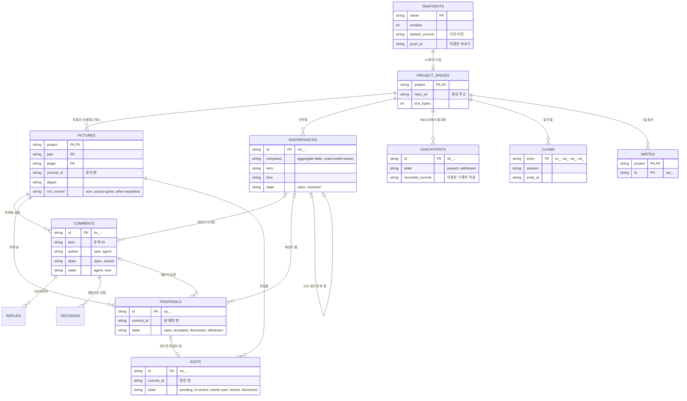

# NEXUS: 서버의 자료와 파일

[English](nexus.md)

CORTHEX 자신의 프로젝트에서 NEXUS 0.2의 05단계입니다: [nexus.sql](nexus.sql)에 있는 NEXUS 서버의 표, 그리고 그것과 함께 가는 파일, 곧 프로젝트를 서버로 싣고 가는 스냅샷, 프로젝트 저장소의 단계 기록, 기기에 있는 허브의 보낼 편지함입니다. 상태: 2026-11-02에 관리자가 그날 고른 대로 기억 플러그인을 만드는 동안, 사용자 흐름과 기능 명세의 추천을 따라 초안을 썼습니다. 관리자가 2026-11-03에 03·04단계, 06\~08단계와 함께 이 파일의 확인 지점을 통과시켜, NEXUS 0.2의 스키마는 고정되었습니다. 이제 호환되지 않는 변경을 하려면 관리자의 결정과 새 스키마 버전이 필요합니다. 2026-11-03에 관리자가 01단계 이벤트 스토밍을 NEXUS에서 하기로 고르면서 DDD 보드의 그림 자료에 타임라인을 더했고, 이것은 표를 바꾸지 않습니다. ② 차례의 작업 보드는 그 차례에 맡겼습니다. 둘 다 관리자가 같은 날 통과시켰습니다([확인할 것](#확인할-것)). 이 번역과 영어 원문이 다르면 영어 원문이 원본입니다.

입력: [docs/04-functional-spec/nexus.ko.md](../04-functional-spec/nexus.ko.md)의 기능 명세(SPEC-101\~SPEC-142), 특히 그 [05단계를 위한 메모](../04-functional-spec/nexus.ko.md#05단계-서버의-자료와-파일); [docs/02-prd/nexus.ko.md](../02-prd/nexus.ko.md)의 요구사항 가운데 자료를 가장 많이 정하는 REQ-116, REQ-118, REQ-120, REQ-123, REQ-124; [docs/01-domain/nexus.ko.md](../01-domain/nexus.ko.md)의 용어집과 DDD 보드(이 파일은 그 말을 그 뜻으로 쓰고, 표는 그 보드의 애그리거트를 적습니다); [nexus/src/store.js](../../nexus/src/store.js)에 있는 1차의 표. Cloudflare의 D1 문서는 2026-11-02에 읽었습니다: [한도](https://developers.cloudflare.com/d1/platform/limits/), [요금](https://developers.cloudflare.com/d1/platform/pricing/), [외래 키](https://developers.cloudflare.com/d1/sql-api/foreign-keys/), [JSON 함수](https://developers.cloudflare.com/d1/sql-api/query-json/), [배치](https://developers.cloudflare.com/d1/worker-api/d1-database/).

## 이 파일을 읽는 법

- 서버의 표는 빈 데이터베이스의 스키마인 [nexus.sql](nexus.sql)에 있습니다. 표마다 주석에 TBL ID, 컨텍스트, 그 표가 간직하는 DDD 보드 애그리거트의 용어(없으면 `terms: none`), 그 표를 읽거나 쓰는 동작(SPEC)을 적습니다. 프로젝트 허브는 이 주석을 읽고, NEXUS 0.2부터는 그 파일에서 `nexus` 부분의 ERD 그림을 그립니다(SPEC-107). 이 파일은 표를 설명하고, 나머지 저장 단위, 곧 [저장 단위](#저장-단위)의 파일을 정합니다.
- `근거` 열과 표의 주석에는 그 저장 단위를 읽거나 쓰는 동작을 모두 적고, [동작마다 읽고 쓰는 자료](#동작마다-읽고-쓰는-자료)는 같은 것을 반대 방향으로 적습니다.
- 상태: 지금 도는 1차 그대로인 것(스냅샷 표, 저장한 스냅샷, 진행 기록 파일)은 `built`, NEXUS 0.2가 더하거나 바꾸는 것은 `active`, 편집의 자리와 작업 보드는 `later (phase ②)`입니다.
- 필드 표는 열과 필드를 쓰는 순서대로 적습니다. 값이 없는 열은 NULL이고, 파일의 선택 필드는 값이 없으면 뺍니다.
- 표는 보드 애그리거트의 용어만 적습니다. 어느 애그리거트에도 없는 용어를 적으면 NEXUS가 자기 그림을 점검할 때 어긋남이 열리기 때문입니다(SPEC-121). 허브의 컨텍스트 CTX-006, CTX-008, CTX-009는 보드에 애그리거트가 없으므로, 그 자료를 간직하거나 쓰기의 순서를 지키는 표는 `terms: none`이라고 적습니다. ③ 차례의 애그리거트인 연결은 `without a table:` 뒤에 적습니다.

## 자료가 있는 곳

```txt
NEXUS 서버: Cloudflare Worker 하나와 그 D1 데이터베이스 corthex-nexus (nexus.sql)
├─ snapshots                  TBL-101 프로젝트마다 가장 새 스냅샷
│  └─ project_spaces          TBL-102 프로젝트마다 공간 하나
│     ├─ pictures             TBL-103 부분과 그림이 있는 단계마다 하나
│     │  ├─ comments          TBL-105
│     │  │  ├─ replies        TBL-106
│     │  │  └─ decisions      TBL-107
│     │  ├─ proposals         TBL-108
│     │  └─ edits             TBL-109 닫힐 때까지는 반영 대기
│     ├─ discrepancies        TBL-104
│     ├─ checkpoints          TBL-110 NEXUS에서 통과한 것
│     ├─ claims               TBL-111
│     └─ writes               TBL-112 7일 동안 둠
└─ migrations                 TBL-113

프로젝트의 저장소, 기본 브랜치의 커밋에서
└─ .corthex/stages/<part>.json 또는 .corthex/stages.json    TBL-115 단계 기록

기기: ~/.corthex/hub/
├─ snapshots/<project>.json                 TBL-114 스냅샷
├─ status/<project>.json                    TBL-116 진행 기록 파일
├─ outbox/<project>/<time>.<write>.json     TBL-117 보낼 편지함, 쓰기마다 파일 하나
├─ outbox/<project>.lock
└─ index.html                               허브 페이지
```

서버의 나무는 지우기가 무엇을 지우는지도 보여 줍니다: 프로젝트의 스냅샷을 지우면 그 공간이 지워지고, 외래 키가 공간 안의 모든 것을 함께 지웁니다(SPEC-115).

## 저장 단위

| ID | 저장 단위 | 컨텍스트 | 있는 곳 | 구별하는 값 | 보관 | 근거 | 상태 |
| --- | --- | --- | --- | --- | --- | --- | --- |
| TBL-114 | 스냅샷 | CTX-006 | 기기의 `snapshots/<project>.json`, 그리고 보내기마다의 본문 | 프로젝트마다 하나 | 그 프로젝트의 다음 스냅샷까지 | SPEC-103, SPEC-104, SPEC-105, SPEC-106, SPEC-107, SPEC-108, SPEC-109, SPEC-110, SPEC-111, SPEC-122, SPEC-125 | active |
| TBL-115 | 단계 기록 | CTX-007 | 프로젝트 저장소에서 부분마다 `.corthex/stages/<part>.json`, 부분이 없는 프로젝트는 `.corthex/stages.json` | 부분마다 하나 | Git에, 저장소가 있는 동안 | SPEC-109, SPEC-137, SPEC-140 | active |
| TBL-116 | 진행 기록 파일 | CTX-007 | 기기의 `status/<project>.json` | 프로젝트마다 하나 | 사용자가 지울 때까지 | SPEC-109 | built |
| TBL-117 | 보낼 편지함 | CTX-014 | 기기의 `outbox/<project>/<time>.<write>.json` | 그 쓰기 ID | 서버가 받거나 끝내 거절할 때까지, 길어야 7일 | SPEC-128, SPEC-129, SPEC-135 | active |
| TBL-118 | 자리 | CTX-012 | ② 차례가 더하는 서버의 표 `positions` | 프로젝트, 부분, 단계, 항목 | 그 항목이 그림에 있는 동안 | SPEC-134 | later (phase ②) |

서버의 표는 [nexus.sql](nexus.sql)에 있습니다:

| 표 | 이름 | 담는 것 | 보관 | 상태 |
| --- | --- | --- | --- | --- |
| TBL-101 | `snapshots` | 프로젝트마다 가장 새 스냅샷(그림 자료는 뺌)과, 그것을 가져온 기본 브랜치 커밋 | 다음 스냅샷이나 지우기까지 | built; 0.2가 `default_commit`과 `push_id`를 더함 |
| TBL-102 | `project_spaces` | 프로젝트마다 공간 하나, 그 저장소의 주소에 묶임 | 지우기까지 | active |
| TBL-103 | `pictures` | 부분과 그림이 있는 단계마다 마지막 그림, 현재 그림이든 아니든 | 지우기까지 | active |
| TBL-104 | `discrepancies` | 점검이 찾은 것, 열린 것과 풀린 것 | 지우기까지 | active |
| TBL-105 | `comments` | 그림 항목에 단 의견 | 지우기까지 | active |
| TBL-106 | `replies` | 의견마다 그 아래의 답글 | 지우기까지 | active |
| TBL-107 | `decisions` | 의견에 기록한 결정과 그 링크 | 지우기까지 | active |
| TBL-108 | `proposals` | 에이전트의 제안과 그 결과 | 지우기까지 | active |
| TBL-109 | `edits` | 편집. 닫힐 때까지는 반영 대기 | 지우기까지 | active |
| TBL-110 | `checkpoints` | NEXUS에서 통과한 확인 지점, 그 기록의 PR, 단계 기록이 그것을 적는지 | 지우기까지 | active |
| TBL-111 | `claims` | 어느 에이전트 세션이 AI 할 일의 어느 것을 언제까지 맡았는지 | 맡음이 이어지는 동안 | active |
| TBL-112 | `writes` | 서버가 받은 쓰기의 ID와 그 첫 응답 | 7일 | active |
| TBL-113 | `migrations` | 데이터베이스에 적용한 스키마 버전 | 데이터베이스가 있는 동안 | active |

## 모든 표와 파일

- 글은 UTF-8입니다. 글자 수로 적은 길이는 기억에서처럼 유니코드 코드 포인트를 셉니다. 그림 보기는 저장된 글을 모두 글로만 보여 줍니다(REQ-148).
- 시각은 `2026-11-02T12:05:12.345Z`처럼 밀리초까지 적은 UTC이고, 서버의 시계에서 옵니다. 세 가지는 다른 곳에서 와서 자기 시간대를 지닙니다: 기기에서 오는 스냅샷의 `generated_at`, Git에서 오는 커밋의 시각, 그것을 쓴 기기에서 오는 단계 기록의 `updated`. 날짜는 `2026-11-02`처럼 적습니다.
- 서버는 의견, 어긋남, 제안, 편집, 확인 지점의 ID를 만듭니다: `n`, 종류를 나타내는 글자 하나, `_`, 그리고 Crockford base32 소문자로 된 무작위 글자 12개(무작위 60비트)입니다. `nc_`는 의견, `nd_`는 어긋남, `np_`는 제안, `ne_`는 편집, `nk_`는 확인 지점이며, 예를 들면 `nc_7f3k2m9q4x1v`입니다. 페이지와 허브는 쓰기 ID를 같은 방법으로 `nw_`를 붙여 만듭니다. 이 ID들은 추적 ID처럼 보이지 않으므로 허브는 어느 것도 읽지 않고, 맡음은 맡은 것의 종류를 접두사로 압니다. 답글과 결정은 의견 안에서 1부터 번호를 매깁니다. 어떤 ID도 다시 쓰지 않습니다.
- 프로젝트와 부분의 이름은 프로젝트 목록이 프로젝트를 부르듯 소문자, 숫자, 하이픈으로 씁니다. 빈 부분 `''`은 프로젝트 전체입니다: 부분이 없는 프로젝트, 또는 어느 부분에도 들지 않는 프로젝트의 문서(SPEC-105).
- 단계는 `05-erd`처럼 13단계의 키이며, 그림이 있는 단계는 `01-domain`, `05-erd`, `07-sitemap`뿐입니다. 커밋은 Git이 주는 대로의 전체 커밋 ID입니다.
- JSON 열에는 서버가 쓴, 빈칸 없이 줄인 JSON을 담습니다. 예와 아니요는 INTEGER 열의 `1`과 `0`입니다.
- 상한은 [상한](#상한)에 적은 대로 코드가 검사합니다. 표의 제약에는 열이 가질 수 있는 상태처럼 늘 참인 것만 두어, 상한을 바꿀 때 변환이 필요 없게 합니다.
- 서버는 쓴 쪽의 종류 말고는 신원을 간직하지 않으며(SPEC-116), 어떤 표나 파일도 서비스 토큰을 담지 않습니다(REQ-109, REQ-110).

## 표마다의 필드

### 스냅샷 (TBL-101)

1차의 표에 열 두 개를 더했습니다. 보내기는 [보내기](#보내기)에 적은 대로 행을 바꾸고, 지우기는 행을 지우며 그와 함께 프로젝트의 공간도 지웁니다.

| 열 | 값 | 뜻 |
| --- | --- | --- |
| `name` | 프로젝트 이름 | 프로젝트의 등록된 이름(SPEC-101) |
| `revision` | 1부터의 정수 | 서버 리비전: 서버가 그 프로젝트의 스냅샷을 몇 번 저장했는지(TERM-081) |
| `generated_ms` | 정수 | 비교하려고 1970년부터의 밀리초로 적은 `generated_at` |
| `generated_at` | 시간대가 있는 시각 | 허브가 스냅샷을 만든 때 |
| `received_at` | 시각 | 서버가 저장한 때 |
| `bytes` | 정수 | 보낸 그대로의 스냅샷 크기, 많아야 1 MiB(SPEC-114) |
| `body` | JSON | `pictures`를 뺀 스냅샷(TBL-114). 그림 자료는 그림이 간직합니다(TBL-103). 허브 페이지가 모든 본문을 읽으므로 본문은 1차만큼 작게 둡니다 |
| `default_commit` | 커밋, 또는 NULL | 스냅샷의 그림과 단계 기록을 가져온 기본 브랜치 커밋(SPEC-105, SPEC-109), 곧 가진 커밋. 0.1의 스냅샷이나 기본 브랜치가 없는 스냅샷이면 NULL |
| `push_id` | 무작위 12글자, 또는 NULL | Worker가 서버 ID의 무작위 부분을 만들듯 그 스냅샷을 저장한 보내기에 만들어 준 ID. 그 보내기의 뒤 문장들은 스냅샷이 이것을 가지고 있을 때만 씁니다([보내기](#보내기)). 1차의 서버가 저장한 스냅샷이면 NULL |

### 프로젝트 공간 (TBL-102)

프로젝트에 공간이 없을 때 그 스냅샷을 저장하는 요청 안에서 만듭니다: 0.2의 첫 스냅샷, 또는 지우기 뒤의 첫 스냅샷(SPEC-117).

| 열 | 값 | 뜻 |
| --- | --- | --- |
| `project` | 프로젝트 이름 | 그 프로젝트. 프로젝트마다 공간 하나이고, 그 스냅샷과 함께 갑니다 |
| `repo_url` | 주소, 또는 NULL | 프로젝트 설정이 있는 저장소의 `origin` 원격 주소, 스냅샷이 주는 대로. 그 저장소에 원격이 없으면 NULL. 다른 주소의 스냅샷은 `409`로 거절합니다(SPEC-117). 주소에 묶이지 않은 공간은 뒤의 스냅샷이 주는 첫 주소에 묶습니다 |
| `created_at` | 시각 | 공간을 만든 때 |
| `text_bytes` | 정수 | 공간의 의견, 답글, 결정, 제안, 편집에 든 글의 UTF-8 바이트 수. 이것을 8 MiB 넘게 만들 쓰기는 거절합니다([상한](#상한)) |
| `unopened` | JSON 객체 | 마지막 점검이 공간이 열어 둘 수 있는 것보다 많은 어긋남을 찾은 부분마다, 열지 못한 수. 예: `{"nexus": 12}`. 보내기의 응답과 단계 현황이 보여 줍니다(SPEC-121) |

### 그림 (TBL-103)

공간의 부분과 그림이 있는 단계마다 행 하나, 곧 현재 그림이든 아니든 마지막 그림입니다. 새 문서 판이 그것을 바꾸고, 지우기만 그것을 지웁니다(SPEC-118). 의견, 제안, 편집은 자기가 만들어진 그림의 커밋을 간직하므로, 그것들을 보여 주는 데 예전 그림이 필요하지 않습니다.

| 열 | 값 | 뜻 |
| --- | --- | --- |
| `project` | 프로젝트 이름 | |
| `part` | 부분 이름, 또는 `''` | |
| `stage` | `01-domain`, `05-erd`, `07-sitemap` | DDD 보드, ERD, 사이트맵 |
| `commit_id` | 커밋 | 그림을 그린 문서 판(REQ-139) |
| `committed_at` | 시간대가 있는 시각 | 그 커밋의 시각(REQ-139) |
| `source` | JSON | 스냅샷이 싣고 온 그대로의 그림 자료([그림 자료](#그림-자료)). 그림 보기가 이것을 배치합니다(SPEC-119) |
| `digest` | 16진수 64글자 | `source`의 SHA-256. 보내기는 그림 자료마다 그 다이제스트를 이것과 비교하고, 다른 곳에서만 그림을 그립니다 |
| `drawn_at` | 시각 | 서버가 이 문서 판의 그림을 저장한 때 |
| `not_current` | `size`, `source-gone`, `other-repository`, 또는 NULL | 그림이 현재 그림이 아닌 까닭: 스냅샷이 크기 때문에 뺐거나(REQ-192), 그린 문서가 단계별 원본에서 없어졌거나, 그 단계별 원본이 이제 다른 저장소에 있음(REQ-144). 현재 그림인 동안은 NULL |

저장된 그림과 같은 그림 자료는 아무것도 바꾸지 않습니다. 다만 현재 그림이 아니던 그림은 다시 현재 그림이 됩니다(SPEC-118). 의견, 제안, 어긋남의 항목이 아직 그림에 있는지는 그림을 읽을 때 알아내므로(SPEC-119), 다시 그리기는 자기 그림의 행 말고는 아무 행도 바꾸지 않습니다.

#### 그림 자료

그림 자료는 저마다 `format`(NEXUS 0.2에서 `1`)으로 시작하고, 그 요소마다 그 커밋에서의 파일과 줄인 `where`가 있어, 그림 보기가 요소를 단계별 원본으로 이을 수 있습니다. 이름은 06단계가 허브의 양식과 함께 정합니다. 서버는 그림 자료를 온 그대로 간직하고, 그 안에서 형식과, 점검을 위해 용어, 컨텍스트, 삭제 표시만 읽습니다.

| 단계 | 그림 자료가 담는 것 |
| --- | --- |
| `01-domain` | 컨텍스트: 저마다 ID, 이름, 유형, 목적, 명령 줄(줄마다 주는 쪽, 읽기 모델, 명령, 애그리거트, 사건, 정책인지), 바깥 시스템. 애그리거트와 읽기 모델: 저마다 이름, 컨텍스트, 용어, 그 용어가 삭제로 표시됐는지. 의존: 두 컨텍스트, 종류, 까닭, 자료. 핫스팟: 컨텍스트, 상태, 답, 그리고 글이 번호로 시작하면 그 번호. 그리고 문서에 있으면 타임라인: 흐름(레인)을 차례대로, 저마다 왼쪽에서 오른쪽으로의 자리와 자리마다 쌓인 사건(SPEC-106) |
| `05-erd` | 표: 저마다 ID, 이름, 컨텍스트, 용어나 `none`, 열과 그 유형과 비어도 되는지, 기본 키, 유일 규칙, 외래 키와 저마다 가리키는 표와 지울 때 하는 일. 그리고 `without a table:` 뒤에 적은 용어(SPEC-107) |
| `07-sitemap` | 화면: 저마다 ID, 이름, 경로, 볼 수 있는 사람, 흐름, 부모, 컨텍스트, 용어나 `none`. 그리고 `# without a screen:` 뒤에 적은 용어(SPEC-108) |

### 어긋남 (TBL-104)

보내기의 점검만 씁니다(SPEC-120, SPEC-121). 점검이 더는 찾지 않는 어긋남은 풀리며, 지워지지 않습니다. 그 뒤에 다시 찾은 것은 새 행이 되고, 예전 것을 가리킵니다.

| 열 | 값 | 뜻 |
| --- | --- | --- |
| `id` | `nd_` ID | |
| `project` | 프로젝트 이름 | |
| `part` | 부분 이름, 또는 `''` | 그림을 맞춰 본 부분 |
| `compares` | `aggregate-table` 또는 `read-model-screen` | 짝의 종류: DDD 보드의 애그리거트와 ERD의 표, 또는 읽기 모델과 사이트맵의 화면(SPEC-120) |
| `term` | TERM ID, 또는 `''` | 짝의 용어: 애그리거트나 읽기 모델의 용어, 또는 표나 화면이 적은 용어. 아무것도 적지 않은 표나 화면이면 비어 있음 |
| `item` | 추적 ID, 이름, 또는 `''` | 짝의 표나 화면. ID로, ID가 없으면 이름으로. 표나 화면이 없는 용어면 비어 있음 |
| `reasons` | JSON 목록 | 맞지 않는 것. 까닭마다 종류와 해당하는 것: `no-term`, `not-on-board`, `no-table`, `no-screen`, 두 컨텍스트와 함께 `other-context`, 삭제로 표시된 쪽과 함께 `removed`(기능 명세의 7번) |
| `level` | `warn` 또는 `info` | 가장 무거운 까닭의 수준(REQ-155) |
| `state` | `open` 또는 `resolved` | |
| `waiting` | `1` 또는 `0` | 해당 그림이 현재 그림이 아닌 동안 `1`. 그래서 현재 그림을 기다립니다(SPEC-120) |
| `opened_commit` | 커밋 | 그것을 연 보내기의 기본 브랜치 커밋 |
| `opened_at` | 시각 | |
| `resolved_commit` | 커밋, 또는 NULL | 점검이 그것을 더는 찾지 않은 보내기의 커밋(REQ-157) |
| `resolved_at` | 시각, 또는 NULL | |
| `earlier` | `nd_` ID, 또는 NULL | 이것이 뒤따르는, 같은 짝의 풀린 어긋남(SPEC-121) |

짝에 건 유일 색인이 짝마다 열린 어긋남을 하나로 지킵니다(REQ-156). 애그리거트와 표를 맞춰 보는 어긋남은 DDD 보드와 ERD에, 읽기 모델과 화면을 맞춰 보는 것은 DDD 보드와 사이트맵에 해당하며, 그 단계마다의 현황이 그것을 보여 줍니다(SPEC-138).

### 의견 (TBL-105)

사용자가 그림 보기에서, 또는 에이전트가 허브를 거쳐 남깁니다(SPEC-126, SPEC-128). 의견은 그 공간과 함께만 지워집니다. 닫히고, 다시 열릴 수 있습니다(SPEC-127).

| 열 | 값 | 뜻 |
| --- | --- | --- |
| `id` | `nc_` ID | |
| `project`, `part`, `stage` | | 의견이 달린 그림 |
| `item` | 추적 ID, 또는 `''` | 의견이 붙은 항목(REQ-160): 고른 항목, 자기 ID가 없는 부분을 담은 항목, 또는 어긋남의 첫 항목. 그림 자체에 단 의견이면 비어 있음(SPEC-126) |
| `quote` | 300자까지, 또는 NULL | 의견을 남긴 부분. 예: 사건, 열, ID가 없는 표(REQ-161) |
| `discrepancy` | `nd_` ID, 또는 NULL | 의견이 달린 어긋남 |
| `commit_id` | 커밋 | 의견을 남길 때 그림의 문서 판. 에이전트가 사용자가 본 것을 알 수 있게 합니다 |
| `author` | `user` 또는 `agent` | 로그인의 종류에서(SPEC-116) |
| `text` | 4,000자까지 | |
| `state` | `open` 또는 `closed` | |
| `closed_as` | `answered`, `decided`, 또는 NULL | 어떻게 닫혔는지: 사용자나 에이전트가 답이 났다고 표시함(REQ-166), 또는 결정으로(REQ-165) |
| `waits` | `agent`, `user`, 또는 NULL | 열린 의견이 누구를 기다리는지: 사용자가 쓴 것이나 버린 제안 뒤에는 에이전트, 에이전트가 쓴 것 뒤에는 사용자(SPEC-135). 닫힌 동안은 NULL |
| `settled` | `1` 또는 `0` | 사용자의 마지막 답글이 의견을 정했고 에이전트가 아직 결정을 기록하지 않은 동안 `1`(SPEC-127, SPEC-132) |
| `dismissed` | `1` 또는 `0` | 그것에 답한 제안이 버려졌고 그 뒤 에이전트가 거기에 아무것도 쓰지 않은 동안 `1`(SPEC-131) |
| `made_at` | 시각 | |
| `last_at` | 시각 | 그것에 마지막으로 쓴 때: 답글, 결정, 그것에 낸 제안, 버리기, 표시, 다시 열기. AI 할 일은 이것으로 의견을 오래된 것부터 나열합니다 |

### 답글 (TBL-106)

| 열 | 값 | 뜻 |
| --- | --- | --- |
| `comment` | `nc_` ID | |
| `seq` | 1부터의 정수 | 의견 아래에서 답글의 차례. 많아야 200(SPEC-127) |
| `author` | `user` 또는 `agent` | |
| `text` | 4,000자까지 | |
| `settles` | `1` 또는 `0` | 의견을 정하는 사용자의 답글이면 `1` |
| `made_at` | 시각 | |

닫힌 의견에 단 사용자의 답글은 의견을 다시 열고, 닫힌 의견에 단 에이전트의 답글은 거절합니다(SPEC-127).

### 결정 (TBL-107)

| 열 | 값 | 뜻 |
| --- | --- | --- |
| `comment` | `nc_` ID | |
| `seq` | 1부터의 정수 | |
| `link` | 2,000자까지의 주소 | 결정을 쓴 곳: 프로젝트 기록이나 병합된 PR(REQ-164) |
| `text` | 4,000자까지, 또는 NULL | 에이전트의 말로 적은 결정 |
| `made_at` | 시각 | |

결정은 그 의견을 `decided`로 닫거나, 닫힌 의견에 더해지며 의견은 닫힌 채입니다(SPEC-132). 결정은 에이전트만 기록합니다(SPEC-116).

### 제안 (TBL-108)

| 열 | 값 | 뜻 |
| --- | --- | --- |
| `id` | `np_` ID | |
| `project`, `part`, `stage` | | 제안을 낸 그림 |
| `commit_id` | 커밋 | 제안을 낼 때 그 그림의 문서 판. 받은 제안의 편집은 이것에 묶입니다(REQ-169) |
| `items` | 추적 ID 1\~50개의 JSON 목록 | 해당 항목. 변경이 더하는 항목이 아니면 그림에 있어야 합니다(SPEC-130) |
| `reason` | 2,000자까지 | |
| `change` | 4,000자까지 | 말로 적은 변경 |
| `source_text` | 20,000자까지, 또는 NULL | 단계별 원본에 쓸 글 |
| `comment` | `nc_` ID, 또는 NULL | 제안이 답하는 의견 |
| `discrepancy` | `nd_` ID, 또는 NULL | 제안이 풀 어긋남 |
| `state` | `open`, `accepted`, `dismissed`, `withdrawn` | 사용자가 받거나 버림(SPEC-131), 에이전트가 철회함(SPEC-130) |
| `made_at` | 시각 | |
| `closed_at` | 시각, 또는 NULL | 열려 있기를 그친 때 |

제안은 에이전트만 내므로 쓴 쪽을 간직하지 않습니다(SPEC-116).

### 편집 (TBL-109)

받은 제안이 받기와 같은 쓰기에서 편집 하나를 만듭니다(SPEC-131). ② 차례에는 사용자가 편집기에서 한 변경도 그렇습니다(SPEC-134). 닫히지도 버려지지도 않은 편집이 반영 대기입니다(TERM-117).

| 열 | 값 | 뜻 |
| --- | --- | --- |
| `id` | `ne_` ID | |
| `project`, `part`, `stage` | | 편집하는 그림 |
| `commit_id` | 커밋 | 편집이 묶인 문서 판: 그 제안의 것, ② 차례에는 사용자가 고친 그림의 것. 더 새 문서 판이 생기면 편집 충돌이 됩니다(REQ-130) |
| `proposal` | `np_` ID, 또는 NULL | 받은 제안. 그 항목, 변경, 글이 곧 편집입니다 |
| `content` | JSON, 또는 NULL | ② 차례: 편집기에서 한 변경. 받은 제안이면 NULL |
| `state` | `pending`, `in-review`, `needs-user`, `closed`, `dismissed` | 대기, 보고된 PR이 열린 동안 검토 중, 변경이 더는 단계별 원본에 맞지 않으면 사용자가 필요, 반영되면 닫힘, 사용자가 버리면 버림(SPEC-133) |
| `pull_request` | 주소, 또는 NULL | 에이전트가 보고한 PR: 편집이 검토 중인 동안 열려 있고, 닫히면 병합된 것. PR이 병합되지 않고 닫혀 편집이 다시 대기가 되면 다시 NULL |
| `closed_commit` | 커밋, 또는 NULL | 에이전트가 PR 대신 그것을 보고했을 때, 단계별 원본이 이미 그 변경을 담고 있던 커밋 |
| `made_at` | 시각 | |
| `changed_at` | 시각 | 상태가 마지막으로 바뀐 때 |

### 확인 지점 (TBL-110)

사용자가 단계 현황에서 통과시키며(SPEC-139), 에이전트는 절대 통과시키지 않습니다(REQ-179). 통과된 확인 지점은 저장된 단계 기록이 그것을 적을 때까지 AI 할 일에 남습니다. 철회된 것은 열린 PR이나 저장된 단계 기록이 아직 그것을 적는 동안 남아, 에이전트가 그 PR을 닫거나 기록을 고치게 하고, 둘 다 적지 않으면 빠집니다(SPEC-135, SPEC-140).

| 열 | 값 | 뜻 |
| --- | --- | --- |
| `id` | `nk_` ID | 단계 기록이 적는 ID(SPEC-140) |
| `project` | 프로젝트 이름 | |
| `part` | 부분 이름, 또는 `''` | |
| `stage` | 단계 키 | 13단계 가운데 어느 것이든 |
| `commit_id` | 커밋, 또는 NULL | 통과시킬 때 저장된 스냅샷의 기본 브랜치 커밋(REQ-178). 그 스냅샷에 없었으면 NULL |
| `words` | 2,000자까지, 또는 NULL | 사용자가 승인하는 것, 사용자 자신의 말로 |
| `state` | `passed` 또는 `withdrawn` | 저장된 단계 기록이 그것을 적지 않는 동안 사용자가 철회할 수 있습니다(SPEC-139) |
| `passed_at` | 시각 | 사용자가 통과시킨 때. 사람의 로그인만 통과시킬 수 있으므로 통과시킨 쪽은 늘 사용자입니다(SPEC-116) |
| `withdrawn_at` | 시각, 또는 NULL | |
| `pull_request` | 주소, 또는 NULL | 에이전트가 보고한 기록의 PR(SPEC-140) |
| `pr_state` | `open`, `merged`, `closed`, 또는 NULL | `open`인 동안은 그 PR이 확인 지점을 맡으며(SPEC-136), 그것을 위해 보고한 두 번째 PR은 거절합니다 |
| `recorded_commit` | 커밋, 또는 NULL | 단계 기록이 그 확인 지점을 적는 저장된 스냅샷의 기본 브랜치 커밋. 보내기마다 이것을 정하고, 기록이 더는 그 확인 지점을 적지 않으면 비웁니다. 기록된 커밋이 있는 철회된 확인 지점은 그 단계에 `checkpoint-withdrawn` 경고를 줍니다(SPEC-140) |

### 맡음 (TBL-111)

| 열 | 값 | 뜻 |
| --- | --- | --- |
| `entry` | `nc_`, `nd_`, `ne_`, `nk_` ID | 맡은 의견, 어긋남, 편집, 확인 지점 |
| `project` | 프로젝트 이름 | |
| `session` | 1\~100자의 이름표 | 그것을 맡은 에이전트 세션. 그 세션이 지니는 이름표로 적으며, 이름표에는 개인적인 것이 없습니다(SPEC-128) |
| `claimed_at` | 시각 | |
| `ends_at` | 시각 | 그 세션이 그것에 마지막으로 쓴 뒤 60분(SPEC-136) |

맡음이 이어지는 동안 서버는 다른 세션이 그것에 하는 에이전트의 쓰기를 거절하고, AI 할 일은 그 세션들에게 그것을 `ends_at`까지 맡겨진 것으로 보여 줍니다. 맡음은 `ends_at`에, 그것이 닫힐 때, 또는 그 세션이 놓을 때 끝납니다. 끝난 맡음은 없는 것으로 치고, 공간의 다음 쓰기가 지웁니다. 사용자의 쓰기는 맡음 때문에 거절하지 않습니다.

### 쓰기 (TBL-112)

| 열 | 값 | 뜻 |
| --- | --- | --- |
| `project` | 프로젝트 이름 | |
| `id` | `nw_` ID | 페이지나 허브가 쓰기 하나를 위해 만들고, 그 쓰기를 보낼 때마다 함께 보냄(SPEC-126, SPEC-128) |
| `request` | 요청의 이름 | 그 쓰기를 받은 요청. 예: `reply`, `accept`, 이름은 06단계가 정함. 같은 ID로 다른 요청을 보내면 거절합니다 |
| `result` | JSON | 첫 응답. 다시 보낸 쓰기는 아무것도 바꾸지 않고 이것을 받습니다(SPEC-128) |
| `received_at` | 시각 | 이로부터 7일이 지나면 공간의 다음 쓰기가 행을 지웁니다. 보낼 편지함은 쓰기를 만든 지 7일 뒤에 버리므로, ID가 없어진 쓰기를 다시 보내는 일은 없습니다 |

서버가 받은 쓰기만 간직합니다. 거절한 쓰기는 행을 남기지 않으므로, 그 까닭이 없어지면 다시 보낼 수 있습니다.

### 변환 (TBL-113)

| 열 | 값 | 뜻 |
| --- | --- | --- |
| `version` | 정수 | store.js가 적용한 스키마 버전: 1차의 표는 1, NEXUS 0.2는 2 |
| `applied_at` | 시각 | |

## 파일마다의 필드

### 스냅샷 (TBL-114)

1차의 형식 `corthex-hub/0.1`은 허브의 [snapshot.md](../../plugins/corthex-nexus/skills/corthex-hub/references/snapshot.md)에 적혀 있습니다. NEXUS 0.2는 아래 필드를 `corthex-hub/0.2`로 더하며, 06단계가 그 파일에 더합니다. 허브는 스냅샷을 기기에 저장하고 보내기마다 새로 만든 것을 보냅니다(SPEC-111). 서버는 `pictures` 없이 간직합니다(TBL-101). 그 안의 모든 것은 SPEC-104대로 가립니다.

| 필드 | 값 | 뜻 |
| --- | --- | --- |
| `schema` | `corthex-hub/0.2` | 형식. 서버는 0.1과 0.2를 받습니다(SPEC-114) |
| `project.parts` | (선택) 부분 이름의 목록 | 프로젝트 설정이 적은 부분, 그 차례대로(SPEC-105) |
| `repos.".".url` | (선택) 주소 | 프로젝트 설정이 있는 저장소의 `origin` 원격 주소. 사용자 이름과 비밀번호는 뺌. 공간이 묶이는 주소입니다(SPEC-117) |
| `repos.".".default` | (선택) 객체: `branch`, `commit`, `time` | 기본 브랜치, 체크아웃이 마지막으로 가져온 그 브랜치의 커밋, 그 커밋의 시각(SPEC-105). 없으면 빼고 `pictures-not-sent` 점검 결과를 냅니다 |
| `replaces` | (선택) 커밋 | 허브가 물었을 때 서버가 가진 기본 브랜치 커밋. 이 스냅샷이 그것을 대신합니다(SPEC-111). 서버가 가진 것이 없으면 뺌 |
| `records` | 객체: `from`, (선택) `commit`, `time` | 단계 기록을 가져온 곳: 그 커밋의 `repository`, 또는 `status-file`(SPEC-109) |
| `stages.<stage>.checkpoints` | (선택) 목록 | 부분이 없는 프로젝트에서, 단계 기록이 담은 그대로의 그 단계의 확인 지점(TBL-115). `checkpoint`와 `checkpoint_date`는 0.1처럼 마지막 것을 지닙니다 |
| `stages.<stage>.parts.<part>` | (선택) 객체: `state`, `checkpoints`, `next`, `updated` | 부분이 있는 프로젝트에서, 부분마다 그 단계의 기록(SPEC-109, SPEC-123) |
| `checks[].part` | (선택) 부분 이름 | 점검 결과가 해당하는 부분. 예: 한 부분의 기록에 있는 검토 결과 |
| `pictures` | 객체의 목록: `part`, `stage`, `commit`, `time`, `source` | 그림이 있는 단계의 부분마다 그림 자료 하나와 그 문서 판(SPEC-105). `source`는 [그림 자료](#그림-자료)에 적었습니다 |
| `left_out` | (선택) 객체의 목록: `part`, `stage`, `why` | 스냅샷이 싣지 않는 그림과 그 까닭: `size`(REQ-192) 또는 `other-repository`(REQ-144) |
| `ask_before` | 객체: `entries`, `source`, `left_out` | 먼저 물을 일: 30개까지의 값, 그 출처(`project`, `profile`, `default`), 그리고 프로젝트의 목록이 빼는 프로필 목록이나 기본 목록의 값(SPEC-110) |

### 단계 기록 (TBL-115)

에이전트가 단계 작업의 PR(SPEC-137)이나 통과한 확인 지점의 PR(SPEC-140)에서 씁니다. NEXUS는 절대 쓰지 않습니다(REQ-122). 허브는 기본 브랜치의 커밋에서 읽습니다(SPEC-109). 진행 기록 파일(TBL-116)의 형식을 따르되, 확인 지점은 목록입니다:

```json
{
  "format": 1,
  "project": "acme-shop",
  "part": "orders",
  "stages": {
    "05-erd": {
      "state": "done",
      "checkpoints": [
        {
          "approved": "초안대로의 주문 표",
          "by": "관리자",
          "where": "https://github.com/example/acme-shop/pull/12",
          "date": "2026-11-03",
          "nexus": "nk_7f3k2m9q4x1v"
        }
      ],
      "next": "API 계약 쓰기",
      "checks": [{ "level": "warn", "message": "주문 표에 날짜로 찾기 위한 색인이 없음", "at": "2026-11-03" }],
      "updated": "2026-11-03T10:00:00+09:00"
    }
  }
}
```

| 필드 | 값 | 뜻 |
| --- | --- | --- |
| `format` | 정수, `1` | 단계 기록의 형식 |
| `project` | 프로젝트 이름 | 등록된 이름 |
| `part` | 부분 이름 | 그 부분. `.corthex/stages.json`에서는 뺌 |
| `stages` | 단계 키별 객체 | 기록이 있는 단계마다 기록 하나 |
| `stages.<stage>.state` | `done`, `in_progress`, `not_started`, `skipped` | 기록한 대로(REQ-084). `done`은 확인 지점과 그 날짜가 있을 때만(REQ-085) |
| `stages.<stage>.checkpoints` | 목록 | 확인 지점마다: `approved`는 승인한 것이며 사용자가 말을 주었으면 그 말로, `by`는 `관리자` 같은 역할이며 이름이나 이메일 주소는 절대 쓰지 않음, `where`는 승인한 곳의 링크, `date`, 그리고 NEXUS에서 통과했으면 `nexus`에 그 확인 지점의 ID(SPEC-137, SPEC-140) |
| `stages.<stage>.next` | 글 | 다음 행동 |
| `stages.<stage>.checks` | (선택) 목록 | 검토 결과. 저마다 `level`, `message`, (선택) `refs`, `at`(REQ-087) |
| `stages.<stage>.updated` | 시간대가 있는 시각 | 기록을 쓴 때 |

파일은 두 칸 들여 쓴 JSON이고, 필드는 이 순서대로 적고 끝에 LF를 두어, PR이 바뀐 것만 보여 주게 합니다. 부분마다 자기 파일이 있으므로 서로 다른 부분의 기록을 바꾸는 두 PR은 충돌하지 않습니다(SPEC-137). 저장소는 이 저장소처럼 공개일 수 있으므로, 기록에는 역할과 링크만 담고 개인 정보는 절대 담지 않습니다. 허브가 모르는 형식의 파일은, SPEC-109가 올바른 JSON이 아닌 파일에 대해 말하듯 올바르지 않은 것으로 칩니다.

### 진행 기록 파일 (TBL-116)

허브의 [snapshot.md](../../plugins/corthex-nexus/skills/corthex-hub/references/snapshot.md)가 적은 대로 `hub.py status`가 기기마다 쓰는 1차의 파일입니다: 단계마다 상태, 마지막 확인 지점과 그 날짜, 다음 행동, 검토 결과, 쓴 때. NEXUS 0.2부터 허브는 저장소에 단계 기록이 없는 프로젝트에서만 이것을 읽고, `records-in-status-file` 점검 결과를 냅니다(SPEC-109).

### 보낼 편지함 (TBL-117)

허브가 보내지 못한 에이전트의 쓰기이며(SPEC-129), 쓰기마다 파일 하나입니다: `outbox/<project>/<time>.<write>.json`. `<time>`은 `20261102T120512345Z`처럼 쓰기를 만든 때여서, 이름이 쓰기의 순서대로 정렬됩니다. 허브는 다른 파일을 쓸 때처럼 임시 파일에 쓰고 옮기는 방법으로 파일마다 쓰고, 서버가 그 쓰기를 받거나 끝내 거절하면 지웁니다.

| 필드 | 값 | 뜻 |
| --- | --- | --- |
| `format` | 정수, `1` | |
| `write` | `nw_` ID | 보낼 때마다 함께 보냄(TBL-112) |
| `project` | 프로젝트 이름 | |
| `request` | 요청의 이름 | 어떤 쓰기인지. 예: `reply`, `proposal`, `decision`, 또는 반영이나 기록 PR의 보고 |
| `path` | 요청의 경로 | 쓰기가 가는 곳. 예: `/api/spaces/corthex/comments/nc_3a6d9g2j5m8r/replies`. 시도마다 첫 시도가 간 곳으로 갑니다 |
| `session` | 세션 이름표 | 그것을 만든 세션. 그 세션의 맡음에 대해 셉니다 |
| `made` | 시각 | 에이전트가 만든 때. 허브는 7일 뒤 그것을 버리고, 그렇다고 알립니다 |
| `body` | 객체 | 허브가 보내는 그대로의 쓰기. 이미 가린 것(SPEC-128) |
| `tries` | 정수 | 보내기가 몇 번 실패했는지 |
| `failure` | (선택) 글 | 마지막 실패의 종류. 예: `no network`, `no service token` |

한 기기의 허브들은 잠금 `outbox/<project>.lock`으로 프로젝트의 보낼 편지함을 차례로 씁니다. 이 잠금은 배타적 생성으로 만드는 파일이며 Linux, macOS, Windows에서 됩니다(REQ-083). 허브의 프로세스 ID와 시각을 담습니다. 잠금을 가진 쪽은 보낸 쓰기마다 그 뒤에 잠금을 새로 하고, 보내기 하나는 많아야 30초 기다리며, 2분보다 오래된 잠금은 낡은 것으로 보고 넘겨받습니다. 맡음은 절대 보낼 편지함에서 기다리지 않습니다: 나중에 보내면 이미 다른 일로 넘어간 세션을 위해 그것을 맡아 두게 되므로, 보내지 못한 맡음은 그것을 맡지 않은 채로 두고 허브가 그렇다고 알립니다. 보낼 편지함은 절대 서비스 토큰을 담지 않습니다(REQ-109).

### 자리 (TBL-118), ② 차례

② 차례는 사용자가 PC에서 요소를 옮겨 남기는 자리를 위해 변환과 함께 표 `positions`를 더합니다(REQ-172, SPEC-134). 0.2의 다른 것은 그 때문에 바뀌지 않습니다.

| 열 | 값 | 뜻 |
| --- | --- | --- |
| `project`, `part`, `stage` | | 그 그림. 자리는 그림과 함께 갑니다 |
| `item` | 추적 ID | 사용자가 옮긴 요소 |
| `x`, `y` | 수 | 그림 안의 자리 |
| `moved_at` | 시각 | |

다시 그리기는 그 그림에 더는 없는 항목의 자리를 지우고, 배치는 남은 자리에서 시작합니다(SPEC-134).

② 차례는 01단계 워크숍의 작업 보드(SPEC-142)도 그 프레임, 스티커, 붙인 쪽과 함께 더하되, 먼저 그 스텝을 그립니다(01단계 핫스팟 14). 그 표는 그때 비어 있는 다음 TBL ID를 받습니다. NEXUS 0.2에는 작업 보드가 없고, DDD 보드의 스텝별 보기(SPEC-141)는 그림만 읽습니다.

## 서버가 쓰는 방법

### 보내기

보내기는 스냅샷, 공간, 그림, 점검이 찾은 어긋남, 단계 기록이 적는 확인 지점을 모두 저장하거나 아무것도 저장하지 않으며(SPEC-114), 배치 두 번으로 합니다:

1. 읽기 배치 하나: 저장된 스냅샷의 리비전, 만든 시각, 기본 커밋; 공간의 주소; 그림의 다이제스트와 표시; 부분들의 열린 어긋남; AI 할 일이 아직 나열하거나 기록이 적는 공간의 확인 지점.
2. Worker가 커밋 규칙(SPEC-114)과 주소(SPEC-117)를 검사합니다. 그릴 그림, 다시 현재 그림으로 할 그림, 현재 그림이 아니라고 표시할 그림을 찾고(SPEC-118), 그림이 바뀌었거나 다시 현재 그림이 된 부분을 점검하며(SPEC-120, SPEC-121), 단계 기록이 적는 확인 지점을 찾습니다.
3. D1이 트랜잭션 하나로 실행하는 쓰기 배치 하나. 첫 문장은 저장된 리비전과 기본 커밋이 아직 읽기에서 찾은 그대로일 때만, 그리고 새 프로젝트이면 서버의 프로젝트가 30개보다 적을 때만, 보내기마다 무작위인 새 `push_id`와 함께 스냅샷을 저장합니다. 뒤의 문장은 모두 스냅샷이 그 `push_id`를 가지고 있을 때만 씁니다. 리비전으로는 안 되는데, 같은 리비전을 읽은 두 보내기는 같은 다음 리비전을 주기 때문입니다. 그래서 두 배치 사이에 다른 보내기에 앞질린 보내기는 아무것도 쓰지 않고, Worker는 첫 문장이 바꾼 행이 없음을 보고 SPEC-114가 두 보내기 가운데 두 번째를 거절하듯 `409`로 거절합니다.

D1은 배치 하나를 무료 요금제의 요청마다 50개인 질의 가운데 하나로 세지만, 문장마다 바인딩 매개변수 100개 같은 자기 한도가 있습니다([D1 한도](https://developers.cloudflare.com/d1/platform/limits/), 2026-11-02에 읽음). 그래서 문장마다 자기 행을 JSON 매개변수 하나로 받고 SQLite가 `json_each`로 읽으므로, 보내기는 크기와 상관없이 두 한도 안에 머뭅니다. 무료 요금제는 하루에 행 100,000개를 쓰고 색인마다의 행도 세므로([D1 요금](https://developers.cloudflare.com/d1/platform/pricing/)), 보내기는 바뀌는 행만 씁니다: 같은 스냅샷을 두 번 보낸 것처럼 스냅샷 말고는 아무것도 바꾸지 않는 보내기는 행 하나를 씁니다.

### 사용자와 에이전트의 쓰기

쓰기는 저마다 D1이 트랜잭션 하나로 실행하는 배치 하나이므로, 동시에 온 두 쓰기는 하나씩 차례로 받습니다(SPEC-127, SPEC-136). 첫 문장은 쓰기가 맡음, 공간의 상한, 그것이 바꾸는 상태의 검사를 통과할 때만 쓰기 ID를 기록하고, 뒤의 문장은 모두 그 ID가 기록되어 있을 때만 씁니다. 공간이 이미 그 ID를 가진 쓰기는 그 첫 문장에서 실패하므로 그 배치가 아무것도 바꾸지 않고, 첫 응답을 받습니다. 다른 세션이 맡은 것에 하는 에이전트의 쓰기는 거절하고, 맡은 세션의 쓰기는 맡음이 끝나는 때를 60분 뒤로 옮깁니다. 글을 더하는 쓰기는 그 UTF-8 바이트 수를 공간의 `text_bytes`에 더하며, 그러면 8 MiB를 넘을 때는 거절합니다. 같은 배치가 공간의 끝난 맡음과 7일보다 오래된 쓰기 ID를 지워, 필요한 동안만 간직합니다(REQ-118).

### 지우기

문장 하나 `DELETE FROM snapshots WHERE name = ?`가 스냅샷을 지우고, 외래 키가 공간과 모든 표에 있는 그 프로젝트의 행을 모두 지웁니다(REQ-120). 그 앞의 시험 실행은 SPEC-115가 적은 개수와 ID를 읽습니다.

### 읽기

- 허브 페이지는 배치 하나로 모든 스냅샷의 본문과, 프로젝트마다 열린 의견, 열린 제안, 열린 어긋남, 기록을 기다리는 확인 지점의 개수를 읽습니다(SPEC-123).
- 그림 보기는 그림; 그 열린 의견과 의견마다의 답글 수와 마지막 답글; 단계별 원본 글을 뺀 열린 제안; 닫히지 않은 편집과 그 제안; 그 부분의 열린 어긋남을 읽습니다(SPEC-119). 의견 자신의 읽기가 그 모든 답글과 결정을, 제안 자신의 읽기가 그 단계별 원본 글을 주므로, 그림의 답이 작게 머뭅니다(06단계).
- AI 할 일은 자기 차례대로 에이전트를 기다리는 열린 의견, 열린 어긋남, 닫히지도 버려지지도 않은 편집, 확인 지점을 읽습니다: 저장된 기록이 적지 않은 통과된 것과, 열린 PR이나 저장된 기록이 아직 적는 철회된 것입니다. 목록마다 50개까지 전체 개수와 함께 읽고, 공간의 맡음도 읽습니다(SPEC-135).
- 단계 현황은 한 부분과 단계에 대해 같은 것을 스냅샷의 기록, 점검 결과와 함께 읽습니다(SPEC-138).

## 형식 버전과 변환

- 스키마의 버전은 `migrations`(TBL-113)에 있습니다. 1차의 서버는 처음 쓸 때 `snapshots`를 만들고 버전을 두지 않았으며, 그것이 버전 1입니다. NEXUS 0.2의 버전 2가 [nexus.sql](nexus.sql)입니다. nexus.sql은 버전을 기록하지 않으므로 서버의 데이터베이스는 늘 store.js가 차리고, nexus.sql만으로 만든 데이터베이스는 스키마를 비교하는 데만 씁니다.
- store.js가 변환을 모두 간직합니다. 데이터베이스를 처음 쓸 때 nexus.sql의 `migrations` 문장을 실행해 그 표가 없을 때만 만들고, 그 표에 없는 버전의 변환을 차례로, 저마다 그것을 기록하는 행과 함께 배치 하나로 실행합니다. 다른 인스턴스가 같은 버전을 먼저 적용했을 때처럼 실패한 배치는 아무것도 바꾸지 않고, store.js는 버전을 다시 읽습니다.
- 변환 1은 1차의 문장이며, 이미 그 표가 있는 데이터베이스에서는 아무것도 바꾸지 않습니다:

  ```sql
  CREATE TABLE IF NOT EXISTS snapshots (
    name TEXT PRIMARY KEY,
    revision INTEGER NOT NULL,
    generated_ms INTEGER NOT NULL,
    generated_at TEXT NOT NULL,
    received_at TEXT NOT NULL,
    bytes INTEGER NOT NULL,
    body TEXT NOT NULL
  );
  ```

- 변환 2는 `snapshots`에 기본 브랜치 커밋과 보내기 ID를 더한 뒤, nexus.sql의 `CREATE TABLE project_spaces`부터 끝까지의 문장을 거기 있는 그대로 써서 나머지 표와 그 색인을 만듭니다:

  ```sql
  ALTER TABLE snapshots ADD COLUMN default_commit TEXT;
  ALTER TABLE snapshots ADD COLUMN push_id TEXT;
  ```

  그 문장들 가운데 마지막인 `migrations`의 문장은 store.js가 만든 표를 찾고 아무것도 바꾸지 않습니다. 그래서 1차의 데이터베이스는 프로젝트마다 다음 보내기까지 리비전과 본문은 있고 기본 커밋과 보내기 ID는 없는 스냅샷을 그대로 간직합니다. store.js가 차리는 빈 데이터베이스는 nexus.sql의 스키마를 가집니다: 2026-11-02에 SQLite로 확인한 바, 빈 데이터베이스에서도 1차의 표에서도 이 단계는 nexus.sql과 같은 표, 열, 키, 외래 키, 색인을 내고, 스냅샷을 지우면 그 프로젝트의 행이 하나도 남지 않습니다.
- 한 번 출시한 변환은 절대 바꾸지 않습니다. 스키마의 변경은 새 버전이며, 그 변환과 nexus.sql의 같은 변경이 함께 갑니다.
- 파일에는 저마다 형식이 있습니다: 스냅샷의 `schema`, 그리고 그림 자료, 단계 기록, 보낼 편지함 파일의 `format`. 서버는 자기가 아는 스냅샷 형식을 받습니다(SPEC-114). 그림은 그림 자료의 형식을 간직하고, 그림 보기는 자기가 아는 형식을 저마다 그립니다.
- 확인 지점 뒤에 표나 파일을 호환되지 않게 바꾸려면, 단계 계약이 말하듯 관리자의 결정이 필요합니다.

## 기기 밖으로 나가는 것과 서버가 간직하는 것

- 기기에서 서버로: SPEC-104대로 가린 스냅샷, SPEC-128대로 가린 에이전트의 쓰기(REQ-105). 서비스 토큰, 보낼 편지함의 파일, 진행 기록 파일 자체, 프로젝트의 파일은 절대 보내지 않습니다.
- 브라우저에서 서버로: 사용자의 의견, 답글, 선택. 저마다 쓰기 ID와 함께(SPEC-126).
- 서버는 쓴 쪽의 종류 말고는 신원을 간직하지 않습니다: 보낸 이의 이메일 주소, 이름, 주소는 없습니다(REQ-163). 세션 이름표는 사람이 아니라 세션을 부릅니다. 맡음은 이어지는 동안, 쓰기 ID는 7일 동안 간직합니다(REQ-118). NEXUS는 AI 모델을 부르지 않으므로(REQ-121), 모델 호출을 기록하는 표는 없습니다.
- 저장소로: 에이전트의 PR로 들어가는 단계 기록뿐이며, 역할과 링크만 담고 개인 정보는 절대 담지 않습니다.

## 상한

글자 수로 적은 길이는 코드 포인트를 셉니다. 요구사항에서 온 숫자인 1 MiB와 프로젝트 30개는 상한이고, 나머지는 이번 릴리스의 기본값이며, 06단계가 코드에 정하고 시험 운영에 따라 바뀔 수 있습니다.

| 상한 | 값 | 근거 |
| --- | --- | --- |
| 보낸 그대로의 스냅샷 | 1 MiB | SPEC-114 |
| 서버의 프로젝트 | 30개 | SPEC-114 |
| 공간의 의견 | 2,000개 | SPEC-126 |
| 의견이나 답글의 글 | 4,000자 | SPEC-126, SPEC-127 |
| 의견의 인용 | 300자 | SPEC-126 |
| 의견 아래의 답글 | 200개 | SPEC-127 |
| 공간의 열린 제안 | 500개 | SPEC-130 |
| 제안의 까닭, 변경, 단계별 원본 글 | 2,000자, 4,000자, 20,000자 | SPEC-130 |
| 제안의 항목 | 1\~50개 | 이 파일 |
| 공간의 반영 대기 | 500개 | SPEC-131 |
| 공간의 열린 어긋남 | 1,000개 | SPEC-121 |
| 확인 지점의 말 | 2,000자 | SPEC-139 |
| 결정의 글 | 4,000자 | 이 파일 |
| 링크: 결정이나 PR의 것 | 2,000자 | 이 파일 |
| 세션 이름표 | ASCII 글자, 숫자, `.`, `_`, `:`, `-`로 1\~100자 | 이 파일 |
| 공간의 글: 의견, 답글, 결정, 제안, 편집 | UTF-8로 8 MiB | 이 파일 |
| 쓰기의 본문 | 256 KiB | 06단계 |
| 맡음 | 그 세션이 그것에 마지막으로 쓴 뒤 60분 | SPEC-136 |
| 쓰기 ID | 서버가 그 쓰기를 받은 뒤 7일 | 기능 명세의 05단계 메모 |
| 보낼 편지함의 쓰기 | 만든 뒤 7일 | SPEC-129 |

공간마다 8 MiB이면, 프로젝트 30개가 저마다 1 MiB까지의 스냅샷과 그 그림을 가지고 에이전트가 사람이 읽는 것보다 훨씬 많이 쓰더라도 데이터베이스가 무료 요금제의 500 MB([D1 한도](https://developers.cloudflare.com/d1/platform/limits/)) 안에 머뭅니다. 상한을 넘는 쓰기는 기능 명세대로 거절하고, 공간의 글을 넘는 쓰기는 공간이 찼다고 알리며 `409`로 거절합니다.

## 동작마다 읽고 쓰는 자료

이 저장 단위 말고도 허브는 다른 스킬과 사람이 쓰는 프로젝트 목록, 프로젝트 설정, 프로필, 단계별 원본을 읽습니다(SPEC-101, SPEC-102, SPEC-105, SPEC-110). NEXUS는 그 어느 것도 바꾸지 않으며, 단계 기록은 에이전트의 PR로만 바꿉니다.

| 동작 | 이름 | 읽는 것 | 쓰는 것 |
| --- | --- | --- | --- |
| SPEC-101 | 등록한 프로젝트만 읽기 | 이 저장 단위는 없음 | 없음 |
| SPEC-102 | 단계별 원본을 글로 읽기 | 없음 | 없음 |
| SPEC-103 | 항목, 링크, 점검 결과 찾기 | 없음 | TBL-114 |
| SPEC-104 | 프로젝트의 자료를 스냅샷에 넣지 않기 | 없음 | TBL-114 |
| SPEC-105 | 기본 브랜치에서 그림 자료 가져오기 | 없음 | TBL-114 |
| SPEC-106 | DDD 보드의 그림 자료 가져오기 | 없음 | TBL-114 |
| SPEC-107 | ERD의 그림 자료 가져오기 | 없음 | TBL-114 |
| SPEC-108 | 사이트맵의 그림 자료 가져오기 | 없음 | TBL-114 |
| SPEC-109 | 저장소에서 단계 기록 읽기 | TBL-115, TBL-116 | TBL-114 |
| SPEC-110 | 먼저 물을 일 가져오기 | 없음 | TBL-114 |
| SPEC-111 | 프로젝트 보내기 | TBL-114, TBL-101 | SPEC-114를 거쳐 TBL-101 |
| SPEC-112 | 병합과 확인 지점 뒤, 그리고 일을 시작할 때 보내기 | TBL-101 | SPEC-111을 거쳐 TBL-101 |
| SPEC-113 | 사용자의 주소에서 확인된 요청에만 답하기 | 없음 | 없음 |
| SPEC-114 | 스냅샷 저장하기 | TBL-101, TBL-102, TBL-103, TBL-104, TBL-110, TBL-113 | TBL-101, TBL-102, TBL-103, TBL-104, TBL-110, TBL-113 |
| SPEC-115 | 프로젝트 지우기 | TBL-101, TBL-102, TBL-103, TBL-104, TBL-105, TBL-108, TBL-109, TBL-110 | TBL-101을 지우며, 그와 함께 TBL-102\~TBL-112의 그 프로젝트 행도 지움 |
| SPEC-116 | 사용자와 에이전트 가리기 | 없음 | TBL-105와 TBL-106의 쓴 쪽 |
| SPEC-117 | 프로젝트 공간 만들기 | TBL-102 | TBL-102 |
| SPEC-118 | 그림 그리고 다시 그리기 | TBL-103 | TBL-103 |
| SPEC-119 | 그림 배치하고 보여 주기 | TBL-103, TBL-104, TBL-105, TBL-106, TBL-107, TBL-108, TBL-109 | 없음 |
| SPEC-120 | 그림 짝짓기 | TBL-103, TBL-104 | TBL-104 |
| SPEC-121 | 어긋남 열고, 두고, 풀기 | TBL-104 | TBL-104, TBL-102 |
| SPEC-122 | 프로젝트마다 어디쯤인지 보여 주기 | 서버의 TBL-101, 기기의 TBL-114 | 없음 |
| SPEC-123 | 부분, 그림, 열린 것 보여 주기 | TBL-101, TBL-103, TBL-104, TBL-105, TBL-108, TBL-110 | 없음 |
| SPEC-124 | 빈 서버 설명하기 | TBL-101 | 없음 |
| SPEC-125 | 에이전트가 먼저 묻는 일 보여 주기 | 서버의 TBL-101, 기기의 TBL-114 | 없음 |
| SPEC-126 | 의견 남기기 | TBL-102, TBL-103, TBL-104, TBL-112 | TBL-105, TBL-102, TBL-112 |
| SPEC-127 | 답글 달기, 답이 났다고 표시하기, 다시 열기 | TBL-105, TBL-106, TBL-111, TBL-112 | TBL-106, TBL-105, TBL-102, TBL-111, TBL-112 |
| SPEC-128 | 에이전트의 쓰기를 허브로 보내기 | TBL-111, TBL-112 | 쓰기마다 말하는 대로 TBL-105\~TBL-110; TBL-111, TBL-112; 보내지 못하면 TBL-117 |
| SPEC-129 | 보내지 못한 에이전트의 쓰기 두기 | TBL-117, TBL-112 | TBL-117 |
| SPEC-130 | 제안하기 | TBL-103, TBL-104, TBL-105, TBL-108, TBL-111 | TBL-108, TBL-105, TBL-102, TBL-111, TBL-112 |
| SPEC-131 | 제안 받거나 버리기 | TBL-108, TBL-109, TBL-112 | TBL-108, TBL-109, TBL-105, TBL-112 |
| SPEC-132 | 결정으로 의견 정하기 | TBL-105, TBL-111 | TBL-107, TBL-106, TBL-105, TBL-102, TBL-111, TBL-112 |
| SPEC-133 | PR로 반영하기 | TBL-108, TBL-109, TBL-111 | TBL-109, TBL-106, TBL-102, TBL-111, TBL-112 |
| SPEC-134 | PC에서 그림 고치기 | TBL-103, TBL-109, TBL-118 | TBL-118, TBL-109, TBL-102 |
| SPEC-135 | 일을 시작할 때 AI 할 일 읽기 | TBL-104, TBL-105, TBL-109, TBL-110, TBL-111, TBL-117 | TBL-117 |
| SPEC-136 | 에이전트가 잡은 것 맡기 | TBL-104, TBL-105, TBL-109, TBL-110, TBL-111 | TBL-111 |
| SPEC-137 | 작업과 함께 단계 기록 쓰기 | TBL-115 | TBL-115 |
| SPEC-138 | 단계에 남은 것 보여 주기 | TBL-101, TBL-104, TBL-105, TBL-109, TBL-110 | 없음 |
| SPEC-139 | NEXUS에서 확인 지점 통과시키기 | TBL-101, TBL-110, TBL-112 | TBL-110, TBL-112 |
| SPEC-140 | 통과한 확인 지점을 단계 기록에 쓰기 | TBL-110, TBL-111, TBL-115 | TBL-115, TBL-110, TBL-111, TBL-112 |
| SPEC-141 | DDD 보드를 스텝별로 따라가기 | TBL-103 | 없음 |
| SPEC-142 | 작업 보드에서 워크숍 하기 | ② 차례의 작업 보드 | ② 차례의 작업 보드 |

## 다이어그램

프로젝트 공간 하나의 표와 그것들이 서로 가리키는 관계입니다. `migrations`는 따로 떨어져 있어 뺐습니다.



## 이 단계가 고른 것

기능 명세가 05단계에 맡긴 것들입니다. 2026-11-03의 확인 지점은 저마다 그대로 두었습니다.

1. 서버의 자료는 D1 데이터베이스에, 11단계 메모가 적은 두 가지 말고는 SQLite와 Postgres가 함께 쓰는 SQL의 표로 두고, 모두 store.js가 실행합니다(REQ-123). 상한은 코드에 두고, 제약은 늘 참인 것에만 씁니다.
2. 부분과 그림이 있는 단계마다 그림 하나: 현재 그림이든 아니든 마지막으로 그린 것이며, 새 문서 판마다 그것을 바꿉니다. 의견, 제안, 편집은 자기가 만들어진 커밋을 간직하므로 예전 그림은 두지 않고, 공간의 그림은 그 단계별 원본의 크기 안에 머뭅니다.
3. 스냅샷은 그림 자료를 빼고 저장하며, 그림 자료는 그림이 다이제스트와 함께 간직합니다. 그래서 모든 스냅샷을 불러오는 허브 페이지가 그림을 싣지 않고, 보내기는 그림마다 다이제스트로 비교합니다.
4. 무료 요금제의 한도에 맞춰 보내기는 배치 두 번으로 하며, 두 번째는 스냅샷의 리비전과 보내기 ID가 지키는 트랜잭션 하나이고, 목록은 문장마다 JSON 매개변수 하나로 넘기며, 바뀐 행만 씁니다.
5. 항목이 아직 그림에 있는지는 그림을 읽을 때 알아내므로, 다시 그리기는 의견, 제안, 어긋남의 행을 쓰지 않습니다.
6. 서버가 만드는 ID는 기억의 ID 모양에 `n`과 종류를 나타내는 글자를 붙이고, 답글과 결정은 의견 안에서 번호를 매깁니다.
7. 표는 보드 애그리거트의 용어만 적습니다: 허브 컨텍스트의 스냅샷과 맡음, 쓰기, 변환은 `terms: none`이고, 연결은 ③ 차례까지 표 없이 둡니다.
8. 무료 요금제의 500 MB를 위해, 기능 명세에 없는 공간마다 글 8 MiB의 상한.
9. 맡음은 보낼 편지함에 넣지 않고, 주소가 없는 공간은 뒤의 스냅샷이 주는 첫 주소에 묶습니다.
10. 보낼 편지함은 쓰기마다 파일 하나이며 한 기기의 허브들이 잠금 파일로 차례를 지키고, 단계 기록은 부분마다 파일 하나이며 이름 없이 역할만 적습니다.
11. 사람이 보는 곳: 단계 설정대로 이 파일과 그 다이어그램, 그리고 표를 데이터베이스로 둔 Notion의 한국어 사본이며, 단계의 기본값인 ERD Editor가 아닙니다. NEXUS 0.2부터는 NEXUS가 nexus.sql에서 이 ERD를 직접 그립니다.

## 확인할 것

2026-11-03 관리자가 고른 01단계 이벤트 스토밍을 NEXUS에서 하는 것은 그것이 다른 단계에 낸 변경과 함께 같은 날 16:54(KST)에 통과했습니다: 관리자가 프로젝트 스레드의 결정 카드에서 스텝별 보기와 작업 보드를 그린 대로 통과시켰습니다(‘모두 그린 대로 통과’). 확인 지점이 다룬 것: DDD 보드의 그림 자료가 `pictures.source`의 JSON 안에서 타임라인을 얻으므로 표, 열, 변환은 바뀌지 않습니다. 그리고 ② 차례가 작업 보드(SPEC-142)를 더하며, 그 표는 그 스텝을 그릴 때 번호를 받습니다.

2026-11-03 11:39(KST)에 03·04단계, 06\~08단계와 함께 통과했습니다: 관리자가 프로젝트 스레드의 결정 카드에서 모든 추천을 골라(‘모두 추천대로’), 아래 선택이 06단계의 변경과 함께 그린 대로 섭니다. 확인 지점이 다룬 것:

1. 부분과 단계마다 그림 하나(선택 2). 문서 판마다 그림을 간직하면 그림 보기가 예전 판을 보여 줄 수 있지만, 그것을 묻는 요구사항은 없고 무료 요금제의 공간을 씁니다.
2. 공간마다 글 8 MiB(선택 8). 새 거절이 딸린 새 상한입니다.
3. 자료가 행의 동작에 더하는 것: 저장된 스냅샷은 더는 그림 자료를 담지 않으므로 그것을 읽으면 그림 자료가 없습니다(선택 3). 맡음은 절대 보낼 편지함에서 기다리지 않고, 주소가 없던 공간은 첫 주소에 묶입니다(선택 9).
4. 스냅샷과 쓰기의 순서를 지키는 표의 `terms: none`(선택 7). 그래서 NEXUS가 자기 그림을 점검할 때 그 표에는 어긋남이 열리지 않습니다.

## 다음 단계를 위한 메모

### 06단계: 요청, 명령, 형식

- TBL-114의 필드로 만드는 스냅샷 0.2의 JSON, 그리고 허브의 양식과 함께 그림 자료의 JSON. 둘 다 허브의 snapshot.md와 reading.md에 들어갑니다.
- 요청마다 쓰기 ID, 세션 이름표, `writes.result`가 간직하는 응답, 그리고 `writes.request`와 보낼 편지함의 `request`가 담는 요청 이름.
- 가진 커밋 묻기의 응답: `default_commit`과 `revision`.
- 핵심 플러그인의 참고 문서에 `parts` 설정과 함께 단계 기록(TBL-115).

### 07·08단계: 화면

[읽기](#읽기)에 적은 대로 화면마다 읽는 것, 그리고 자료에서 오는 표시: 현재 그림이 아닌 그림과 그 까닭(`not_current`), 현재 그림을 기다리는 어긋남(`waiting`), 항목이 없어진 의견(그림을 읽을 때 알아냄), 아직 반영되지 않은 받은 제안(닫히지 않은 편집), 기록을 기다리는 확인 지점(`recorded_commit`이 비어 있음). DDD 보드의 스텝별 보기는 `timeline`이 있든 없든 그 그림 자료만 있으면 됩니다(SPEC-141).

### 10단계: 작업 분해

store.js가 먼저입니다: 변환 1과 2, 두 배치로 하는 보내기, 그다음 논의의 쓰기, 맡음이 있는 AI 할 일, 확인 지점. 허브 쪽이 뒤따릅니다: 그림 자료와 단계 기록이 있는 스냅샷 0.2, 그다음 보낼 편지함.

### 11단계: 개발

- store.js는 두 변환의 SQL을 간직하고, 시험 하나가 nexus.sql로 데이터베이스 하나를, 변환으로 또 하나를 만들어 표, 열, 키, 색인, 제약을 비교합니다.
- Postgres에서는 두 가지가 다르며, store.js의 주석에 그렇게 적습니다: SQLite의 `json_each` 대신 JSON 목록을 `json_array_elements`로 읽고, INTEGER가 32비트이므로 밀리초를 담는 `generated_ms`는 거기서 BIGINT입니다.
- 바뀌는 행만 쓰려면 두 NULL을 같다고 보는 비교가 필요합니다: D1의 SQLite에 있으면 SQLite가 3.39부터, Postgres가 늘 가진 `IS DISTINCT FROM`, 없으면 `IS NOT`.

### 12단계: QA

- Wrangler가 로컬에서 돌리는 D1의 빈 데이터베이스에 nexus.sql을 쓰면 store.js가 만드는 스키마가 나오고, 저장된 스냅샷이 있는 1차의 데이터베이스는 변환을 거쳐도 그것을 간직합니다.
- 지우기 뒤에는 어느 표에도 그 프로젝트의 행이 남지 않습니다.
- 가장 큰 보내기: 무료 요금제에서 그 질의 수, 쓰는 행 수, CPU 시간(REQ-124).
- 배치가 엇갈린 한 프로젝트의 두 보내기: 다른 쪽에 앞질린 보내기는 아무것도 쓰지 않고 `409`를 받습니다.
- 기록의 PR이 열려 있는 동안 철회된 확인 지점과, 그래도 병합되어 보내진 그 기록: 기록이 더는 그것을 적지 않는 보내기까지 AI 할 일은 그 확인 지점을 두고, 그 단계에는 `checkpoint-withdrawn` 경고가 있습니다.
- 두 번 보낸 쓰기와 7일 뒤에 다시 보낸 쓰기; 같은 것을 맡으려는 두 세션과 끝나는 맡음; 한 보낼 편지함을 보내는 한 기기의 두 허브; 글 상한에 닿은 공간.
- 차례로 병합된 두 PR이 바꾼 두 부분의 단계 기록.
