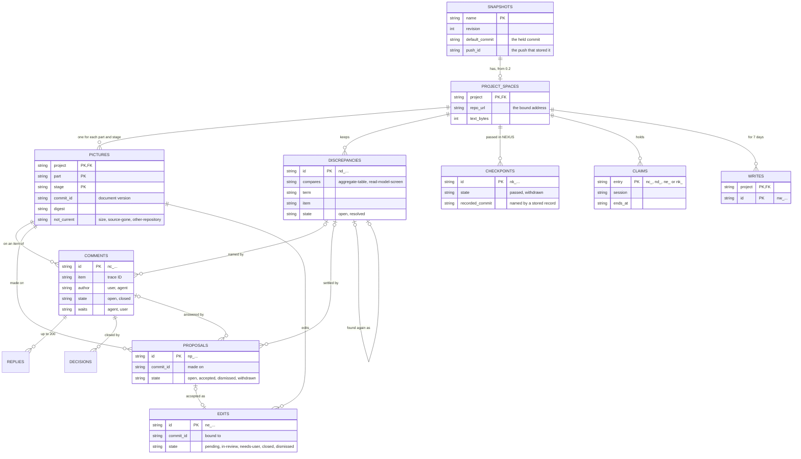

# NEXUS: the server's data and the files

[한국어](nexus.ko.md)

Stage 05 of CORTHEX's own project, for NEXUS 0.2: the tables of the NEXUS server, in [nexus.sql](nexus.sql), and the files that go with them: the snapshot that carries a project to the server, the stage records in the project's repository and the hub's outbox on a device. Status: drafted on 2026-11-02, while the memory plugin is being built, as the maintainer chose that day, on the recommendations of the user flows and the functional spec. The maintainer passed its checkpoint on 2026-11-03, together with stages 03, 04 and 06 to 08, so the schema is frozen for NEXUS 0.2: a later breaking change needs the maintainer's decision and a new schema version. The maintainer's choice of 2026-11-03 to hold stage 01's event storming in NEXUS added the timeline to the DDD board's picture source, which changes no table, and left the work boards of phase ② to that phase; both wait for the maintainer's check ([For the checkpoint](#for-the-checkpoint)). When this file and its Korean translation differ, this file is the source.

Inputs: the functional spec in [docs/04-functional-spec/nexus.md](../04-functional-spec/nexus.md) (SPEC-101 to SPEC-142), above all its [notes for stage 05](../04-functional-spec/nexus.md#stage-05-the-servers-data-and-the-files); the requirements in [docs/02-prd/nexus.md](../02-prd/nexus.md), of which REQ-116, REQ-118, REQ-120, REQ-123 and REQ-124 shape the data most; the glossary and the DDD board in [docs/01-domain/nexus.md](../01-domain/nexus.md), whose words this file keeps and whose aggregates the tables name; and phase 1's table in [nexus/src/store.js](../../nexus/src/store.js). Cloudflare's D1 documents were read on 2026-11-02: its [limits](https://developers.cloudflare.com/d1/platform/limits/), [pricing](https://developers.cloudflare.com/d1/platform/pricing/), [foreign keys](https://developers.cloudflare.com/d1/sql-api/foreign-keys/), [JSON functions](https://developers.cloudflare.com/d1/sql-api/query-json/) and [batches](https://developers.cloudflare.com/d1/worker-api/d1-database/).

## How to read this file

- The server's tables are in [nexus.sql](nexus.sql), the schema of an empty database. Each table's comment gives its TBL ID, its context, the terms of the DDD board's aggregates that it keeps, or `terms: none`, and the behaviours (SPEC) that read or write it. The project hub reads these comments, and from NEXUS 0.2 it draws the ERD picture of the `nexus` part from that file (SPEC-107). This file explains the tables and defines the other records, the files in [Records](#records).
- `From` and the table comments name every behaviour that reads or writes a record, and [Data each behaviour reads and writes](#data-each-behaviour-reads-and-writes) lists the same the other way round.
- Status: `built` for phase 1 as it runs (the snapshots table, the saved snapshot and the status file), `active` for what NEXUS 0.2 adds or changes, and `later (phase ②)` for the positions of editing and the work boards.
- The field tables give the columns and fields in the order in which they are written. A column that has no value is NULL; an optional field of a file is left out.
- A table names only the terms of the board's aggregates, since a term that no aggregate has would open a discrepancy when NEXUS cross-checks its own pictures (SPEC-121). The hub's contexts, CTX-006, CTX-008 and CTX-009, have no aggregates on the board, so the tables that keep their data, or that keep writes in order, say `terms: none`. Tool link, the aggregate of phase ③, is listed after `without a table:`.

## Where the data is

```txt
the NEXUS server: one Cloudflare Worker with its D1 database, corthex-nexus (nexus.sql)
├─ snapshots                  TBL-101 the newest snapshot of each project
│  └─ project_spaces          TBL-102 one space for each project
│     ├─ pictures             TBL-103 one for each part and pictured stage
│     │  ├─ comments          TBL-105
│     │  │  ├─ replies        TBL-106
│     │  │  └─ decisions      TBL-107
│     │  ├─ proposals         TBL-108
│     │  └─ edits             TBL-109 pending reflections until they close
│     ├─ discrepancies        TBL-104
│     ├─ checkpoints          TBL-110 passed in NEXUS
│     ├─ claims               TBL-111
│     └─ writes               TBL-112 kept 7 days
└─ migrations                 TBL-113

the project's repository, at the default branch's commit
└─ .corthex/stages/<part>.json, or .corthex/stages.json    TBL-115 stage records

a device: ~/.corthex/hub/
├─ snapshots/<project>.json                 TBL-114 snapshot
├─ status/<project>.json                    TBL-116 status file
├─ outbox/<project>/<time>.<write>.json     TBL-117 outbox, one file for each write
├─ outbox/<project>.lock
└─ index.html                               the hub page
```

The server's tree also shows what a removal deletes: deleting a project's snapshot deletes its space, and the foreign keys delete everything in the space with it (SPEC-115).

## Records

| ID | Record | Context | Where | Identified by | Kept | From | Status |
| --- | --- | --- | --- | --- | --- | --- | --- |
| TBL-114 | Snapshot | CTX-006 | `snapshots/<project>.json` on a device, and the body of each push | one per project | until the next snapshot of the project | SPEC-103, SPEC-104, SPEC-105, SPEC-106, SPEC-107, SPEC-108, SPEC-109, SPEC-110, SPEC-111, SPEC-122, SPEC-125 | active |
| TBL-115 | Stage records | CTX-007 | `.corthex/stages/<part>.json` for each part, or `.corthex/stages.json` for a project without parts, in the project's repository | one per part | in Git, as long as the repository | SPEC-109, SPEC-137, SPEC-140 | active |
| TBL-116 | Status file | CTX-007 | `status/<project>.json` on a device | one per project | until the user deletes it | SPEC-109 | built |
| TBL-117 | Outbox | CTX-014 | `outbox/<project>/<time>.<write>.json` on a device | its write ID | until the server takes it or refuses it for good, or for 7 days | SPEC-128, SPEC-129, SPEC-135 | active |
| TBL-118 | Positions | CTX-012 | a table of the server, `positions`, which phase ② adds | its project, part, stage and item | while the item is in its picture | SPEC-134 | later (phase ②) |

The server's tables are in [nexus.sql](nexus.sql):

| Table | Name | Holds | Kept | Status |
| --- | --- | --- | --- | --- |
| TBL-101 | `snapshots` | The newest snapshot of each project, without its picture sources, and the default branch commit that it came from | until the next snapshot or a removal | built; 0.2 adds `default_commit` and `push_id` |
| TBL-102 | `project_spaces` | One space for each project, bound to its repository's address | until a removal | active |
| TBL-103 | `pictures` | The last picture of each part and pictured stage, current or not | until a removal | active |
| TBL-104 | `discrepancies` | What the cross-checks found, open and resolved | until a removal | active |
| TBL-105 | `comments` | The comments on the items of the pictures | until a removal | active |
| TBL-106 | `replies` | The replies under each comment | until a removal | active |
| TBL-107 | `decisions` | The decisions recorded on comments, with their links | until a removal | active |
| TBL-108 | `proposals` | The agent's proposals and what became of them | until a removal | active |
| TBL-109 | `edits` | The edits, which are pending reflections until they close | until a removal | active |
| TBL-110 | `checkpoints` | The checkpoints passed in NEXUS, the pull requests of their records, and whether a stage record names them | until a removal | active |
| TBL-111 | `claims` | Which agent session holds which entry of the agent to-do, and until when | while the claim lasts | active |
| TBL-112 | `writes` | The IDs of the writes that the server took, with their first answers | 7 days | active |
| TBL-113 | `migrations` | The schema versions applied to the database | as long as the database | active |

## Every table and file

- Text is UTF-8. A length in characters counts Unicode code points, as memory's do. The view shows every stored text only as text (REQ-148).
- Times are in UTC with milliseconds, as `2026-11-02T12:05:12.345Z`, from the server's clock. Three come from elsewhere and keep their time zone: a snapshot's `generated_at`, from the device; a commit's time, from Git; and a stage record's `updated`, from the device that wrote it. Dates are written as `2026-11-02`.
- The server makes the IDs of its entries: `n`, a letter for the kind, `_` and 12 random characters of Crockford's base32 in lowercase, 60 random bits. `nc_` is a comment, `nd_` a discrepancy, `np_` a proposal, `ne_` an edit and `nk_` a checkpoint, as `nc_7f3k2m9q4x1v`. The page and the hub make write IDs the same way, with `nw_`. These IDs never look like trace IDs, so the hub reads none of them, and a claim tells the kind of its entry by the prefix. Replies and decisions are numbered from 1 within their comment. No ID is reused.
- Projects and parts are named in lowercase letters, digits and hyphens, as the project list names projects. An empty part, `''`, is the project as a whole: a project without parts, or the documents of a project that belong to no part (SPEC-105).
- Stages are the keys of the 13 stages, such as `05-erd`; only `01-domain`, `05-erd` and `07-sitemap` have pictures. Commits are full commit IDs, as Git gives them.
- A JSON column holds compact JSON that the server wrote. Yes and no are `1` and `0` in an INTEGER column.
- The limits are checked by the code, as [Limits](#limits) lists them. The tables' constraints hold only what is always true, such as the states that a column can take, so that changing a limit needs no migration.
- The server keeps no identity but the author's kind (SPEC-116), and no table or file holds the service token (REQ-109, REQ-110).

## Fields of each table

### Snapshots (TBL-101)

Phase 1's table, with two columns more. A push replaces the row as [A push](#a-push) says; a removal deletes it, and with it the project's space.

| Column | Value | Meaning |
| --- | --- | --- |
| `name` | project name | The project's registered name (SPEC-101) |
| `revision` | integer from 1 | The server revision: how many snapshots of the project the server stored (TERM-081) |
| `generated_ms` | integer | `generated_at` in milliseconds since 1970, for comparing |
| `generated_at` | time with its zone | When the hub made the snapshot |
| `received_at` | time | When the server stored it |
| `bytes` | integer | The snapshot's size as sent, at most 1 MiB (SPEC-114) |
| `body` | JSON | The snapshot (TBL-114) without its `pictures`, whose sources the pictures keep (TBL-103). The hub page reads every body, so the body stays as small as in phase 1 |
| `default_commit` | commit, or NULL | The default branch commit that the snapshot's pictures and stage records came from (SPEC-105, SPEC-109): the held commit. NULL for a snapshot of 0.1 or one without a default branch |
| `push_id` | 12 random characters, or NULL | The ID that the Worker made, as it makes the random part of the server's IDs, for the push that stored the snapshot. That push's later statements write only while the snapshot holds it ([A push](#a-push)). NULL for a snapshot that phase 1's server stored |

### Project spaces (TBL-102)

Made in the request that stores a project's snapshot when the project has no space: its first snapshot of 0.2, or the first one after a removal (SPEC-117).

| Column | Value | Meaning |
| --- | --- | --- |
| `project` | project name | The project; one space each, which goes with its snapshot |
| `repo_url` | address, or NULL | The address of the `origin` remote of the repository that holds the project settings, as the snapshot gives it; NULL when that repository has none. A snapshot with another address is refused with `409` (SPEC-117). A space bound to no address is bound to the first address that a later snapshot gives |
| `created_at` | time | When the space was made |
| `text_bytes` | integer | The UTF-8 bytes of the text in the space's comments, replies, decisions, proposals and edits. A write that would take it past 8 MiB is refused ([Limits](#limits)) |
| `unopened` | JSON object | For each part whose last cross-check found more discrepancies than the space could keep open, how many it did not open, as `{"nexus": 12}`. The push's answer and the stage overview show it (SPEC-121) |

### Pictures (TBL-103)

One row for each part and pictured stage of the space: the last picture, current or not. A new document version replaces it, and only a removal deletes it (SPEC-118). The comments, proposals and edits keep the commit of the picture that they were made on, so no earlier picture is needed to show them.

| Column | Value | Meaning |
| --- | --- | --- |
| `project` | project name | |
| `part` | part name, or `''` | |
| `stage` | `01-domain`, `05-erd` or `07-sitemap` | The DDD board, the ERD or the sitemap |
| `commit_id` | commit | The document version that the picture was drawn from (REQ-139) |
| `committed_at` | time with its zone | That commit's time (REQ-139) |
| `source` | JSON | The picture source as the snapshot carried it ([Picture sources](#picture-sources)). The view lays it out (SPEC-119) |
| `digest` | 64 hexadecimal characters | The SHA-256 of `source`. A push compares each picture source's digest with it, and draws a picture only where they differ |
| `drawn_at` | time | When the server stored this document version's picture |
| `not_current` | `size`, `source-gone`, `other-repository`, or NULL | Why the picture is not current: the snapshot left it out for its size (REQ-192), its pictured documents are gone from the stage sources, or its stage source is now in another repository (REQ-144). NULL while it is current |

A picture source equal to the stored picture changes nothing, except that a picture that was not current is current again (SPEC-118). Whether the item of a comment, a proposal or a discrepancy is still in its picture is found when the picture is read (SPEC-119), so a redraw changes no row but its picture's.

#### Picture sources

Each picture source starts with its `format`, `1` in NEXUS 0.2, and each of its elements has its `where`, its file and line at the commit, so that the view can link it to the stage source. Stage 06 fixes the names together with the hub's forms. The server keeps a picture source as it came, and reads in it only its format and, for the cross-check, the terms, the contexts and the removed marks.

| Stage | A picture source holds |
| --- | --- |
| `01-domain` | The contexts, each with its ID, name, type and purpose, its command rows (who gives each, its read model, command, aggregate and events, and whether it is a policy) and its external systems; the aggregates and read models, each with its name, its context, its term and whether the term is marked removed; the dependencies, with their two contexts, kind, reason and data; the hotspots, with their context, state and answer, and their number when their text starts with one; and, when the document has one, the timeline: its lanes in order, each with its places from left to right and the events stacked in each place (SPEC-106) |
| `05-erd` | The tables, each with its ID, name, context and terms or `none`, its columns with their types and whether they may be empty, its primary key, its unique rules and its foreign keys, with the table that each references and what a delete does; and the terms listed after `without a table:` (SPEC-107) |
| `07-sitemap` | The screens, each with its ID, name, path, who can see it, its flows, its parent, its context and its terms or `none`; and the terms listed after `# without a screen:` (SPEC-108) |

### Discrepancies (TBL-104)

Written only by a push's cross-check (SPEC-120, SPEC-121). A discrepancy that the cross-check no longer finds is resolved, never deleted; one found again after that is a new row, which names the earlier one.

| Column | Value | Meaning |
| --- | --- | --- |
| `id` | `nd_` ID | |
| `project` | project name | |
| `part` | part name, or `''` | The part whose pictures were compared |
| `compares` | `aggregate-table` or `read-model-screen` | The kind of pair: an aggregate of the DDD board with the ERD's tables, or a read model with the sitemap's screens (SPEC-120) |
| `term` | TERM ID, or `''` | The pair's term: the aggregate's or the read model's, or the one that the table or screen names. Empty for a table or screen that names none |
| `item` | trace ID, name, or `''` | The pair's table or screen, by its ID, or by its name when it has none. Empty for a term without one |
| `reasons` | JSON list | What disagrees, each reason with its kind and what it concerns: `no-term`, `not-on-board`, `no-table`, `no-screen`, `other-context` with both contexts, and `removed` with the side marked removed (point 7 of the functional spec) |
| `level` | `warn` or `info` | The level of its most serious reason (REQ-155) |
| `state` | `open` or `resolved` | |
| `waiting` | `1` or `0` | `1` while a picture that it concerns is not current, so that it waits for a current one (SPEC-120) |
| `opened_commit` | commit | The default branch commit of the push that opened it |
| `opened_at` | time | |
| `resolved_commit` | commit, or NULL | The commit of the push whose cross-check no longer found it (REQ-157) |
| `resolved_at` | time, or NULL | |
| `earlier` | `nd_` ID, or NULL | The resolved discrepancy of the same pair that this one follows (SPEC-121) |

The unique index on the pair keeps one open discrepancy for each (REQ-156). A discrepancy that compares an aggregate with tables concerns the DDD board and the ERD, and one that compares a read model with screens the DDD board and the sitemap; the overview of each of those stages shows it (SPEC-138).

### Comments (TBL-105)

Left by the user in the view or by the agent through the hub (SPEC-126, SPEC-128). A comment is deleted only with its space; it closes, and it can open again (SPEC-127).

| Column | Value | Meaning |
| --- | --- | --- |
| `id` | `nc_` ID | |
| `project`, `part`, `stage` | | The picture that the comment is on |
| `item` | trace ID, or `''` | The item that the comment is attached to (REQ-160): the selected item, the item that holds a part without an ID of its own, or the discrepancy's first item. Empty for a comment on the picture itself (SPEC-126) |
| `quote` | up to 300 characters, or NULL | The part that the comment was left on, such as an event, a column or a table without an ID (REQ-161) |
| `discrepancy` | `nd_` ID, or NULL | The discrepancy that the comment is on |
| `commit_id` | commit | The document version of the picture when the comment was left, so that the agent can tell what the user saw |
| `author` | `user` or `agent` | From the kind of sign-in (SPEC-116) |
| `text` | up to 4,000 characters | |
| `state` | `open` or `closed` | |
| `closed_as` | `answered`, `decided`, or NULL | How it closed: marked answered by the user or the agent (REQ-166), or with a decision (REQ-165) |
| `waits` | `agent`, `user`, or NULL | Whom an open comment waits for: the agent after an entry of the user's or a dismissed proposal, and the user after an entry of the agent's (SPEC-135). NULL while it is closed |
| `settled` | `1` or `0` | `1` while the user's last reply settles the comment and the agent has not yet recorded the decision (SPEC-127, SPEC-132) |
| `dismissed` | `1` or `0` | `1` while a proposal that answered it is dismissed and the agent has made no entry on it since (SPEC-131) |
| `made_at` | time | |
| `last_at` | time | The time of its last entry: a reply, a decision, a proposal on it, a dismissal, a marking or an opening again. The agent to-do lists the comments by it, oldest first |

### Replies (TBL-106)

| Column | Value | Meaning |
| --- | --- | --- |
| `comment` | `nc_` ID | |
| `seq` | integer from 1 | The reply's place under its comment; at most 200 (SPEC-127) |
| `author` | `user` or `agent` | |
| `text` | up to 4,000 characters | |
| `settles` | `1` or `0` | `1` for a user's reply that settles the comment |
| `made_at` | time | |

A user's reply to a closed comment opens it again, and an agent's reply to a closed comment is refused (SPEC-127).

### Decisions (TBL-107)

| Column | Value | Meaning |
| --- | --- | --- |
| `comment` | `nc_` ID | |
| `seq` | integer from 1 | |
| `link` | address of up to 2,000 characters | Where the decision is written: the project's records or the merged pull request (REQ-164) |
| `text` | up to 4,000 characters, or NULL | The decision, in the agent's words |
| `made_at` | time | |

A decision closes its comment as `decided`, or is added to a closed one, which stays closed (SPEC-132). Only the agent records one (SPEC-116).

### Proposals (TBL-108)

| Column | Value | Meaning |
| --- | --- | --- |
| `id` | `np_` ID | |
| `project`, `part`, `stage` | | The picture that it was made on |
| `commit_id` | commit | That picture's document version when it was made. The edit of an accepted proposal is bound to it (REQ-169) |
| `items` | JSON list of 1 to 50 trace IDs | The items that it concerns, which the picture holds unless the change adds them (SPEC-130) |
| `reason` | up to 2,000 characters | |
| `change` | up to 4,000 characters | The change in words |
| `source_text` | up to 20,000 characters, or NULL | The text of the stage source that it would write |
| `comment` | `nc_` ID, or NULL | The comment that it answers |
| `discrepancy` | `nd_` ID, or NULL | The discrepancy that it would settle |
| `state` | `open`, `accepted`, `dismissed` or `withdrawn` | Accepted or dismissed by the user (SPEC-131), withdrawn by the agent (SPEC-130) |
| `made_at` | time | |
| `closed_at` | time, or NULL | When it stopped being open |

Only the agent makes a proposal, so its author is not kept (SPEC-116).

### Edits (TBL-109)

An accepted proposal makes one, in the same write as the acceptance (SPEC-131); in phase ②, so does a change that the user makes in the editor (SPEC-134). An edit that is neither closed nor dismissed is a pending reflection (TERM-117).

| Column | Value | Meaning |
| --- | --- | --- |
| `id` | `ne_` ID | |
| `project`, `part`, `stage` | | The picture that it edits |
| `commit_id` | commit | The document version that it is bound to: its proposal's, or in phase ② that of the picture that the user edited. A newer document version makes it an edit conflict (REQ-130) |
| `proposal` | `np_` ID, or NULL | The accepted proposal, whose items, change and text are the edit |
| `content` | JSON, or NULL | Phase ②: the change made in the editor. NULL for an accepted proposal |
| `state` | `pending`, `in-review`, `needs-user`, `closed` or `dismissed` | Pending; in review while its reported pull request is open; needing the user when its change no longer fits the stage source; closed once it is reflected; dismissed by the user (SPEC-133) |
| `pull_request` | address, or NULL | The pull request that the agent reported: open while the edit is in review, merged once it closed. NULL again when the pull request was closed unmerged and the edit is pending again |
| `closed_commit` | commit, or NULL | The commit whose stage source already held the change, when the agent reported that instead of a pull request |
| `made_at` | time | |
| `changed_at` | time | When its state last changed |

### Checkpoints (TBL-110)

Passed by the user in a stage's overview (SPEC-139), never by the agent (REQ-179). A passed checkpoint stays in the agent to-do until a stored stage record names it. A withdrawn one stays there while an open pull request or a stored stage record still names it, so that the agent closes the pull request or corrects the record, and leaves once neither does (SPEC-135, SPEC-140).

| Column | Value | Meaning |
| --- | --- | --- |
| `id` | `nk_` ID | The ID that the stage record names (SPEC-140) |
| `project` | project name | |
| `part` | part name, or `''` | |
| `stage` | stage key | Any of the 13 stages |
| `commit_id` | commit, or NULL | The default branch commit of the stored snapshot when it was passed (REQ-178); NULL when that snapshot had none |
| `words` | up to 2,000 characters, or NULL | What the user approves, in their own words |
| `state` | `passed` or `withdrawn` | The user can withdraw it while no stored stage record names it (SPEC-139) |
| `passed_at` | time | When the user passed it. Who passed it is always the user, since only a person's sign-in can pass one (SPEC-116) |
| `withdrawn_at` | time, or NULL | |
| `pull_request` | address, or NULL | The pull request of the record that the agent reported (SPEC-140) |
| `pr_state` | `open`, `merged`, `closed`, or NULL | While it is `open`, the pull request holds the checkpoint (SPEC-136), and a second pull request reported for it is refused |
| `recorded_commit` | commit, or NULL | The default branch commit of the stored snapshot whose stage record names the checkpoint. Each push sets it, or empties it when the records no longer name the checkpoint. A withdrawn checkpoint with a recorded commit gives its stage the `checkpoint-withdrawn` warning (SPEC-140) |

### Claims (TBL-111)

| Column | Value | Meaning |
| --- | --- | --- |
| `entry` | `nc_`, `nd_`, `ne_` or `nk_` ID | The comment, discrepancy, edit or checkpoint held |
| `project` | project name | |
| `session` | label of 1 to 100 characters | The agent session that holds the entry, by the label that it keeps for the session, which holds nothing personal (SPEC-128) |
| `claimed_at` | time | |
| `ends_at` | time | 60 minutes after the session's last write on the entry (SPEC-136) |

While a claim lasts, the server refuses the agent's writes on the entry from other sessions, and the agent to-do shows the entry to them as taken until `ends_at`. A claim ends at `ends_at`, when the entry closes or when its session releases it. An ended claim counts as none, and the space's next write deletes it. The user's writes are never refused for a claim.

### Writes (TBL-112)

| Column | Value | Meaning |
| --- | --- | --- |
| `project` | project name | |
| `id` | `nw_` ID | Made by the page or the hub for one write, and sent with each try of it (SPEC-126, SPEC-128) |
| `request` | name of a request | Which request took the write, such as `reply` or `accept`, as stage 06 names them. The same ID with another request is refused |
| `result` | JSON | The first answer, which a write sent again gets without any change (SPEC-128) |
| `received_at` | time | The space's next write deletes the row 7 days after this. The outbox drops a write 7 days after it was made, so no write is sent again once its ID is gone |

Only the writes that the server took are kept. A write that it refused leaves no row, so it can be sent again once the reason is gone.

### Migrations (TBL-113)

| Column | Value | Meaning |
| --- | --- | --- |
| `version` | integer | A schema version that store.js applied: 1 for phase 1's table, 2 for NEXUS 0.2 |
| `applied_at` | time | |

## Fields of each file

### Snapshot (TBL-114)

Phase 1's format, `corthex-hub/0.1`, is described in the hub's [snapshot.md](../../plugins/corthex-nexus/skills/corthex-hub/references/snapshot.md). NEXUS 0.2 adds the fields below as `corthex-hub/0.2`, and stage 06 adds them to that file. The hub saves the snapshot on the device and sends a fresh one with each push (SPEC-111); the server keeps it without `pictures` (TBL-101). Everything in it is redacted as SPEC-104 says.

| Field | Value | Meaning |
| --- | --- | --- |
| `schema` | `corthex-hub/0.2` | The format. The server takes 0.1 and 0.2 (SPEC-114) |
| `project.parts` | optional list of part names | The parts that the project settings name, in their order (SPEC-105) |
| `repos.".".url` | optional address | The address of the `origin` remote of the repository that holds the project settings, without user names or passwords: the address that the space is bound to (SPEC-117) |
| `repos.".".default` | optional object: `branch`, `commit`, `time` | The default branch, its commit as the checkout last fetched it, and that commit's time (SPEC-105). Left out, with a `pictures-not-sent` check, when there is none |
| `replaces` | optional commit | The default branch commit that the server held when the hub asked, which this snapshot replaces (SPEC-111). Left out when the server held none |
| `records` | object: `from`, optional `commit` and `time` | Where the stage records came from: `repository`, at that commit, or `status-file` (SPEC-109) |
| `stages.<stage>.checkpoints` | optional list | For a project without parts, the stage's checkpoints as its record holds them (TBL-115). `checkpoint` and `checkpoint_date` keep the last one, as in 0.1 |
| `stages.<stage>.parts.<part>` | optional object: `state`, `checkpoints`, `next`, `updated` | For a project with parts, each part's record of the stage (SPEC-109, SPEC-123) |
| `checks[].part` | optional part name | The part that a check concerns, such as a review finding in one part's record |
| `pictures` | list of objects: `part`, `stage`, `commit`, `time`, `source` | One picture source for each part of each pictured stage, with its document version (SPEC-105); `source` is described in [Picture sources](#picture-sources) |
| `left_out` | optional list of objects: `part`, `stage`, `why` | The pictures that the snapshot does not carry, and why: `size` (REQ-192) or `other-repository` (REQ-144) |
| `ask_before` | object: `entries`, `source`, `left_out` | The actions to ask about first: up to 30 entries; where they come from, `project`, `profile` or `default`; and the entries of the profile's list or the default list that the project's list leaves out (SPEC-110) |

### Stage records (TBL-115)

The agent writes them in the pull request of the stage's work (SPEC-137) or of a passed checkpoint (SPEC-140); NEXUS never does (REQ-122). The hub reads them from the default branch's commit (SPEC-109). They take the status file's form (TBL-116), with the checkpoints as a list:

```json
{
  "format": 1,
  "project": "acme-shop",
  "part": "orders",
  "stages": {
    "05-erd": {
      "state": "done",
      "checkpoints": [
        {
          "approved": "The order tables as drafted",
          "by": "the maintainer",
          "where": "https://github.com/example/acme-shop/pull/12",
          "date": "2026-11-03",
          "nexus": "nk_7f3k2m9q4x1v"
        }
      ],
      "next": "Write the API contract",
      "checks": [{ "level": "warn", "message": "The orders table has no index for the search by date", "at": "2026-11-03" }],
      "updated": "2026-11-03T10:00:00+09:00"
    }
  }
}
```

| Field | Value | Meaning |
| --- | --- | --- |
| `format` | integer, `1` | The format of the stage records |
| `project` | project name | The registered name |
| `part` | part name | The part; left out in `.corthex/stages.json` |
| `stages` | object by stage key | One record for each stage that has one |
| `stages.<stage>.state` | `done`, `in_progress`, `not_started` or `skipped` | As recorded (REQ-084); `done` only with a checkpoint and its date (REQ-085) |
| `stages.<stage>.checkpoints` | list | Each checkpoint with `approved`, what was approved, in the user's words when they gave some; `by`, a role such as `the maintainer`, never a name or an email address; `where`, a link to where it was approved; `date`; and `nexus`, the ID of the checkpoint when it was passed in NEXUS (SPEC-137, SPEC-140) |
| `stages.<stage>.next` | text | The next action |
| `stages.<stage>.checks` | optional list | The review findings, each with `level`, `message`, optional `refs` and `at` (REQ-087) |
| `stages.<stage>.updated` | time with its zone | When the record was written |

The file is JSON indented by two spaces, with its fields in this order and a final LF, so that a pull request shows only what changed. Two pull requests that change the records of different parts never conflict, since each part has its own file (SPEC-137). A repository can be public, as this one is, so a record holds roles and links, never personal data. A file of a format that the hub does not know counts as not valid, as SPEC-109 says of one that is not valid JSON.

### Status file (TBL-116)

Phase 1's file, which `hub.py status` writes on each device, as the hub's [snapshot.md](../../plugins/corthex-nexus/skills/corthex-hub/references/snapshot.md) describes: for each stage its state, its last checkpoint with its date, its next action, its review findings and when it was written. From NEXUS 0.2 the hub reads it only for a project whose repository holds no stage records, with a `records-in-status-file` check (SPEC-109).

### Outbox (TBL-117)

The agent's writes that the hub could not send (SPEC-129), one file for each write: `outbox/<project>/<time>.<write>.json`, where `<time>` is when the write was made, as `20261102T120512345Z`, so that the names sort in the order of the writes. The hub writes each file through a temporary file and a move, as it writes its other files, and deletes it once the server has taken the write or refused it for good.

| Field | Value | Meaning |
| --- | --- | --- |
| `format` | integer, `1` | |
| `write` | `nw_` ID | Sent with each try (TBL-112) |
| `project` | project name | |
| `request` | name of a request | Which write it is, such as `reply`, `proposal`, `decision`, or a report of a reflection or of a record's pull request |
| `path` | the request's path | Where the write goes, such as `/api/spaces/corthex/comments/nc_3a6d9g2j5m8r/replies`, so that each try goes where the first went |
| `session` | session label | The session that made it, whose claims it counts for |
| `made` | time | When the agent made it. The hub drops it 7 days after, and says so |
| `body` | object | The write as the hub sends it, already redacted (SPEC-128) |
| `tries` | integer | How many sends of it failed |
| `failure` | optional text | The kind of the last failure, such as `no network` or `no service token` |

The hubs of one device take turns on a project's outbox with the lock `outbox/<project>.lock`, a file made with an exclusive create, which works on Linux, macOS and Windows (REQ-083). It holds the hub's process ID and the time. The holder renews it after each write that it sends, each send waiting at most 30 seconds, and a lock older than 2 minutes is stale and taken over. A claim never waits in the outbox: sent later, it would hold an entry for a session that has moved on, so a claim that cannot be sent leaves the entry untaken, and the hub says so. The outbox never holds the service token (REQ-109).

### Positions (TBL-118), phase ②

Phase ② adds the table `positions`, with a migration, for the positions that the user keeps by moving elements on a PC (REQ-172, SPEC-134). Nothing else of 0.2 changes for it.

| Column | Value | Meaning |
| --- | --- | --- |
| `project`, `part`, `stage` | | The picture; the positions go with it |
| `item` | trace ID | The element that the user moved |
| `x`, `y` | numbers | Its position in the picture |
| `moved_at` | time | |

A redraw deletes the positions of the items that its picture no longer holds, and the layout starts from the kept positions (SPEC-134).

Phase ② also adds the work boards of stage 01's workshops (SPEC-142), with their frames, stickies and authors, once it has drawn their steps (hotspot 14 of stage 01); their tables take the next free TBL IDs then. NEXUS 0.2 keeps no work board: the step view of a DDD board (SPEC-141) reads only the picture.

## How the server writes

### A push

A push stores the snapshot, the space, the pictures, the discrepancies that its cross-check finds and the checkpoints that its stage records name, all of it or none (SPEC-114), in two batches:

1. One batch of reads: the stored snapshot's revision, made time and default commit; the space's address; the pictures' digests and marks; the open discrepancies of the parts; and the space's checkpoints that the to-do still lists or that a record names.
2. The Worker checks the commit rule (SPEC-114) and the address (SPEC-117). It finds the pictures to draw, to make current again and to mark as not current (SPEC-118), cross-checks the parts whose pictures changed or became current again (SPEC-120, SPEC-121), and finds the checkpoints that the stage records name.
3. One batch of writes, which D1 runs as one transaction. Its first statement stores the snapshot, with a new `push_id` that is random for each push, only while the stored revision and default commit are still those that the reads found, and, for a new project, only while the server holds fewer than 30. Every later statement writes only while the snapshot holds that `push_id`. The revision would not do, since two pushes that read the same revision give the same next one. So a push that another push overtook between its two batches writes nothing, and the Worker, finding that the first statement changed no row, refuses it with `409` as SPEC-114 refuses the second of two pushes.

D1 counts a batch as one query against the free plan's 50 for each request, while each statement keeps its own limits, such as 100 bound parameters ([D1 limits](https://developers.cloudflare.com/d1/platform/limits/), read on 2026-11-02). So each statement takes its rows as one JSON parameter, which SQLite reads with `json_each`, and a push of any size stays within both. A push writes only the rows that change, since the free plan writes 100,000 rows a day and counts the row of each index too ([D1 pricing](https://developers.cloudflare.com/d1/platform/pricing/)): a push that changes nothing but the snapshot, such as the same snapshot sent twice, writes one row.

### The writes of the user and the agent

Each write is one batch, which D1 runs as one transaction, so that two writes at once are taken one after the other (SPEC-127, SPEC-136). Its first statement records the write ID only while the write passes its checks of the claim, the space's limits and the state that it changes, and every later statement writes only while that ID is recorded. A write whose ID the space holds fails at that first statement, so that its batch changes nothing, and gets the first answer. A write of the agent's on an entry that another session claims is refused, and one by the session that holds the claim moves the claim's end to 60 minutes later. A write that adds text adds its UTF-8 bytes to the space's `text_bytes`, and is refused when that would pass 8 MiB. The same batch deletes the space's ended claims and its write IDs older than 7 days, so that they are kept only while they are needed (REQ-118).

### A removal

One statement, `DELETE FROM snapshots WHERE name = ?`, deletes the snapshot, and the foreign keys delete the space and every row of the project in every table (REQ-120). The dry run before it reads the counts and IDs that SPEC-115 lists.

### Reads

- The hub page reads every snapshot's body, and for each project the counts of open comments, open proposals and open discrepancies and of the checkpoints that wait for their records (SPEC-123), in one batch.
- The picture view reads the picture; its open comments, each with its count of replies and its last reply; its open proposals, without their stage source text; its edits that are not closed, with their proposals; and the open discrepancies of its part (SPEC-119). A comment's own read gives all its replies and decisions, and a proposal's own read its stage source text, so that a picture's answer stays small (stage 06).
- The agent to-do reads, in its order, the open comments that wait for the agent, the open discrepancies, the edits that are neither closed nor dismissed, and the checkpoints: the passed ones that no stored record names, and the withdrawn ones that an open pull request or a stored record still names. Each list holds up to 50 with its total, and the to-do also reads the space's claims (SPEC-135).
- The stage overview reads the same for one part and stage, with the snapshot's records and checks (SPEC-138).

## Format version and migrations

- The schema's version is in `migrations` (TBL-113). Phase 1's server made `snapshots` at its first use and kept no version: that is version 1. Version 2, for NEXUS 0.2, is [nexus.sql](nexus.sql). nexus.sql records no version, so the server's database is always set up by store.js, and one made from nexus.sql alone serves only to compare the schemas.
- store.js keeps every migration. At its first use of a database it runs nexus.sql's statement for `migrations`, which makes the table only when it is missing, and then runs, in order, each migration whose version the table does not hold, each in one batch with the row that records it. A batch that fails, as when another instance applied the same version first, changes nothing, and store.js reads the versions again.
- Migration 1 is phase 1's statement, which changes nothing in a database that already holds the table:

  ```sql
  CREATE TABLE IF NOT EXISTS snapshots (
    name TEXT PRIMARY KEY,
    revision INTEGER NOT NULL,
    generated_ms INTEGER NOT NULL,
    generated_at TEXT NOT NULL,
    received_at TEXT NOT NULL,
    bytes INTEGER NOT NULL,
    body TEXT NOT NULL
  );
  ```

- Migration 2 adds the default branch commit and the push ID to `snapshots`, and then makes the other tables and their indexes with the statements of nexus.sql from `CREATE TABLE project_spaces` to the end, as they are there:

  ```sql
  ALTER TABLE snapshots ADD COLUMN default_commit TEXT;
  ALTER TABLE snapshots ADD COLUMN push_id TEXT;
  ```

  The last of those statements, for `migrations`, finds the table that store.js made and changes nothing. A database of phase 1 thus keeps its snapshots, with their revisions and bodies and no default commit or push ID, until each project's next push. An empty database that store.js sets up has the schema of nexus.sql: checked on 2026-11-02 with SQLite, these steps give the same tables, columns, keys, foreign keys and indexes as nexus.sql on an empty database and on phase 1's table alike, and deleting a snapshot leaves no row of its project.
- A migration, once released, is never changed. A change of the schema is a new version, with its migration and the same change to nexus.sql.
- The files have their own formats: the snapshot's `schema`, and the `format` of picture sources, stage records and outbox files. The server takes the snapshot formats that it knows (SPEC-114). A picture keeps the format of its picture source, and the view draws each format that it knows.
- After the checkpoint, a breaking change of a table or a file needs the maintainer's decision, as the stage contract says.

## What leaves the device, and what the server keeps

- From a device to the server: the snapshot, redacted as SPEC-104 says, and the agent's writes, redacted as SPEC-128 says (REQ-105). Never the service token, the outbox's files, the status file itself or the project's files.
- From a browser to the server: the user's comments, replies and choices, each with its write ID (SPEC-126).
- The server keeps no identity but the author's kind: no email address, no name and no address of the sender (REQ-163). A session label names a session, not a person. Claims are kept while they last, and write IDs for 7 days (REQ-118). NEXUS calls no AI model (REQ-121), so no table records model calls.
- Into the repository: only the stage records, by the agent's pull requests, with roles and links and never personal data.

## Limits

Lengths in characters count code points. The numbers that come from the requirements, 1 MiB and 30 projects, are caps; the others are defaults of this release, which stage 06 fixes in the code and the trial may change.

| Limit | Value | From |
| --- | --- | --- |
| A snapshot, as sent | 1 MiB | SPEC-114 |
| Projects on the server | 30 | SPEC-114 |
| Comments in a space | 2,000 | SPEC-126 |
| Text of a comment or a reply | 4,000 characters | SPEC-126, SPEC-127 |
| Quote of a comment | 300 characters | SPEC-126 |
| Replies under a comment | 200 | SPEC-127 |
| Open proposals in a space | 500 | SPEC-130 |
| Reason, change and stage source text of a proposal | 2,000, 4,000 and 20,000 characters | SPEC-130 |
| Items of a proposal | 1 to 50 | this file |
| Pending reflections in a space | 500 | SPEC-131 |
| Open discrepancies in a space | 1,000 | SPEC-121 |
| Words of a checkpoint | 2,000 characters | SPEC-139 |
| Text of a decision | 4,000 characters | this file |
| A link: a decision's or a pull request's | 2,000 characters | this file |
| A session label | 1 to 100 ASCII letters, digits, `.`, `_`, `:` and `-` | this file |
| Text in a space: its comments, replies, decisions, proposals and edits | 8 MiB of UTF-8 | this file |
| The body of a write | 256 KiB | stage 06 |
| A claim | 60 minutes after the session's last write on the entry | SPEC-136 |
| Write IDs | 7 days after the server took the write | the functional spec's notes for stage 05 |
| A write in the outbox | 7 days after it was made | SPEC-129 |

The 8 MiB of a space keep the database within the free plan's 500 MB ([D1 limits](https://developers.cloudflare.com/d1/platform/limits/)) with 30 projects, each with a snapshot of up to 1 MiB and its pictures, even when an agent writes far more than a person reads. A write past a limit is refused as the functional spec says, and one past the text of its space with `409`, saying that the space is full.

## Data each behaviour reads and writes

Besides these records, the hub reads the project list, the project settings, the profile and the stage sources (SPEC-101, SPEC-102, SPEC-105, SPEC-110), which other skills and people write. NEXUS changes none of them, and it changes the stage records only through the agent's pull requests.

| Behaviour | Name | Reads | Writes |
| --- | --- | --- | --- |
| SPEC-101 | Read only registered projects | none of these records | none |
| SPEC-102 | Read the stage sources as text | none | none |
| SPEC-103 | Find the items, links and checks | none | TBL-114 |
| SPEC-104 | Keep project material out of the snapshot | none | TBL-114 |
| SPEC-105 | Take the picture sources from the default branch | none | TBL-114 |
| SPEC-106 | Take a DDD board's picture source | none | TBL-114 |
| SPEC-107 | Take an ERD's picture source | none | TBL-114 |
| SPEC-108 | Take a sitemap's picture source | none | TBL-114 |
| SPEC-109 | Read the stage records from the repository | TBL-115, TBL-116 | TBL-114 |
| SPEC-110 | Take the actions to ask about first | none | TBL-114 |
| SPEC-111 | Push a project | TBL-114, TBL-101 | TBL-101, through SPEC-114 |
| SPEC-112 | Push after merges and checkpoints, and at the start of work | TBL-101 | TBL-101, through SPEC-111 |
| SPEC-113 | Answer only checked requests at the user's address | none | none |
| SPEC-114 | Store a snapshot | TBL-101, TBL-102, TBL-103, TBL-104, TBL-110, TBL-113 | TBL-101, TBL-102, TBL-103, TBL-104, TBL-110, TBL-113 |
| SPEC-115 | Remove a project | TBL-101, TBL-102, TBL-103, TBL-104, TBL-105, TBL-108, TBL-109, TBL-110 | deletes TBL-101, and with it the project's rows of TBL-102 to TBL-112 |
| SPEC-116 | Tell the user from the agent | none | the author of TBL-105 and TBL-106 |
| SPEC-117 | Create the project space | TBL-102 | TBL-102 |
| SPEC-118 | Draw and redraw the pictures | TBL-103 | TBL-103 |
| SPEC-119 | Lay out and show a picture | TBL-103, TBL-104, TBL-105, TBL-106, TBL-107, TBL-108, TBL-109 | none |
| SPEC-120 | Pair the pictures | TBL-103, TBL-104 | TBL-104 |
| SPEC-121 | Open, keep and resolve discrepancies | TBL-104 | TBL-104, TBL-102 |
| SPEC-122 | Show where every project stands | TBL-101 on the server, TBL-114 on a device | none |
| SPEC-123 | Show the parts, the pictures and what is open | TBL-101, TBL-103, TBL-104, TBL-105, TBL-108, TBL-110 | none |
| SPEC-124 | Explain an empty server | TBL-101 | none |
| SPEC-125 | Show what the agent asks about first | TBL-101 on the server, TBL-114 on a device | none |
| SPEC-126 | Leave a comment | TBL-102, TBL-103, TBL-104, TBL-112 | TBL-105, TBL-102, TBL-112 |
| SPEC-127 | Reply, answer and open again | TBL-105, TBL-106, TBL-111, TBL-112 | TBL-106, TBL-105, TBL-102, TBL-111, TBL-112 |
| SPEC-128 | Send the agent's writes through the hub | TBL-111, TBL-112 | TBL-105 to TBL-110, as each write says; TBL-111, TBL-112; TBL-117 when it cannot send |
| SPEC-129 | Keep the agent's writes that cannot be sent | TBL-117, TBL-112 | TBL-117 |
| SPEC-130 | Make a proposal | TBL-103, TBL-104, TBL-105, TBL-108, TBL-111 | TBL-108, TBL-105, TBL-102, TBL-111, TBL-112 |
| SPEC-131 | Accept or dismiss a proposal | TBL-108, TBL-109, TBL-112 | TBL-108, TBL-109, TBL-105, TBL-112 |
| SPEC-132 | Settle a comment with a decision | TBL-105, TBL-111 | TBL-107, TBL-106, TBL-105, TBL-102, TBL-111, TBL-112 |
| SPEC-133 | Reflect by pull request | TBL-108, TBL-109, TBL-111 | TBL-109, TBL-106, TBL-102, TBL-111, TBL-112 |
| SPEC-134 | Edit a picture on a PC | TBL-103, TBL-109, TBL-118 | TBL-118, TBL-109, TBL-102 |
| SPEC-135 | Read the agent to-do at the start of work | TBL-104, TBL-105, TBL-109, TBL-110, TBL-111, TBL-117 | TBL-117 |
| SPEC-136 | Claim what the agent takes | TBL-104, TBL-105, TBL-109, TBL-110, TBL-111 | TBL-111 |
| SPEC-137 | Write the stage record with the work | TBL-115 | TBL-115 |
| SPEC-138 | Show what is left in a stage | TBL-101, TBL-104, TBL-105, TBL-109, TBL-110 | none |
| SPEC-139 | Pass a checkpoint in NEXUS | TBL-101, TBL-110, TBL-112 | TBL-110, TBL-112 |
| SPEC-140 | Write a passed checkpoint into the stage record | TBL-110, TBL-111, TBL-115 | TBL-115, TBL-110, TBL-111, TBL-112 |
| SPEC-141 | Go through a DDD board step by step | TBL-103 | none |
| SPEC-142 | Hold a workshop on a work board | the work boards of phase ② | the work boards of phase ② |

## Diagram

The tables of one project space and how they point at each other. `migrations` stands apart and is left out.



## Choices this stage made

The functional spec left these to stage 05. The checkpoint of 2026-11-03 kept each as it is.

1. The server's data in its D1 database, in tables in SQL that SQLite and Postgres share but for the two differences that the notes for stage 11 name, all of it run by store.js (REQ-123), with the limits in the code and constraints only for what is always true.
2. One picture for each part and pictured stage: the last one drawn, current or not, which each new document version replaces. The comments, proposals and edits keep the commit that they were made on, so no earlier picture is kept, and a space's pictures stay within the size of its stage sources.
3. The snapshot stored without its picture sources, which the pictures keep with a digest, so that the hub page, which loads every snapshot, does not carry the pictures, and a push compares each picture by its digest.
4. A push in two batches, the second one transaction guarded by the snapshot's revision and push ID, with its lists as one JSON parameter for each statement and only the changed rows written, for the free plan's limits.
5. Whether an item is still in its picture is found when the picture is read, so that a redraw writes no row of comments, proposals or discrepancies.
6. The IDs of the server's entries in the form of memory's IDs, with `n` and a letter for the kind, and replies and decisions numbered within their comment.
7. Tables that name only the terms of the board's aggregates: `terms: none` for the snapshots of the hub's contexts and for the claims, writes and migrations, and Tool link kept without a table until phase ③.
8. A limit of 8 MiB of text in each space, which the functional spec does not have, for the free plan's 500 MB.
9. Claims kept out of the outbox, and a space without an address bound to the first address that a later snapshot gives.
10. The outbox as one file for each write, which the hubs of a device take turns on with a lock file, and the stage records as one file for each part, with roles and no names.
11. The human view: this file with its diagram, and a Korean copy in Notion with the tables as databases, as the stage's settings give, instead of ERD Editor, the stage's default. From NEXUS 0.2, NEXUS draws this ERD itself from nexus.sql.

## For the checkpoint

The maintainer's choice of 2026-11-03, to hold stage 01's event storming in NEXUS, waits for the maintainer's check: the DDD board's picture source gains its timeline inside the JSON of `pictures.source`, so no table, field or migration changes; and phase ② adds the work boards (SPEC-142), whose tables it numbers when it draws their steps.

Passed on 2026-11-03 at 11:39 KST, together with stages 03, 04 and 06 to 08: on a decision card in the project's thread the maintainer chose all the recommendations ("모두 추천대로", all as recommended), so the choices below stand as drawn, with the changes of stage 06. The checkpoint covered:

1. One picture for each part and stage (choice 2). Keeping each document version's picture would let the view show earlier versions, which no requirement asks for, at the cost of space on the free plan.
2. The 8 MiB of text in each space (choice 8), a new limit with a new refusal.
3. What the data adds to the behaviour of the rows: a stored snapshot no longer holds its picture sources, so reading it returns none (choice 3); claims never wait in the outbox; and the first address binds a space that had none (choice 9).
4. `terms: none` for the snapshots and for the tables that keep writes in order (choice 7), so that NEXUS's cross-check of its own pictures opens no discrepancy for them.

## Notes for later stages

### Stage 06: requests, commands and formats

- The JSON of the snapshot 0.2, from the fields of TBL-114, and that of the picture sources, with the hub's forms. Both go into the hub's snapshot.md and reading.md.
- For each request, its write ID, its session label and its answer, which `writes.result` keeps, and the names of the requests that `writes.request` and the outbox's `request` hold.
- The answer to the question for the held commit: `default_commit` and `revision`.
- The stage records (TBL-115) in the core plugin's references, with the `parts` setting.

### Stages 07 and 08: screens

What each screen reads, as [Reads](#reads) lists it, and the marks that come from the data: a picture that is not current and why (`not_current`), a discrepancy that waits for a current picture (`waiting`), a comment whose item is gone (found when the picture is read), an accepted proposal not yet reflected (an edit that is not closed), and a checkpoint that waits for its record (`recorded_commit` empty). A DDD board's step view needs only its picture source, with or without `timeline` (SPEC-141).

### Stage 10: work breakdown

store.js first: migrations 1 and 2, the push with its two batches, then the writes of the discussion, the agent to-do with the claims, and the checkpoints. The hub's side follows: the snapshot 0.2 with its picture sources and stage records, then the outbox.

### Stage 11: development

- store.js keeps the SQL of both migrations, and a test builds one database from nexus.sql and one through the migrations and compares their tables, columns, keys, indexes and constraints.
- Two things differ in Postgres, and store.js's comments say so: it reads a JSON list with `json_array_elements` where SQLite has `json_each`, and its INTEGER has 32 bits, so `generated_ms`, in milliseconds, is BIGINT there.
- Writing only the rows that change needs comparisons that treat two NULLs as equal: `IS DISTINCT FROM`, which SQLite has from 3.39 and Postgres always had, where D1's SQLite has it, otherwise `IS NOT`.

### Stage 12: QA

- nexus.sql on an empty database in D1, as Wrangler runs it locally, gives the schema that store.js makes, and a database of phase 1 with stored snapshots keeps them through the migration.
- A removal leaves no row of the project in any table.
- The largest push: its queries, the rows that it writes and its CPU time on the free plan (REQ-124).
- Two pushes of one project whose batches interleave: the one that the other overtook writes nothing and gets `409`.
- A checkpoint withdrawn while its record's pull request is open, and that record merged and pushed anyway: the to-do keeps the checkpoint, and its stage has the `checkpoint-withdrawn` warning, until a push whose records no longer name it.
- A write sent twice, and again after 7 days; two sessions that claim one entry, and a claim that ends; two hubs of one device that send one outbox; and a space at its text limit.
- The stage records of two parts changed by two pull requests merged one after the other.
