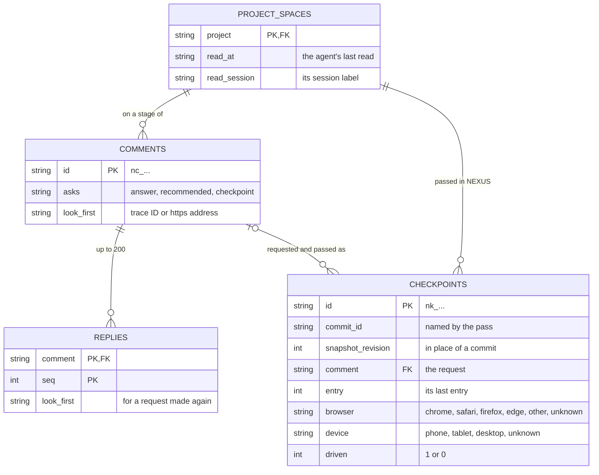
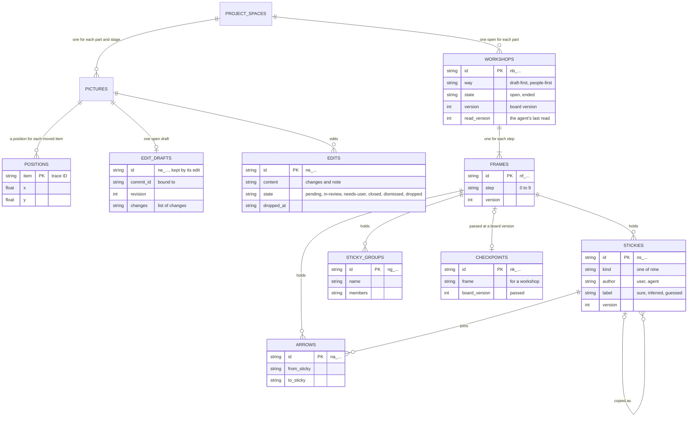
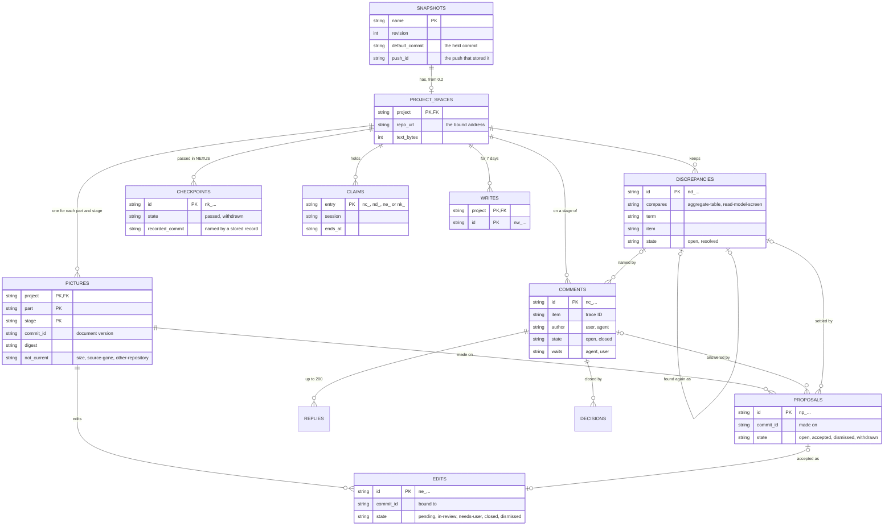

# NEXUS: the server's data and the files

[한국어](nexus.ko.md)

Stage 05 of CORTHEX's own project, for NEXUS 0.2: the tables of the NEXUS server, in [nexus.sql](nexus.sql), and the files that go with them: the snapshot that carries a project to the server, the stage records in the project's repository and the hub's outbox on a device. Status: drafted on 2026-11-02, while the memory plugin is being built, as the maintainer chose that day, on the recommendations of the user flows and the functional spec. The maintainer passed its checkpoint on 2026-11-03, together with stages 03, 04 and 06 to 08, so the schema is frozen for NEXUS 0.2: a later breaking change needs the maintainer's decision and a new schema version. The maintainer's choice of 2026-11-03 to hold stage 01's event storming in NEXUS added the timeline to the DDD board's picture source, which changes no table, and left the work boards of phase ② to that phase; the maintainer passed both the same day ([For the checkpoint](#for-the-checkpoint)). The maintainer's redesign of 2026-11-06 changes comments (TBL-105) and checkpoints (TBL-110), for talk on the items of every stage, choice ② A of its checkpoint 1; after its checkpoint 3 passed on 2026-11-08, its build made the change in nexus.sql and migration 4 ([The redesign's change](#the-redesigns-change)). Phase ②, editing on a PC and the workshops of stage 01, whose stages 01 to 04 passed on 2026-11-06 and 2026-11-07, plans the tables TBL-118 to TBL-124 and changes of six tables of 0.2, which nexus.sql and phase ②'s migration take when phase ② is built, after the redesign ([Phase ②'s tables](#phase-②s-tables)). This stage's checkpoint for phase ②, with stage 06's, passed them at 09:33 KST on 2026-11-08 ([For the checkpoint](#for-the-checkpoint)). The design revision of 2026-11-11, which answers the review of that day, plans two columns of TBL-102, one each of TBL-105 and TBL-106, five of TBL-110, an index and a file on a device, TBL-125, for the functional spec's rows SPEC-187 to SPEC-210, and five changes more for phase ②; its checkpoint passed on 2026-11-12, and on 2026-11-13 its build took the nine columns and the index into nexus.sql and migration 5, which no release holds yet ([The design revision of 2026-11-11](#the-design-revision-of-2026-11-11)). When this file and its Korean translation differ, this file is the source.

Inputs: the functional spec in [docs/04-functional-spec/nexus.md](../04-functional-spec/nexus.md) (SPEC-101 to SPEC-156, SPEC-170 to SPEC-186 for phase ②, and SPEC-187 to SPEC-210 for the design revision of 2026-11-11), above all its [notes for stage 05](../04-functional-spec/nexus.md#stage-05-the-servers-data-and-the-files); the requirements in [docs/02-prd/nexus.md](../02-prd/nexus.md), of which REQ-116, REQ-118, REQ-120, REQ-123 and REQ-124 shape the data most; the glossary and the DDD board in [docs/01-domain/nexus.md](../01-domain/nexus.md), whose words this file keeps and whose aggregates the tables name; and phase 1's table in [nexus/src/store.js](../../nexus/src/store.js). Cloudflare's D1 documents were read on 2026-11-02: its [limits](https://developers.cloudflare.com/d1/platform/limits/), [pricing](https://developers.cloudflare.com/d1/platform/pricing/), [foreign keys](https://developers.cloudflare.com/d1/sql-api/foreign-keys/), [JSON functions](https://developers.cloudflare.com/d1/sql-api/query-json/) and [batches](https://developers.cloudflare.com/d1/worker-api/d1-database/).

## Approved runtime placement (2026-11-04)

The default origin is Node with a SQLite file on the existing VPS; the Worker compatibility path retains D1. Both adapters execute each batch in one transaction, and the data's SQL stays in store.js. The tables, the DDL, the transitions and the limits below are unchanged; the earlier descriptions of D1 apply to the Worker path. Back up daily, and before each migration and each deployment, and compare an actual restore. Real paths, connection values, databases and backups stay outside Git, on the server. From the design revision of 2026-11-11: a copy of the backup, at most a day old, is also kept on another machine than the server's, and its age is checked each day (REQ-291); it stays outside Git too.

## How to read this file

- The server's tables are in [nexus.sql](nexus.sql), the schema of an empty database. Each table's comment gives its TBL ID, its context, the terms of the DDD board's aggregates that it keeps, or `terms: none`, and the behaviours (SPEC) that read or write it. The project hub reads these comments, and from NEXUS 0.2 it draws the ERD picture of the `nexus` part from that file (SPEC-107). This file explains the tables and defines the other records, the files in [Records](#records).
- `From` and the table comments name every behaviour that reads or writes a record, and [Data each behaviour reads and writes](#data-each-behaviour-reads-and-writes) lists the same the other way round.
- Status: `built` for phase 1 as it runs (the snapshots table, the saved snapshot and the status file), `active` for what NEXUS 0.2 adds or changes, and `later (phase ②)` for what phase ② adds or changes, editing on a PC and the work boards ([Phase ②'s tables](#phase-②s-tables)). The design revision of 2026-11-11 adds the functional spec's two: `planned` for what is specified and in no release yet, and `open (Dn)` for what followed the recommendation of an open decision of stage 02, which no row says since D16 to D18 were decided on 2026-11-12 as recommended ([The design revision of 2026-11-11](#the-design-revision-of-2026-11-11)).
- The field tables give the columns and fields in the order in which they are written. A column that has no value is NULL; an optional field of a file is left out.
- A table names only the terms of the board's aggregates, since a term that no aggregate has would open a discrepancy when NEXUS cross-checks its own pictures (SPEC-121). The hub's contexts, CTX-006, CTX-008 and CTX-009, have no aggregates on the board, so the tables that keep their data, or that keep writes in order, say `terms: none`. Tool link, the aggregate of phase ③, is listed after `without a table:`, and so are Positions, Workshop and Sticky, phase ②'s aggregates, until phase ② builds their tables.
- This file was written for the Worker with its D1 database. Since the placement of 2026-11-04 the maintainer's server runs the standalone runtime, so where a sentence below says that the Worker checks or that D1 runs a batch, read the server and its database; the free plan's limits bind the Worker build only ([The two runtimes and the free plan's limits](#the-two-runtimes-and-the-free-plans-limits)).

## Where the data is

```txt
the NEXUS server: the standalone server with its SQLite file, or the Worker build with its D1 database (nexus.sql)
├─ snapshots                  TBL-101 the newest snapshot of each project
│  └─ project_spaces          TBL-102 one space for each project
│     ├─ pictures             TBL-103 one for each part and pictured stage
│     │  ├─ proposals         TBL-108
│     │  └─ edits             TBL-109 pending reflections until they close
│     ├─ comments             TBL-105 on any stage of a part
│     │  ├─ replies           TBL-106
│     │  └─ decisions         TBL-107
│     ├─ discrepancies        TBL-104
│     ├─ checkpoints          TBL-110 passed in NEXUS
│     ├─ claims               TBL-111
│     └─ writes               TBL-112 kept 7 days
└─ migrations                 TBL-113

the project's repository, at the default branch's commit
└─ .corthex/stages/<part>.json, or .corthex/stages.json    TBL-115 stage records

a device: ~/.corthex/hub/
├─ snapshots/<project>.json                 TBL-114 snapshot
├─ status/<project>.json                    TBL-116 status file
├─ outbox/<project>/<time>.<write>.json     TBL-117 outbox, one file for each write
├─ outbox/<project>.lock
├─ reads/<project>.json                     TBL-125 session reads, planned
└─ index.html                               the hub page
```

The server's tree also shows what a removal deletes: deleting a project's snapshot deletes its space, and the foreign keys delete everything in the space with it (SPEC-115). From the design revision of 2026-11-11: the tree draws the comments under the space, where migration 4 put them, names both runtimes and adds the session reads (TBL-125).

## Records

| ID | Record | Context | Where | Identified by | Kept | From | Status |
| --- | --- | --- | --- | --- | --- | --- | --- |
| TBL-114 | Snapshot | CTX-006 | `snapshots/<project>.json` on a device, and the body of each push | one per project | until the next snapshot of the project | SPEC-103, SPEC-104, SPEC-105, SPEC-106, SPEC-107, SPEC-108, SPEC-109, SPEC-110, SPEC-111, SPEC-122, SPEC-125 | active |
| TBL-115 | Stage records | CTX-007 | `.corthex/stages/<part>.json` for each part, or `.corthex/stages.json` for a project without parts, in the project's repository | one per part | in Git, as long as the repository | SPEC-109, SPEC-137, SPEC-140 | active |
| TBL-116 | Status file | CTX-007 | `status/<project>.json` on a device | one per project | until the user deletes it | SPEC-109 | built |
| TBL-117 | Outbox | CTX-014 | `outbox/<project>/<time>.<write>.json` on a device | its write ID | until the server takes it or refuses it for good, or for 7 days | SPEC-128, SPEC-129, SPEC-135 | active |
| TBL-118 | Positions | CTX-012 | a table of the server, `positions`, which phase ② adds | its project, part, stage and item | while the item is in its picture | SPEC-134, SPEC-174, SPEC-175 | later (phase ②) |
| TBL-125 | Session reads | CTX-007 | `reads/<project>.json` on a device, which the design revision of 2026-11-11 adds | one per project, with an entry for each session | each entry for 7 days after its read | SPEC-191 | planned |

The server's tables are in [nexus.sql](nexus.sql):

| Table | Name | Holds | Kept | Status |
| --- | --- | --- | --- | --- |
| TBL-101 | `snapshots` | The newest snapshot of each project, without its picture sources, and the default branch commit that it came from | until the next snapshot or a removal | built; 0.2 adds `default_commit` and `push_id` |
| TBL-102 | `project_spaces` | One space for each project, bound to its repository's address | until a removal | active; the design revision of 2026-11-11 adds `read_at` and `read_session` with migration 5, planned |
| TBL-103 | `pictures` | The last picture of each part and pictured stage, current or not | until a removal | active |
| TBL-104 | `discrepancies` | What the cross-checks found, open and resolved | until a removal | active |
| TBL-105 | `comments` | The comments on the items of every stage, or on a stage as a whole | until a removal | active; the redesign binds it to the space and adds `asks`; the design revision of 2026-11-11 adds `look_first` and the index `comments_request` with migration 5, planned |
| TBL-106 | `replies` | The replies under each comment | until a removal | active; the design revision of 2026-11-11 adds `look_first` with migration 5, planned |
| TBL-107 | `decisions` | The decisions recorded on comments, with their links | until a removal | active |
| TBL-108 | `proposals` | The agent's proposals and what became of them | until a removal | active |
| TBL-109 | `edits` | The edits, which are pending reflections until they close | until a removal | active |
| TBL-110 | `checkpoints` | The checkpoints passed in NEXUS, the pull requests of their records, and whether a stage record names them | until a removal | active; the redesign adds `comment`; the design revision of 2026-11-11 adds `snapshot_revision`, `entry`, `browser`, `device` and `driven` with migration 5, planned |
| TBL-111 | `claims` | Which agent session holds which entry of the agent to-do, and until when | while the claim lasts | active |
| TBL-112 | `writes` | The IDs of the writes that the server took, with their first answers | 7 days | active |
| TBL-113 | `migrations` | The schema versions applied to the database | as long as the database | active |

## Every table and file

- Text is UTF-8. A length in characters counts Unicode code points, as memory's do. The view shows every stored text only as text (REQ-148).
- Times are in UTC with milliseconds, as `2026-11-02T12:05:12.345Z`, from the server's clock. Three come from elsewhere and keep their time zone: a snapshot's `generated_at`, from the device; a commit's time, from Git; and a stage record's `updated`, from the device that wrote it. Dates are written as `2026-11-02`.
- The server makes the IDs of its entries: `n`, a letter for the kind, `_` and 12 random characters of Crockford's base32 in lowercase, 60 random bits. `nc_` is a comment, `nd_` a discrepancy, `np_` a proposal, `ne_` an edit and `nk_` a checkpoint, as `nc_7f3k2m9q4x1v`. The page and the hub make write IDs the same way, with `nw_`. These IDs never look like trace IDs, so the hub reads none of them, and a claim tells the kind of its entry by the prefix. Replies and decisions are numbered from 1 within their comment. No ID is reused.
- Projects and parts are named in lowercase letters, digits and hyphens, as the project list names projects. An empty part, `''`, is the project as a whole: a project without parts, or the documents of a project that belong to no part (SPEC-105).
- Stages are the keys of the 13 stages, such as `05-erd`; only `01-domain`, `05-erd` and `07-sitemap` have pictures. Commits are full commit IDs, as Git gives them.
- A JSON column holds compact JSON that the server wrote. Yes and no are `1` and `0` in an INTEGER column.
- The limits are checked by the code, as [Limits](#limits) lists them. The tables' constraints hold only what is always true, such as the states that a column can take, so that changing a limit needs no migration.
- The server keeps no identity but the author's kind (SPEC-116), and no table or file holds the service token (REQ-109, REQ-110).

## Fields of each table

### Snapshots (TBL-101)

Phase 1's table, with two columns more. A push replaces the row as [A push](#a-push) says; a removal deletes it, and with it the project's space.

| Column | Value | Meaning |
| --- | --- | --- |
| `name` | project name | The project's registered name (SPEC-101) |
| `revision` | integer from 1 | The server revision: how many snapshots of the project the server stored (TERM-081) |
| `generated_ms` | integer | `generated_at` in milliseconds since 1970, for comparing |
| `generated_at` | time with its zone | When the hub made the snapshot |
| `received_at` | time | When the server stored it |
| `bytes` | integer | The snapshot's size as sent, at most 1 MiB (SPEC-114) |
| `body` | JSON | The snapshot (TBL-114) without its `pictures`, whose sources the pictures keep (TBL-103). The hub page reads every body, so the body stays as small as in phase 1 |
| `default_commit` | commit, or NULL | The default branch commit that the snapshot's pictures and stage records came from (SPEC-105, SPEC-109): the held commit. NULL for a snapshot of 0.1 or one without a default branch |
| `push_id` | 12 random characters, or NULL | The ID that the Worker made, as it makes the random part of the server's IDs, for the push that stored the snapshot. That push's later statements write only while the snapshot holds it ([A push](#a-push)). NULL for a snapshot that phase 1's server stored |

### Project spaces (TBL-102)

Made in the request that stores a project's snapshot when the project has no space: its first snapshot of 0.2, or the first one after a removal (SPEC-117). The design revision of 2026-11-11 adds two columns, `read_at` and `read_session`, for the agent's last read: migration 5 makes them, and they are `planned` until the revision's release ([Changes to the tables](#changes-to-the-tables)).

| Column | Value | Meaning |
| --- | --- | --- |
| `project` | project name | The project; one space each, which goes with its snapshot |
| `repo_url` | address, or NULL | The address of the `origin` remote of the repository that holds the project settings, as the snapshot gives it; NULL when that repository has none. A snapshot with another address is refused with `409` (SPEC-117). A space bound to no address is bound to the first address that a later snapshot gives |
| `created_at` | time | When the space was made |
| `text_bytes` | integer | The UTF-8 bytes of the text in the space's comments, replies, decisions, proposals and edits. A write that would take it past 8 MiB is refused ([Limits](#limits)) |
| `unopened` | JSON object | For each part whose last cross-check found more discrepancies than the space could keep open, how many it did not open, as `{"nexus": 12}`. The push's answer and the stage overview show it (SPEC-121) |
| `read_at` | time, or NULL | When the agent last read the project's agent to-do with the service token, by the server's clock (SPEC-187). NULL until the first such read |
| `read_session` | label of 1 to 100 characters, or NULL | The session label that the read named; NULL when it named none (SPEC-187) |

### Pictures (TBL-103)

One row for each part and pictured stage of the space: the last picture, current or not. A new document version replaces it, and only a removal deletes it (SPEC-118). The comments, proposals and edits keep the commit of the picture that they were made on, so no earlier picture is needed to show them.

| Column | Value | Meaning |
| --- | --- | --- |
| `project` | project name | |
| `part` | part name, or `''` | |
| `stage` | `01-domain`, `05-erd` or `07-sitemap` | The DDD board, the ERD or the sitemap |
| `commit_id` | commit | The document version that the picture was drawn from (REQ-139) |
| `committed_at` | time with its zone | That commit's time (REQ-139) |
| `source` | JSON | The picture source as the snapshot carried it ([Picture sources](#picture-sources)). The view lays it out (SPEC-119) |
| `digest` | 64 hexadecimal characters | The SHA-256 of `source`. A push compares each picture source's digest with it, and draws a picture only where they differ |
| `drawn_at` | time | When the server stored this document version's picture |
| `not_current` | `size`, `source-gone`, `other-repository`, or NULL | Why the picture is not current: the snapshot left it out for its size (REQ-192), its pictured documents are gone from the stage sources, or its stage source is now in another repository (REQ-144). NULL while it is current |

A picture source equal to the stored picture changes nothing, except that a picture that was not current is current again (SPEC-118). Whether the item of a comment, a proposal or a discrepancy is still in its picture is found when the picture is read (SPEC-119), so a redraw changes no row but its picture's.

#### Picture sources

Each picture source starts with its `format`, `1` in NEXUS 0.2, and each of its elements has its `where`, its file and line at the commit, so that the view can link it to the stage source. Stage 06 fixes the names together with the hub's forms. The server keeps a picture source as it came, and reads in it only its format and, for the cross-check, the terms, the contexts and the removed marks.

| Stage | A picture source holds |
| --- | --- |
| `01-domain` | The contexts, each with its ID, name, type and purpose, its command rows (who gives each, its read model, command, aggregate and events, and whether it is a policy) and its external systems; the aggregates and read models, each with its name, its context, its term and whether the term is marked removed; the dependencies, with their two contexts, kind, reason and data; the hotspots, with their context, state and answer, and their number when their text starts with one; and, when the document has one, the timeline: its lanes in order, each with its places from left to right and the events stacked in each place (SPEC-106) |
| `05-erd` | The tables, each with its ID, name, context and terms or `none`, its columns with their types and whether they may be empty, its primary key, its unique rules and its foreign keys, with the table that each references and what a delete does; and the terms listed after `without a table:` (SPEC-107) |
| `07-sitemap` | The screens, each with its ID, name, path, who can see it, its flows, its parent, its context and its terms or `none`; and the terms listed after `# without a screen:` (SPEC-108) |

### Discrepancies (TBL-104)

Written only by a push's cross-check (SPEC-120, SPEC-121). A discrepancy that the cross-check no longer finds is resolved, never deleted; one found again after that is a new row, which names the earlier one.

| Column | Value | Meaning |
| --- | --- | --- |
| `id` | `nd_` ID | |
| `project` | project name | |
| `part` | part name, or `''` | The part whose pictures were compared |
| `compares` | `aggregate-table` or `read-model-screen` | The kind of pair: an aggregate of the DDD board with the ERD's tables, or a read model with the sitemap's screens (SPEC-120) |
| `term` | TERM ID, or `''` | The pair's term: the aggregate's or the read model's, or the one that the table or screen names. Empty for a table or screen that names none |
| `item` | trace ID, name, or `''` | The pair's table or screen, by its ID, or by its name when it has none. Empty for a term without one |
| `reasons` | JSON list | What disagrees, each reason with its kind and what it concerns: `no-term`, `not-on-board`, `no-table`, `no-screen`, `other-context` with both contexts, and `removed` with the side marked removed (point 7 of the functional spec) |
| `level` | `warn` or `info` | The level of its most serious reason (REQ-155) |
| `state` | `open` or `resolved` | |
| `waiting` | `1` or `0` | `1` while a picture that it concerns is not current, so that it waits for a current one (SPEC-120) |
| `opened_commit` | commit | The default branch commit of the push that opened it |
| `opened_at` | time | |
| `resolved_commit` | commit, or NULL | The commit of the push whose cross-check no longer found it (REQ-157) |
| `resolved_at` | time, or NULL | |
| `earlier` | `nd_` ID, or NULL | The resolved discrepancy of the same pair that this one follows (SPEC-121) |

The unique index on the pair keeps one open discrepancy for each (REQ-156). A discrepancy that compares an aggregate with tables concerns the DDD board and the ERD, and one that compares a read model with screens the DDD board and the sitemap; the overview of each of those stages shows it (SPEC-138).

### Comments (TBL-105)

Left by the user in the view or by the agent through the hub (SPEC-126, SPEC-128), on any of the 13 stages of a part, with or without a picture (SPEC-151). A comment is deleted only with its space; it closes, and it can open again (SPEC-127). The design revision of 2026-11-11 adds `look_first` and the index of one open checkpoint request for each part's stage with migration 5, and changes what `checkpoint` in `asks` means; all three are `planned` until its release ([Changes to the tables](#changes-to-the-tables)).

| Column | Value | Meaning |
| --- | --- | --- |
| `id` | `nc_` ID | |
| `project`, `part`, `stage` | | The stage of a part that the comment is on, any of the 13 stages. `project` is a foreign key to the space, so a comment needs no picture (SPEC-151) |
| `item` | trace ID, or `''` | The item that the comment is attached to (REQ-160): the selected item, the item that holds a part without an ID of its own, or the discrepancy's first item. Empty for a comment on the stage as a whole, or on its picture itself (SPEC-126, REQ-231) |
| `quote` | up to 300 characters, or NULL | The part that the comment was left on, such as an event, a column or a table without an ID (REQ-161) |
| `discrepancy` | `nd_` ID, or NULL | The discrepancy that the comment is on |
| `commit_id` | commit | The version that the writer saw, so that the agent can tell what the user saw: on a pictured stage the picture's document version, on any other the default branch commit of the stored snapshot when the comment was left |
| `author` | `user` or `agent` | From the kind of sign-in (SPEC-116) |
| `text` | up to 4,000 characters | |
| `state` | `open` or `closed` | |
| `closed_as` | `answered`, `decided`, or NULL | How it closed: marked answered by the user or the agent (REQ-166), or with a decision (REQ-165) |
| `waits` | `agent`, `user`, or NULL | Whom an open comment waits for: the agent after an entry of the user's or a dismissed proposal, and the user after an entry of the agent's (SPEC-135). NULL while it is closed |
| `asks` | `answer`, `recommended`, `checkpoint`, or NULL | What the agent's last entry asks of the user while the comment waits for the user: an answer, taking its recommendation, or passing the stage's checkpoint as recommended. The agent's comment or reply sets it and any other entry empties it, so it is NULL while the comment waits for the agent or is closed (SPEC-143) |
| `settled` | `1` or `0` | `1` while the user's last reply settles the comment and the agent has not yet recorded the decision (SPEC-127, SPEC-132) |
| `dismissed` | `1` or `0` | `1` while a proposal that answered it is dismissed and the agent has made no entry on it since (SPEC-131) |
| `made_at` | time | |
| `last_at` | time | The time of its last entry: a reply, a decision, a proposal on it, a dismissal, a marking or an opening again. The agent to-do lists the comments by it, oldest first |
| `look_first` | trace ID or `https` address, or NULL | The thing to look at first of a comment that is a checkpoint request (SPEC-197). NULL for any other comment |

### Replies (TBL-106)

| Column | Value | Meaning |
| --- | --- | --- |
| `comment` | `nc_` ID | |
| `seq` | integer from 1 | The reply's place under its comment; at most 200 (SPEC-127) |
| `author` | `user` or `agent` | |
| `text` | up to 4,000 characters | |
| `settles` | `1` or `0` | `1` for a user's reply that settles the comment |
| `made_at` | time | |
| `look_first` | trace ID or `https` address, or NULL | The thing to look at first of an agent's reply that asks for the checkpoint again on the stage's open request (SPEC-197). NULL for any other reply |

A user's reply to a closed comment opens it again, and an agent's reply to a closed comment is refused (SPEC-127). The design revision of 2026-11-11 adds `look_first`, with migration 5, for an agent's reply that asks for the checkpoint again; it is `planned` until its release ([Changes to the tables](#changes-to-the-tables)).

### Decisions (TBL-107)

| Column | Value | Meaning |
| --- | --- | --- |
| `comment` | `nc_` ID | |
| `seq` | integer from 1 | |
| `link` | address of up to 2,000 characters | Where the decision is written: the project's records or the merged pull request (REQ-164) |
| `text` | up to 4,000 characters, or NULL | The decision, in the agent's words |
| `made_at` | time | |

A decision closes its comment as `decided`, or is added to a closed one, which stays closed (SPEC-132). Only the agent records one (SPEC-116).

### Proposals (TBL-108)

| Column | Value | Meaning |
| --- | --- | --- |
| `id` | `np_` ID | |
| `project`, `part`, `stage` | | The picture that it was made on |
| `commit_id` | commit | That picture's document version when it was made. The edit of an accepted proposal is bound to it (REQ-169) |
| `items` | JSON list of 1 to 50 trace IDs | The items that it concerns, which the picture holds unless the change adds them (SPEC-130) |
| `reason` | up to 2,000 characters | |
| `change` | up to 4,000 characters | The change in words |
| `source_text` | up to 20,000 characters, or NULL | The text of the stage source that it would write |
| `comment` | `nc_` ID, or NULL | The comment that it answers |
| `discrepancy` | `nd_` ID, or NULL | The discrepancy that it would settle |
| `state` | `open`, `accepted`, `dismissed` or `withdrawn` | Accepted or dismissed by the user (SPEC-131), withdrawn by the agent (SPEC-130) |
| `made_at` | time | |
| `closed_at` | time, or NULL | When it stopped being open |

Only the agent makes a proposal, so its author is not kept (SPEC-116).

### Edits (TBL-109)

An accepted proposal makes one, in the same write as the acceptance (SPEC-131); in phase ②, so does the user's edit draft when it is sent (SPEC-171). An edit that is neither closed, dismissed nor dropped is a pending reflection (TERM-117); phase ② adds the drop and its columns ([Phase ②'s tables](#phase-②s-tables)).

| Column | Value | Meaning |
| --- | --- | --- |
| `id` | `ne_` ID | |
| `project`, `part`, `stage` | | The picture that it edits |
| `commit_id` | commit | The document version that it is bound to: its proposal's, or in phase ② that of the picture that the user edited. A newer document version makes it an edit conflict (REQ-130) |
| `proposal` | `np_` ID, or NULL | The accepted proposal, whose items, change and text are the edit |
| `content` | JSON, or NULL | Phase ②: the list of changes and the note of an edit sent from the editor. NULL for an accepted proposal |
| `state` | `pending`, `in-review`, `needs-user`, `closed` or `dismissed` | Pending; in review while its reported pull request is open; needing the user when its change no longer fits the stage source; closed once it is reflected; dismissed by the user (SPEC-133) |
| `pull_request` | address, or NULL | The pull request that the agent reported: open while the edit is in review, merged once it closed. NULL again when the pull request was closed unmerged and the edit is pending again |
| `closed_commit` | commit, or NULL | The commit whose stage source already held the change, when the agent reported that instead of a pull request |
| `made_at` | time | |
| `changed_at` | time | When its state last changed |
| `last_report` | JSON, or NULL | Internal event, pull request or commit of its last report. It distinguishes a repeated `closed` report after the pull request field was cleared from an invalid first `closed` report. Never returned by an API |

### Checkpoints (TBL-110)

Passed by the user in a stage's overview (SPEC-139), never by the agent (REQ-179). A passed checkpoint stays in the agent to-do until a stored stage record names it. A withdrawn one stays there while an open pull request or a stored stage record still names it, so that the agent closes the pull request or corrects the record, and leaves once neither does (SPEC-135, SPEC-140). The design revision of 2026-11-11 adds, with migration 5, what a pass carries, the commit or the snapshot's revision that the user saw and the request with its last entry, and the kind of browser and device; they are `planned` until its release ([Changes to the tables](#changes-to-the-tables)).

| Column | Value | Meaning |
| --- | --- | --- |
| `id` | `nk_` ID | The ID that the stage record names (SPEC-140) |
| `project` | project name | |
| `part` | part name, or `''` | |
| `stage` | stage key | Any of the 13 stages |
| `commit_id` | commit, or NULL | The default branch commit of the stored snapshot when it was passed (REQ-178); NULL when that snapshot had none |
| `words` | up to 2,000 characters, or NULL | What the user approves, in their own words |
| `state` | `passed` or `withdrawn` | The user can withdraw it while no stored stage record names it (SPEC-139) |
| `passed_at` | time | When the user passed it. Who passed it is always the user, since only a person's sign-in can pass one (SPEC-116) |
| `withdrawn_at` | time, or NULL | |
| `pull_request` | address, or NULL | The pull request of the record that the agent reported (SPEC-140) |
| `pr_state` | `open`, `merged`, `closed`, or NULL | While it is `open`, the pull request holds the checkpoint (SPEC-136), and a second pull request reported for it is refused |
| `recorded_commit` | commit, or NULL | The default branch commit of the stored snapshot whose stage record names the checkpoint. Each push sets it, or empties it when the records no longer name the checkpoint. A withdrawn checkpoint with a recorded commit gives its stage the `checkpoint-withdrawn` warning (SPEC-140) |
| `comment` | `nc_` ID, or NULL | The agent's comment that asked for the checkpoint which the user passed as recommended, and which holds what was approved (SPEC-143, REQ-090). Set when the user takes the recommendation from the comment (API-159); NULL for a checkpoint passed any other way |
| `browser` | `chrome`, `safari`, `firefox`, `edge`, `other`, `unknown`, or NULL | The family of the browser that sent the pass, as the server read it from the request (SPEC-195). NULL only for a checkpoint passed before the revision |
| `device` | `phone`, `tablet`, `desktop`, `unknown`, or NULL | The class of the device, read in the same way (SPEC-195) |
| `driven` | `1`, `0`, or NULL | Whether the page reported that software drives the browser; NULL when it reported nothing (SPEC-195) |
| `snapshot_revision` | integer, or NULL | For a project whose snapshot names no commit, the server revision of the snapshot that the pass named, in place of `commit_id` (SPEC-194) |
| `entry` | integer from 0, or NULL | The request's last entry that the pass named: `0` for the comment's own text, otherwise the `seq` of its reply (SPEC-194). NULL when `comment` is NULL |

### Claims (TBL-111)

| Column | Value | Meaning |
| --- | --- | --- |
| `entry` | `nc_`, `nd_`, `ne_` or `nk_` ID | The comment, discrepancy, edit or checkpoint held |
| `project` | project name | |
| `session` | label of 1 to 100 characters | The agent session that holds the entry, by the label that it keeps for the session, which holds nothing personal (SPEC-128) |
| `claimed_at` | time | |
| `ends_at` | time | 60 minutes after the session's last write on the entry (SPEC-136) |

While a claim lasts, the server refuses the agent's writes on the entry from other sessions, and the agent to-do shows the entry to them as taken until `ends_at`. A claim ends at `ends_at`, when the entry closes or when its session releases it. An ended claim counts as none, and the space's next write deletes it. The user's writes are never refused for a claim.

### Writes (TBL-112)

| Column | Value | Meaning |
| --- | --- | --- |
| `project` | project name | |
| `id` | `nw_` ID | Made by the page or the hub for one write, and sent with each try of it (SPEC-126, SPEC-128) |
| `request` | name of a request | Which request took the write, such as `reply` or `accept`, as stage 06 names them. The same ID with another request is refused |
| `result` | JSON | An internal envelope with the first answer's status and body, plus a random per-attempt transaction token that is never returned. A write sent again gets that status and body without any change (SPEC-128) |
| `received_at` | time | The space's next write deletes the row 7 days after this. The outbox drops a write 7 days after it was made, so no write is sent again once its ID is gone |

Only the writes that the server took are kept. A write that it refused leaves no row, so it can be sent again once the reason is gone.

The transaction token distinguishes a newly inserted write from an already stored ID, even when retries have the same clock millisecond and answer. Every later statement checks this token; an ID conflict therefore cannot run the first write's mutations again. The token is storage metadata, not part of an API answer or an outbox file, and changes no schema column.

### Migrations (TBL-113)

| Column | Value | Meaning |
| --- | --- | --- |
| `version` | integer | A schema version that store.js applied: 1 for phase 1's table, 2 for NEXUS 0.2, 3 for the internal metadata of repeated reports, 4 for the redesign's comments, 5 for the design revision's columns and index |
| `applied_at` | time | |

## Fields of each file

### Snapshot (TBL-114)

Phase 1's format, `corthex-hub/0.1`, is described in the hub's [snapshot.md](https://github.com/kodonghui/corthex/blob/76508243558abaedcc15bb422c454341845fcabd/plugins/corthex-nexus/skills/corthex-hub/references/snapshot.md). NEXUS 0.2 adds the fields below as `corthex-hub/0.2`, and stage 06 adds them to that file. The hub saves the snapshot on the device and sends a fresh one with each push (SPEC-111); the server keeps it without `pictures` (TBL-101). Everything in it is redacted as SPEC-104 says.

| Field | Value | Meaning |
| --- | --- | --- |
| `schema` | `corthex-hub/0.2` | The format. The server takes 0.1 and 0.2 (SPEC-114) |
| `project.parts` | optional list of part names | The parts that the project settings name, in their order (SPEC-105) |
| `repos.".".url` | optional address | The address of the `origin` remote of the repository that holds the project settings, without user names or passwords: the address that the space is bound to (SPEC-117) |
| `repos.".".default` | optional object: `branch`, `commit`, `time` | The default branch, its commit as the checkout last fetched it, and that commit's time (SPEC-105). Left out, with a `pictures-not-sent` check, when there is none |
| `replaces` | optional commit | The default branch commit that the server held when the hub asked, which this snapshot replaces (SPEC-111). Left out when the server held none |
| `records` | object: `from`, optional `commit` and `time` | Where the stage records came from: `repository`, at that commit, or `status-file` (SPEC-109) |
| `stages.<stage>.checkpoints` | optional list | For a project without parts, the stage's checkpoints as its record holds them (TBL-115). `checkpoint` and `checkpoint_date` keep the last one, as in 0.1 |
| `stages.<stage>.parts.<part>` | optional object: `state`, `checkpoints`, `next`, `updated` | For a project with parts, each part's record of the stage (SPEC-109, SPEC-123) |
| `checks[].part` | optional part name | The part that a check concerns, such as a review finding in one part's record |
| `pictures` | list of objects: `part`, `stage`, `commit`, `time`, `source` | One picture source for each part of each pictured stage, with its document version (SPEC-105); `source` is described in [Picture sources](#picture-sources) |
| `left_out` | optional list of objects: `part`, `stage`, `why` | The pictures that the snapshot does not carry, and why: `size` (REQ-192) or `other-repository` (REQ-144) |
| `ask_before` | object: `entries`, `source`, `left_out` | The actions to ask about first: up to 30 entries; where they come from, `project`, `profile` or `default`; and the entries of the profile's list or the default list that the project's list leaves out (SPEC-110) |

### Stage records (TBL-115)

The agent writes them in the pull request of the stage's work (SPEC-137) or of a passed checkpoint (SPEC-140); NEXUS never does (REQ-122). The hub reads them from the default branch's commit (SPEC-109). They take the status file's form (TBL-116), with the checkpoints as a list:

```json
{
  "format": 1,
  "project": "acme-shop",
  "part": "orders",
  "stages": {
    "05-erd": {
      "state": "done",
      "checkpoints": [
        {
          "approved": "The order tables as drafted",
          "by": "the maintainer",
          "where": "https://github.com/example/acme-shop/pull/12",
          "date": "2026-11-03",
          "nexus": "nk_7f3k2m9q4x1v"
        }
      ],
      "next": "Write the API contract",
      "checks": [{ "level": "warn", "message": "The orders table has no index for the search by date", "at": "2026-11-03" }],
      "updated": "2026-11-03T10:00:00+09:00"
    }
  }
}
```

| Field | Value | Meaning |
| --- | --- | --- |
| `format` | integer, `1` | The format of the stage records |
| `project` | project name | The registered name |
| `part` | part name | The part; left out in `.corthex/stages.json` |
| `stages` | object by stage key | One record for each stage that has one |
| `stages.<stage>.state` | `done`, `in_progress`, `not_started` or `skipped` | As recorded (REQ-084); `done` only with a checkpoint and its date (REQ-085) |
| `stages.<stage>.checkpoints` | list | Each checkpoint with `approved`, what was approved, in the user's words when they gave some; `by`, a role such as `the maintainer`, never a name or an email address; optional `where`, a safe HTTPS link to where it was approved; `date`; and optional `nexus`, the ID of the checkpoint when it was passed in NEXUS (SPEC-137, SPEC-140). An unsafe link is left out as SPEC-109 requires; its absence does not discard the approval |
| `stages.<stage>.next` | text | The next action |
| `stages.<stage>.checks` | optional list | The review findings, each with `level`, `message`, optional `refs` and `at` (REQ-087) |
| `stages.<stage>.updated` | time with its zone | When the record was written |

The file is JSON indented by two spaces, with its fields in this order and a final LF, so that a pull request shows only what changed. Two pull requests that change the records of different parts never conflict, since each part has its own file (SPEC-137). A repository can be public, as this one is, so a record holds roles and links, never personal data. A file of a format that the hub does not know counts as not valid, as SPEC-109 says of one that is not valid JSON.

Repository status updates serialize the complete read-modify-replace operation per record file. A short native OS guard, released by the OS after a process exits, is kept outside the repository under the user's `~/.corthex/hub/record-locks/`. Its key uses the record directory's filesystem identity and generated filename, so sessions using different `--home` profiles or path aliases still share it. Windows obtains that identity through one fixed native file-information API, since Python versions may expose different device-number widths. Redirected guard directories, including Windows junctions, are refused. An opened guard must be a regular file with one link before any initialization. A busy writer fails without replacing the record, and a retry reloads the latest file; no guard or new data field is committed or sent.

### Status file (TBL-116)

Phase 1's file, which `hub.py status` writes on each device, as the hub's [snapshot.md](https://github.com/kodonghui/corthex/blob/76508243558abaedcc15bb422c454341845fcabd/plugins/corthex-nexus/skills/corthex-hub/references/snapshot.md) describes: for each stage its state, its last checkpoint with its date, its next action, its review findings and when it was written. From NEXUS 0.2 the hub reads it only for a project whose repository holds no stage records, with a `records-in-status-file` check (SPEC-109).

### Outbox (TBL-117)

The agent's writes that the hub could not send (SPEC-129), one file for each write: `outbox/<project>/<time>.<write>.json`, where `<time>` is when the write was made, as `20261102T120512345Z`, so that the names sort in the order of the writes. The hub writes each file through a temporary file and a move, as it writes its other files, and deletes it once the server has taken the write or refused it for good.

| Field | Value | Meaning |
| --- | --- | --- |
| `format` | integer, `1` | |
| `write` | `nw_` ID | Sent with each try (TBL-112) |
| `project` | project name | |
| `request` | name of a request | Which write it is, such as `reply`, `proposal`, `decision`, or a report of a reflection or of a record's pull request |
| `path` | the request's path | Where the write goes, such as `/api/spaces/corthex/comments/nc_3a6d9g2j5m8r/replies`, so that each try goes where the first went |
| `session` | session label | The session that made it, whose claims it counts for |
| `made` | time | When the agent made it. The hub drops it 7 days after, and says so |
| `body` | object | The write as the hub sends it, already redacted (SPEC-128) |
| `tries` | integer | How many sends of it failed |
| `failure` | optional text | The kind of the last failure, such as `no network` or `no service token` |

The hubs of one device take turns on a project's outbox with the lock `outbox/<project>.lock`, a file made with an exclusive create, which works on Linux, macOS and Windows (REQ-083). It holds the hub's process ID and the time. The holder renews it after each write that it sends, each send waiting at most 30 seconds, and a lock older than 2 minutes is stale and taken over. A claim never waits in the outbox: sent later, it would hold an entry for a session that has moved on, so a claim that cannot be sent leaves the entry untaken, and the hub says so. The outbox never holds the service token (REQ-109).

A short native operating-system lock on `outbox/<project>.guard` serializes creating, renewing and taking over that lease. It holds no text or token and never spans a network request. A sender verifies its random ownership marker before changing a queued file, so a former holder cannot alter a new holder's queue. While the lease is busy, another hub may append a new unique write under the short guard, with `tries: 0`; it waits for the next drain and is never sent ahead of the waiting head. These are device-only synchronization details, not new fields of `OutboxFile`.

Every agent write is atomically queued with its original ID before its first send, and that same drain sends it after older writes. This closes the gap between checking an empty queue and sending a fresh write, and retains the write if its process loses the lease. `outbox/<project>.order` holds only the queued write IDs in admission order, under the same short guard, so writes created in the same millisecond keep their order without altering their actual `made` times. Its entry is written before publishing a new queue file; a missing file is ignored. Existing queue files without ordering metadata retain filename order. Retries do not move a write, and a former sender may only recover its original missing file through the unique-append path, never overwrite a new holder's file. Failure to persist gives the agent one redacted recovery copy, as SPEC-129 requires, without saving it in a log.

### Positions (TBL-118), phase ②

Phase ② adds the table `positions`, with phase ②'s migration, for the positions that the user keeps by moving the items of a picture on a PC (REQ-172, SPEC-174). The stage sources and the edit drafts never hold them.

| Column | Value | Meaning |
| --- | --- | --- |
| `project`, `part`, `stage` | | The picture, a foreign key to `pictures`, so that the positions go with its space |
| `item` | trace ID | The item that the user moved: a context or an aggregate of the DDD board, a table of the ERD or a screen of the sitemap. A part without an ID of its own, such as a column, moves with its item |
| `x`, `y` | numbers | Its place in the picture |
| `moved_at` | time | When the user put it there; of two windows, the later save wins |

- A save takes only IDs that the current picture holds, up to 2,000 positions for each part's stage (SPEC-174).
- A redraw deletes the positions of the items that the picture before it held and the new one does not (REQ-246), and the layout starts from the positions kept (SPEC-119).
- The positions of the items that a sent edit adds wait in the edit's list of changes, under their temporary names, which no redraw touches. When the agent reports the edit merged with the IDs that the stage source gave those items, the same write keeps each position under its new ID, unless that ID has a newer one already (REQ-247, SPEC-175); when the edit closes otherwise, they go with it.

Phase ② also adds the edit drafts and the work boards of stage 01's workshops, TBL-119 to TBL-124, in [Phase ②'s tables](#phase-②s-tables). NEXUS 0.2 keeps no work board: the step view of a DDD board (SPEC-141) reads only the picture.

## How the server writes

### A push

A push stores the snapshot, the space, the pictures, the discrepancies that its cross-check finds and the checkpoints that its stage records name, all of it or none (SPEC-114), in two batches:

1. One batch of reads: the stored snapshot's revision, made time and default commit; the space's address; the pictures' digests and marks; the open discrepancies of the parts; and the space's checkpoints that the to-do still lists or that a record names.
2. The Worker checks the commit rule (SPEC-114) and the address (SPEC-117). It finds the pictures to draw, to make current again and to mark as not current (SPEC-118), cross-checks the parts whose pictures changed or became current again (SPEC-120, SPEC-121), and finds the checkpoints that the stage records name.
3. One batch of writes, which D1 runs as one transaction. Its first statement stores the snapshot, with a new `push_id` that is random for each push, only while the stored revision and default commit are still those that the reads found, and, for a new project, only while the server holds fewer than 30. Every later statement writes only while the snapshot holds that `push_id`. The revision would not do, since two pushes that read the same revision give the same next one. So a push that another push overtook between its two batches writes nothing, and the Worker, finding that the first statement changed no row, refuses it with `409` as SPEC-114 refuses the second of two pushes.

D1 counts a batch as one query against the free plan's 50 for each request, while each statement keeps its own limits, such as 100 bound parameters ([D1 limits](https://developers.cloudflare.com/d1/platform/limits/), read on 2026-11-02). So each statement takes its rows as one JSON parameter, which SQLite reads with `json_each`, and a push of any size stays within both. A push writes only the rows that change, since the free plan writes 100,000 rows a day and counts the row of each index too ([D1 pricing](https://developers.cloudflare.com/d1/platform/pricing/)): a push that changes nothing but the snapshot, such as the same snapshot sent twice, writes one row.

### The writes of the user and the agent

Each write is one batch, which D1 runs as one transaction, so that two writes at once are taken one after the other (SPEC-127, SPEC-136). Its first statement records the write ID only while the write passes its checks of the claim, the space's limits and the state that it changes, and every later statement writes only while that ID is recorded. A write whose ID the space holds fails at that first statement, so that its batch changes nothing, and gets the first answer. A write of the agent's on an entry that another session claims is refused, and one by the session that holds the claim moves the claim's end to 60 minutes later. A write that adds text adds its UTF-8 bytes to the space's `text_bytes`, and is refused when that would pass 8 MiB. The same batch deletes the space's ended claims and its write IDs older than 7 days, so that they are kept only while they are needed (REQ-118).

### A removal

One statement, `DELETE FROM snapshots WHERE name = ?`, deletes the snapshot, and the foreign keys delete the space and every row of the project in every table (REQ-120). The dry run before it reads the counts and IDs that SPEC-115 lists. From the design revision of 2026-11-11: the server runs the statement only for a request under the user's own sign-in and refuses one that carries the service token with `403`, and the dry run also serves the project's data ([How the revision reads and writes](#how-the-revision-reads-and-writes)).

### Reads

- The hub page reads every snapshot's body, and for each project the counts of open comments, open proposals and open discrepancies and of the checkpoints that wait for their records (SPEC-123), in one batch.
- The picture view reads the picture; its open comments, each with its count of replies and its last reply; its open proposals, without their stage source text; its edits that are not closed, with their proposals; and the open discrepancies of its part (SPEC-119). A comment's own read gives all its replies and decisions, and a proposal's own read its stage source text, so that a picture's answer stays small (stage 06).
- The agent to-do reads, in its order, the open comments that wait for the agent, the open discrepancies, the edits that are neither closed nor dismissed, and the checkpoints: the passed ones that no stored record names, and the withdrawn ones that an open pull request or a stored record still names. Each list holds up to 50 with its total, and the to-do also reads the space's claims (SPEC-135). From the design revision of 2026-11-11: a read with the service token first records the time of the read and its session label in the space, and the pages read that time with the time of the last push ([How the revision reads and writes](#how-the-revision-reads-and-writes)).
- The stage overview reads the same for one part and stage, with the snapshot's records and checks (SPEC-138).

## Format version and migrations

- The schema's version is in `migrations` (TBL-113). Phase 1's unversioned `snapshots` is version 1. Version 2 adds NEXUS 0.2's space tables; version 3 adds the internal `edits.last_report` metadata needed for SPEC-133's repeated reports; version 4 makes `comments` again for the redesign and adds `checkpoints.comment` ([The redesign's change](#the-redesigns-change)); version 5 adds the nine columns and the index of the design revision of 2026-11-11 ([The revision's migrations](#the-revisions-migrations)). Released migrations 1 to 3 stay unchanged. [nexus.sql](nexus.sql) describes the latest schema, records no version, and serves only to compare the schemas; store.js always initializes a server database.
- store.js keeps every migration. At its first use of a database it runs nexus.sql's statement for `migrations`, which makes the table only when it is missing, and then runs, in order, each migration whose version the table does not hold, each in one batch with the row that records it. A batch that fails, as when another instance applied the same version first, changes nothing, and store.js reads the versions again.
- Migration 1 is phase 1's statement, which changes nothing in a database that already holds the table:

  ```sql
  CREATE TABLE IF NOT EXISTS snapshots (
    name TEXT PRIMARY KEY,
    revision INTEGER NOT NULL,
    generated_ms INTEGER NOT NULL,
    generated_at TEXT NOT NULL,
    received_at TEXT NOT NULL,
    bytes INTEGER NOT NULL,
    body TEXT NOT NULL
  );
  ```

- Migration 2 adds the default branch commit and the push ID to `snapshots`, and then makes the other tables and their indexes with the statements of nexus.sql from `CREATE TABLE project_spaces` to the end, as they are there:

  ```sql
  ALTER TABLE snapshots ADD COLUMN default_commit TEXT;
  ALTER TABLE snapshots ADD COLUMN push_id TEXT;
  ```

  The last of those statements, for `migrations`, finds the table that store.js made and changes nothing. A database of phase 1 thus keeps its snapshots, with their revisions and bodies and no default commit or push ID, until each project's next push. An empty database that store.js sets up has the schema of nexus.sql: checked on 2026-11-02 with SQLite, these steps give the same tables, columns, keys, foreign keys and indexes as nexus.sql on an empty database and on phase 1's table alike, and deleting a snapshot leaves no row of its project.
- A migration, once released, is never changed. A change of the schema is a new version, with its migration and the same change to nexus.sql. A migration takes the next free version when its release is built, so the design revision of 2026-11-11 names phase ②'s migration by its phase and not by a number ([The revision's migrations](#the-revisions-migrations)).
- The files have their own formats: the snapshot's `schema`, and the `format` of picture sources, stage records and outbox files. The server takes the snapshot formats that it knows (SPEC-114). A picture keeps the format of its picture source, and the view draws each format that it knows.
- After the checkpoint, a breaking change of a table or a file needs the maintainer's decision, as the stage contract says.

## The redesign's change

Planned with the redesign of 2026-11-06, whose checkpoint 1 chose talk on the items of every stage (choice ② A). Its checkpoint 3 passed on 2026-11-08, and its build made the change that day: [nexus.sql](nexus.sql), store.js and migration 4 hold it, and the tables above describe it.

| Table | Column or key | In 0.2 | With the redesign |
| --- | --- | --- | --- |
| TBL-105 `comments` | `project`, `part`, `stage` | The picture that the comment is on, a foreign key to `pictures` | The stage of a part that the comment is on, any of the 13 stages. The key goes to `project_spaces (project)`, so that a comment needs no picture and a removal still deletes it with its space (SPEC-151) |
| TBL-105 `comments` | `item` | A trace ID of the picture, or `''` for the picture itself | A trace ID of the stage's items, or `''` for the stage as a whole (REQ-231) |
| TBL-105 `comments` | `commit_id` | The picture's document version | The default branch commit of the stored snapshot when the comment was left, which is the picture's document version on a pictured stage |
| TBL-105 `comments` | `asks`, new | | `answer`, `recommended`, `checkpoint`, or NULL: what the comment's last entry by the agent asks of the user, while the comment waits for the user; NULL while it waits for the agent or is closed. The agent's comment or reply sets it, and the user's next entry empties it (SPEC-143) |
| TBL-105 `comments` | index | `comments_picture (project, part, stage, state)` | The same columns as `comments_stage`, since it now serves a stage's talk (SPEC-150) |
| TBL-105 `comments` | checks | `stage` is a pictured stage, through the picture's key | `stage` is one of the 13 stage keys, and `asks` is NULL unless the comment is open and waits for the user |
| TBL-110 `checkpoints` | `comment`, new | | `nc_` ID, or NULL: the comment whose checkpoint the user passed as recommended, which holds what was approved (SPEC-143, REQ-090) |

SQLite changes a foreign key only by making the table again: a new table with the new key, the rows copied, the old table dropped and the new one renamed ([SQLite, ALTER TABLE](https://www.sqlite.org/lang_altertable.html#otheralter)). `replies` and `decisions` delete their rows with their comment, and `proposals` empties its `comment`, so dropping the old table must not run those actions. Migration 4 therefore copies the replies, the decisions and the proposals' comments aside before it drops the old table, and puts them back after the rename, all in its one batch: those actions run even while foreign keys are deferred, and D1 keeps foreign keys on ([D1, foreign keys](https://developers.cloudflare.com/d1/sql-api/foreign-keys/)). On 2026-11-08, with Node 24.22.1's SQLite and foreign keys on, as the standalone server and the Worker's D1 run, a database of schema 3 with a comment, its reply and decision, a proposal on it and a checkpoint kept every row, and `PRAGMA foreign_key_check` found nothing (`nexus/test/entry-store.test.js`); D1 itself was not run.

## The design revision of 2026-11-11

Planned with the design revision of 2026-11-11, which answers the review of that day ([the review's map](../reviews/2026-11-11-design-review.md)), for the functional spec's rows SPEC-187 to SPEC-210 and its [notes for stage 05](../04-functional-spec/nexus.md#stage-05-the-servers-data-and-the-files). Its build began on 2026-11-13: migration 5 adds the nine columns and the index, and [nexus.sql](nexus.sql) and the field tables above hold them (TASK-295, [The revision's migrations](#the-revisions-migrations)). The rows that use them come with their own tasks, and the statuses stay `planned` until the revision's release. The revision adds no table to the server and makes none again. It adds nine columns, each of which may be empty: two to TBL-102, one to TBL-105, one to TBL-106 and five to TBL-110. It adds one index, and one file on a device, TBL-125. Its checkpoint passed on 2026-11-12 ([For the checkpoint](#for-the-checkpoint)).

The statuses are the functional spec's: `planned` for what is specified and in no release yet. Five rows below said `open (D17)`, for what followed the recommendation of stage 02's decision D17, and are `planned` since the maintainer decided D17 on 2026-11-12 as recommended: the pass carries what the user saw, and the first page offers it as an entry's second action.

### Changes to the tables

| Table | Column or key | Now | With the revision | Status |
| --- | --- | --- | --- | --- |
| TBL-102 `project_spaces` | `read_at`, new | | Time, or NULL: when the agent last read the project's agent to-do with the service token, by the server's clock (TERM-150, SPEC-187). Each such read replaces it. NULL until the first read, which the pages show as "not read yet" (SPEC-188) | planned |
| TBL-102 `project_spaces` | `read_session`, new | | Label of 1 to 100 characters, or NULL: the session label that the read named; NULL when it named none (SPEC-187). Only the project's data shows it (SPEC-203), and the export leaves it out (SPEC-201) | planned |
| TBL-105 `comments` | `asks` | `checkpoint`: the agent's last entry asks the user to pass the stage's checkpoint as recommended | `checkpoint`: the agent's last entry is the stage's checkpoint request (TERM-151), which the user opens and passes on what it shows, and no longer "as recommended" (SPEC-196). `answer` and `recommended` stay as they are (SPEC-143) | planned |
| TBL-105 `comments` | `look_first`, new | | A trace ID or an `https` address, or NULL: the thing to look at first of a comment that is a checkpoint request (SPEC-197, SPEC-198). NULL for any other comment, and for a request stored before the revision, which the pages show without a pass (SPEC-196) | planned |
| TBL-105 `comments` | index `comments_request`, new | | Unique on `(project, part, stage)` where `state = 'open' AND asks = 'checkpoint'`: one open checkpoint request for each part's stage (SPEC-197). It also finds a stage's open request for the stage's record and for a pass (SPEC-139, SPEC-194) | planned |
| TBL-106 `replies` | `look_first`, new | | As for a comment: the thing to look at first of an agent's reply that asks for the checkpoint again on the stage's open request, whose last entry the reply then is (SPEC-197). NULL for any other reply | planned |
| TBL-110 `checkpoints` | `commit_id` | The default branch commit of the stored snapshot when the checkpoint was passed | The same commit, which the pass now names as the page showed it, and which the server compares with the commit that it holds before it records the checkpoint (SPEC-194) | planned |
| TBL-110 `checkpoints` | `snapshot_revision`, new | | Integer, or NULL: for a project whose snapshot names no commit, the server revision of the snapshot (TBL-101 `revision`) that the pass named and the server held, in place of `commit_id` (SPEC-194). NULL when the pass named a commit, and for a checkpoint passed before the revision | planned |
| TBL-110 `checkpoints` | `comment` | The agent's comment whose checkpoint the user passed as recommended, set when the user takes the recommendation (API-159) | The checkpoint request that the pass named, from the first page or from the stage's record (SPEC-194, SPEC-196). NULL for a pass without a request. Taking a recommendation passes no checkpoint any more, so it no longer sets this column (SPEC-143) | planned |
| TBL-110 `checkpoints` | `entry`, new | | Integer from 0, or NULL: the request's last entry that the user saw and the pass named, `0` for the comment's own text and otherwise the `seq` of its reply (TBL-106), so that `comment` and `entry` together hold what was approved (REQ-090). NULL when `comment` is NULL, and for a checkpoint passed before the revision | planned |
| TBL-110 `checkpoints` | `browser`, new | | `chrome`, `safari`, `firefox`, `edge`, `other`, `unknown`, or NULL: the family of the browser that sent the pass, as the server read it from the request (SPEC-195). NULL only for a checkpoint passed before the revision, which is not the same as `unknown` | planned |
| TBL-110 `checkpoints` | `device`, new | | `phone`, `tablet`, `desktop`, `unknown`, or NULL: the class of the device, read in the same way. NULL as for `browser` | planned |
| TBL-110 `checkpoints` | `driven`, new | | `1`, `0`, or NULL: whether the page reported that software drives the browser. NULL when the page reported nothing, as an older page does, and for a checkpoint passed before the revision | planned |

- The three columns of SPEC-195 hold words of a fixed vocabulary and never the request's own text. Their constraints refuse anything else, so that no `User-Agent` and no address can reach the table even by a mistake of the code (SPEC-116). They are a record to look at afterwards and never a check, and the stage record in Git holds none of them (SPEC-140).
- While a comment's `asks` is `checkpoint`, its last entry is the agent's entry that asks: the comment's own text when it has no reply, and otherwise the reply with the highest `seq`, since any other entry empties `asks` (SPEC-143). A pass that names another entry is refused (SPEC-194).
- A request holds its text in `text` and its thing to look at first in `look_first`, on the comment or on the reply that asks again. The bytes of `look_first` count in the space's text with the entry's own, and [Limits](#limits) gives the limits of both.
- A workshop's checkpoint request, in phase ②, is a comment on stage `01-domain` like any other (SPEC-182), so it is that stage's one open request, and its pass keeps the board version as its binding (SPEC-194).

The mark of what the agent has not read (SPEC-189) needs no column of its own. An entry that waits for the agent is not yet read while the time since which it waits is at or after the space's `read_at`, or while `read_at` is NULL:

| Entry that waits for the agent | The time since which it waits |
| --- | --- |
| An open comment whose `waits` is `agent` (TBL-105) | `last_at`: the user's last entry on it, or the dismissal of its proposal |
| An open discrepancy (TBL-104) | `opened_at` |
| An edit whose state is `pending` (TBL-109) | `made_at`: the acceptance that made it or, in phase ②, the user's send |
| A passed checkpoint that no stored record names (TBL-110) | `passed_at` |
| A withdrawn checkpoint that the to-do still lists (TBL-110) | `withdrawn_at` |
| Phase ②: a dropped edit whose pull request is still open (TBL-109) | `dropped_at` |

An entry that a session holds by a claim shows as taken, without the mark (TBL-111, SPEC-136), and a changed work board keeps its own mark, from `read_version` (SPEC-181). The indexes that the tables have serve the counts of the first page: `comments_waiting`, `discrepancies_state`, `edits_state` and `checkpoints_state`. The same read gives the oldest of those times among the entries not yet read, from which a page tells a wait of more than 24 hours (SPEC-188). The 24 hours are worked out in the page and stored nowhere.

### Session reads (TBL-125)

A new file on a device, under `~/.corthex/hub/`: `reads/<project>.json`, in which the hub keeps for each session the time of the session's last read of the project's agent to-do, as the server's answer named it (SPEC-187, SPEC-191). The hub's `todo` reads it to tell whether a day has passed since the session's last read, so that a step of the stage skills costs no request when it has not. Stage 06 names the option.

```json
{
  "format": 1,
  "project": "acme-shop",
  "reads": [
    {
      "session": "claude-code-4f2a91",
      "at": "2026-11-11T01:00:00.000Z"
    },
    {
      "at": "2026-11-10T07:30:12.345Z"
    }
  ]
}
```

| Field | Value | Meaning |
| --- | --- | --- |
| `format` | integer, `1` | |
| `project` | project name | |
| `reads` | list | One entry for each session that read, the newest first |
| `reads[].session` | optional session label | The session, by the label that it gives the hub (SPEC-128). Left out for a session without a label; such sessions share one entry |
| `reads[].at` | time | The time of the session's last read, by the server's clock, as the server recorded it and its answer named it |

- A read that the server answered replaces its session's entry. Before that, the hub uses the entry's old time to tell which entries of the to-do are new since the session's last read, which is all that the agent tells the user after a later read (SPEC-191).
- The hub drops an entry 7 days after its time, so that the file stays small on a device that many sessions use.
- The hub reads again when the session has no entry, when the file is missing or not valid, when the entry's time is more than a day old by the device's clock, or when that time is more than an hour ahead of the device's clock. So a wrong clock or a lost file, as in a cloud session, costs one more read and never hides one.
- The hub writes the file through a temporary file and a move, as it writes its other files, and takes no lock for it: of two hubs that write at once, one entry may be lost, and that session only reads once more.
- Sessions without a label share one entry, so one of them may wait up to a day longer for its daily read. The read before a checkpoint request does not look at this file and is always made (SPEC-191).
- The file holds no token, and of the project only its name and the sessions' labels. It never leaves the device.

### How the revision reads and writes

- The agent's read (SPEC-187). A read of the agent to-do that carries the service token runs its reads in one batch, as now ([Reads](#reads)), and that batch now begins with the statement that records the read: `UPDATE project_spaces SET read_at = ?, read_session = ? WHERE project = ?`, with the server's time and the request's session label or NULL. A project without a space is answered `404`, as now, and nothing is recorded: the server finds it before the batch, and a statement that changes no row means the same. When the batch fails, the answer is `500` and no list is answered, so that an answered read is always a recorded one. The answer names the recorded time. The statement takes no write ID and no claim, as a claim takes none: sent again, it only records a later time. A read of the same data under a person's own sign-in runs the reads alone and records nothing. TASK-296 built it on 2026-11-13, and a `HEAD` records nothing either; a space removed between the server's check and the batch leaves the statement no row to change, which is answered `404`.
- The order of the times. On the standalone server a request takes its time and runs its statements in one turn of the process, without waiting on anything in between, and the server runs one batch at a time. So the order of the times is the order of the writes, and an entry that the read's lists do not hold has a time at or after `read_at`: it counts as not yet read, never the other way round (SPEC-189). Stage 11 keeps this so and stage 12 tests it: since TASK-296 of 2026-11-13, a write of an entry takes its time after its last read and a push after its plan, each in the turn of its batch, and TC-1749 runs a comment's batch just before and just after a read's, with a push's discrepancy beside it. The Worker build waits for D1 between a request's time and its batch, so there an entry may carry a time a few milliseconds before a read that did not list it. The compatibility path keeps that gap.
- What the pages read (SPEC-188, SPEC-203). The first page and the head of a workspace read `snapshots.received_at` and `snapshots.default_commit` for the last push and `project_spaces.read_at` for the last read. The project's data also reads `read_session`, and the counts of what the space holds and Git does not, from TBL-105 to TBL-110 and in phase ② from TBL-118 to TBL-124.
- A checkpoint request (SPEC-197). The agent's comment or reply whose `asks` is `checkpoint` is taken only in form: at most ten lines and 1,200 characters of text, and a `look_first` that is a trace ID among the items of the stored snapshot or an `https` address. Anything else is answered `400`. Its batch's first statement records the write ID only while the part's stage has no other open request, besides the checks that every write passes ([The writes of the user and the agent](#the-writes-of-the-user-and-the-agent)). A second request is answered `409`, naming the open one, and the hub then sends it as a reply on that one. The index `comments_request` is the guard beneath that check: of two requests at once, the second batch fails.
- A pass (SPEC-194, SPEC-195, SPEC-196), under D17. The page sends with the pass the commit that it showed, or the snapshot's server revision where the snapshot names no commit, and, for a request, the comment and the place of its last entry. The batch's first statement records the write ID only while the stored snapshot still has that commit or revision and, for a request, while the comment is open, on that part's stage, with `asks` `checkpoint`, and has that entry as its last, or, for a pass that names no request, while the part's stage has no open request. The later statements write the checkpoint, with `commit_id` or `snapshot_revision`, `comment`, `entry`, `browser`, `device` and `driven`. For a request they also write the user's reply that settles the comment, set the comment's `settled`, empty its `asks`, turn its `waits` to `agent`, and add the reply's bytes to the space's text. The refusals are `409` when the commit, the revision or the request changed, and `400` for a pass that names neither a commit nor a revision. A write ID sent again gets the first answer, even when the commit changed in between. A workshop's pass names the commit for the record only and is not refused for another held commit.
- A removal (SPEC-115, SPEC-202). The statement stays as it is ([A removal](#a-removal)). The server runs it only for a request under the user's own sign-in and answers one that carries the service token with `403` (REQ-293). The dry run's reads serve the hub's `remove` and the project's data alike. The new columns go with their rows, and nothing of a removed project is left.
- The export (SPEC-201). It has no table and no stored copy. One batch reads, for the file's head, `snapshots.name` and `default_commit` and `project_spaces.read_at`, and for its body the project's rows of TBL-105 to TBL-110, the decisions (TBL-107) among them, and in phase ② those of TBL-118 to TBL-124. It leaves out the snapshot's body, the pictures (TBL-103) and the discrepancies (TBL-104), which the stage sources in Git give again; the claims (TBL-111) and the writes (TBL-112) with their `result`; every session label, `project_spaces.read_session` and in phase ② `workshops.read_session`; and `edits.last_report`, which no answer returns. The head's counts are those of the rows read.
- What is not stored. The folds of the workspace stay in the browser's storage (SPEC-210), and selecting an item from the talk keeps nothing (SPEC-209). The hub works out whether a session can send from the profile or the session's environment each time that it is asked, and that the agent has said so once is known only within the session (SPEC-190). The push job keeps its secrets in the repository's CI and writes only what a push writes (SPEC-193). The optional field that says that a project is expected on a NEXUS server is a field of the project settings, `.corthex/project.json`, which the core plugin owns: stage 06 names it, and this file numbers no record for it. In the environment mode of SPEC-192 the hub keeps the same files under `~/.corthex/hub/`, the outbox and the session reads among them.

### The revision's migrations

- A migration takes the next free version of `migrations` (TBL-113) when its release is built: the revision's is 5, after the redesign's migration 4 (TASK-295). The revision's releases come before phase ②, as stage 02's scope orders them, so this file no longer calls phase ②'s migration "migration 5": it is [phase ②'s migration](#phase-②s-migration), with the version that is free when phase ② is built.
- A release's migration adds only the columns of the rows that the release builds: the two columns of `project_spaces` with the rows of the loop (SPEC-187 to SPEC-191); `look_first` and the index with the checkpoint request (SPEC-197); `browser`, `device` and `driven` with SPEC-195; and `snapshot_revision` and `entry` with SPEC-194, since D17 was decided on 2026-11-12 as recommended. One migration may carry several of them, and migration 5 carries them all, since stage 10 puts the redesign and the revision's rows in one server release (TASK-314). Every column may be empty, so no table is made again and no row is rewritten, but for the statement before the index.
- nexus.sql takes the same columns in the same release, each after its table's last column, where `ALTER TABLE` puts it, so that the test that compares nexus.sql with the migrations still passes ([stage 11](#stage-11-development)). With migration 5 nexus.sql is schema 5, and [schema-4.sql](../../nexus/test/schema-4.sql) keeps the schema before it, from which the tests of migration 5 start.
- The statements, as SQLite takes them:

  ```sql
  ALTER TABLE project_spaces ADD COLUMN read_at TEXT;
  ALTER TABLE project_spaces ADD COLUMN read_session TEXT;
  ALTER TABLE checkpoints ADD COLUMN browser TEXT CHECK (browser IN ('chrome', 'safari', 'firefox', 'edge', 'other', 'unknown'));
  ALTER TABLE checkpoints ADD COLUMN device TEXT CHECK (device IN ('phone', 'tablet', 'desktop', 'unknown'));
  ALTER TABLE checkpoints ADD COLUMN driven INTEGER CHECK (driven IN (0, 1));
  ALTER TABLE checkpoints ADD COLUMN snapshot_revision INTEGER;
  ALTER TABLE checkpoints ADD COLUMN entry INTEGER CHECK (entry >= 0);
  ALTER TABLE comments ADD COLUMN look_first TEXT;
  ALTER TABLE replies ADD COLUMN look_first TEXT;
  UPDATE comments SET asks = 'answer'
   WHERE state = 'open' AND asks = 'checkpoint'
     AND EXISTS (SELECT 1 FROM comments AS newer
                  WHERE newer.project = comments.project AND newer.part = comments.part AND newer.stage = comments.stage
                    AND newer.state = 'open' AND newer.asks = 'checkpoint'
                    AND (newer.last_at > comments.last_at OR (newer.last_at = comments.last_at AND newer.id > comments.id)));
  CREATE UNIQUE INDEX comments_request ON comments (project, part, stage) WHERE state = 'open' AND asks = 'checkpoint';
  ```

- A database may hold several open requests on one stage, since nothing refused them before. The statement before the index leaves the newest of each stage as its request and turns the older ones into entries that ask for an answer, so that the index can be made and no row is lost. They stay open and still wait for the user.
- Tried on 2026-11-11 with SQLite 3.53.1 under Python 3.13.18 and with SQLite 3.53.4 under Node 22.23.4, foreign keys on: nexus.sql on an empty database; then a snapshot, a space, six comments of which three open ones ask for a checkpoint on one stage, a reply and a checkpoint; then these statements. Every row was kept; the two older requests ask for an answer and the newest stays the request; `PRAGMA foreign_key_check` found nothing; the index alone, without the statement before it, was refused; a second open request on a stage was refused; a value outside each vocabulary was refused; the read's statement changed no row for a project without a space; and a removal left no row. D1 and Postgres were not run, and no test of the repository holds this yet: each migration comes with its test (stage 11). Since TASK-280 of 2026-11-12, [revision-statements.test.js](../../nexus/test/revision-statements.test.js) on `node:sqlite` and [test_revision_statements.py](../../tests/test_revision_statements.py) on Python's `sqlite3` run the statements of this block, as this guide gives them, on the same database, and keep what this paragraph found (TC-1781, TC-1782). Since TASK-295 of 2026-11-13, migration 5 of store.js is this block word for word, and [migrations.test.js](../../nexus/test/migrations.test.js) runs it on the same database of schema 4 through D1's interface, as the Worker build calls it, and on the standalone server's SQLite file, opened again: every row is kept, a second start changes nothing, a failure inside its batch leaves no column and no version, and the migrated schema equals nexus.sql (TC-1783, TC-1784). The same steps, run once by hand on Wrangler's local D1 (workerd 1.20261101.1), gave the same; no test of the repository runs workerd.

### For phase ②

The functional spec's rows SPEC-204 to SPEC-208 add to what [Phase ②'s tables](#phase-②s-tables) plans. Phase ②'s migration and nexus.sql take these with the rest, when phase ② is built. Stage 02's decision D20, made on 2026-11-12, puts no prototype before that, so these columns may change with what phase ②'s build finds when it makes the reading back and the work board first.

| Table | Column or key | As planned for phase ② | With the revision | Status |
| --- | --- | --- | --- | --- |
| TBL-119 `edit_drafts` | `starts_on`, new | | JSON list of `ne_` IDs, in the order in which the edits were sent: the waiting edits on whose changes the draft started, beside `commit_id` (SPEC-204). `[]` for a draft that started on the picture alone | later (phase ②) |
| TBL-109 `edits` | `content` | `{"changes": [...], "note": "..."}` | Also `"notes"`, the draft's marks that were not read, as up to 50 texts of up to 200 characters (SPEC-206), and `"starts_on"`, the waiting edits that the draft named when it was sent, so that the agent reflects them in the order sent (SPEC-204) | later (phase ②) |
| TBL-109 `edits` | `ids`, new | | JSON object, or NULL: the IDs that the agent's report of the merge gave for the items that the edit added, by temporary name (SPEC-175), kept so that a draft that started on the edit takes them in place of those names (SPEC-204). NULL until that report | later (phase ②) |
| TBL-122 `stickies` | `author` | `user` or `agent` | Also `source`: a sticky that the server put on the board from the stage 01 source as the workshop started (SPEC-207). Such a sticky has no label, and its copies keep `source` | later (phase ②) |
| TBL-122 `stickies` | `source_id` and `source_name`, new | | For a sticky from the source: the item's trace ID, or, for a part without an ID of its own, its context's CTX ID with the part's name, of up to 300 characters. NULL otherwise. The copies keep both, so that the reflection can tell an item of the source from a new one (SPEC-208) | later (phase ②) |

- Whether a draft that started on a waiting edit can be bound to the new document version is found when the draft is read, from `starts_on`, the edit's `ids` and the current picture, as whether each change still applies is found (SPEC-170). A redraw still writes nothing to a draft, and stage 06 says which request stores the new binding (SPEC-204).
- The marks that are not read are found from the draft's `elements` each time that the list of changes is shown, so a draft keeps no column for them; they are stored only when the edit is sent, as its notes (SPEC-206).
- SPEC-205 draws a picture as elements that carry their IDs, from the picture that TBL-103 holds, and stores nothing.

### The two runtimes and the free plan's limits

The maintainer's server has run the standalone runtime since the placement of 2026-11-04, and the Worker with its D1 database stays as a compatibility path ([Approved runtime placement](#approved-runtime-placement-2026-11-04)). This file was written for the Worker, and the revision does not rewrite its sentences: where they say that the Worker checks or that D1 runs a batch, read the server and its database, since both adapters run a batch as one transaction.

The free plan's numbers, 50 queries for each request, 100,000 rows written a day and 500 MB, bind the Worker build only. What they bought still serves the standalone server: few statements and only the changed rows keep the largest push under 1 second (REQ-124), and the 8 MiB of a space keep the database small enough to copy to another machine each day (REQ-291). So no limit changes with this revision. Whether the choices that came from the free plan alone stay, the 8 MiB of a space (choice 8) and a push in few statements (choice 4), is decided again once the old Worker and its D1 database are deleted, which waits for the maintainer's confirmation (stage 02's open question; the review, finding 19).

The backup of REQ-291 copies the whole database file, so it holds every table here. The data that Git cannot give again are the project's rows of TBL-105 to TBL-110, `project_spaces.read_at` and in phase ② TBL-118 to TBL-124, which is also what the export holds.

### Diagram of the revision

The tables that the revision changes, with the new columns and the columns whose meaning changes.



## Phase ②'s tables

Planned for phase ②, editing on a PC and the workshops of stage 01 (SPEC-134, SPEC-142, SPEC-170 to SPEC-186), whose stages 01 to 04 passed on 2026-11-06 and 2026-11-07. This stage's checkpoint for phase ②, with stage 06's, passed them at 09:33 KST on 2026-11-08; [nexus.sql](nexus.sql), store.js and phase ②'s migration take them when phase ② is built, after the redesign's migration 4 and the migrations of the design revision of 2026-11-11, and until then the tables above are as they run. Every table here hangs from the project space, so a removal deletes it with the rest of the project (SPEC-115). The design revision of 2026-11-11 adds five changes for SPEC-204 to SPEC-208 ([For phase ②](#for-phase-②)).

```txt
project_spaces                TBL-102
├─ pictures                   TBL-103
│  ├─ positions               TBL-118 where the user moved the items of a part's stage
│  └─ edit_drafts             TBL-119 one open draft for each part's pictured stage
└─ workshops                  TBL-120 the workshops of a part's stage 01, one open for each part
   └─ frames                  TBL-121 one for each step
      ├─ stickies             TBL-122
      ├─ arrows               TBL-123
      └─ sticky_groups        TBL-124
```

| Table | Name | Holds | Kept | Status |
| --- | --- | --- | --- | --- |
| TBL-118 | `positions` | Where the user moved the items of a part's pictured stage ([Positions](#positions-tbl-118-phase-②)) | while the picture holds the item | later (phase ②) |
| TBL-119 | `edit_drafts` | The open edit draft of each part's pictured stage, with its revision, its list of changes and the editor's elements | until it is sent or dropped | later (phase ②) |
| TBL-120 | `workshops` | Each workshop of a part's stage 01, open or ended, with its way of working, its board version and the agent's last read | until a removal | later (phase ②) |
| TBL-121 | `frames` | The frames of a workshop's board, one for each step | until a removal | later (phase ②) |
| TBL-122 | `stickies` | The stickies of each frame, removed ones too | until a removal | later (phase ②) |
| TBL-123 | `arrows` | The arrows between two stickies of a frame, taken-away ones too | until a removal | later (phase ②) |
| TBL-124 | `sticky_groups` | The named groups of stickies of a frame, ungrouped ones too | until a removal | later (phase ②) |

### Changes to 0.2's tables

| Table | Column or key | Now | In phase ② |
| --- | --- | --- | --- |
| TBL-102 `project_spaces` | `text_bytes` | The UTF-8 bytes of the space's comments, replies, decisions, proposals and edits | Also those of the open drafts and of the boards' texts and names, so that the space's 8 MiB hold phase ②'s data too |
| TBL-105 `comments` | `item` | A trace ID, or `''` | Also the `ns_` ID of a sticky or the `nf_` ID of a frame, on stage `01-domain`, for a comment on a work board (REQ-258, SPEC-180) |
| TBL-109 `edits` | `id` | An `ne_` ID made with the edit | For an edit sent from the editor, its draft's ID (SPEC-171) |
| TBL-109 `edits` | `content` | JSON reserved for phase ② | `{"changes": [...], "note": "..."}`: the list of changes as sent, whose added items keep, under their temporary names, the positions at which the user placed them, and the one-line note (SPEC-171, SPEC-175) |
| TBL-109 `edits` | `state` | `pending`, `in-review`, `needs-user`, `closed` or `dismissed` | Also `dropped`: the user dropped the sent edit while it waited (SPEC-173). A dropped edit whose `pull_request` is set still has that pull request open, and the agent to-do lists it until the agent reports the pull request closed, which empties `pull_request`, or merged, which closes the edit as reflected after the drop (SPEC-185, point 20) |
| TBL-109 `edits` | `dropped_at`, new | | Time, or NULL: when the user dropped it, kept when a pull request merged before the drop closes it (REQ-244). Who dropped it is always the user, since only a person's sign-in drops one (SPEC-116) |
| TBL-109 `edits` | `comment`, new | | `nc_` ID, or NULL: for an edit sent from the editor, the agent's comment on the stage as a whole that asks the user about the edit or tells them what became of it (SPEC-171, SPEC-172) |
| TBL-110 `checkpoints` | `frame` and `board_version`, new | | For a workshop's checkpoint, the `nf_` ID of the frame of Step 1-b, 7 or 9 that it passed and the board version that the user passed (REQ-261); NULL for any other checkpoint. Its record's pull request is the board's reflection, so `pr_state` `merged` marks the version as reflected (SPEC-183) |
| TBL-110 `checkpoints` | `differs`, new | | `1` while the agent has reported that another pull request changed the stage 01 source since the board was last reflected, and waits for the user (REQ-265); `0` otherwise |
| TBL-111 `claims` | `entry` | An `nc_`, `nd_`, `ne_` or `nk_` ID | Also an `nb_` ID, a workshop whose board the user changed since the agent read it (SPEC-185) |
| TBL-113 `migrations` | `version` | 1 to 3, and 4 with the redesign | The next free version for phase ②, after those of the design revision of 2026-11-11 |

The new IDs follow the form of the others: `nb_` for a workshop, whose board it is, `nf_` a frame, `ns_` a sticky, `na_` an arrow and `ng_` a group. An edit draft takes the `ne_` ID that its edit keeps.

### Edit drafts (TBL-119)

The user's changes to a picture that are not sent yet (TERM-145): one open draft for each part's pictured stage, whatever document version it is on (REQ-240). Only the user writes one (SPEC-116).

| Column | Value | Meaning |
| --- | --- | --- |
| `id` | `ne_` ID | The ID that the edit keeps once the draft is sent |
| `project`, `part`, `stage` | | The picture, and the table's key, so that one draft is open for each |
| `commit_id` | commit | The document version that the draft is bound to: the picture's when the draft started, or the latest one on which the user kept it (SPEC-170) |
| `revision` | integer from 1 | Raised by one with each save. A save, a choice, a send or a drop names the revision that it starts from, and is taken only when the draft holds it (REQ-241) |
| `changes` | JSON | The list of changes against the picture of `commit_id`, item by item (TERM-149), in the form that stage 06 gives, at most 300 |
| `elements` | JSON | The editor's elements that show the changes, so that the editor opens the draft where it was left, on any PC (SPEC-134) |
| `earlier` | JSON, or NULL | The list of changes of the draft that the user's choice to edit again dropped, shown beside this one until it is sent or dropped (SPEC-170) |
| `bytes` | integer | The UTF-8 bytes of `changes`, `elements` and `earlier`: at most 1 MiB, and counted in the space's text |
| `made_at` | time | |
| `saved_at` | time | Its last save, which the picture's mark shows with `commit_id` (point 19) |

- A draft has no expiry (point 19). Sending it deletes its row and makes the edit under its ID (SPEC-171); dropping it deletes its row (SPEC-173). No closed draft is kept, so a save, a choice, a send or a drop that names a draft that is no longer open is refused.
- Whether each change still applies is found when the draft is read or sent, from the values before the change that each change keeps and the current picture source, so a redraw writes nothing to a draft (SPEC-170).

### Workshops (TBL-120)

| Column | Value | Meaning |
| --- | --- | --- |
| `id` | `nb_` ID | |
| `project`, `part` | | The part whose stage 01 the workshop holds, `''` for the project as a whole |
| `way` | `draft-first` or `people-first` | The way of working that the user chose at the start (REQ-249) |
| `state` | `open` or `ended` | One open workshop for each part, which a partial unique index keeps (REQ-248). An ended workshop's board is read-only (REQ-218) |
| `version` | integer from 1 | The board version (TERM-147): 1 with the Step 0 frame, raised by one with each change to the board (SPEC-181) |
| `read_version` | integer, or NULL | The board version that the agent last read through the hub (REQ-259); NULL before its first read |
| `read_session` | label, or NULL | The session label of that read |
| `read_at` | time, or NULL | |
| `started_at` | time | |
| `ended_at` | time, or NULL | When the pass of its last checkpoint or the user ended it (SPEC-184) |

Who started a workshop is not kept: the user starts one, or the agent when the user asks in the session (SPEC-142, SPEC-186).

### Frames (TBL-121)

| Column | Value | Meaning |
| --- | --- | --- |
| `id` | `nf_` ID | The ID that a comment on the whole frame names (REQ-258) |
| `workshop` | `nb_` ID | |
| `step` | `0`, `1-a`, `1-b`, `2` to `7`, `8-a`, `8-b` or `9` | One frame for each step, in stage 01's order (SPEC-176) |
| `text` | up to 4,000 characters, or NULL | The frame's own words beside its stickies: on Step 0, the workshop's goal and scope, which names the contexts that the workshop changes or adds (SPEC-142, point 22). A new frame does not copy it |
| `version` | integer | The board version of the frame's last change, its addition or its text |
| `changed_by` | `user` or `agent` | Who made that change |
| `made_at` | time | |

A frame changes only while it is its board's last one and has no passed checkpoint (REQ-250). Whether its checkpoint passed is read from `checkpoints` (TBL-110), so a frame keeps no state of its own.

### Stickies (TBL-122)

| Column | Value | Meaning |
| --- | --- | --- |
| `id` | `ns_` ID | NEXUS's ID for the sticky, which comments and the hub name (TERM-134) |
| `frame` | `nf_` ID | |
| `copies` | `ns_` ID, or NULL | The sticky of the previous frame that this one copies (REQ-269) |
| `kind` | `event`, `external-system`, `command`, `hotspot`, `answered-hotspot`, `actor`, `aggregate`, `policy` or `read-model` | One of the nine kinds of stage 01's legend (REQ-214) |
| `text` | up to 300 characters | Shown only as text |
| `x`, `y` | numbers | Its place in the frame |
| `author` | `user` or `agent` | Who placed it, from the kind of sign-in; a copy keeps its origin's (REQ-215, REQ-269) |
| `label` | `sure`, `inferred`, `guessed`, or NULL | The agent's label, which the user's change or confirmation takes off (REQ-252, REQ-253); a copy keeps its origin's |
| `removed_by` | `user`, `agent`, or NULL | Who removed it; NULL while it is on the board (REQ-257) |
| `removed_at` | time, or NULL | |
| `made_version` | integer | The board version at which it was placed or copied |
| `version` | integer | The board version of its last change, which a change names as the one it starts from (REQ-256) |
| `changed_by` | `user` or `agent` | Who made that change, which a refusal for an older version names (point 23) |
| `change` | `placed`, `copied`, `changed`, `removed` or `restored` | What that change was |
| `made_at` | time | |

### Arrows (TBL-123) and groups (TBL-124)

| Column | Value | Meaning |
| --- | --- | --- |
| `id` | `na_` or `ng_` ID | |
| `frame` | `nf_` ID | |
| `copies` | `na_` or `ng_` ID, or NULL | The arrow or group of the previous frame that this one copies, joining the copies of its stickies (SPEC-176) |
| `from_sticky`, `to_sticky` | `ns_` IDs | An arrow's two stickies, of its frame |
| `name` | up to 100 characters | A group's name, such as a context of Step 7 |
| `members` | JSON list of 1 to 300 `ns_` IDs | A group's stickies, of its frame |
| `author` | `user` or `agent` | Who drew or grouped it; a copy keeps its origin's |
| `removed_at` | time, or NULL | When the arrow was taken away or the group ungrouped |
| `made_version`, `version`, `changed_by`, `change` | | As for a sticky, with `placed` for drawing or grouping, `changed` for a renaming or new members and `removed` for taking away or ungrouping |
| `made_at` | time | |

`arrows` has the arrow's columns and `sticky_groups` the group's. A sticky's removal folds its arrows away with it and its restoring brings them back, without changing them (REQ-257). An arrow taken away and a group ungrouped are kept as removed, so that an open board and the marks since the agent's read see them, and they count in their frame's limits as removed stickies do. A new frame copies neither.

### How phase ② writes

- Each write of phase ② is one batch, as 0.2's writes are, with its write ID and, for the agent, its session's claim (SPEC-128, SPEC-136). The agent's read mark needs no write ID, as a claim needs none (stage 06).
- A draft's save replaces its changes, elements and earlier list only while the draft holds the revision that the save names, raises the revision, and adds the difference of its bytes to the space's `text_bytes`. A send makes the edit under the draft's ID and deletes the draft, and a drop deletes it; both take its bytes off (SPEC-134, SPEC-171, SPEC-173).
- A change to a board is one batch that checks the workshop's state, the last frame, the version of each element that the change starts from and the frame's limits, raises the workshop's `version` by one and writes every element of the change with that version, or nothing (SPEC-177, SPEC-179). Adding a frame copies, in the same batch, the last frame's stickies, arrows and groups that are not removed, with new IDs, each naming what it copies (SPEC-176). A comment or a reply writes no board version (SPEC-180).
- What changed since a version is read from the elements: those whose `version` is higher. The marks since the agent's read are the elements whose last change after `read_version` is the user's: added for a sticky, arrow or group that the user placed since, otherwise as its `change` says; a copy that nobody changed since is not marked, since its frame's addition is (SPEC-181).
- The agent's read sets `read_version`, `read_session` and `read_at` (REQ-259); a read of an older version than the one recorded changes nothing.
- Passing a workshop's checkpoint records its frame and board version in `checkpoints` only while the board still holds that version, and passing Step 9's also ends the workshop, in the same batch (SPEC-182, SPEC-184).
- A push that redraws a picture deletes, in its batch of writes, the positions of the items that the old picture held and the new one does not (REQ-246). It writes nothing to drafts, edits or boards.

### Phase ②'s migration

Phase ②'s migration makes TBL-118 to TBL-124 with their indexes and adds the new columns of `edits` and `checkpoints`. SQLite changes a `CHECK` only by making the table again, so `edits`, with its new state, is made again as migration 4 makes `comments` again, keeping every row. When phase ② is built, nexus.sql takes the same tables, and its `without a table:` line names TERM-122 alone again: until then it also names Positions (TERM-146), Workshop (TERM-132) and Sticky (TERM-134), the board's aggregates that phase ② keeps in these tables, so that NEXUS's cross-check of its own pictures opens no discrepancy for them in the meantime (choice 19). Until the design revision of 2026-11-11 this file called it migration 5; it takes the version that is free when phase ② is built ([The revision's migrations](#the-revisions-migrations)).

### Diagram of phase ②



## What leaves the device, and what the server keeps

- From a device to the server: the snapshot, redacted as SPEC-104 says, and the agent's writes, redacted as SPEC-128 says (REQ-105). Never the service token, the outbox's files, the status file itself or the project's files.
- From a browser to the server: the user's comments, replies and choices, each with its write ID (SPEC-126). From the design revision of 2026-11-11: a pass also carries what the page showed, and the server keeps of the request only the kind of browser and device, never its `User-Agent` or its address (SPEC-194, SPEC-195).
- The server keeps no identity but the author's kind: no email address, no name and no address of the sender (REQ-163). A session label names a session, not a person. Claims are kept while they last, and write IDs for 7 days (REQ-118). NEXUS calls no AI model (REQ-121), so no table records model calls. From the design revision of 2026-11-11: it also keeps, for each space, the time and the session label of the agent's last read (SPEC-187).
- Into the repository: only the stage records, by the agent's pull requests, with roles and links and never personal data.
- From the server to the user's browser, from the design revision of 2026-11-11: the export, one file that the server builds as it answers and keeps no copy of, under the user's own sign-in only (SPEC-201).
- Staying on the device, from the design revision of 2026-11-11: the session reads (TBL-125), which hold no token and are never sent.

## Limits

Lengths in characters count code points. The numbers that come from the requirements, 1 MiB and 30 projects, are caps; the others are defaults of this release, which stage 06 fixes in the code and the trial may change. Of the design revision's numbers, the ten lines of a checkpoint request and the day between the agent's reads come from the requirements (REQ-281, REQ-274).

| Limit | Value | From |
| --- | --- | --- |
| A snapshot, as sent | 1 MiB | SPEC-114 |
| Projects on the server | 30 | SPEC-114 |
| Comments in a space | 2,000 | SPEC-126 |
| Text of a comment or a reply | 4,000 characters | SPEC-126, SPEC-127 |
| Quote of a comment | 300 characters | SPEC-126 |
| Replies under a comment | 200 | SPEC-127 |
| Open proposals in a space | 500 | SPEC-130 |
| Reason, change and stage source text of a proposal | 2,000, 4,000 and 20,000 characters | SPEC-130 |
| Items of a proposal | 1 to 50 | this file |
| Pending reflections in a space | 500 | SPEC-131 |
| Open discrepancies in a space | 1,000 | SPEC-121 |
| Words of a checkpoint | 2,000 characters | SPEC-139 |
| Text of a decision | 4,000 characters | this file |
| A link: a decision's or a pull request's | 2,000 characters | this file |
| A session label | 1 to 100 ASCII letters, digits, `.`, `_`, `:` and `-` | this file |
| Text in a space: its comments, replies, decisions, proposals and edits, and in phase ② its open drafts and its boards' texts and names | 8 MiB of UTF-8 | this file |
| The body of a write | 256 KiB, and 1 MiB for a draft's save and a board's change in phase ② | stage 06 |
| Phase ②: an edit draft | 1 MiB of its changes, elements and earlier list, and 300 changes | SPEC-134 |
| Phase ②: the note of a sent edit | 200 characters | SPEC-171 |
| Phase ②: positions of a part's pictured stage | 2,000 | SPEC-174 |
| Phase ②: frames of a work board | 12, one for each step | SPEC-142 |
| Phase ②: stickies, arrows and groups of a frame | 300, 600 and 50, removed ones included | SPEC-142, this file for the arrows and groups |
| Phase ②: text of a sticky, name of a group, text of a frame | 300, 100 and 4,000 characters | SPEC-177, this file for a frame |
| A claim | 60 minutes after the session's last write on the entry | SPEC-136 |
| Write IDs | 7 days after the server took the write | the functional spec's notes for stage 05 |
| A write in the outbox | 7 days after it was made | SPEC-129 |
| The text of a checkpoint request | 10 lines and 1,200 characters | SPEC-197 |
| A checkpoint request's thing to look at first | A trace ID among the items of the stored snapshot, or an `https` address of up to 2,000 characters | SPEC-197, this file for the length |
| Open checkpoint requests of a part's stage | 1 | SPEC-197 |
| The agent's read again in a session | once the session's last read is more than 24 hours old | SPEC-191 |
| The mark of a long wait | an entry that has waited for the agent, not yet read, for more than 24 hours | SPEC-188 |
| A session's kept read on a device | 7 days after its time | this file |
| Phase ②: the marks that a sent edit carries as notes | 50, of up to 200 characters each | SPEC-206 |
| Phase ②: the name of a part that a sticky from the source carries | 300 characters | this file |

The 8 MiB of a space keep the database within the free plan's 500 MB ([D1 limits](https://developers.cloudflare.com/d1/platform/limits/)) with 30 projects, each with a snapshot of up to 1 MiB and its pictures, even when an agent writes far more than a person reads. A write past a limit is refused as the functional spec says, and one past the text of its space with `409`, saying that the space is full. From the design revision of 2026-11-11: the 500 MB bind the Worker build only, and the 8 MiB stay as they are until the limits are derived again ([The two runtimes and the free plan's limits](#the-two-runtimes-and-the-free-plans-limits)).

## Data each behaviour reads and writes

Besides these records, the hub reads the project list, the project settings, the profile and the stage sources (SPEC-101, SPEC-102, SPEC-105, SPEC-110), which other skills and people write. NEXUS changes none of them, and it changes the stage records only through the agent's pull requests. The rows SPEC-187 to SPEC-210 are the design revision's, planned and not built, and the notes after "with the revision" say what the revision adds to a row of 0.2 or of the redesign.

| Behaviour | Name | Reads | Writes |
| --- | --- | --- | --- |
| SPEC-101 | Read only registered projects | none of these records | none |
| SPEC-102 | Read the stage sources as text | none | none |
| SPEC-103 | Find the items, links and checks | none | TBL-114 |
| SPEC-104 | Keep project material out of the snapshot | none | TBL-114 |
| SPEC-105 | Take the picture sources from the default branch | none | TBL-114 |
| SPEC-106 | Take a DDD board's picture source | none | TBL-114 |
| SPEC-107 | Take an ERD's picture source | none | TBL-114 |
| SPEC-108 | Take a sitemap's picture source | none | TBL-114 |
| SPEC-109 | Read the stage records from the repository | TBL-115, TBL-116 | TBL-114 |
| SPEC-110 | Take the actions to ask about first | none | TBL-114 |
| SPEC-111 | Push a project | TBL-114, TBL-101 | TBL-101, through SPEC-114 |
| SPEC-112 | Push after merges and checkpoints, and at the start of work | TBL-101 | TBL-101, through SPEC-111 |
| SPEC-113 | Answer only checked requests at the user's address | none | none |
| SPEC-114 | Store a snapshot | TBL-101, TBL-102, TBL-103, TBL-104, TBL-110, TBL-113 | TBL-101, TBL-102, TBL-103, TBL-104, TBL-110, TBL-113 |
| SPEC-115 | Remove a project | TBL-101, TBL-102, TBL-103, TBL-104, TBL-105, TBL-108, TBL-109, TBL-110; in phase ②, TBL-119 and TBL-120 | deletes TBL-101, and with it the project's rows of TBL-102 to TBL-112, and in phase ② of TBL-118 to TBL-124. With the revision, the hub's `remove` deletes nothing, and the deletion is SPEC-202's |
| SPEC-116 | Tell the user from the agent | none | the author of TBL-105 and TBL-106 |
| SPEC-117 | Create the project space | TBL-102 | TBL-102 |
| SPEC-118 | Draw and redraw the pictures | TBL-103 | TBL-103 |
| SPEC-119 | Lay out and show a picture | TBL-103, TBL-104, TBL-105, TBL-106, TBL-107, TBL-108, TBL-109 | none |
| SPEC-120 | Pair the pictures | TBL-103, TBL-104 | TBL-104 |
| SPEC-121 | Open, keep and resolve discrepancies | TBL-104 | TBL-104, TBL-102 |
| SPEC-122 | Show where every project stands | TBL-101 on the server, TBL-114 on a device | none |
| SPEC-123 | Show the parts, the pictures and what is open | TBL-101, TBL-103, TBL-104, TBL-105, TBL-108, TBL-110 | none |
| SPEC-124 | Explain an empty server | TBL-101 | none |
| SPEC-125 | Show what the agent asks about first | TBL-101 on the server, TBL-114 on a device | none |
| SPEC-126 | Leave a comment | TBL-102, TBL-103, TBL-104, TBL-112 | TBL-105, TBL-102, TBL-112 |
| SPEC-127 | Reply, answer and open again | TBL-105, TBL-106, TBL-111, TBL-112 | TBL-106, TBL-105, TBL-102, TBL-111, TBL-112 |
| SPEC-128 | Send the agent's writes through the hub | TBL-111, TBL-112 | TBL-105 to TBL-110, as each write says; TBL-111, TBL-112; TBL-117 when it cannot send |
| SPEC-129 | Keep the agent's writes that cannot be sent | TBL-117, TBL-112 | TBL-117 |
| SPEC-130 | Make a proposal | TBL-103, TBL-104, TBL-105, TBL-108, TBL-111 | TBL-108, TBL-105, TBL-102, TBL-111, TBL-112 |
| SPEC-131 | Accept or dismiss a proposal | TBL-108, TBL-109, TBL-112 | TBL-108, TBL-109, TBL-105, TBL-112 |
| SPEC-132 | Settle a comment with a decision | TBL-105, TBL-111 | TBL-107, TBL-106, TBL-105, TBL-102, TBL-111, TBL-112 |
| SPEC-133 | Reflect by pull request | TBL-108, TBL-109, TBL-111 | TBL-109, TBL-106, TBL-102, TBL-111, TBL-112 |
| SPEC-134 | Edit a picture on a PC | TBL-103, TBL-119 | TBL-119, TBL-102, TBL-112 |
| SPEC-135 | Read the agent to-do at the start of work | TBL-104, TBL-105, TBL-109, TBL-110, TBL-111, TBL-117 | TBL-117; with the revision, TBL-102 through SPEC-187, and TBL-125 |
| SPEC-136 | Claim what the agent takes | TBL-104, TBL-105, TBL-109, TBL-110, TBL-111 | TBL-111 |
| SPEC-137 | Write the stage record with the work | TBL-115 | TBL-115 |
| SPEC-138 | Show what is left in a stage | TBL-101, TBL-104, TBL-105, TBL-109, TBL-110 | none |
| SPEC-139 | Pass a checkpoint in NEXUS | TBL-101, TBL-110, TBL-112; with the revision, TBL-105 and TBL-106 for a request | TBL-110, TBL-112; with the revision, TBL-106, TBL-105 and TBL-102 when the pass answers a request |
| SPEC-140 | Write a passed checkpoint into the stage record | TBL-110, TBL-111, TBL-115 | TBL-115, TBL-110, TBL-111, TBL-112 |
| SPEC-141 | Go through a DDD board step by step | TBL-103 | none |
| SPEC-142 | Hold a workshop on a work board | TBL-101, TBL-102, TBL-120 to TBL-124 | TBL-120, TBL-121, TBL-102, TBL-112 |
| SPEC-143 | Gather my turn | TBL-101, TBL-102, TBL-105, TBL-106, TBL-108, TBL-112 | TBL-106, TBL-105, TBL-108, TBL-109, TBL-110, TBL-102, TBL-112, when the user answers on the page |
| SPEC-144 | Show the agent to-do's counts | TBL-102, TBL-104, TBL-105, TBL-109, TBL-110, TBL-111 | none |
| SPEC-145 | Show the projects on the first page | TBL-101, TBL-103, TBL-105; with the revision, TBL-102 through SPEC-188 | none |
| SPEC-146 | Open a project's workspace | TBL-101, TBL-105, TBL-108; with the revision, TBL-102 through SPEC-188 | none |
| SPEC-147 | Show a stage's head with its picture or list | TBL-101, TBL-103, TBL-104, TBL-105, TBL-109, TBL-110; with the revision, TBL-106 for the open request's last entry | none |
| SPEC-148 | List a stage's items | TBL-101, TBL-104, TBL-105, TBL-108, TBL-109 | none |
| SPEC-149 | Show an item with its links | TBL-101, TBL-105, TBL-106 | none |
| SPEC-150 | Show the talk by turn | TBL-105, TBL-106, TBL-107, TBL-108, TBL-111; with the revision, TBL-102 for the marks of SPEC-189 | none |
| SPEC-151 | Leave a comment on any stage | TBL-101, TBL-102, TBL-103, TBL-104, TBL-112 | TBL-105, TBL-102, TBL-112 |
| SPEC-152 | Search from every page | TBL-101 | none |
| SPEC-153 | Keep the hub page as the full checks | as SPEC-122 to SPEC-125 | none |
| SPEC-154 | Lead NEXUS 0.2's addresses to their new places | TBL-101 | none |
| SPEC-155 | Show the workspace as tabs on a phone | as SPEC-146 to SPEC-150 | none |
| SPEC-156 | Show where the view is in a large picture | TBL-103 | none |
| SPEC-170 | Resolve an edit conflict | TBL-103, TBL-119 | TBL-119, TBL-102, TBL-112 |
| SPEC-171 | Send an edit | TBL-103, TBL-109, TBL-119 | TBL-109, TBL-119, TBL-102, TBL-112 |
| SPEC-172 | Show a sent edit while it waits | TBL-103, TBL-105, TBL-109 | none |
| SPEC-173 | Drop an edit | TBL-109, TBL-119 | TBL-109, TBL-119, TBL-102, TBL-112 |
| SPEC-174 | Keep the positions of moved items | TBL-103, TBL-118 | TBL-118, TBL-112; a push's redraw deletes from TBL-118 |
| SPEC-175 | Keep the positions of the items that an edit adds | TBL-109, TBL-118 | TBL-118, TBL-109, TBL-112 |
| SPEC-176 | Add a step frame | TBL-110, TBL-120 to TBL-124 | TBL-120 to TBL-124, TBL-102, TBL-112 |
| SPEC-177 | Place and change stickies, arrows and groups | TBL-110, TBL-111, TBL-120 to TBL-124 | TBL-120, TBL-122 to TBL-124, TBL-102, TBL-111, TBL-112 |
| SPEC-178 | Remove and restore stickies | TBL-110, TBL-111, TBL-120, TBL-121, TBL-122 | TBL-120, TBL-122, TBL-111, TBL-112 |
| SPEC-179 | Place the agent's draft of a step | as SPEC-176 and SPEC-177 | as SPEC-176 and SPEC-177 |
| SPEC-180 | Comment on a work board | TBL-120, TBL-121, TBL-122, and as SPEC-126 | TBL-105, TBL-102, TBL-112 |
| SPEC-181 | Show what changed since the agent read the board | TBL-120 to TBL-124 | TBL-120, when the agent reads |
| SPEC-182 | Pass a workshop's checkpoint | TBL-101, TBL-105, TBL-110, TBL-120, TBL-121, TBL-122 | TBL-110, TBL-120, TBL-112 |
| SPEC-183 | Reflect a workshop's board | TBL-110, TBL-111, TBL-120 to TBL-124 | TBL-110, TBL-111, TBL-112, TBL-115 |
| SPEC-184 | End a workshop | TBL-110, TBL-120 | TBL-120, TBL-112 |
| SPEC-185 | List phase ②'s work in the agent to-do | TBL-109, TBL-110, TBL-111, TBL-120, TBL-122 to TBL-124 | none |
| SPEC-186 | Read and write a work board through the hub | TBL-111, TBL-117, TBL-120 to TBL-124 | TBL-120 to TBL-124, TBL-111, TBL-112, TBL-117 |
| SPEC-187 | Record the agent's read of the agent to-do | TBL-102 | TBL-102 |
| SPEC-188 | Show the last push and the agent's last read | TBL-101, TBL-102, and as SPEC-189 | none |
| SPEC-189 | Mark what the agent has not read | TBL-102, TBL-104, TBL-105, TBL-109, TBL-110, TBL-111 | none |
| SPEC-190 | Say once that a session cannot send | none of these records | none |
| SPEC-191 | Read the agent to-do again in a session | TBL-125, and as SPEC-135 | TBL-125; TBL-102 through SPEC-187 |
| SPEC-192 | Work from a session's environment | none of these records, then as the rows that it serves | as the rows that it serves |
| SPEC-193 | Push from a repository's push job | as SPEC-111 | TBL-101, through SPEC-114 |
| SPEC-194 | Bind a pass to what the user saw | TBL-101, TBL-105, TBL-106, TBL-112 | TBL-110, TBL-112 |
| SPEC-195 | Record the kind of browser and device of a pass | none | TBL-110 |
| SPEC-196 | Open a checkpoint request before passing it | TBL-101, TBL-104, TBL-105, TBL-106, TBL-109 | TBL-110, TBL-106, TBL-105, TBL-102, TBL-112, when the user passes |
| SPEC-197 | Ask for a checkpoint, one stage at a time | TBL-101, TBL-102, TBL-105, TBL-111, TBL-112 | TBL-105 or TBL-106, TBL-102, TBL-111, TBL-112; TBL-117 when it cannot send |
| SPEC-198 | Show the screen with a checkpoint request for a stage of screens | as SPEC-197 | as SPEC-197 |
| SPEC-199 | Merge a draft before its checkpoint request | TBL-115 | TBL-115; TBL-101 through SPEC-112 |
| SPEC-200 | Leave the user's own acts to the user in a browser walk | none | none |
| SPEC-201 | Export a project space | TBL-101, TBL-102, TBL-105 to TBL-110; in phase ②, TBL-118 to TBL-124 | none |
| SPEC-202 | Remove a project in NEXUS | as SPEC-115 | deletes TBL-101, and with it what SPEC-115 lists |
| SPEC-203 | Show a project's data | TBL-101, TBL-102, TBL-105 to TBL-110; in phase ②, TBL-118 to TBL-124 | none |
| SPEC-204 | Start an edit on a waiting edit | TBL-103, TBL-109, TBL-119 | TBL-119, TBL-102, TBL-112 |
| SPEC-205 | Draw a picture as elements that carry their IDs | TBL-103 | none |
| SPEC-206 | Read a drawing back as a list of changes | TBL-103, TBL-119 | TBL-119; TBL-109 when the edit is sent |
| SPEC-207 | Start a work board from the source's items | TBL-103, TBL-120, TBL-121 | TBL-122, with what SPEC-142 writes |
| SPEC-208 | Tell a removed item from one that was never on the board | TBL-120 to TBL-124, as SPEC-183 | none of these records |
| SPEC-209 | Select an item from the talk | as SPEC-149 and SPEC-150 | none |
| SPEC-210 | Fold the workspace's columns | none | none |

## Diagram

The tables of one project space and how they point at each other. `migrations` stands apart and is left out.



## Choices this stage made

The functional spec left these to stage 05. The checkpoint of 2026-11-03 kept each as it is.

1. The server's data in its D1 database, in tables in SQL that SQLite and Postgres share but for the two differences that the notes for stage 11 name, all of it run by store.js (REQ-123), with the limits in the code and constraints only for what is always true.
2. One picture for each part and pictured stage: the last one drawn, current or not, which each new document version replaces. The comments, proposals and edits keep the commit that they were made on, so no earlier picture is kept, and a space's pictures stay within the size of its stage sources.
3. The snapshot stored without its picture sources, which the pictures keep with a digest, so that the hub page, which loads every snapshot, does not carry the pictures, and a push compares each picture by its digest.
4. A push in two batches, the second one transaction guarded by the snapshot's revision and push ID, with its lists as one JSON parameter for each statement and only the changed rows written, for the free plan's limits.
5. Whether an item is still in its picture is found when the picture is read, so that a redraw writes no row of comments, proposals or discrepancies.
6. The IDs of the server's entries in the form of memory's IDs, with `n` and a letter for the kind, and replies and decisions numbered within their comment.
7. Tables that name only the terms of the board's aggregates: `terms: none` for the snapshots of the hub's contexts and for the claims, writes and migrations, and Tool link kept without a table until phase ③.
8. A limit of 8 MiB of text in each space, which the functional spec does not have, for the free plan's 500 MB.
9. Claims kept out of the outbox, and a space without an address bound to the first address that a later snapshot gives.
10. The outbox as one file for each write, which the hubs of a device take turns on with a lock file, and the stage records as one file for each part, with roles and no names.
11. The human view: this file with its diagram, and a Korean copy in Notion with the tables as databases, as the stage's settings give, instead of ERD Editor, the stage's default. From NEXUS 0.2, NEXUS draws this ERD itself from nexus.sql.

For phase ②, this stage chose ([Phase ②'s tables](#phase-②s-tables)):

12. The edit draft in a table of its own, one row for each part's pictured stage, whose ID the edit keeps once it is sent, and no closed draft kept: a draft is written again every few seconds, while the edits, which the to-do and the reflections read, stay as 0.2 has them.
13. The positions of the items that an edit adds kept in the edit's list of changes, under their temporary names, and written into `positions` by the report of the merge, so that no position waits outside its edit (D14).
14. A dropped edit as a state of the edit, `dropped`, which keeps its pull request while that is open, with 0.2's `dismissed` kept for a reflection that needs the user and is dismissed.
15. The board versions on the board's elements: each sticky, arrow and group keeps the version of its creation and of its last change, who made it and what it was, so that the checks of a change, what changed since a version and the marks since the agent's read come from the elements, with no log of changes to keep or trim. An arrow taken away and a group ungrouped are kept as removed, so that the marks and an open board see them, and they count in their frame's limits as removed stickies do.
16. A frame's own text, for Step 0's goal and scope, since no kind of the legend holds them.
17. A workshop's checkpoint as a row of `checkpoints` with its frame and board version, whose record's pull request is the board's reflection, so that 0.2's reports, claims and to-do serve it.
18. Phase ②'s drafts and texts counted in the space's 8 MiB, so that a space stays within the free plan whatever it holds.
19. Positions, Workshop and Sticky listed after `without a table:` in nexus.sql until phase ② builds their tables, as Tool link waits for phase ③ (choice 7), so that NEXUS's cross-check of its own pictures opens no discrepancy for them meanwhile.

For the design revision of 2026-11-11, this stage proposes these choices, which stand since the revision's checkpoint passed on 2026-11-12 ([The design revision of 2026-11-11](#the-design-revision-of-2026-11-11)):

20. The agent's last read as two columns of the project space, which each read replaces, and no table of reads: the requirements ask for the last read alone (REQ-270), a row for each read would grow with every session, and one statement at the head of the to-do's batch records it, with no write ID.
21. The mark of what the agent has not read worked out from two times, the entry's and the space's, with nothing kept for each entry: the tables already hold since when each entry waits, a read writes one row whatever the to-do holds, and an entry written while the agent read counts as not yet read, never as read.
22. The thing to look at first in a column of the entry that asks, the comment or the reply, and not inside its text: the server checks its form, a page links it, and a request made again keeps its own.
23. One open checkpoint request for a part's stage held by a unique index, beneath the check of the write's first statement, so that two requests at once cannot both be stored. The migration turns the older requests of a database that holds several into entries that ask for an answer, and loses no row.
24. What a pass carries as columns of `checkpoints`: `comment`, used again for the request, with `entry`, and `snapshot_revision` beside `commit_id`. A checkpoint's row then holds all of what was approved, and the columns are added without making the table again. They waited for D17, which was decided on 2026-11-12 as recommended.
25. The kind of browser and device as words of a fixed vocabulary under `CHECK` constraints, so that the database itself refuses the request's own text. A family that the vocabulary lacks is `other`, since a new word would need the table made again.
26. The times of the sessions' last reads in one file for each project on the device, TBL-125, written without a lock and holding the server's times: the server keeps one last read for a space and none for each session, and a lost or wrong file costs one more read and never hides one. The project settings' field gets no number here, since the core plugin owns that file.
27. The export with no table and no stored copy, built from the rows as it is answered, and the removal's statement unchanged: who may remove is checked on the request, and the foreign keys delete the new columns with their rows.
28. A migration numbered by the next free version when its release is built, each release adding only the columns of its own rows, and phase ②'s migration named by its phase: the revision's releases come before phase ②, so the number 5 no longer belongs to it.
29. No limit changed, and the sentences on the Worker not rewritten: the free plan's numbers bind the Worker build only, and the choices that came from the free plan alone, 4 and 8, are decided again after the old Worker and its D1 database are deleted.

## For the checkpoint

The design revision of 2026-11-11 passed its checkpoint on 2026-11-12, in the maintainer's own words ([the review's map](../reviews/2026-11-11-design-review.md)). It plans what [The design revision of 2026-11-11](#the-design-revision-of-2026-11-11) lists and builds none of it: nexus.sql and the migrations are unchanged, so no data that a screen shows or a client sends changes with this stage. The revision changes this stage as follows, one line for each thing that changes for the maintainer:

1. For each project the server keeps when the agent last read its to-do, and from which session: two columns of the project space and no history of reads (choice 20). What the agent has not read is worked out from that time, and nothing is kept for each entry (choice 21).
2. A checkpoint request keeps its thing to look at first in a column of its own, and a part's stage holds one open request at a time, which an index guards (choices 22 and 23). Where a database already holds several open requests on one stage, the migration keeps the newest as the request and turns the older ones into entries that ask for an answer.
3. Under D17, decided on 2026-11-12: a passed checkpoint keeps the commit, or the snapshot's revision, and the request with its last entry, as the pass named them (choice 24). `checkpoint` in `asks` then means a request that the user opens, and taking a recommendation passes no checkpoint.
4. A passed checkpoint keeps the kind of browser and device in fixed words, which the database itself checks, so that no text of the request can be stored (choice 25).
5. A device keeps the times of its sessions' last reads in one file for each project, TBL-125, the revision's only new record (choice 26).
6. The export and the project's data add no table, and a removal deletes what it deletes now; the server only refuses it from the service token (choice 27).
7. A migration takes the next free number when its release is built, so phase ②'s migration is no longer called migration 5 (choice 28).
8. Phase ②: five changes to its planned tables, for a draft that starts on a waiting edit, the notes that an edit carries and the stickies that come from the source ([For phase ②](#for-phase-②)). They come with phase ②, with no prototype before it (D20).
9. No limit changes. The free plan's numbers bind the Worker build only, and what came from the free plan alone is decided again after the old Worker and its D1 database are deleted (choice 29).
10. Corrections: the tree and the diagram draw the comments under the project space, where migration 4 put them; the tree names both runtimes; the paragraph of 2026-11-04 has its wording mended and gains REQ-291's copy on another machine; and two rows of the functional spec gain a clause, SPEC-189 for a withdrawn checkpoint and SPEC-201 for the decisions.

The first thing to look at is [Changes to the tables](#changes-to-the-tables), above all the rows of `checkpoints`. The risk to check first is the statement before the index, the only one that changes rows: it was tried in two builds of SQLite on a database with three open requests on one stage, and no test of the repository holds it yet ([The revision's migrations](#the-revisions-migrations)). Five rows of that table said `open (D17)` and are `planned` since D17 was decided on 2026-11-12 as recommended. D16 and D18 change no table and no file. Two changes refuse what a hub of today sends: a checkpoint request without the thing to look at first gets `400`, and a second open request on a stage gets `409` (SPEC-197). Taking a recommendation no longer passes a checkpoint, which changes what the first page's button sends (API-159, under D17). The three come only with their releases, after this checkpoint, as the stage contract asks for a change that breaks what a client already sends, and stage 06 says how a hub and a server of different versions meet. The independent list that the revision was compared with is the review itself.

Phase ②'s stages 05 and 06 came to one checkpoint after its stages 02 to 04 passed at 23:27 KST on 2026-11-07, and it passed at 09:33 KST on 2026-11-08: on a decision card in the project's thread the maintainer chose to pass them as recommended ("추천대로 통과", pass as recommended), so this stage's choices 12 to 19 and stage 06's 12 to 21 stand as written. [Phase ②'s tables](#phase-②s-tables) writes down the data of editing on a PC and of the workshops: the tables TBL-118 to TBL-124, and the changes of TBL-102, TBL-105, TBL-109, TBL-110, TBL-111 and TBL-113. The points that the checkpoint looked at first: the draft in a table of its own, whose row goes when it is sent or dropped (choice 12); the dropped edit as a state of the edit (choice 14); the versions kept on the board's elements, with taken-away arrows and ungrouped groups counted in the limits (choice 15); the frame's text for Step 0 (choice 16); phase ②'s drafts and texts in the space's 8 MiB (choice 18); and the `without a table:` line of nexus.sql (choice 19). Migration 5 makes `edits` again, the risk to check first, as migration 4 is for `comments` (stage 11).

The redesign of 2026-11-06 passed its checkpoint 1 at 17:44 KST that day ("이대로 진행", go ahead as drawn), with talk on the items of every stage (choice ② A), which its list of changes named as a change of TBL-105. [The redesign's change](#the-redesigns-change) writes it down for its checkpoint 3: comments bound to the project space instead of a picture, what the agent's last entry asks, and the comment that a checkpoint passed as recommended keeps. A migration that makes `comments` again is the risk to check first (stage 11). Its checkpoint 3 passed at 14:54 KST on 2026-11-08 ([stage 08](../08-screens/nexus/README.md#for-the-checkpoint)), and the build that followed made the change in migration 4.

The maintainer's choice of 2026-11-03, to hold stage 01's event storming in NEXUS, passed at 16:54 KST the same day, together with the changes that it made to the other stages: on a decision card in the project's thread the maintainer chose to pass the step view and the work board as drawn ("모두 그린 대로 통과", pass all as drawn). The checkpoint covered: the DDD board's picture source gains its timeline inside the JSON of `pictures.source`, so no table, field or migration changes; and phase ② adds the work boards (SPEC-142), whose tables it numbers when it draws their steps.

Passed on 2026-11-03 at 11:39 KST, together with stages 03, 04 and 06 to 08: on a decision card in the project's thread the maintainer chose all the recommendations ("모두 추천대로", all as recommended), so the choices below stand as drawn, with the changes of stage 06. The checkpoint covered:

1. One picture for each part and stage (choice 2). Keeping each document version's picture would let the view show earlier versions, which no requirement asks for, at the cost of space on the free plan.
2. The 8 MiB of text in each space (choice 8), a new limit with a new refusal.
3. What the data adds to the behaviour of the rows: a stored snapshot no longer holds its picture sources, so reading it returns none (choice 3); claims never wait in the outbox; and the first address binds a space that had none (choice 9).
4. `terms: none` for the snapshots and for the tables that keep writes in order (choice 7), so that NEXUS's cross-check of its own pictures opens no discrepancy for them.

## Notes for later stages

### Stage 06: requests, commands and formats

- For the design revision of 2026-11-11, each operation `planned` in the contract until it is built: the agent to-do's answer names the recorded time of the read, and the same read under a person's sign-in names none (SPEC-187); the data of the first page and of a workspace carry `received_at`, `default_commit` and `read_at`, and the oldest time among the entries not yet read (SPEC-188, SPEC-189); a comment or a reply whose `asks` is `checkpoint` takes `look_first`, with `400` out of form and `409` that names the open request, and how a hub and a server of different versions meet (SPEC-197); a stage's picture as the thing to look at first, named by the address of the stage's page so that `look_first` keeps its two forms (SPEC-198); under D17, the pass with the commit or the revision, the comment, the place of its last entry and what the page reports of `navigator.webdriver`, and API-159 without a pass (SPEC-194 to SPEC-196); the export's JSON, with its head, and the project's data, with `read_session` (SPEC-201, SPEC-203); and the removal's `403` for the service token (SPEC-202). In the hub: the format of TBL-125 with `todo`'s option that reads only after a day, the command that says whether a session can send, the push list's variable, `push`'s first-push option and `remove` as a dry run (SPEC-190 to SPEC-192, SPEC-111, SPEC-115). In the core plugin: the project settings' field (SPEC-190). For phase ②: the request that stores a draft's new binding (SPEC-204), the merge report's IDs kept in `ids` (SPEC-175), a sent edit's notes (SPEC-206) and the stickies from the source in the board's read (SPEC-207, SPEC-208). Stage 06's own "migration 5" becomes phase ②'s migration.
- For phase ②: the requests of the drafts, the positions, the drop and the work boards, the merge report's IDs for temporary names, and the changes to 0.2's requests, in stage 06's [Phase ②'s interfaces](../06-api/nexus.md#phase-②s-interfaces).
- For the redesign: a comment's stage instead of its picture, `asks` on the agent's comments and replies, and the comment that a checkpoint passed as recommended keeps ([The redesign's change](#the-redesigns-change)).
- The JSON of the snapshot 0.2, from the fields of TBL-114, and that of the picture sources, with the hub's forms. Both go into the hub's snapshot.md and reading.md.
- For each request, its write ID, its session label and its answer, which `writes.result` keeps, and the names of the requests that `writes.request` and the outbox's `request` hold.
- The answer to the question for the held commit: `default_commit` and `revision`.
- The stage records (TBL-115) in the core plugin's references, with the `parts` setting.

### Stages 07 and 08: screens

For the design revision of 2026-11-11, the marks that come from the data: `read_at` NULL is "not read yet", which an old read is not; an entry that waits for the agent is not yet read while its time is at or after `read_at`, and one that a session holds shows as taken, without the mark; the wait of more than 24 hours is worked out in the page, from the oldest such time; a request whose `look_first` is NULL was stored without the form and shows without a pass; a checkpoint whose `browser` is NULL was passed before the revision, which is not `unknown`, and one whose `comment` is NULL was passed without a request; and only the project's data shows `read_session` (SPEC-188, SPEC-189, SPEC-195, SPEC-196, SPEC-203).

For phase ②: the draft's mark from `edit_drafts`, the sent edit as not yet reflected and as dropped with its pull request, and on the work board the folded stickies, the labels, the marks since the agent's read and the checkpoint box with its board version. The sitemap lists Work board view (TERM-148) and List of changes (TERM-149) after `# without a screen:` until phase ②'s screens name them, as this file does for its aggregates (choice 19).

What each screen reads, as [Reads](#reads) lists it, and the marks that come from the data: a picture that is not current and why (`not_current`), a discrepancy that waits for a current picture (`waiting`), a comment whose item is gone (found when the picture is read), an accepted proposal not yet reflected (an edit that is not closed), and a checkpoint that waits for its record (`recorded_commit` empty). A DDD board's step view needs only its picture source, with or without `timeline` (SPEC-141).

### Stage 10: work breakdown

For the design revision of 2026-11-11: each release's first task is its migration, with the next free version, the same change to nexus.sql and the migration's test, before the requests that read the new columns: the two columns of `project_spaces` with the loop (SPEC-187); `look_first` and the index with the checkpoint request (SPEC-197); `browser`, `device` and `driven` with SPEC-195; and `snapshot_revision` and `entry` with SPEC-194, since D17 was decided on 2026-11-12 as recommended. TBL-125 belongs to the hub's task for the read again, in the harness's repository (SPEC-191). Phase ②'s five changes go into phase ②'s migration; D20 puts no prototype before it.

For phase ②, after the redesign's migration 4 and the revision's migrations: phase ②'s migration, the requests of the drafts, positions and drops, then those of the work boards, then the hub's board commands in the core repository, and the views last.

store.js first: migrations 1 and 2, the push with its two batches, then the writes of the discussion, the agent to-do with the claims, and the checkpoints. The hub's side follows: the snapshot 0.2 with its picture sources and stage records, then the outbox.

### Stage 11: development

- For the design revision of 2026-11-11: each migration comes with a test that runs it on a database with rows, among them several open requests on one stage, and the columns go into nexus.sql after each table's last column, where `ALTER TABLE` puts them, so that the test that compares nexus.sql with the migrations still passes; the statement that records the read is the first of the to-do's batch; on the standalone server a request takes its time and runs its batch in one turn, with no wait between them, so that the order of the times is the order of the writes; and the code that reads the kind of browser and device can return only the words of the vocabulary.
- For phase ②: phase ②'s migration makes `edits` again with its new state on both runtimes, keeping every row; once nexus.sql holds phase ②'s tables, the test that compares it with the migrations covers them, and its `without a table:` line names TERM-122 alone again.
- store.js keeps the SQL of both migrations, and a test builds one database from nexus.sql and one through the migrations and compares their tables, columns, keys, indexes and constraints.
- Two things differ in Postgres, and store.js's comments say so: it reads a JSON list with `json_array_elements` where SQLite has `json_each`, and its INTEGER has 32 bits, so `generated_ms`, in milliseconds, is BIGINT there.
- Writing only the rows that change needs comparisons that treat two NULLs as equal: `IS DISTINCT FROM`, which SQLite has from 3.39 and Postgres always had, where D1's SQLite has it, otherwise `IS NOT`.

### Stage 12: QA

- For the design revision of 2026-11-11: the revision's migrations on a copy of a database with several open requests on one stage, on the Node SQLite file and on D1; a read of the to-do while a comment is written on the standalone server, after which the comment is in the read's lists or counts as not yet read; a read for a project without a space, which records nothing; a second open request on a stage, refused; a value outside each vocabulary, refused, and a `User-Agent` of 2,000 characters, of which nothing is stored; a pass after a push and after a newer entry, both refused; a removal that leaves no row, and one with the service token, refused; an export compared with the rows, which holds no session label; and the session reads with a missing file, a file that is not valid, a clock a day ahead or a day behind, and two hubs at once.
- For phase ②: phase ②'s migration on a copy of a database with edits; a draft at 1 MiB and at 300 changes; two windows on one draft and on one sticky; a frame added at its limits; a redraw that drops positions while an edit's positions under temporary names stay; a merged report with and without IDs; and a removal that leaves no row of phase ②.
- For the redesign: migration 4 on a copy of a database with comments, replies, decisions and proposals keeps every row, on the Node SQLite file and on D1.
- nexus.sql on an empty database in D1, as Wrangler runs it locally, gives the schema that store.js makes, and a database of phase 1 with stored snapshots keeps them through the migration.
- A removal leaves no row of the project in any table.
- The largest push: its queries, the rows that it writes and its CPU time on the free plan (REQ-124).
- Two pushes of one project whose batches interleave: the one that the other overtook writes nothing and gets `409`.
- A checkpoint withdrawn while its record's pull request is open, and that record merged and pushed anyway: the to-do keeps the checkpoint, and its stage has the `checkpoint-withdrawn` warning, until a push whose records no longer name it.
- A write sent twice, and again after 7 days; two sessions that claim one entry, and a claim that ends; two hubs of one device that send one outbox; and a space at its text limit.
- The stage records of two parts changed by two pull requests merged one after the other.


## Machine source registration, 2026-11-04

The hub's stage 05 source is `docs/05-erd/nexus.sql`. This file provides the table picture through the fetched default-branch Git objects. The explanatory model and its Korean copy remain the readable model for the human view. A local own-repository check found that registering only `nexus.md` produced DDD and sitemap pictures and omitted the ERD. The registration now selects the SQL source; the regression runs the actual pinned hub against both registrations and verifies all three picture stages for the current one. No new stage IDs or SQL schema change are introduced.
