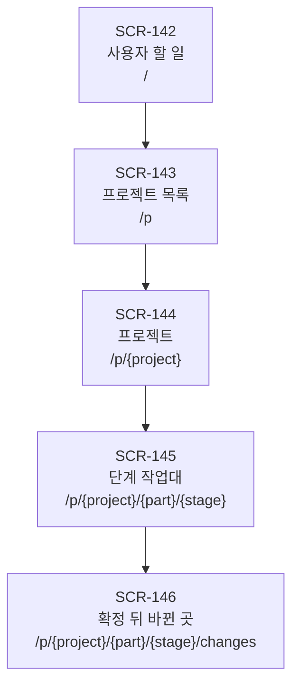

# NEXUS v3: 사이트맵

[English](README.md)

상태: 2026-11-23 통과.

입력: 사용자 흐름(03단계), 기능 명세(04단계), API 계약(06단계, 페이지 주소), 도메인 설계의 읽기 모델(01단계), 그리고 이 단계가 출발점으로 삼은 2026-11-21 클릭 목업(프로젝트 기록에 있음). 원본은 [nexus.yaml](nexus.yaml)이고, hub가 이름이 nexus로 시작하는 파일에만 part nexus를 붙여서 sitemap.yaml 대신 이 이름을 씁니다. 화면 상태는 08단계에서 씁니다.

## 1. 화면

화면 다섯 개를 한 줄기로 둡니다. 헤더의 할 일과 프로젝트 메뉴는 어느 화면에서나 보입니다.

| ID | 화면 | 경로 | 볼 수 있는 사람 | 흐름 | 읽기 모델 |
| --- | --- | --- | --- | --- | --- |
| SCR-142 | 사용자 할 일 | `/` | 게이트로 로그인한 사용자 | FL-001, FL-002, FL-003, FL-006, FL-007, FL-008, FL-011 | CTX-041, TERM-225 |
| SCR-143 | ↳ 프로젝트 목록 | `/p` | 게이트로 로그인한 사용자 | FL-001, FL-002, FL-009, FL-010 | CTX-037, TERM-223 |
| SCR-144 | ↳ ↳ 프로젝트 | `/p/{project}` | 게이트로 로그인한 사용자 | FL-002, FL-006, FL-010, FL-013 | CTX-037, TERM-223 |
| SCR-145 | ↳ ↳ ↳ 단계 작업대 | `/p/{project}/{part}/{stage}` | 게이트로 로그인한 사용자 | FL-001, FL-002, FL-003, FL-004, FL-005, FL-006, FL-007, FL-008, FL-012, FL-013 | CTX-037, TERM-222 |
| SCR-146 | ↳ ↳ ↳ ↳ 확정 뒤 바뀐 곳 | `/p/{project}/{part}/{stage}/changes` | 게이트로 로그인한 사용자 | FL-002, FL-004, FL-006 | CTX-039, TERM-224 |

화면이 없는 읽기 모델: TERM-226(에이전트 할 일: 에이전트는 페이지가 아니라 hub로 읽음).

SCR-145와 SCR-146은 5절의 선택 쿼리 `?d={diagram}`을 받습니다. 03·08·09단계는 파일마다 그림이 하나라 주소가 어느 그림인지 적습니다. 없으면 그 단계의 첫 그림(이름 순)이 열리므로, hub가 주는 단계 링크는 예전처럼 동작합니다.

## 2. 화면마다 보여 주는 것

### SCR-142 사용자 할 일

첫 화면(SPEC-042). 확정할 그림, 답할 AI 제안, 에이전트 질문을 프로젝트마다 최신순으로 보여 주고, 백업 경고도 여기에 나옵니다. 항목을 누르면 그 요소나 스레드가 있는 단계 작업대가 열립니다.

11-21 목업에서: 헤더의 "내 차례 N"은 그대로 두고 이 화면으로 이어집니다. 목업에서는 보드 옆 AI 제안 칸으로 갔습니다.

### SCR-143 프로젝트 목록

사용자의 프로젝트 공간을 통과한 단계 수·할 일 수와 함께 보여 주고, 에이전트 자격을 발급(비밀값은 한 번만 보임)하고 폐기합니다. 도메인 설계에서 두 자격 명령이 이 읽기 모델에서 나옵니다.

11-21 목업에서: 새 화면. 목업은 프로젝트 하나였고, 헤더의 프로젝트 이름이 이 화면으로 가는 메뉴가 됩니다.

### SCR-144 프로젝트

프로젝트 하나. 13단계의 상태와 마지막 체크포인트 날짜, 프로젝트와 단계의 Notion·Jira 링크, #data의 데이터(공간을 지우면 사라지는 것과 삭제, SPEC-013)를 보여 줍니다.

11-21 목업에서: 새 화면. hub가 이미 /p/{project}#data로 링크하고, 06단계에서 그 주소를 지키기로 했습니다.

### SCR-145 단계 작업대

그림 보기. 단계 탭, 그 단계의 그림이나 항목 표, 작업 패널(그림의 상태와 확정, AI 제안, 고른 요소와 스레드)을 보여 줍니다. 워크숍이 열려 있으면 01단계는 여기서 워크숍 보드(스텝마다 프레임 하나, 자유로운 스티커)를 보여 줍니다. 도메인 설계에서 워크숍 명령이 이 읽기 모델에서 나오기 때문입니다. 파트가 없는 프로젝트는 {part}가 _입니다.

11-21 목업에서: 그려진 그대로 이어받습니다. 헤더, 단계 탭, 가운데 보드, 오른쪽 작업 패널의 세 칸, 점선 AI 제안, 범례, 스티커 색, 키보드 조작.

### SCR-146 확정 뒤 바뀐 곳

바뀐 곳 보기. 지난 확정 버전 뒤 더하고 빼고 바뀐 요소를 그 버전 링크와 함께 보여 주고(SPEC-034), 반영을 기다리는 직접 편집(여기서 취소할 수 있음)과 확정을 함께 둡니다.

11-21 목업에서: 작업 패널의 "확정한 뒤 바뀐 곳" 목록은 그대로 두고, "+N개" 줄을 누르면 이 화면이 열립니다.

## 3. 흐름 단계와 화면

사용자에게 무언가를 보여 주는 흐름 단계마다 화면이 있습니다. 단계 글자는 흐름 그림의 상자입니다.

| 흐름 | 단계 | 화면 |
| --- | --- | --- |
| FL-001 | E | SCR-143 |
| FL-001 | F | SCR-145 |
| FL-001 | G | SCR-142 |
| FL-002 | C | SCR-142 |
| FL-002 | D | SCR-143, SCR-144 |
| FL-002 | F, G | SCR-145 |
| FL-002 | H | SCR-145, SCR-146 |
| FL-002 | J, K | SCR-145 |
| FL-002 | R1 | 게이트의 페이지 |
| FL-003 | A, E, F, G, H, I, J, K | SCR-145 |
| FL-003 | F | SCR-142 |
| FL-003 | R2 | SCR-145(휴대폰) |
| FL-004 | A, F | SCR-145 |
| FL-004 | D | SCR-145, SCR-146 |
| FL-004 | E | SCR-146 |
| FL-004 | R1 | SCR-145(휴대폰) |
| FL-005 | F, G, H | SCR-145 |
| FL-006 | A | SCR-142, SCR-145 |
| FL-006 | B, D | SCR-145, SCR-146 |
| FL-006 | E | SCR-145 |
| FL-006 | I | SCR-144, SCR-145 |
| FL-006 | J | SCR-142 |
| FL-006 | R1 | SCR-145(휴대폰) |
| FL-007 | E, F, G | SCR-145 |
| FL-007 | I | SCR-142, SCR-145 |
| FL-008 | A | SCR-142(휴대폰) |
| FL-008 | B, D, R1 | SCR-145(휴대폰) |
| FL-009 | A, B, E | SCR-143 |
| FL-010 | A, C, D, F | SCR-144 |
| FL-010 | E | SCR-143 |
| FL-011 | E | SCR-142 |
| FL-012 | A, B, C, E, F, I, M, N | SCR-145 |
| FL-013 | A, E, F | SCR-144 |
| FL-013 | C, D | SCR-144, SCR-145 |

페이지에 아무것도 보여 주지 않는 단계: 에이전트가 보내고 점유하고 보고하는 일과 그 답. 거절 가운데 FL-001·FL-007의 R1~R3, FL-003의 R1·R3, FL-006의 R2, FL-010·FL-012의 R1, 쉬는 점유 풀기(FL-005 R1), 폐기한 자격 거절(FL-009 F)이 여기 듭니다. 자격의 다이제스트 저장(FL-009 C), 백업 작업과 복원 연습(FL-011)도 그렇습니다. 판단 상자는 그 뒤에 오는 단계의 화면을 따릅니다.

## 4. 11-21 목업과의 관계

v3는 11-21 목업과 따로 새로 기획한 것이 아닙니다. 01·02단계가 11-21~22 결정(그림 작업대, IBM Carbon과 둥근 모서리, 혼자 먼저 쓰기)을 옮겼고, 이 단계는 그 목업의 화면을 출발점으로 삼았습니다. 이어받은 것:

- 헤더: NEXUS, 프로젝트 이름, "내 차례 N", 어두운 화면 스위치.
- 헤더 아래 단계 탭, 단계마다 하나.
- 작업대: 가운데 그림, 오른쪽 작업 패널의 세 칸(그림의 상태와 확정, AI 제안, 고른 요소와 댓글).
- 문서에 들어가기 전의 AI 제안은 그림 위에 점선으로 그리고, 범례에 그 뜻을 적음.
- 경계 컨텍스트별 시간 줄로 그린 도메인 보드, 스티커 여섯 종류와 그 색.
- 끌기나 화살표로 옮기기(Shift는 크게), 두 번 누르기나 F2로 이름 바꾸기.
- PK·FK 표시와 한 개·여러 개 선 끝을 단 ERD 테이블, 이유와 다른 방법을 적은 AI 제안.
- 요소에 단 댓글과 AI·나 표시.
- 01단계에서 정한 대로 IBM Carbon에 둥근 모서리.

01~06단계가 목업과 다르게 정한 곳은 아래와 같습니다. 체크포인트에서 하나씩 묻습니다.

| # | 무엇 | 목업 | 01~06단계 | 추천 |
| --- | --- | --- | --- | --- |
| 1 | 첫 화면 | 프로젝트의 도메인 보드. "내 차례 N"은 보드 옆 AI 제안 칸으로 이동. | 프로젝트를 가로지르는 사용자 할 일이 첫 화면(REQ-052, SPEC-042). | 할 일을 /에 두고, "내 차례 N"은 헤더에 남겨 할 일로 이어지게 하며, 보드 옆 칸은 그 그림의 제안만 보여 줌. 승인된 요구사항이고, 프로젝트가 여럿이라 보드에서 시작하면 다른 프로젝트의 확정과 질문을 놓칩니다. |
| 2 | 프로젝트와 에이전트 자격 | 헤더에 이름만 있는 프로젝트 하나. 자격 화면 없음. | 도구 링크와 데이터·삭제가 있는 여러 프로젝트 공간, 프로젝트 목록에서 발급·폐기하는 자격(SPEC-013, 046, 049, 050). | 헤더의 프로젝트 이름을 프로젝트 메뉴로 하고, 프로젝트 목록(/p, 자격 포함)과 프로젝트(/p/{project}, #data 포함)를 더함. 흐름에 필요하고, 도메인 설계가 이 명령들을 프로젝트 목록에서 주기 때문입니다. |
| 3 | 단계 탭 | 탭 4개: 도메인 보드, ERD, "준비 중"인 사이트맵과 화면 상태. | 13단계 모두. 그림은 01·03·05·07·08·09, 나머지는 항목 표(SPEC-005). | 목업의 탭 줄에 13단계를 모두 넣고(좁으면 가로로 넘김), "준비 중" 대신 항목 표. 그림이 없어도 모든 단계에 읽고 확정할 항목이 있기 때문입니다. |
| 4 | 스티커 더하기·지우기 | 도메인 보드에서 스티커를 마음대로 더하고 지움. | 그려진 그림은 Git 문서에서 나오고, 사용자 직접 편집은 이름 바꾸기와 잇기(SPEC-021). 자유로운 스티커 편집은 워크숍(SPEC-038). | 그려진 보드에서는 옮기기, 이름 바꾸기, 잇기, 댓글. 스티커 더하기·지우기는 워크숍이 열려 있을 때 01단계 작업대가 보여 주는 워크숍 모드에서. 그려진 보드에 요소를 더하려면 승인된 단계에 없는 요구사항이 필요합니다. 댓글로 에이전트에게 부탁하면 제안으로 같은 일을 합니다. |
| 5 | 반영은 수락 뒤 반영 대기 | AI 제안의 "반영"이나 이름 바꾸기가 바로 실선 스티커로 그림에 들어감. | 수락한 제안과 직접 편집은 에이전트가 PR로 문서에 넣을 때까지 기다리고, 그 커밋을 그리면 실선이 됨(SPEC-019, 021, 022, 025). 기다리는 것이 있으면 확정을 거절(SPEC-029). 옮기기만 바로 저장(SPEC-012). | 목업의 조작은 그대로 두고, 버튼 이름은 "수락", 수락한 제안과 편집은 "반영 대기"로 표시, 기다리는 것이 있으면 확정 버튼을 이유와 함께 꺼 둠. Git이 원본으로 남고, 표시가 아직 실선이 아닌 까닭을 알려 줍니다. |
| 6 | 되돌리기 | 반영·거절 뒤 "되돌리기", 스티커의 "AI 이름으로 되돌리기". | 직접 편집은 반영 전에 취소(SPEC-023). 수락과 거절은 되돌리지 않고, 거절한 제안의 스레드는 다른 제안을 위해 열려 있음(SPEC-020). | 직접 편집에만 "편집 취소", 수락과 거절은 한 번 묻고 기록. 수락한 변경은 이미 에이전트 할 일에 있어서, 되돌리면 에이전트의 PR과 엇갈립니다. |
| 7 | 확정 | "이 그림 확정"이 바로 문서에 들어가고, "확정 풀기"로 되돌림. | 확정은 보던 버전으로 기록되고, 에이전트가 PR로 남긴 뒤 모두 기록되면 단계가 통과(SPEC-029~035). 확정은 취소할 수 있음(SPEC-030). | 두 버튼은 그대로 두고, 확정한 뒤 문구가 에이전트가 기록하면 단계가 통과된다고 알려 줌. 승인된 체크포인트 경로이고, 문구만 바뀝니다. |
| 8 | 확정 뒤 바뀐 곳 | 작업 패널에 바뀐 곳 4개까지와 "+N개" 줄. | 지난 확정 버전 뒤의 모든 바뀐 곳을 보는 화면(SPEC-034, TERM-224). | 패널 목록은 그대로, "+N개"를 누르면 바뀐 곳 화면(SCR-146). 도메인 설계에서 바뀐 곳 보기는 따로 된 읽기 모델이고, 편집 취소와 확정이 거기서 나옵니다. |
| 9 | 휴대폰 | 데스크톱만, 너비 1440. | 휴대폰에서는 그림·표를 읽고 댓글을 담. 옮기기, 편집, 수락, 확정은 PC에서(SPEC-051, FL-008). | 같은 화면을 쓰고, 휴대폰에서는 작업 패널이 그림 아래 시트가 되어 댓글만 둠. 이 상태는 08단계에서 씀. 이동 중에 읽고 댓글 다는 것은 승인된 흐름이고, 화면을 하나로 두면 페이지마다 주소가 하나입니다. |

## 5. 주소

- hub가 링크하는 `/p/{project}/{part 또는 _}/{stage}`와 `/p/{project}#data`는 06단계에서 정한 대로 그대로입니다.
- 단계 작업대와 그 바뀐 곳 페이지에서 그림 하나는 `?d=<그림 ID>`로, 단계 작업대에서 스레드 하나는 `?thread=<스레드 ID>`로 가리킵니다. 같은 화면의 상태라 화면을 따로 두지 않습니다.
- 로그인은 게이트가 맡고, 들어오지 못한 사람은 게이트의 페이지를 봅니다. NEXUS에는 로그인 화면이 없습니다(SPEC-048).

## 6. 체크포인트

내비게이션 구조에 합의합니다. 이 단계가 없애거나 미루거나 바꾸는 승인된 항목: 없음. 모든 흐름이 화면을 가집니다. 4절의 다른 점은 하나씩 따로 묻고, 답이 없으면 01~06단계에서 승인한 대로 남습니다.

2026-11-23 통과. 관리자가 체크포인트를 맡긴 대리인을 거쳐 추천안을 모두 승인했습니다. 답은 프로젝트 기록에 있습니다.

### 2026-11-23 기능 변경

관리자가 사용자 흐름, 화면 상태, 목업을 첫 릴리스부터 그리기로 정했고, 그 원본은 hub가 보냅니다. 이 변경이 건드리는 승인 항목은 하나씩 여쭸고, 관리자가 체크포인트용으로 정한 대리인을 통해 승인했습니다. 답은 프로젝트 기록에 있습니다. 여기서는: 4절 다른 점 3이 03·08·09단계도 그림으로 그립니다. 사이트맵은 그대로입니다. 이 단계 몫은 2026-11-23에 같은 대리인을 통해 따로 체크포인트를 통과했습니다.

#### PR 104 리뷰 뒤

승인된 항목 1개가 바뀌었고, 하나씩 여쭈어 같은 대리인을 통해 승인했습니다. SCR-145와 그 아래 SCR-146의 주소가 그림이 여럿인 단계를 위해 선택 쿼리 `?diagram={diagram}`을 받습니다. 경로와 트리는 그대로입니다. 이 몫은 2026-11-23에 같은 대리인을 통해 따로 체크포인트를 통과했습니다.

#### PR 104 두 번째 리뷰 뒤

승인된 항목 1개가 바뀌었고, 하나씩 여쭈어 같은 대리인을 통해 승인했습니다. 쿼리는 새 `?diagram=`이 아니라 5절에 이미 있는 `?d=`입니다. 그래서 할 일에서 연 그림과 목록에서 연 그림이 똑같이 동작합니다. 이 몫은 2026-11-23에 같은 대리인을 통해 따로 체크포인트를 통과했습니다.

#### PR 104 세 번째 리뷰 뒤

5절의 `?thread=`는 단계 작업대에만 둡니다. 바뀐 곳 페이지에는 스레드가 없습니다. 바뀐 승인 항목은 없습니다. 이 몫은 2026-11-23에 같은 대리인을 통해 따로 체크포인트를 통과했습니다.

#### PR 104 일곱 번째 리뷰 뒤

승인된 항목 1개가 바뀌었고, 하나씩 여쭈어 같은 대리인을 통해 승인했습니다. SCR-145와 SCR-146의 `?d=`는 열린 스레드가 있어 목록에 남은 지운 그림도 받습니다(SPEC-027). 그래서 그 스레드에 갈 수 있습니다. 이 몫은 2026-11-23에 같은 대리인을 통해 따로 체크포인트를 통과했습니다.

### 2026-11-24 기능 변경

지운 그림은 자기를 기다리는 것을 지킵니다(기능 명세 6절). 이 단계는 바뀌지 않습니다. SCR-145와 SCR-146의 `?d=`는 "a removed one still listed (SPEC-027)"를 받고, 무엇이 그림을 목록에 남기든 SPEC-027의 목록을 따릅니다. 경로와 트리는 그대로입니다. 이 몫은 따로 체크포인트를 기다려요.
