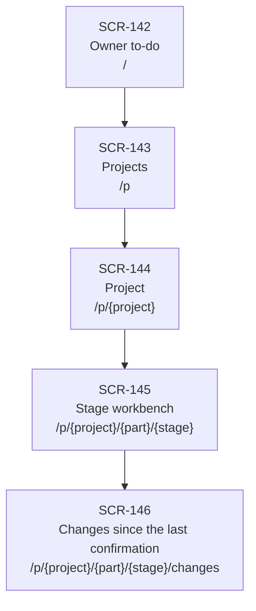

# NEXUS v3: sitemap

[한국어](README.ko.md)

Status: passed on 2026-11-23.

Inputs: the user flows (stage 03), the functional spec (stage 04), the API contract (stage 06, for the page addresses), the read models of the domain design (stage 01), and the click mockup of 2026-11-21, kept in the project's records, which this stage starts from. The source is [nexus.yaml](nexus.yaml), named after the part nexus rather than sitemap.yaml, because the hub gives the part only to files whose names start with it. Screen states are stage 08.

## 1. Screens

Five screens in one branch. The header's to-do and project menu show on every screen.

| ID | Screen | Path | Who can see it | Flows | Read model |
| --- | --- | --- | --- | --- | --- |
| SCR-142 | Owner to-do | `/` | the owner, signed in through the gate | FL-001, FL-002, FL-003, FL-006, FL-007, FL-008, FL-011 | CTX-041, TERM-225 |
| SCR-143 | ↳ Projects | `/p` | the owner, signed in through the gate | FL-001, FL-002, FL-009, FL-010 | CTX-037, TERM-223 |
| SCR-144 | ↳ ↳ Project | `/p/{project}` | the owner, signed in through the gate | FL-002, FL-006, FL-010, FL-013 | CTX-037, TERM-223 |
| SCR-145 | ↳ ↳ ↳ Stage workbench | `/p/{project}/{part}/{stage}` | the owner, signed in through the gate | FL-001, FL-002, FL-003, FL-004, FL-005, FL-006, FL-007, FL-008, FL-012, FL-013 | CTX-037, TERM-222 |
| SCR-146 | ↳ ↳ ↳ ↳ Changes since the last confirmation | `/p/{project}/{part}/{stage}/changes` | the owner, signed in through the gate | FL-002, FL-004, FL-006 | CTX-039, TERM-224 |

Read model without a screen: TERM-226 (Agent to-do: agents read it through the hub, not on a page).

## 2. What each screen shows

### SCR-142 Owner to-do

The first screen (SPEC-042): diagrams to confirm, AI proposals to answer and agent questions, newest first, per project, with backup warnings. Each entry opens its stage workbench at the element or thread it is about.

From the 2026-11-21 mockup: The header's "My turn N" counter stays and now opens this screen; in the mockup it jumped to the board's AI proposals.

### SCR-143 Projects

The owner's project spaces with each stage's state and tool links, and the agent credentials: issue one, whose secret shows once, and revoke one. The domain design gives both credential commands from this read model.

From the 2026-11-21 mockup: New. The mockup had one project; the project name in its header becomes the way here.

### SCR-144 Project

One project: its 13 stages with state and the date of the last checkpoint, the Notion and Jira links of the project and its stages, and its data at #data: what deleting the space removes, and the deletion (SPEC-013).

From the 2026-11-21 mockup: New. The hub already links to /p/{project}#data, which stage 06 kept.

### SCR-145 Stage workbench

The diagram view: the stage tabs, the stage's diagram or item table, and the work panel with the diagram's state and confirmation, its AI proposals, and the selected element with its threads. While a workshop is open, stage 01 shows the workshop board here, with one frame per step and free sticky notes, as the domain design gives the workshop commands from this read model. {part} is _ for a project without parts.

From the 2026-11-21 mockup: Carried over as drawn: the header, the stage tabs, the board in the middle and the work panel on the right with its three sections, dashed AI proposals, the legend, the sticky colours and the keyboard moves.

### SCR-146 Changes since the last confirmation

The diff view: every element added, removed or changed since the last confirmed version, before and after (SPEC-034), with the direct edits waiting for reflection, which can be cancelled here, and the confirmation.

From the 2026-11-21 mockup: The work panel's "changed since confirmation" list stays; its "+N more" line opens this screen.

## 3. Flow steps and screens

Every flow step that shows the owner something has a screen. The letters are the boxes of the flow diagrams.

| Flow | Steps | Screen |
| --- | --- | --- |
| FL-001 | E | SCR-143 |
| FL-001 | F | SCR-145 |
| FL-001 | G | SCR-142 |
| FL-002 | C | SCR-142 |
| FL-002 | D | SCR-143, SCR-144 |
| FL-002 | F, G | SCR-145 |
| FL-002 | H | SCR-145, SCR-146 |
| FL-002 | J, K | SCR-145 |
| FL-002 | R1 | the gate's page |
| FL-003 | A, E, F, G, H, I, J, K | SCR-145 |
| FL-003 | F | SCR-142 |
| FL-003 | R2 | SCR-145 on a phone |
| FL-004 | A, F | SCR-145 |
| FL-004 | D | SCR-145, SCR-146 |
| FL-004 | E | SCR-146 |
| FL-004 | R1 | SCR-145 on a phone |
| FL-005 | F, G, H | SCR-145 |
| FL-006 | A | SCR-142, SCR-145 |
| FL-006 | B, D | SCR-145, SCR-146 |
| FL-006 | E | SCR-145 |
| FL-006 | I | SCR-144, SCR-145 |
| FL-006 | J | SCR-142 |
| FL-006 | R1 | SCR-145 on a phone |
| FL-007 | E, F, G | SCR-145 |
| FL-007 | I | SCR-142, SCR-145 |
| FL-008 | A | SCR-142 on a phone |
| FL-008 | B, D, R1 | SCR-145 on a phone |
| FL-009 | A, B, E | SCR-143 |
| FL-010 | A, C, D, F | SCR-144 |
| FL-010 | E | SCR-143 |
| FL-011 | E | SCR-142 |
| FL-012 | A, B, C, E, F, I, M, N | SCR-145 |
| FL-013 | A, E, F | SCR-144 |
| FL-013 | C, D | SCR-144, SCR-145 |

Steps that show nothing on a page: what agents send, claim and report, and the answers they get, among them the refusals R1 to R3 of FL-001 and FL-007, R1 and R3 of FL-003, R2 of FL-006 and R1 of FL-010 and FL-012, the release of an idle claim (FL-005 R1) and the refusal of a revoked credential (FL-009 F); storing a credential's digest (FL-009 C); and the backup jobs and restore rehearsal (FL-011). A decision box takes the screen of the step it leads to.

## 4. The 2026-11-21 mockup

v3 is not planned apart from the 2026-11-21 mockup. Stages 01 and 02 carried its decisions (the drawing workbench, IBM Carbon with rounded corners, one person first), and this stage starts from its screens. Carried over:

- The header: NEXUS, the project name, the "My turn N" counter and the dark-screen switch.
- The stage tabs under the header, one per stage.
- The workbench: the diagram in the middle and the work panel on the right with three sections, the diagram's state and confirmation, the AI proposals, and the selected element with its comments.
- AI proposals drawn dashed over the diagram until they are in the document, with a legend line that says so.
- The domain board in time lanes per bounded context, the six sticky kinds and their colours.
- Moving by drag or arrow keys (Shift for long steps) and renaming by double click or F2.
- ERD tables with PK and FK marks and one-or-many line ends; an AI proposal with its reason and the other way.
- Comments on an element with AI and owner badges.
- IBM Carbon with rounded corners, as stage 01 decided.

Where stages 01 to 06 decided otherwise than the mockup; each is asked on its own at the checkpoint:

| # | What | Mockup | Stages 01 to 06 | Recommended |
| --- | --- | --- | --- | --- |
| 1 | The first screen | A project's domain board; "My turn N" jumps to the board's AI proposals. | The owner's to-do across projects is the first screen (REQ-052, SPEC-042). | The to-do at /; "My turn N" stays in the header and opens it, and the board's panel keeps only that diagram's proposals. It is an approved requirement, and with several projects a board as the first screen hides the other projects' confirmations and questions. |
| 2 | Projects and agent credentials | One project, named in the header; no credentials. | Several project spaces with tool links, data and deletion; credentials issued and revoked from the project list (SPEC-013, SPEC-046, SPEC-049, SPEC-050). | The project name in the header opens a project menu; add Projects (/p, with the credentials) and Project (/p/{project}, with #data). The flows need them, and the domain design gives these commands from the project list. |
| 3 | The stage tabs | Four tabs: domain board, ERD, and sitemap and screen states marked "coming". | All 13 stages; pictures for 01, 05 and 07, item tables for the rest (SPEC-005). Flow, screen-state and mockup pictures are out of the first release (stage 06). | Keep the mockup's tab row with all 13 stages, scrolling sideways when narrow, and an item table instead of "coming". Every stage has items to read and confirm, even without a picture. |
| 4 | Adding and removing stickies | The domain board adds and removes stickies freely. | A drawn diagram comes from its Git document; the owner's direct edits are renames and connections (SPEC-021). Free sticky editing belongs to a workshop (SPEC-038). | On a drawn board: move, rename, connect and comment. Adding and removing stickies works in workshop mode, which the stage-01 workbench shows while a workshop is open. Adding an element to a drawn board would need a requirement the approved stages do not have; asking an agent in a comment does the same through a proposal. |
| 5 | Apply means accept, then wait for reflection | "Apply" on an AI proposal, or a rename, goes straight into the diagram as a solid sticky. | An accepted proposal or a direct edit waits for an agent to reflect it into the document through a pull request, and turns solid when that commit is drawn (SPEC-019, 021, 022, 025). Confirmation is refused while anything waits (SPEC-029); only moving is stored at once (SPEC-012). | Keep the mockup's moves; name the button "Accept"; show accepted proposals and edits as "waiting for reflection"; disable confirmation with its reason while anything waits. Git stays the source; the mark tells the owner why a change is not solid yet. |
| 6 | Undo | "Undo" after applying or rejecting, and "back to the AI's name" on a sticky. | A direct edit can be cancelled before it is reflected (SPEC-023); accepting and rejecting are not undone, and a rejected proposal leaves its thread open for another (SPEC-020). | "Cancel edit" for direct edits only; accept and reject ask once and then record. An accepted change is already in an agent's to-do; undoing it would race the agent's pull request. |
| 7 | Confirmation | "Confirm this diagram" puts it into the document at once; "Unconfirm" undoes it. | A confirmation is recorded with the version shown; an agent records it in a pull request, and the stage passes once all are recorded (SPEC-029 to SPEC-035). A confirmation can be cancelled (SPEC-030). | Keep both buttons; the message after confirming says the agent records it and the stage passes then. It is the approved checkpoint path; only the wording changes. |
| 8 | Changes since confirmation | Up to four changes in the work panel and a "+N more" line. | A diff view of every change since the last confirmed version (SPEC-034, TERM-224). | Keep the panel list; "+N more" opens the changes screen (SCR-146). The domain design has the diff view as its own read model, where an edit is cancelled and a diagram confirmed. |
| 9 | Phones | Desktop only, 1440 wide. | On a phone the owner reads diagrams and tables and comments; moving, editing, accepting and confirming wait for a PC (SPEC-051, FL-008). | The same screens; on a phone the work panel becomes a sheet under the diagram with comments only. Stage 08 writes these states. Reading and commenting on the move is an approved flow; one set of screens keeps one address per page. |

## 5. Addresses

- The addresses the hub links to, `/p/{project}/{part or _}/{stage}` and `/p/{project}#data`, stay as stage 06 decided.
- On the stage workbench, `?d=<diagram ID>` names one diagram and `?thread=<thread ID>` one thread. They are states of the same screen, so they have no screen of their own.
- The gate keeps the sign-in, and someone it does not admit sees the gate's page; NEXUS has no sign-in screen (SPEC-048).

## 6. Checkpoint

The navigation structure is agreed. Approved items that this stage removes, defers or changes: none; every flow has its screens. Each difference in section 4 is asked on its own; without its own answer, stages 01 to 06 stand as approved.

Passed on 2026-11-23. The maintainer approved every recommendation through the delegate they named for checkpoints; the answer is in the project's records.
