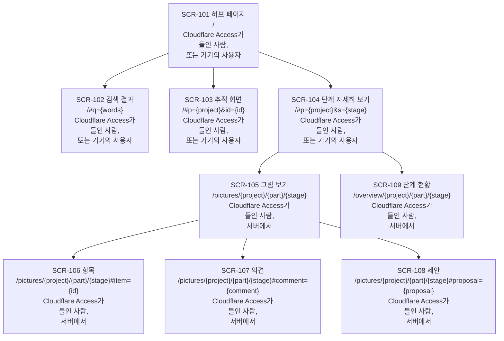

# NEXUS: 사이트맵

[English](nexus.md)

CORTHEX 자신의 프로젝트에서 NEXUS 0.2의 07단계입니다: [nexus.yaml](nexus.yaml)에 있는 허브 페이지와 NEXUS 서버의 화면, 그리고 이 파일에 있는 화면마다 보여 주는 것, 그 파일에서 그린 보드와 목록, 화면마다 보여 주는 사용자 흐름의 단계입니다. 상태: 2026-11-03에 관리자가 2026-11-02에 고른 대로 기억 플러그인을 만드는 동안, 사용자 흐름, 기능 명세, 서버의 자료, 인터페이스의 추천을 따라 초안을 썼습니다. 관리자가 같은 날 03\~06단계, 08단계와 함께 이 파일의 확인 지점을 통과시켰습니다. 2026-11-03에 관리자가 01단계 이벤트 스토밍을 NEXUS에서 하기로 고르면서 그림 보기에 스텝별 보기와 ② 차례의 워크숍을 새 화면 없이 더했고, 이것은 관리자의 확인을 기다립니다([확인할 것](#확인할-것)). YAML이 화면의 원본이고, 이 파일은 그것을 설명하며 나머지의 원본입니다. 이 번역과 영어 원문이 다르면 영어 원문이 원본입니다.

입력: [docs/03-user-flow/nexus/](../03-user-flow/nexus/README.ko.md)의 사용자 흐름(FL-101\~FL-116); [docs/04-functional-spec/nexus.ko.md](../04-functional-spec/nexus.ko.md)의 기능 명세(SPEC-101\~SPEC-142), 특히 그 [07·08단계를 위한 메모](../04-functional-spec/nexus.ko.md#0708단계-화면); [docs/06-api/nexus.ko.md](../06-api/nexus.ko.md)의 인터페이스와 그 안의 페이지 요청 API-101\~API-103, 사이트맵의 그림 자료 형식, [07·08단계를 위한 메모](../06-api/nexus.ko.md#0708단계-화면); [docs/05-erd/nexus.ko.md](../05-erd/nexus.ko.md)의 서버의 자료와 그 [07·08단계를 위한 메모](../05-erd/nexus.ko.md#0708단계-화면); [docs/01-domain/nexus.ko.md](../01-domain/nexus.ko.md)의 DDD 보드와 용어집(화면은 그 읽기 모델을 적고, 이 파일은 그 말을 그 뜻으로 씁니다); 그리고 지금 도는 1차의 허브 페이지 [hub.html](../../plugins/corthex-nexus/skills/corthex-hub/assets/hub.html)이며, 그 보기에는 저마다 주소가 있습니다. 기억 플러그인에는 화면이 없으므로 이 단계에는 그 파일이 없습니다.

이 단계의 기본 사람 화면은 YAML에서 그린 세 보기, 곧 보드, 목록, 슬라이드가 있는 페이지입니다. 여기서는 이 파일이 nexus.yaml에서 그린 보드와 목록을 담고, 사람은 그것을 프로젝트의 Notion 기록에 있는 한국어 사본으로 읽으며, 목록은 거기서 데이터베이스입니다. 회의가 아니라 한 사람이 사이트맵을 확인하므로 슬라이드는 없습니다([8번 선택](#이-단계가-고른-것)). NEXUS 0.2부터는 NEXUS가 nexus.yaml에서 이 사이트맵을 직접 그립니다(REQ-142). `.corthex/project.json`이 이 선택을 적어 둡니다.

## 이 파일을 읽는 법

- 화면은 [nexus.yaml](nexus.yaml)이 정하는 SCR-101\~SCR-109입니다. 화면마다 `children` 아래 중첩에서 오는 상위 화면, 경로, 볼 수 있는 사람, 흐름, 용어, 상태가 있습니다.
- 경로는 서버에서의 페이지 주소이며, 계약 [nexus.openapi.yaml](../06-api/nexus.openapi.yaml)이 그 요청을 적는 대로 `{project}`, `{part}`, `{stage}`를 써서 적습니다. `#` 뒤는 보기나 패널의 페이지 자신의 주소로, 브라우저가 지니고 서버로 보내지 않습니다([주소](#주소)).
- 화면의 흐름은 그 화면이 보여 주는 단계가 있는 흐름입니다. 그런 단계는 흐름 안에서 요구사항 뒤에 `REQ-102 · SCR-101`처럼 화면의 ID를 적습니다([화면 위의 흐름](#화면-위의-흐름)).
- 화면의 용어는 그 컨텍스트와, 그 화면이 나타내는 DDD 보드의 읽기 모델의 TERM ID, 또는 `none`입니다([용어](#용어)).
- 상태: 04\~06단계처럼, NEXUS 0.2가 그대로 두는 1차의 보기는 `built`, 0.2가 더하거나 바꾸는 것은 `active`입니다.
- 비어 있음, 읽는 중, 오래됨 같은 화면의 상태는 따로 화면이 아닙니다. 화면마다의 상태는 08단계가 정합니다.

## 화면

- **SCR-101 허브 페이지**, `/`: 모든 프로젝트를 현재 단계와 다음 행동을 먼저, 그다음 13단계와 그 상태, 항목 수, 점검 결과와 함께 보여 주고, 스냅샷마다 언제 어느 커밋에서 만들었는지 보여 줍니다(SPEC-122, 1차에서 만듦). NEXUS 0.2는 부분마다의 상태, 열린 것의 개수, 기록을 기다리는 확인 지점, 먼저 물을 일, 빈 서버의 설명을 더합니다(SPEC-123\~SPEC-125). 허브는 같은 페이지를 기기에서 파일로, 기본값으로는 `~/.corthex/hub/index.html`에, 서버의 링크와 개수 없이 만듭니다.
- **SCR-102 검색 결과**, `/#q={words}`: ID나 제목의 낱말에 맞는 항목(SPEC-122).
- **SCR-103 추적 화면**, `/#p={project}&id={id}`: 한 항목이 모든 단계를 거쳐 어디서 왔고 어디로 이어지는지(SPEC-122).
- **SCR-104 단계 자세히 보기**, `/#p={project}&s={stage}`: 한 프로젝트의 한 단계와 그 상태, 마지막 확인 지점, 다음 행동, 점검 결과, 항목, 그리고 그 사람 화면으로 가는 링크(SPEC-122). NEXUS 0.2는 이것을 부분마다 보여 주고, 서버에서는 부분마다 그림 보기와 단계 현황으로 잇습니다(SPEC-123, SPEC-138).
- **SCR-105 그림 보기**, `/pictures/{project}/{part}/{stage}`: 한 부분의 한 단계 그림, 곧 DDD 보드, ERD, 사이트맵을 그 문서 판, 그리고 그 항목 위의 열린 의견, 제안, 어긋남과 함께 보여 주고, 항목이 없어진 열린 의견은 따로 보여 줍니다(SPEC-119). 그 부분의 단계 현황으로 잇습니다. DDD 보드는 여기서 타임라인부터 보드 전체까지 스텝별로 따라가 볼 수 있습니다(SPEC-141). PC에서는 ② 차례에 여기서 그림을 고치고(SPEC-134), DDD 보드와 따로 작업 보드에서 01단계 워크숍을 합니다(SPEC-142).
- **SCR-106 항목**, `/pictures/{project}/{part}/{stage}#item={id}`: 그림의 한 항목을 그 추적 ID로, 그 의견, 제안, 어긋남과 함께 보여 주며, 사용자는 여기서 의견을 남깁니다(SPEC-119, SPEC-126).
- **SCR-107 의견**, `/pictures/{project}/{part}/{stage}#comment={comment}`: 의견 하나를 그 `nc_` ID로, 모든 답글과 그 결정과 함께 보여 주며, 사용자는 여기서 답글을 달고, 답이 났다고 표시하고, 의견을 정하거나 다시 엽니다(SPEC-127, SPEC-132).
- **SCR-108 제안**, `/pictures/{project}/{part}/{stage}#proposal={proposal}`: 제안 하나를 그 `np_` ID로, 그 까닭, 그것이 바꾸는 단계별 원본의 글, 그 반영의 상태와 함께 보여 줍니다. 사용자는 여기서 제안을 받거나 버리고, 반영이 사용자를 필요로 하면 그 반영을 버립니다(SPEC-131, SPEC-133).
- **SCR-109 단계 현황**, `/overview/{project}/{part}/{stage}`: 한 부분의 단계에 남은 것, 곧 그 열린 어긋남, 의견, 반영 대기를 함께, 그리고 기록된 상태, 확인 지점, 점검 결과를 보여 주며, 사용자는 여기서 확인 지점을 통과시키거나 NEXUS에서 통과시킨 것을 철회합니다(SPEC-138, SPEC-139). 항목마다 그림 보기의 그 항목, 의견, 제안으로 잇습니다.

## 보드

2026-11-03에 nexus.yaml에서 그렸습니다: 화면마다 ID, 이름, 경로, 볼 수 있는 사람, 그리고 상위 화면에서 하위 화면마다 가는 화살표.

<!-- board: drawn from nexus.yaml -->

<!-- end of board -->

## 목록

2026-11-03에 nexus.yaml에서 그렸고, 나무의 차례대로 화면마다 한 줄입니다.

<!-- list: drawn from nexus.yaml -->
| 화면 | 이름 | 상위 | 경로 | 볼 수 있는 사람 | 흐름 | 용어 | 상태 |
| --- | --- | --- | --- | --- | --- | --- | --- |
| SCR-101 | 허브 페이지 | 없음 | `/` | Cloudflare Access가 들인 사람, 또는 기기의 사용자 | FL-105, FL-113 | `none` | active |
| SCR-102 | 검색 결과 | SCR-101 | `/#q={words}` | Cloudflare Access가 들인 사람, 또는 기기의 사용자 | FL-105 | `none` | built |
| SCR-103 | 추적 화면 | SCR-101 | `/#p={project}&id={id}` | Cloudflare Access가 들인 사람, 또는 기기의 사용자 | FL-105 | `none` | built |
| SCR-104 | 단계 자세히 보기 | SCR-101 | `/#p={project}&s={stage}` | Cloudflare Access가 들인 사람, 또는 기기의 사용자 | FL-105, FL-113 | `none` | active |
| SCR-105 | 그림 보기 | SCR-104 | `/pictures/{project}/{part}/{stage}` | Cloudflare Access가 들인 사람, 서버에서 | FL-106, FL-110, FL-115, FL-116 | CTX-014, TERM-111 | active |
| SCR-106 | 항목 | SCR-105 | `/pictures/{project}/{part}/{stage}#item={id}` | Cloudflare Access가 들인 사람, 서버에서 | FL-106, FL-107 | CTX-014, TERM-111 | active |
| SCR-107 | 의견 | SCR-105 | `/pictures/{project}/{part}/{stage}#comment={comment}` | Cloudflare Access가 들인 사람, 서버에서 | FL-107, FL-109 | CTX-014, TERM-111 | active |
| SCR-108 | 제안 | SCR-105 | `/pictures/{project}/{part}/{stage}#proposal={proposal}` | Cloudflare Access가 들인 사람, 서버에서 | FL-110 | CTX-014, TERM-111 | active |
| SCR-109 | 단계 현황 | SCR-104 | `/overview/{project}/{part}/{stage}` | Cloudflare Access가 들인 사람, 서버에서 | FL-113 | CTX-007, TERM-120 | active |
<!-- end of list -->

## 화면 위의 흐름

화면에서 사용자에게 무언가를 보여 주는 단계는 모두 그 화면을 적습니다. 기기, 서버, 세션에서 도는 흐름은 자기 화면에 아무것도 보여 주지 않습니다: 허브가 그 명령의 결과(API-133\~API-150)로 세션에서 알리고, 화면은 다음에 열릴 때 그 결과를 보여 줍니다. "그림 보기를 엶, FL-106"처럼 다른 흐름으로 넘기기만 하는 단계는, 그 흐름이 화면을 적으므로 화면을 적지 않습니다.

<!-- flows: drawn from nexus.yaml -->
| 흐름 | 도는 곳 | 그 단계의 화면 |
| --- | --- | --- |
| FL-101 | 기기의 허브에서 | 없음: 허브가 세션에서 알림 |
| FL-102 | 기기의 허브에서 | 없음: 허브가 세션에서 알림 |
| FL-103 | 서버에서 | 없음: 허브가 세션에서 알림 |
| FL-104 | 서버에서 | 없음: 허브가 세션에서 알림 |
| FL-105 | 브라우저와 기기에서 | SCR-101, SCR-102, SCR-103, SCR-104 |
| FL-106 | 브라우저에서 | SCR-105, SCR-106 |
| FL-107 | 브라우저에서 | SCR-106, SCR-107 |
| FL-108 | 세션에서 | 없음: 허브가 세션에서 알림 |
| FL-109 | 세션에서. 그 답과 결정은 의견에 보임 | SCR-107 |
| FL-110 | 브라우저에서 | SCR-105, SCR-108 |
| FL-111 | 세션에서 | 없음: 허브가 세션에서 알림 |
| FL-112 | 세션에서 | 없음: 허브가 세션에서 알림 |
| FL-113 | 브라우저와 세션에서 | SCR-101, SCR-104, SCR-109 |
| FL-114 | 기기의 허브에서 | 없음: 허브가 세션에서 알림 |
| FL-115 | PC의 브라우저에서, ② 차례 | SCR-105 |
| FL-116 | PC의 브라우저에서, ② 차례 | SCR-105 |
<!-- end of flows -->

## 주소

- 세 페이지는 계약의 페이지입니다: 허브 페이지(API-101), 그림 보기(API-102), 단계 현황(API-103). 서버는 다른 페이지를 내주지 않습니다.
- 허브 페이지는 `#` 뒤에 1차의 주소를 그대로 둡니다: 검색은 `q`, 추적 화면은 `p`와 `id`, 단계 자세히 보기는 `p`와 `s`이며, URL의 쿼리와 같은 꼴입니다.
- 그림 보기의 패널도 같은 꼴의 주소를 받습니다: 추적 ID와 함께 `item`, `nc_` ID와 함께 `comment`, `np_` ID와 함께 `proposal`. 이 주소가 든 링크는 단계 현황에서든, 허브 페이지에서든, 세션의 에이전트 메시지에서든 그 패널을 바로 열며, 휴대폰에서도 그렇습니다. 패널을 닫으면 주소가 그림의 주소로 돌아가고, 브라우저의 뒤로 가기 버튼이 패널을 닫습니다. 서버는 `#` 뒤를 보지 못하므로 바뀌는 요청이 없습니다.
- DDD 보드의 스텝은 `#step=6`처럼 `1-b`부터 `9`까지의 스텝 열쇠와 함께 `step`을 받고, `#step=6&item=CTX-012`처럼 열린 패널 곁에서도 그것을 지킵니다. 그것이 없거나 보드에 없는 열쇠면 그림 보기는 보드 전체를 보여 줍니다(SPEC-141).
- 그림에 없는 항목, 의견, 제안의 주소는 그림 보기를 열고 그렇다고 알립니다. 그 상태는 08단계가 그립니다.
- 경로에서 `{part}`는, 계약의 요청처럼, 프로젝트 전체이면 `_`입니다.

## 누가 무엇을 볼 수 있는지

- 서버에서는 모든 페이지가 Cloudflare Access 뒤에 있고, Access는 NEXUS가 답하기 전에 그 밖의 사람을 자기 페이지로 거절합니다(FL-105, FL-106). 그 페이지는 Cloudflare의 것이고 NEXUS의 화면이 아닙니다.
- 허브 페이지와 그 세 보기는 기기에서도, 그 기기의 사용자가 여는 파일로, 서버의 링크와 개수 없이 만들어집니다(SPEC-123).
- 그림 보기, 그 세 패널, 단계 현황은 서버에만 있습니다. 프로젝트 공간은 서버만 지니기 때문입니다.
- 화면이 사용자에게 하게 하는 일은 계약의 로그인을 따릅니다: 제안 받기나 버리기, 반영 버리기, 확인 지점 통과시키기나 철회하기는 사람 자신의 로그인이 있어야 하고(API-124, API-125, API-127\~API-129), 의견, 답글, 답이 났다는 표시는 어느 로그인으로도 됩니다(API-118\~API-120). 화면은 그것이 보여 주는 모든 사람에게 같은 것을 보여 주고, 거절이 무엇을 보여 주는지는 08단계가 그립니다.

## 용어

NEXUS는 한 부분의 DDD 보드에 있는 읽기 모델마다 그 부분의 사이트맵에서 그 읽기 모델의 용어를 적은 화면과 짝을 짓고, 서로 맞지 않는 곳에 어긋남을 엽니다(02단계의 D10, REQ-153, SPEC-120, SPEC-121). 단계 스킬은 에이전트에게 그 용어를 적게 하며(REQ-154, SPEC-137), 여기서는 화면마다의 `terms`에 적었습니다:

- 그림 보기와 그 세 패널은 논의(CTX-014)의 그림 보기(TERM-111)를 적습니다. 논의는, 사용자가 의견을 남기거나 제안을 받거나 버리기 전에 이것을 보는 명령 줄이 있는 컨텍스트입니다.
- 단계 현황은 단계 진행(CTX-007)의 단계 현황(TERM-120)을 적습니다.
- 허브 페이지와 그 보기는 `terms: none`입니다. 허브의 컨텍스트 CTX-006, CTX-008, CTX-009에는 보드에 읽기 모델이 없으므로 용어를 적으면 어긋남이 열립니다. 05단계가 그 컨텍스트의 테이블에 `terms: none`을 적은 것과 같습니다(그 7번 선택).
- AI 할 일(TERM-121)에는 화면이 없습니다: 에이전트가 허브를 거쳐 그것을 읽습니다(SPEC-135). YAML은 그것을 `# without a screen:` 뒤에 적으므로, 그것을 적는 화면을 기다리는 어긋남은 없습니다.

그러면 NEXUS가 자기 그림끼리 하는 점검은 이 사이트맵과 보드 사이에서 어긋남을 찾지 않아야 하며, 12단계가 그것을 확인합니다. [3번 변경](#앞-단계의-변경)은 여러 컨텍스트에서 읽는 읽기 모델에 관한 것입니다.

## 사이트맵 밖의 것

- Cloudflare Access의 로그인 페이지와 그 거절.
- Notion과 Miro 같은 다른 도구에 있는 단계의 사람 화면. 단계 자세히 보기가 그것으로 잇습니다(REQ-095).
- 허브가 세션에서 하는 말. 그 명령의 결과가 정합니다(API-133\~API-150).
- PC에서의 편집과 작업 보드의 워크숍, 곧 ② 차례(FL-115, FL-116, SPEC-134, SPEC-142). 폭이 1024픽셀 이상인 그림 보기에서 하며, 자기 화면이 필요한지는 ② 차례가 정합니다. ③ 차례의 도구 링크에는 아직 화면이 없습니다.

## 앞 단계의 변경

2026-11-03에 확인 지점을 통과하며 반영했습니다. 1과 2는 사용자 흐름에, 3은 기능 명세에, 그리고 같은 답에 담긴 관리자의 승인으로 01단계의 명령 행에 들어갔습니다. 흐름 단계의 SCR ID는 이 단계 자신의 단계이며 이미 흐름에 들어 있습니다. 06단계의 사이트맵 예시 둘도 이 단계와 함께 바뀌었습니다: 허브가 사이트맵을 읽자, 거기 있던 양식의 예시 화면 ID 두 개를 언급했지만 정의하지 않은 것으로 알렸습니다. 이제 YAML의 예시는 nexus.yaml의 화면 둘을 보이고, 계약의 예시 `picture_data_sitemap`은 화면의 ID를 뺍니다. 둘 다 규칙은 바꾸지 않습니다.

1. FL-105의 "사용자가 무엇을 하나?"에 갈래가 하나 더 생깁니다: 사용자가 단계의 현황을 엶, FL-113. SPEC-138은 그림 보기뿐 아니라 허브 페이지에서도 현황을 열고, 단계 자세히 보기가 그것으로 잇습니다.
2. FL-107에서 의견이 그 항목에 보인 뒤에 단계가 하나 더 생깁니다: 사용자와 에이전트가 그 아래에 답글을 달고, 사용자는 답이 났다고 표시하거나, 의견을 정하거나, 다시 열 수 있습니다(REQ-163, REQ-166). 화면은 SCR-107입니다. 지금은 SPEC-127만 이것을 담고 FL-107의 어느 단계도 의견의 답글을 보여 주지 않으므로, SCR-107의 흐름에는 FL-109만 있습니다. 이 단계가 생기면 FL-107이 더해집니다.
3. 보드에는 여러 컨텍스트에서 읽는 읽기 모델이 있습니다: 그림 보기는 논의(CTX-014)와 편집(CTX-010)에서, AI 할 일은 그 둘 다에서 읽는데, 화면은 컨텍스트를 하나만 적습니다. SPEC-121에 규칙이 하나 더해집니다: 화면이 적은 컨텍스트가 그 읽기 모델을 보는 명령 줄이 있는 컨텍스트 가운데 하나이면, 짝의 컨텍스트가 맞는다고 봅니다. 그러면 CTX-014를 적은 그림 보기의 화면들이 편집의 그림 보기와 어긋남을 열지 않습니다. 지금 01단계의 CTX-010에 있는 그림 고치기의 명령 줄은 그 읽기 모델을 "Picture view; on a conflict, the user's edit over the new picture"(한국어판에서는 "그림 보기(충돌이면 새 그림 위에 내 편집)")로 적는데, 용어집에 그런 줄이 없으므로 NEXUS 0.2의 허브는 그것에 `board-term-missing` 경고를 내고 아무것과도 짝을 짓지 않을 것입니다(SPEC-106). 보드의 읽기 모델 표가 이미 편집 충돌 때 그 보기가 무엇을 보여 주는지 말하므로, "Picture view"로 적으면 그것도 짝을 짓습니다. 01단계는 확인을 마쳤으므로 그 줄은 관리자가 승인해야만 바뀝니다.

## 이 단계가 고른 것

흐름, 명세, 인터페이스가 이것들을 07단계에 맡겼습니다. 2026-11-03의 확인 지점은 저마다 그대로 두었습니다.

1. 화면 아홉 개: 허브 페이지와, 1차가 이미 주소를 준 세 보기, 곧 검색 결과, 추적 화면, 단계 자세히 보기; 그리고 NEXUS 0.2의 두 페이지, 곧 세 패널(항목, 의견, 제안)이 있는 그림 보기와 단계 현황. 빈 서버나 빠진 그림 같은 화면의 상태는 화면이 아니며, 08단계가 그립니다.
2. 패널은 허브 페이지의 꼴로 `#` 뒤에 주소를 받습니다. 그래서 단계 현황, 허브 페이지, 세션에서 온 링크가 항목, 의견, 제안을 바로 열고, 브라우저의 뒤로 가기 버튼이 그것을 닫습니다. 서버는 그 주소를 보지 못하므로 바뀌는 요청이 없습니다.
3. 그림 보기와 단계 현황은, 허브 페이지가 부분마다 그것으로 잇는 단계 자세히 보기 아래에 둡니다. 패널은 그림 보기 아래에 둡니다. 항목이 없어진 의견이나 제안도 거기서 열리기 때문입니다.
4. 경로는 양식의 `:id` 대신 계약이 적는 대로 `{project}`처럼 중괄호로 적어, 화면의 경로와 그 페이지의 요청이 같게 읽히게 합니다.
5. 허브 페이지는 서버에서나 기기에서나 화면 하나입니다. 기기에서는 허브가 그것을 서버의 링크와 개수 없이 파일로 만듭니다.
6. 용어로는 보드의 읽기 모델만 적습니다. 05단계의 테이블이 그 애그리거트만 적는 것과 같습니다: 그림 보기와 그 패널은 그림 보기, 현황은 단계 현황, 허브 페이지와 그 보기는 `none`이며, AI 할 일은 화면 없이 적습니다.
7. 04\~06단계의 항목처럼 화면마다 `status`가 있습니다. 허브는 그 읽기 규칙이 상태를 읽듯 그것을 필드로 읽고, 없어진 화면은 그 ID를 잃는 대신 거기에 `removed`를 적게 됩니다. 양식에는 아직 그 필드가 없습니다([10단계를 위한 메모](#10단계-작업-분해)).
8. 사람 화면: 이 단계의 기본인 세 보기의 페이지 대신, 보드와 목록이 있는 이 파일과, 목록이 데이터베이스인 Notion의 한국어 사본입니다. 한 사람이 확인하므로 슬라이드는 없습니다. NEXUS 0.2부터는 NEXUS가 사이트맵을 직접 그립니다.
9. PC에서의 편집, 곧 ② 차례에는 지금 자기 화면이 없습니다: FL-115는 그림 보기에서 돌고, 작업 보드의 워크숍(FL-116)도 ② 차례가 작업 보드의 스텝을 그릴 때까지 DDD 보드와 따로 그림 보기에서 돕니다(01단계 핫스팟 14). 0.2의 스텝별 보기는 화면이 아니라 그림 보기의 DDD 보드를 보여 주는 방법입니다(SPEC-141).

## 돌린 검사

2026-11-03에 nexus.yaml, 이 파일, 그 영어 원문, 흐름에서:

- 이 단계의 검사 네 가지, 저장소 밖에 두는 스크립트로: 무언가를 보여 주는 단계는 모두 그 화면을 적고(화면을 적지 않은 단계의 목록을 손으로 확인함), 흐름마다의 SCR ID가 nexus.yaml이 화면마다 주는 흐름과 영어와 한국어에서 같음; 모든 화면이 SCR-101에서 닿고, 경로가 같은 화면이 둘 없음; 모든 화면이 누가 볼 수 있는지 적음; 화면마다 이 파일과 그 영어 원문의 보드와 목록에 한 번씩 나오고, 둘 다 nexus.yaml에서 새로 그린 것과 같음.
- 06단계의 사이트맵 그림 자료 형식: 모든 화면에 `id`, `name`, `path`, `access`, `flows`, `terms`, `status`가 있음; 모든 용어가 DDD 보드의 문서가 정하는 CTX나 TERM ID이고, 화면마다 그 컨텍스트에 그 읽기 모델을 보는 명령 줄이 있음(3번 변경); 보드의 모든 읽기 모델에 그 용어를 적은 화면이 있거나, 그 용어가 `# without a screen:` 뒤에 적혀 있음.
- 이 저장소의 허브 스냅샷이 SCR-101\~SCR-109를 저마다 상위와 함께 한 번씩 읽고, 점검 결과를 더하지 않음.
- Mermaid 11이 보드와 바뀐 흐름 일곱 개를 영어와 한국어로 Chromium에서 그리고, 경로의 `#`, `&`, 중괄호가 적은 그대로 나옴.
- 이 파일들을 넣은 저장소의 검사: `python -m unittest discover -s tests`, 마켓플레이스와 그 세 플러그인의 `claude plugin validate --strict`, `node --test nexus/test/*.test.js`가 통과하고, 이 파일과 그 영어 원문의 링크가 모두 맞음. 예시를 바꾼 06단계의 계약은 여전히 OpenAPI 3.1 검사기를 통과하고, 예시마다 그 스키마에 맞음.

2026-11-03에 관리자가 01단계 이벤트 스토밍을 NEXUS에서 하기로 고른 뒤, 같은 스크립트로 다시:

- SCR-105를 보여 주는 FL-116을 넣고 이 단계의 검사 네 가지가 통과함: 화면 9개, 흐름 16개. 이 파일과 그 영어 원문이 저마다 nexus.yaml에서 새로 그린 것과 같음.
- 스텝별 보기와 워크숍은 화면을 더하지 않으므로 보드와 나무는 그린 그대로임. 스텝의 주소는 그림 보기의 `#` 뒤에 둠.
- 저장소의 검사가 통과하고(시험 756개, 건너뜀 12개), 이 저장소의 허브 스냅샷이 항목 1014개를 읽고 점검이 없으며, 이 파일과 그 영어 원문의 링크가 모두 맞음.

## 확인할 것

2026-11-03 관리자가 고른 01단계 이벤트 스토밍을 NEXUS에서 하는 것은 관리자의 확인을 기다립니다: 스텝별 보기와 ② 차례의 워크숍은 자기 화면 없이 그림 보기에 두고(선택 9), 스텝은 주소의 `#` 뒤에 `step`으로 둡니다.

2026-11-03 11:39(KST)에 03\~06단계, 08단계와 함께 통과했습니다: 관리자가 프로젝트 스레드의 결정 카드에서 모든 추천을 골라(‘모두 추천대로’), 화면과 그 주소가 그린 대로 섭니다. 확인 지점이 다룬 것:

1. 화면 아홉 개와 그 나무(1번과 3번 선택), 특히 그림 보기의 세 패널을 따로 화면으로 둔 것. 08단계는 그것을 상태마다 그립니다.
2. `#` 뒤의 주소(2번 선택). 단계 현황이나 세션에서 온 링크가 패널을 바로 열게 합니다.
3. 용어(6번 선택). 3번 변경과 함께, NEXUS가 자기 그림끼리 하는 점검이 어긋남을 찾지 않게 합니다.
4. 흐름의 새 단계 둘(1번과 2번 변경).

## 다음 단계를 위한 메모

### 08단계: 화면 상태

- 화면 SCR-101\~SCR-109마다 정의 하나. 기능 명세의 [메모](../04-functional-spec/nexus.ko.md#0708단계-화면)가 늘어놓은 상태, 곧 보통, 읽는 중, 비어 있음, 오류, 권한, 오래됨; 서버의 자료가 주는 표시; 그리고 06단계의 [메모](../06-api/nexus.ko.md#0708단계-화면)에서 온 화면마다의 요청과 그 오류가 이끄는 상태와 함께. 허브 페이지와 그 보기는 1차의 상태를 그대로 두고 0.2의 상태를 더합니다.
- 명세가 이미 적은 것: SCR-101의 빈 서버(SPEC-124)와 스냅샷이 없는 프로젝트; SCR-104의 현재 그림이 아닌 그림 링크와 기록을 기다리는 확인 지점; SCR-105의 아직 그리지 않았거나 까닭과 함께 빠진 그림, 현재 그림이 아닌 그림, 요소가 300개를 넘는 그림, 연결 없음, 끝난 로그인, 읽지 못한 코드(이때는 항목을 목록으로 보여 줌)(SPEC-119), 그리고 DDD 보드의 스텝이나 타임라인이 없는 보드(SPEC-141); SCR-106의 저장되지 않은 의견과 없어진 항목(SPEC-126); SCR-107과 SCR-108의 다른 탭에서 닫힌 의견이나 제안; SCR-109의 남은 것 없음과 통과했지만 기록되지 않은 확인 지점(SPEC-138); 그리고 항목, 의견, 제안이 없어진 주소.
- 상태마다 320과 1440픽셀에서(REQ-101, REQ-146).

### 09단계: 목업

새 화면 SCR-105\~SCR-109마다 후보 둘, 휴대폰을 먼저, 320픽셀에서. 그림 보기는 D11의 읽기 전용 편집기로 그립니다: DDD 보드와 사이트맵은 Excalidraw, ERD는 ERD Editor. 허브 페이지는 1차의 디자인을 그대로 두고, SCR-101과 SCR-104에 0.2가 더하는 것을 더합니다.

### 10단계: 작업 분해

- 보기는 06단계가 정한 차례대로 서버와 허브 뒤에 마지막으로 합니다: [hub.html](../../plugins/corthex-nexus/skills/corthex-hub/assets/hub.html)에서 허브 페이지에 더하는 것(이 파일을 [nexus/src/hub.html](../../nexus/src/hub.html)이 복사함), 그다음 패널이 있는 그림 보기, 그다음 단계 현황.
- 릴리스는 `terms`와 `status`를 07단계 양식, 곧 핵심 플러그인의 [07-sitemap.md](../../plugins/corthex/skills/corthex-screen/references/07-sitemap.md)에 넣고, 에이전트에게 용어를 쓰게 하는 SPEC-137의 단계도 함께 넣습니다.

### 11단계: 개발

보기의 코드는 페이지가 열릴 때 `#` 뒤의 주소를 읽고, 패널이 열리거나 닫힐 때 그것을 씁니다. 테스트는 패널마다 그 주소에서 열어 보고, 의견이 없어진 주소에서도 열어 봅니다.

### 12단계: QA

- 브라우저에서 도는 모든 흐름을, 12단계의 브라우저 에이전트가 이 화면들 위에서 320과 1440픽셀로, 패널마다 그 주소에서 열어 가며 걸어 봅니다.
- NEXUS가 자기 그림끼리 하는 점검: 그림 보기의 화면은 그림 보기와, 단계 현황은 단계 현황과 짝을 짓고, AI 할 일에는 화면이 없으며, 어긋남이 열리지 않습니다. 편집의 그림 보기에 대한 허브의 `board-term-missing` 경고는 3번 변경 때까지 남습니다.
