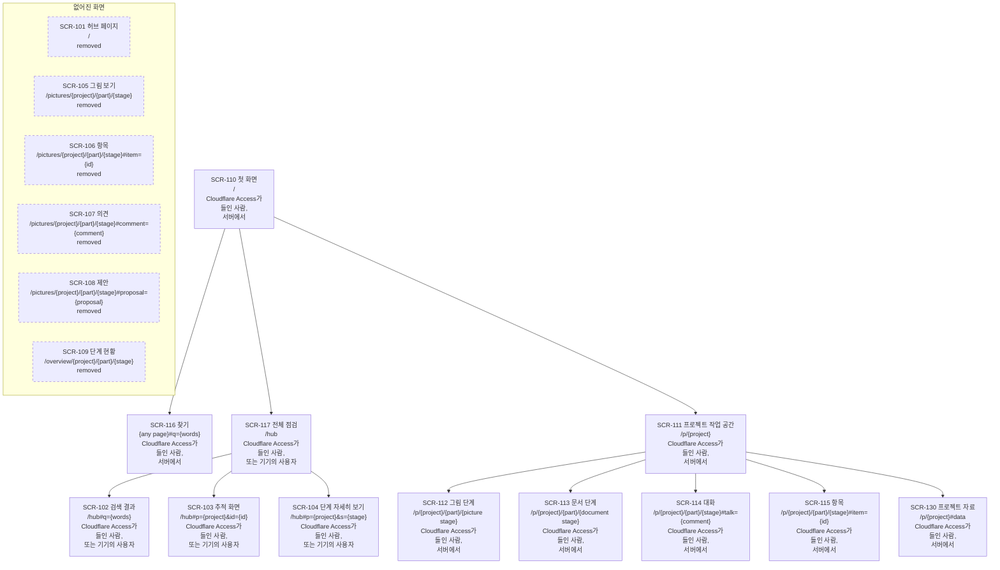

# NEXUS: 사이트맵

[English](nexus.md)

CORTHEX 자신의 프로젝트에서 NEXUS 0.2의 07단계입니다: [nexus.yaml](nexus.yaml)에 있는 허브 페이지와 NEXUS 서버의 화면, 그리고 이 파일에 있는 화면마다 보여 주는 것, 그 파일에서 그린 보드와 목록, 화면마다 보여 주는 사용자 흐름의 단계입니다. 상태: 2026-11-03에 관리자가 2026-11-02에 고른 대로 기억 플러그인을 만드는 동안, 사용자 흐름, 기능 명세, 서버의 자료, 인터페이스의 추천을 따라 초안을 썼습니다. 관리자가 같은 날 03\~06단계, 08단계와 함께 이 파일의 확인 지점을 통과시켰습니다. 2026-11-03에 관리자가 01단계 이벤트 스토밍을 NEXUS에서 하기로 고르면서 그림 보기에 스텝별 보기와 ② 차례의 워크숍을 새 화면 없이 더했고, 이것은 관리자가 같은 날 통과시켰습니다([확인할 것](#확인할-것)). YAML이 화면의 원본이고, 이 파일은 그것을 설명하며 나머지의 원본입니다. 2026-11-06 관리자의 화면 다시 디자인은 두 번째 나무 SCR-110\~SCR-117을 더했습니다. 첫 화면이 사용자를 기다리는 것을 모으고, 프로젝트마다 단계·그림·대화가 있는 작업 공간으로 열립니다. 그 확인 지점 1은 그날 17:44(KST)에 통과했습니다([확인할 것](#확인할-것)). 그 화면은 만들 때까지 `planned`이고, 만든 뒤에는 SCR-101\~SCR-109가 그리로 이어 주는 주소가 됩니다([다시 디자인한 화면](#다시-디자인한-화면)). 그날의 검토에 답하는 2026-11-11의 설계 수정은 두 나무를 SCR-110에서 시작하는 하나로 합치며 SCR-101을 `removed`로 적고, 프로젝트 자료 SCR-130을 더하고, 화면마다 그 화면을 적은 단계가 있는 흐름을 주고, ② 차례의 편집기와 작업 보드가 그림 단계의 어디에 들어가는지 적습니다([선택 15\~19](#이-단계가-고른-것)). 이 수정은 화면을 만들지도 바꾸지도 않으며, 그 확인 지점은 2026-11-12에 통과했습니다([확인할 것](#확인할-것)). 이 번역과 영어 원문이 다르면 영어 원문이 원본입니다.

입력: [docs/03-user-flow/nexus/](../03-user-flow/nexus/README.ko.md)의 사용자 흐름(FL-101\~FL-116); [docs/04-functional-spec/nexus.ko.md](../04-functional-spec/nexus.ko.md)의 기능 명세(SPEC-101\~SPEC-142), 특히 그 [07·08단계를 위한 메모](../04-functional-spec/nexus.ko.md#0708단계-화면); [docs/06-api/nexus.ko.md](../06-api/nexus.ko.md)의 인터페이스와 그 안의 페이지 요청 API-101\~API-103, 사이트맵의 그림 자료 형식, [07·08단계를 위한 메모](../06-api/nexus.ko.md#0708단계-화면); [docs/05-erd/nexus.ko.md](../05-erd/nexus.ko.md)의 서버의 자료와 그 [07·08단계를 위한 메모](../05-erd/nexus.ko.md#0708단계-화면); [docs/01-domain/nexus.ko.md](../01-domain/nexus.ko.md)의 DDD 보드와 용어집(화면은 그 읽기 모델을 적고, 이 파일은 그 말을 그 뜻으로 씁니다); 그리고 지금 도는 1차의 허브 페이지 [hub.html](https://github.com/kodonghui/corthex/blob/76508243558abaedcc15bb422c454341845fcabd/plugins/corthex-nexus/skills/corthex-hub/assets/hub.html)이며, 그 보기에는 저마다 주소가 있습니다. 기억 플러그인에는 화면이 없으므로 이 단계에는 그 파일이 없습니다. 다시 디자인에는 요구 사항 REQ-219\~REQ-237, 흐름 FL-117\~FL-119, 명세 행 SPEC-143\~SPEC-156과, 관리자가 그 확인 지점 1에서 통과시킨 구조를 씁니다. 2026-11-11의 설계 수정에는 [검토 지도](../reviews/2026-11-11-design-review.ko.md)와 특히 검토의 발견 12·15·18, 그 수정이 남긴 대로의 흐름 FL-101\~FL-119와 FL-125\~FL-127, 명세 행 SPEC-115, SPEC-146, SPEC-147, SPEC-153, SPEC-154, SPEC-188, SPEC-201\~SPEC-203, SPEC-209, SPEC-210, 요청 API-108, API-177, API-178, 그리고 그 수정의 04단계와 06단계가 이 단계에 남긴 메모를 씁니다.

이 단계의 기본 사람 화면은 YAML에서 그린 세 보기, 곧 보드, 목록, 슬라이드가 있는 페이지입니다. 여기서는 이 파일이 nexus.yaml에서 그린 보드와 목록을 담고, 사람은 그것을 프로젝트의 Notion 기록에 있는 한국어 사본으로 읽으며, 목록은 거기서 데이터베이스입니다. 회의가 아니라 한 사람이 사이트맵을 확인하므로 슬라이드는 없습니다([8번 선택](#이-단계가-고른-것)). NEXUS 0.2부터는 NEXUS가 nexus.yaml에서 이 사이트맵을 직접 그립니다(REQ-142). `.corthex/project.json`이 이 선택을 적어 둡니다.

## 이 파일을 읽는 법

- 화면은 [nexus.yaml](nexus.yaml)이 정하는 SCR-101\~SCR-109와, 다시 디자인의 SCR-110\~SCR-117입니다. 화면마다 `children` 아래 중첩에서 오는 상위 화면, 경로, 볼 수 있는 사람, 흐름, 용어, 상태가 있습니다. 2026-11-11의 설계 수정부터 화면은 SCR-110에서 시작하는 나무 하나이고, 이 나무는 프로젝트 자료 SCR-130도 지니며, SCR-101은 `removed`로 나무 뒤에 섭니다. TASK-278부터 SCR-105\~SCR-109도 `removed`로 거기 섭니다.
- 경로는 서버에서의 페이지 주소이며, 계약 [nexus.openapi.yaml](../06-api/nexus.openapi.yaml)이 그 요청을 적는 대로 `{project}`, `{part}`, `{stage}`를 써서 적습니다. `#` 뒤는 보기나 패널의 페이지 자신의 주소로, 브라우저가 지니고 서버로 보내지 않습니다([주소](#주소)).
- 화면의 흐름은 그 화면이 보여 주는 단계가 있는 흐름입니다. 그런 단계는 흐름 안에서 요구사항 뒤에 `REQ-102 · SCR-101`처럼 화면의 ID를 적습니다([화면 위의 흐름](#화면-위의-흐름)). 2026-11-11의 설계 수정부터 그 단계는 `REQ-102 · SCR-117`이라고 적고, 화면의 흐름은 그 화면을 적은 단계가 있는 흐름과 정확히 같습니다([선택 17](#이-단계가-고른-것)).
- 화면의 용어는 그 컨텍스트와, 그 화면이 나타내는 DDD 보드의 읽기 모델의 TERM ID, 또는 `none`입니다([용어](#용어)).
- 상태: 04\~06단계처럼, NEXUS 0.2가 그대로 두는 1차의 보기는 `built`, 0.2가 더하거나 바꾸는 것은 `active`입니다. 다시 디자인의 화면 가운데 아직 만들지 않은 것은 `planned`입니다. 2026-11-11의 설계 수정부터, 더는 길이 아닌 화면은 `removed`입니다: ID와 마지막으로 그 화면을 적던 흐름을 지닌 채 `terms: none`을 적고, 상위도 하위도 없이 나무 뒤에 서며, 어느 흐름의 단계도 그 화면을 적지 않습니다([선택 19](#이-단계가-고른-것)).
- 비어 있음, 읽는 중, 오래됨 같은 화면의 상태는 따로 화면이 아닙니다. 화면마다의 상태는 08단계가 정합니다.

## 화면

- **SCR-101 허브 페이지**, `/`: 모든 프로젝트를 현재 단계와 다음 행동을 먼저, 그다음 13단계와 그 상태, 항목 수, 점검 결과와 함께 보여 주고, 스냅샷마다 언제 어느 커밋에서 만들었는지 보여 줍니다(SPEC-122, 1차에서 만듦). NEXUS 0.2는 부분마다의 상태, 열린 것의 개수, 기록을 기다리는 확인 지점, 먼저 물을 일, 빈 서버의 설명을 더합니다(SPEC-123\~SPEC-125). 허브는 같은 페이지를 기기에서 파일로, 기본값으로는 `~/.corthex/hub/index.html`에, 서버의 링크와 개수 없이 만듭니다.
- **SCR-102 검색 결과**, `/#q={words}`: ID나 제목의 낱말에 맞는 항목(SPEC-122).
- **SCR-103 추적 화면**, `/#p={project}&id={id}`: 한 항목이 모든 단계를 거쳐 어디서 왔고 어디로 이어지는지(SPEC-122).
- **SCR-104 단계 자세히 보기**, `/#p={project}&s={stage}`: 한 프로젝트의 한 단계와 그 상태, 마지막 확인 지점, 다음 행동, 점검 결과, 항목, 그리고 그 사람 화면으로 가는 링크(SPEC-122). NEXUS 0.2는 이것을 부분마다 보여 주고, 서버에서는 부분마다 그림 보기와 단계 현황으로 잇습니다(SPEC-123, SPEC-138).
- **SCR-105 그림 보기**, `/pictures/{project}/{part}/{stage}`: 한 부분의 한 단계 그림, 곧 DDD 보드, ERD, 사이트맵을 그 문서 판, 그리고 그 항목 위의 열린 의견, 제안, 어긋남과 함께 보여 주고, 항목이 없어진 열린 의견은 따로 보여 줍니다(SPEC-119). 그 부분의 단계 현황으로 잇습니다. DDD 보드는 여기서 타임라인부터 보드 전체까지 스텝별로 따라가 볼 수 있습니다(SPEC-141). PC에서는 ② 차례에 여기서 그림을 고치고(SPEC-134), DDD 보드와 따로 작업 보드에서 01단계 워크숍을 합니다(SPEC-142).
- **SCR-106 항목**, `/pictures/{project}/{part}/{stage}#item={id}`: 그림의 한 항목을 그 추적 ID로, 그 의견, 제안, 어긋남과 함께 보여 주며, 사용자는 여기서 의견을 남깁니다(SPEC-119, SPEC-126).
- **SCR-107 의견**, `/pictures/{project}/{part}/{stage}#comment={comment}`: 의견 하나를 그 `nc_` ID로, 모든 답글과 그 결정과 함께 보여 주며, 사용자는 여기서 답글을 달고, 답이 났다고 표시하고, 의견을 정하거나 다시 엽니다(SPEC-127, SPEC-132).
- **SCR-108 제안**, `/pictures/{project}/{part}/{stage}#proposal={proposal}`: 제안 하나를 그 `np_` ID로, 그 까닭, 그것이 바꾸는 단계별 원본의 글, 그 반영의 상태와 함께 보여 줍니다. 사용자는 여기서 제안을 받거나 버리고, 반영이 사용자를 필요로 하면 그 반영을 버립니다(SPEC-131, SPEC-133).
- **SCR-109 단계 현황**, `/overview/{project}/{part}/{stage}`: 한 부분의 단계에 남은 것, 곧 그 열린 어긋남, 의견, 반영 대기를 함께, 그리고 기록된 상태, 확인 지점, 점검 결과를 보여 주며, 사용자는 여기서 확인 지점을 통과시키거나 NEXUS에서 통과시킨 것을 철회합니다(SPEC-138, SPEC-139). 항목마다 그림 보기의 그 항목, 의견, 제안으로 잇습니다.

2026-11-11의 설계 수정부터 위 목록은 이렇게 읽습니다. 다시 디자인의 첫 작업들을 이미 만들었기 때문입니다. SCR-101은 `removed`입니다: `/`는 첫 화면(SCR-110)이고, 허브 페이지는 전체 점검(SCR-117)이며, 서버에서는 `/hub`에, 기기에서는 허브가 만드는 파일로 있습니다. SCR-102\~SCR-104는 여전히 허브 페이지의 세 보기이고 이제 SCR-117 아래에 있습니다: 서버에서는 `/hub#q={words}`, `/hub#p={project}&id={id}`, `/hub#p={project}&s={stage}`이고, 기기의 파일에서는 같은 `#` 뒤입니다. SCR-105\~SCR-109는 TASK-278이 그 경로에 넘겨주기로 답할 때까지 그 경로에서 내줍니다([다시 디자인한 화면](#다시-디자인한-화면)). TASK-278이 2026-11-13에 그렇게 했고, 그 화면들은 `removed`입니다.

## 다시 디자인한 화면

NEXUS 0.2는 13단계와 점검의 표로 열리고, 그림마다 따로 주소가 있으며, AI와의 대화는 그림 위의 작은 표시로만 보입니다(2026-11-06 진단). 다시 디자인은 그림을 가운데 두고, 사용자를 기다리는 것을 한 화면에 모읍니다.

- **SCR-110 첫 화면**, `/`: 맨 위에 ‘내 차례’, 곧 모든 프로젝트에서 사용자의 답을 기다리는 것, 열린 제안, 마지막 글이 AI의 것인 의견, AI가 통과를 부탁한 확인 지점을 두고, 하나하나 그 자리에서 답하거나 제자리에서 엽니다(SPEC-143). 그다음 프로젝트마다 AI 할 일이 몇 개 기다리는지와 AI가 언제 읽는지(SPEC-144), 그다음 프로젝트마다 카드 하나: 지금 단계와 다음 행동, 그림마다 작은 보기, 13단계를 모양으로(SPEC-145). 빈 서버에서는 허브 페이지처럼 프로젝트를 올리는 법을 말합니다.
- **SCR-116 찾기**, 모든 페이지 맨 위의 칸이며, 찾는 말은 `#` 뒤에 `q`로 둡니다: 모든 프로젝트에서 ID나 제목의 낱말로 항목을 찾고, 고르면 그 프로젝트의 작업 공간에서 엽니다(SPEC-152). 1차의 검색 결과(SCR-102)를 모든 페이지로 옮깁니다.
- **SCR-117 전체 점검**, `/hub`: 허브 페이지 그대로, 모든 프로젝트의 13단계와 점검이며, 첫 화면이 이리로 이어 줍니다(SPEC-153). SCR-101의 표를 바꾸지 않고 여기로 옮깁니다.
- **SCR-111 프로젝트 작업 공간**, `/p/{project}`: 프로젝트의 지금 단계를 엽니다(SPEC-146). 왼쪽에 13단계를 여섯 묶음으로 둔 목록, 가운데에 단계, 오른쪽에 대화가 있습니다.
- **SCR-112 그림 단계**, 01·05·07의 `/p/{project}/{part}/{stage}`: 기록된 상태, 마지막 확인 지점, 보여 주는 커밋이 있는 단계 머리와, 그 뒤의 단계 기록(사용자가 여기서 확인 지점을 통과시킴)(SPEC-147); SPEC-119가 그리는 그림과, 전체 그림에서 지금 보는 곳(SPEC-156); 단계의 항목을 목록으로 보는 탭(SPEC-148). SCR-104의 단계 자세히 보기, SCR-105의 그림 보기, SCR-109의 단계 현황을 받아들이며, 단계 현황의 ‘남은 것’은 목록의 거르기가 됩니다.
- **SCR-113 문서 단계**, 나머지 10단계의 `/p/{project}/{part}/{stage}`: 같은 머리와, 단계의 항목 목록. 이제 그 항목에도 대화를 남길 수 있습니다(SPEC-148, SPEC-151).
- **SCR-114 대화**, 어느 단계에서나 옆의 `#talk={comment}`: 단계의 대화를 차례로 나눠, 사용자를 기다리는 것을 먼저, 그다음 AI를 기다리는 것과 AI가 맡았는지를 보여 주고, 닫힌 대화는 접습니다. 항목을 고르면 그 항목으로 좁혀지고, 아무것도 고르지 않고 남긴 의견은 단계 전체에 붙습니다(SPEC-150, SPEC-151). SCR-107의 의견과 SCR-108의 제안을 받아들입니다.
- **SCR-115 항목**, 어느 단계에서나 옆의 `#item={id}`: 항목 하나의 필드를 말로, 원문 자리, 다른 단계에서 그 항목이 나온 곳과 이어지는 곳, 그 대화(SPEC-149). SCR-106의 항목과 SCR-103의 추적 화면을 받아들입니다.
- **SCR-130 프로젝트 자료**, `/p/{project}#data`, 2026-11-11의 설계 수정부터: 작업 공간의 패널로 단계 위에 뜨며, 서버가 그 프로젝트에 대해 가졌고 Git에는 없는 것을 종류마다 수와 함께 보여 줍니다. 그 위에는 프로젝트를 마지막으로 보낸 때와 커밋, 에이전트가 그 AI 할 일을 마지막으로 읽은 때를, 그 아래에는 사용자만 하는 두 가지 일, 곧 프로젝트 공간을 파일 하나로 받는 내보내기와 프로젝트 지우기를 둡니다(SPEC-201\~SPEC-203). 작업 공간의 머리가 이것을 열고(SPEC-146), 허브가 지우기의 시험 실행에서 주는 주소도 이것을 엽니다(SPEC-115). 1024픽셀보다 좁으면 탭 위의 시트입니다.

1024픽셀보다 좁으면 작업 공간은 단계·대화·항목을 탭으로 보여 주고, 단계 목록은 단계 제목에서 엽니다(SPEC-155). ② 차례를 위해 두 자리를 꺼 둔 채 둡니다: 단계 머리의 ‘편집’과 그림 옆의 작업 보드 탭. 2026-11-11의 설계 수정부터 두 자리는 편집이 든 릴리스가 나오기 전에는 보이지 않고(SPEC-147), 둘 다 그림 단계의 보기로서 단계의 칸에서 그림의 자리에 들어갑니다: 편집기는 `view=edit`, 01단계에서 부분의 작업 보드는 `view=board`입니다([주소](#주소), [선택 18](#이-단계가-고른-것)).

다시 디자인을 만들면 SCR-101\~SCR-109는 ID를 지닌 채 새 자리로 이어 줍니다: SCR-101은 SCR-117로, SCR-102는 SCR-116으로, SCR-103과 SCR-106은 SCR-115로, SCR-104는 SCR-112나 SCR-113의 머리로, SCR-105는 SCR-112로, SCR-107과 SCR-108은 SCR-114로, SCR-109는 SCR-112나 SCR-113의 목록으로 갑니다(SPEC-154). 그때 그 상태는 더는 길이 아닌 화면으로서 `removed`가 되고, 이 파일이 저마다 어디로 갔는지 적습니다. 2026-11-11의 설계 수정은 이 문단을 만든 것에 비추어 다시 읽습니다(검토의 발견 18): SCR-101은 이제 `removed`입니다. 그 페이지가 TASK-271과 TASK-273으로 `/`를 떠났기 때문이며, SCR-101이 그랬듯 SCR-117이 서버에서든 기기에서든 만들어지는 곳 어디서나 허브 페이지를 가리킵니다. 허브 페이지의 세 보기는 없어지지 않습니다: REQ-233이 허브 페이지를 통째로 남기므로 SCR-102\~SCR-104는 SCR-117 아래에서 그 보기로 남고, `/`에 온 허브 페이지의 옛 주소는 다시 디자인으로, 곧 찾기(SCR-116), 항목(SCR-115), 단계(SCR-112나 SCR-113)로 이어집니다. SCR-105\~SCR-109는 TASK-278과 함께 저마다 `terms: none`과 어디로 갔는지를 적고 `removed`가 됩니다([선택 15](#이-단계가-고른-것)). 2026-11-13부터 `removed`입니다.

## 보드

2026-11-03에 nexus.yaml에서 그렸고, 2026-11-07에 SCR-110부터의 다시 디자인 나무와 함께 다시 그렸습니다: 화면마다 ID, 이름, 경로, 볼 수 있는 사람, 그리고 상위 화면에서 하위 화면마다 가는 화살표. 2026-11-11에 설계 수정과 함께 나무 하나로 다시 그렸습니다: 없어진 화면은 ‘없어진 화면’이라는 상자 안에 따로, 점선 테두리로, 화살표 없이, 볼 수 있는 사람 대신 `removed`를 적어 둡니다. 2026-11-13에 SCR-105\~SCR-109를 `removed`로 바꾼 TASK-278과 함께 다시 그렸습니다: 그 화면들은 SCR-101과 함께 따로 섭니다.

<!-- board: drawn from nexus.yaml -->

<!-- end of board -->

## 목록

2026-11-03에 nexus.yaml에서 그렸고 2026-11-07에 다시 그렸으며, 나무의 차례대로 화면마다 한 줄입니다. 2026-11-11에 다시 그렸으며, 나무 하나의 차례대로 적고 없어진 화면은 맨 뒤에 둡니다. 2026-11-13에 TASK-278과 함께 다시 그렸으며, SCR-105\~SCR-109는 SCR-101 뒤 맨 끝에 둡니다.

<!-- list: drawn from nexus.yaml -->
| 화면 | 이름 | 상위 | 경로 | 볼 수 있는 사람 | 흐름 | 용어 | 상태 |
| --- | --- | --- | --- | --- | --- | --- | --- |
| SCR-110 | 첫 화면 | 없음 | `/` | Cloudflare Access가 들인 사람, 서버에서 | FL-114, FL-117, FL-118 | CTX-014, TERM-121 | active |
| SCR-116 | 찾기 | SCR-110 | `{any page}#q={words}` | Cloudflare Access가 들인 사람, 서버에서 | FL-118 | `none` | active |
| SCR-117 | 전체 점검 | SCR-110 | `/hub` | Cloudflare Access가 들인 사람, 또는 기기의 사용자 | FL-105, FL-113, FL-118 | `none` | active |
| SCR-102 | 검색 결과 | SCR-117 | `/hub#q={words}` | Cloudflare Access가 들인 사람, 또는 기기의 사용자 | FL-105 | `none` | built |
| SCR-103 | 추적 화면 | SCR-117 | `/hub#p={project}&id={id}` | Cloudflare Access가 들인 사람, 또는 기기의 사용자 | FL-105 | `none` | built |
| SCR-104 | 단계 자세히 보기 | SCR-117 | `/hub#p={project}&s={stage}` | Cloudflare Access가 들인 사람, 또는 기기의 사용자 | FL-105, FL-113 | `none` | active |
| SCR-111 | 프로젝트 작업 공간 | SCR-110 | `/p/{project}` | Cloudflare Access가 들인 사람, 서버에서 | FL-117, FL-118 | `none` | active |
| SCR-112 | 그림 단계 | SCR-111 | `/p/{project}/{part}/{picture stage}` | Cloudflare Access가 들인 사람, 서버에서 | FL-106, FL-110, FL-113, FL-115, FL-116, FL-118, FL-119, FL-125 | CTX-014, TERM-111 | active |
| SCR-113 | 문서 단계 | SCR-111 | `/p/{project}/{part}/{document stage}` | Cloudflare Access가 들인 사람, 서버에서 | FL-113, FL-118, FL-119 | CTX-007, TERM-120 | active |
| SCR-114 | 대화 | SCR-111 | `/p/{project}/{part}/{stage}#talk={comment}` | Cloudflare Access가 들인 사람, 서버에서 | FL-106, FL-107, FL-109, FL-110, FL-117, FL-119 | CTX-014, TERM-111 | active |
| SCR-115 | 항목 | SCR-111 | `/p/{project}/{part}/{stage}#item={id}` | Cloudflare Access가 들인 사람, 서버에서 | FL-106, FL-107, FL-118, FL-119 | CTX-014, TERM-111 | active |
| SCR-130 | 프로젝트 자료 | SCR-111 | `/p/{project}#data` | Cloudflare Access가 들인 사람, 서버에서 | FL-114, FL-118, FL-127 | `none` | active |
| SCR-101 | 허브 페이지 | 없음 | `/` | Cloudflare Access가 들인 사람, 또는 기기의 사용자 | FL-105, FL-113 | `none` | removed |
| SCR-105 | 그림 보기 | 없음 | `/pictures/{project}/{part}/{stage}` | Cloudflare Access가 들인 사람, 서버에서 | FL-106, FL-110 | `none` | removed |
| SCR-106 | 항목 | 없음 | `/pictures/{project}/{part}/{stage}#item={id}` | Cloudflare Access가 들인 사람, 서버에서 | FL-106, FL-107 | `none` | removed |
| SCR-107 | 의견 | 없음 | `/pictures/{project}/{part}/{stage}#comment={comment}` | Cloudflare Access가 들인 사람, 서버에서 | FL-107, FL-109 | `none` | removed |
| SCR-108 | 제안 | 없음 | `/pictures/{project}/{part}/{stage}#proposal={proposal}` | Cloudflare Access가 들인 사람, 서버에서 | FL-110 | `none` | removed |
| SCR-109 | 단계 현황 | 없음 | `/overview/{project}/{part}/{stage}` | Cloudflare Access가 들인 사람, 서버에서 | FL-113 | `none` | removed |
<!-- end of list -->

## 화면 위의 흐름

화면에서 사용자에게 무언가를 보여 주는 단계는 모두 그 화면을 적습니다. 기기, 서버, 세션에서 도는 흐름은 자기 화면에 아무것도 보여 주지 않습니다: 허브가 그 명령의 결과(API-133\~API-150)로 세션에서 알리고, 화면은 다음에 열릴 때 그 결과를 보여 줍니다. "그림 보기를 엶, FL-106"처럼 다른 흐름으로 넘기기만 하는 단계는, 그 흐름이 화면을 적으므로 화면을 적지 않습니다. 2026-11-11의 설계 수정부터 이 표는 없어지지 않은 화면의 `flows`에서 그리고 FL-125\~FL-127까지 모든 흐름을 담습니다. 흐름이 도는 곳은 이 표가 직접 적는 것이며, 사용자가 프로젝트를 NEXUS에서 지우므로(SPEC-202) FL-114는 이제 세션과 브라우저에서 돕니다. 2026-11-13에 TASK-278과 함께 다시 그렸습니다: FL-106, FL-107, FL-109, FL-110, FL-113은 SCR-105\~SCR-109를 적던 자리에 다시 디자인의 화면을 적습니다.

<!-- flows: drawn from nexus.yaml -->
| 흐름 | 도는 곳 | 그 단계의 화면 |
| --- | --- | --- |
| FL-101 | 기기의 허브에서 | 없음: 허브가 세션에서 알림 |
| FL-102 | 기기의 허브에서 | 없음: 허브가 세션에서 알림 |
| FL-103 | 서버에서 | 없음: 허브가 세션에서 알림 |
| FL-104 | 서버에서 | 없음: 허브가 세션에서 알림 |
| FL-105 | 브라우저와 기기에서 | SCR-102, SCR-103, SCR-104, SCR-117 |
| FL-106 | 브라우저에서 | SCR-112, SCR-114, SCR-115 |
| FL-107 | 브라우저에서 | SCR-114, SCR-115 |
| FL-108 | 세션에서 | 없음: 허브가 세션에서 알림 |
| FL-109 | 세션에서. 그 답과 결정은 의견에 보임 | SCR-114 |
| FL-110 | 브라우저에서 | SCR-112, SCR-114 |
| FL-111 | 세션에서 | 없음: 허브가 세션에서 알림 |
| FL-112 | 세션에서 | 없음: 허브가 세션에서 알림 |
| FL-113 | 브라우저와 세션에서 | SCR-104, SCR-112, SCR-113, SCR-117 |
| FL-114 | 세션과 브라우저에서 | SCR-110, SCR-130 |
| FL-115 | PC의 브라우저에서, ② 차례 | SCR-112 |
| FL-116 | PC의 브라우저에서, ② 차례 | SCR-112 |
| FL-117 | 브라우저에서, 다시 디자인 | SCR-110, SCR-111, SCR-114 |
| FL-118 | 브라우저에서, 다시 디자인 | SCR-110, SCR-111, SCR-112, SCR-113, SCR-115, SCR-116, SCR-117, SCR-130 |
| FL-119 | 브라우저에서, 다시 디자인 | SCR-112, SCR-113, SCR-114, SCR-115 |
| FL-125 | 브라우저와 세션에서, ② 차례 | SCR-112 |
| FL-126 | 세션에서, ② 차례 | 없음: 허브가 세션에서 알림 |
| FL-127 | 브라우저에서 | SCR-130 |
<!-- end of flows -->

## 주소

- 세 페이지는 계약의 페이지입니다: 허브 페이지(API-101), 그림 보기(API-102), 단계 현황(API-103). 서버는 다른 페이지를 내주지 않습니다.
- 허브 페이지는 `#` 뒤에 1차의 주소를 그대로 둡니다: 검색은 `q`, 추적 화면은 `p`와 `id`, 단계 자세히 보기는 `p`와 `s`이며, URL의 쿼리와 같은 꼴입니다.
- 그림 보기의 패널도 같은 꼴의 주소를 받습니다: 추적 ID와 함께 `item`, `nc_` ID와 함께 `comment`, `np_` ID와 함께 `proposal`. 이 주소가 든 링크는 단계 현황에서든, 허브 페이지에서든, 세션의 에이전트 메시지에서든 그 패널을 바로 열며, 휴대폰에서도 그렇습니다. 패널을 닫으면 주소가 그림의 주소로 돌아가고, 브라우저의 뒤로 가기 버튼이 패널을 닫습니다. 서버는 `#` 뒤를 보지 못하므로 바뀌는 요청이 없습니다.
- DDD 보드의 스텝은 `#step=6`처럼 `1-b`부터 `9`까지의 스텝 열쇠와 함께 `step`을 받고, `#step=6&item=CTX-012`처럼 열린 패널 곁에서도 그것을 지킵니다. 그것이 없거나 보드에 없는 열쇠면 그림 보기는 보드 전체를 보여 줍니다(SPEC-141).
- 그림에 없는 항목, 의견, 제안의 주소는 그림 보기를 열고 그렇다고 알립니다. 그 상태는 08단계가 그립니다.
- 경로에서 `{part}`는, 계약의 요청처럼, 프로젝트 전체이면 `_`입니다.

다시 디자인을 만든 뒤의 주소. TASK-271부터 서버는 그 페이지를 이 주소에서 답합니다: `/`와 단계의 주소는 TASK-272가 그리는 틀과 함께, `/p/{project}`는 그 넘겨주기로, `/hub`는 허브 페이지로 답하므로 SCR-117은 active입니다. TASK-273부터 `/`는 첫 화면이므로 SCR-110도 active입니다. TASK-274부터 단계의 주소는 단계의 목록과 함께 작업 공간을 보이므로 SCR-111과 SCR-113도 active이고, 그림 단계는 TASK-275가 그림을 그릴 때까지 그 목록을 보였습니다. TASK-275\~TASK-277부터 그림 단계, 대화, 항목, 찾기를 만들었으므로 SCR-112, SCR-114, SCR-115, SCR-116도 active이며, TASK-278부터 서버가 0.2의 두 경로에 아래의 넘겨주기로 답하므로 SCR-105\~SCR-109는 `removed`이고, TASK-312부터 `data`가 단계 위에 프로젝트 자료를 열므로 SCR-130도 active입니다:

- 페이지는 첫 화면 `/`(API-155), 지금 단계로 이어 주는 프로젝트 `/p/{project}`(API-153), 단계 `/p/{project}/{part}/{stage}`(API-154), 이제 `/hub`에 있는 허브 페이지(API-101)입니다. `{stage}`는 `02-prd` 같은 단계의 키입니다. SCR-112와 SCR-113은 같은 꼴을 나눠 쓰고, 단계에 그림이 있는지로 갈립니다.
- `#` 뒤는 0.2와 같은 꼴입니다: `talk`만 있으면 단계의 대화를, `nc_`나 `np_` ID와 함께면 그 의견이나 제안을 엽니다. `item`과 추적 ID는 항목을, `view=list`는 그림 단계에서 그림 대신 목록을 보여 줍니다. `step`은 0.2처럼 DDD 보드의 스텝을 지니고, `q`는 어느 페이지에서나 찾는 말을 지닙니다.
- NEXUS 0.2의 주소는 같은 자리로 이어집니다(SPEC-154): `/pictures/{project}/{part}/{stage}`는 그 단계로, `#item=`은 그대로, `#comment=`와 `#proposal=`은 `#talk=`로, `#step=`은 그대로; `/overview/{project}/{part}/{stage}`는 그 단계의 `#view=list`로; `/`에서 허브 페이지의 `#q={words}`는 같은 찾기로, `#p={project}&id={id}`는 그 항목이 있는 단계의 항목으로, `#p={project}&s={stage}`는 프로젝트 첫 부분의 그 단계로 갑니다. 옛 경로 두 개에는 서버가 다른 주소로 보내는 응답을 하고, 브라우저는 `#` 뒤를 그대로 지닙니다. 허브 페이지의 옛 주소는 첫 화면의 스크립트가 읽습니다.

2026-11-11의 설계 수정부터. 이 수정은 열쇠 하나 `data`를 더하고, ② 차례를 위해 `view`의 값 둘을 맡아 두며, 페이지는 더하지 않습니다:

- 허브 페이지의 세 보기는 `/hub`에서도, 허브가 기기에서 만드는 파일에서도 `#` 뒤에 1차의 주소를 그대로 둡니다: `/hub#q={words}`, `/hub#p={project}&id={id}`, `/hub#p={project}&s={stage}`(SCR-102\~SCR-104). `/`에서는 첫 화면이 같은 세 주소를 읽어 위에 적은 대로 다시 디자인으로 이어 주며, `#q=`는 찾기(SCR-116)를 엽니다. SCR-116의 `{any page}`는 다시 디자인의 페이지 SCR-110\~SCR-115 가운데 어느 것이든이고, `/hub`는 허브 페이지 자신의 검색을 그대로 둡니다.
- 값이 없는 열쇠 `data`는 단계 위에 프로젝트 자료(SCR-130)를 엽니다. `/p/{project}#data`는 패널을 연 채 프로젝트의 지금 단계로 갑니다. 브라우저가 넘겨주기를 거치면서 `#` 뒤를 그대로 지니기 때문입니다. 다른 열쇠 곁에서는 `#item=REQ-107&data`처럼 적습니다. 패널을 닫으면 주소에서 `data`만 빠지고 나머지는 남으며, 브라우저의 뒤로 가기 버튼이 패널을 닫습니다(SPEC-203).
- `view`는 그림 단계에서 단계의 칸이 한 번에 하나씩 보여 주는 보기를 가리킵니다: 없으면 그림, `list`는 목록이고, ② 차례를 위해 두 값을 맡아 둡니다. `edit`는 그림의 자리에 들어가는 편집기, `board`는 01단계에서 부분의 작업 보드입니다. 편집이 든 릴리스가 나오기 전에는 두 값 모두 그림을 보여 주며, 페이지가 모르는 값도 그렇습니다(SPEC-147, [선택 18](#이-단계가-고른-것)).
- `filter=left`는 단계의 목록을 남은 것으로 좁혀서 열며, 그림 단계에서도 그렇습니다. 첫 화면의 AI 할 일이 이 주소로 잇고, 페이지에서 거르기를 고르면 주소에서 빠집니다. TASK-274부터 만들어져 있고 08단계(SCR-113)가 정의하는데, 이 목록에는 빠져 있었습니다.
- 페이지는 위의 넷 그대로입니다: 프로젝트 자료는 API-177을 읽는 단계 페이지(API-154)의 패널이고, 내보내기(API-178)는 내려받기입니다.

## 누가 무엇을 볼 수 있는지

- 서버에서는 모든 페이지가 Cloudflare Access 뒤에 있고, Access는 NEXUS가 답하기 전에 그 밖의 사람을 자기 페이지로 거절합니다(FL-105, FL-106). 그 페이지는 Cloudflare의 것이고 NEXUS의 화면이 아닙니다.
- 허브 페이지와 그 세 보기는 기기에서도, 그 기기의 사용자가 여는 파일로, 서버의 링크와 개수 없이 만들어집니다(SPEC-123).
- 그림 보기, 그 세 패널, 단계 현황은 서버에만 있습니다. 프로젝트 공간은 서버만 지니기 때문입니다. 다시 디자인한 화면도 모두 그렇습니다: 허브가 기기에서 만드는 허브 페이지는 첫 화면이나 작업 공간 없이 그대로입니다.
- 화면이 사용자에게 하게 하는 일은 계약의 로그인을 따릅니다: 제안 받기나 버리기, 반영 버리기, 확인 지점 통과시키기나 철회하기는 사람 자신의 로그인이 있어야 하고(API-124, API-125, API-127\~API-129), 의견, 답글, 답이 났다는 표시는 어느 로그인으로도 됩니다(API-118\~API-120). 화면은 그것이 보여 주는 모든 사람에게 같은 것을 보여 주고, 거절이 무엇을 보여 주는지는 08단계가 그립니다.
- 2026-11-11의 설계 수정부터: 나무의 화면 가운데 기기에서도 만들어지는 것은 전체 점검 SCR-117과 그 세 보기 SCR-102\~SCR-104뿐이며, 기기에서는 그 위의 첫 화면 없이 파일 혼자 있습니다. 위 문장은 이것을 서버에만 있는 화면으로 셌습니다. 프로젝트 자료 SCR-130은 어느 로그인으로도 보이지만(API-177), 내보내기와 지우기는 사용자만 하는 일이어서 서비스 토큰으로는 거절됩니다(API-178, API-108).

## 용어

NEXUS는 한 부분의 DDD 보드에 있는 읽기 모델마다 그 부분의 사이트맵에서 그 읽기 모델의 용어를 적은 화면과 짝을 짓고, 서로 맞지 않는 곳에 어긋남을 엽니다(02단계의 D10, REQ-153, SPEC-120, SPEC-121). 단계 스킬은 에이전트에게 그 용어를 적게 하며(REQ-154, SPEC-137), 여기서는 화면마다의 `terms`에 적었습니다:

- 그림 보기와 그 세 패널은 논의(CTX-014)의 그림 보기(TERM-111)를 적습니다. 논의는, 사용자가 의견을 남기거나 제안을 받거나 버리기 전에 이것을 보는 명령 줄이 있는 컨텍스트입니다.
- 단계 현황은 단계 진행(CTX-007)의 단계 현황(TERM-120)을 적습니다.
- 허브 페이지와 그 보기는 `terms: none`입니다. 허브의 컨텍스트 CTX-006, CTX-008, CTX-009에는 보드에 읽기 모델이 없으므로 용어를 적으면 어긋남이 열립니다. 05단계가 그 컨텍스트의 테이블에 `terms: none`을 적은 것과 같습니다(그 7번 선택).
- AI 할 일(TERM-121)에는 화면이 없습니다: 에이전트가 허브를 거쳐 그것을 읽습니다(SPEC-135). YAML은 그것을 `# without a screen:` 뒤에 적으므로, 그것을 적는 화면을 기다리는 어긋남은 없습니다.

- 다시 디자인한 화면: 그림 단계, 대화, 항목은 그림 보기와 그 패널처럼 논의(CTX-014)의 그림 보기(TERM-111)를 적습니다. 문서 단계는 단계 진행(CTX-007)의 단계 현황(TERM-120)을 적습니다. 그림 없는 단계는 그 단계에 든 것과 남은 것을 보여 주고, 사용자가 거기서 확인 지점을 통과시키기 때문입니다. 첫 화면은 그 수를 보여 주는 AI 할 일(TERM-121)을 논의에서 적으므로, YAML은 이제 AI 할 일을 `# without a screen:` 뒤에 적지 않습니다. 작업 공간, 찾기, 전체 점검은 `terms: none`입니다. 열린 대화의 사용자 쪽인 내 차례(TERM-135)는 용어집의 낱말이고 아직 보드의 읽기 모델이 아니므로 그것을 적는 화면은 없습니다. 01단계가 다음에 보드를 고칠 때 더할 수 있습니다.
- ② 차례의 읽기 모델인 작업 보드 보기(TERM-148)와 바뀐 것 목록(TERM-149)에는 아직 화면이 없습니다: ② 차례의 화면이 그림 단계(SCR-112)와 그 대화에서 그것을 적을 때까지 YAML이 그것을 `# without a screen:` 뒤에 적습니다. 05단계의 nexus.sql이 ② 차례의 애그리거트를 `without a table:` 뒤에 적는 것과 같아서(그 선택 19), 그동안 그것을 기다리는 어긋남은 없습니다.
- 2026-11-11의 설계 수정부터: 프로젝트 자료 SCR-130은 `terms: none`입니다. 프로젝트 자료(TERM-154)는 함께 보기(CTX-009)에 있는 용어집의 낱말이고, 그 컨텍스트에는 보드에 읽기 모델이 없으므로, 허브 페이지에서처럼 그것을 적으면 어긋남이 열립니다. 없어진 화면도 `terms: none`입니다. NEXUS의 점검은 읽기 모델을 여전히 적는 없어진 화면에 어긋남을 열기 때문입니다: SCR-101은 적은 것이 없었고, SCR-105\~SCR-109는 TASK-278이 그 화면을 없앨 때 용어를 빼며, 그때부터 그 읽기 모델은 다시 디자인의 화면만 적습니다. TASK-278부터 그렇게 뺐습니다.

그러면 NEXUS가 자기 그림끼리 하는 점검은 이 사이트맵과 보드 사이에서 어긋남을 찾지 않아야 하며, 12단계가 그것을 확인합니다. [3번 변경](#앞-단계의-변경)은 여러 컨텍스트에서 읽는 읽기 모델에 관한 것입니다.

## 사이트맵 밖의 것

- Cloudflare Access의 로그인 페이지와 그 거절.
- Notion과 Miro 같은 다른 도구에 있는 단계의 사람 화면. 단계 자세히 보기가 그것으로 잇습니다(REQ-095).
- 허브가 세션에서 하는 말. 그 명령의 결과가 정합니다(API-133\~API-150).
- PC에서의 편집과 작업 보드의 워크숍, 곧 ② 차례(FL-115, FL-116, SPEC-134, SPEC-142). 폭이 1024픽셀 이상인 그림 보기에서 하며, 자기 화면이 필요한지는 ② 차례가 정합니다. ③ 차례의 도구 링크에는 아직 화면이 없습니다. 2026-11-11의 설계 수정부터 그 자리는 그림 단계 SCR-112이며, 그 칸의 두 보기 `view=edit`와 `view=board`로 두고, 편집이 든 릴리스가 나오기 전에는 보이지 않습니다. 따로 화면이 될지는 D20이 다시 디자인을 만든 바로 뒤에 둔 ② 차례 자신의 07단계가 정하고, 그 읽기 모델도 그때 적습니다([선택 18](#이-단계가-고른-것)).
- 2026-11-11의 설계 수정부터, 검토가 화면을 찾지 못한 서버 자신의 상태: 프로젝트를 마지막으로 보낸 때와 에이전트가 그 AI 할 일을 마지막으로 읽은 때는 첫 화면, 작업 공간의 머리, 프로젝트 자료에 보이므로(REQ-271, SPEC-188, SPEC-203) 따로 화면이 필요 없습니다. 백업과 다른 기계에 두는 그 사본은 서버에서 날마다 확인하고(REQ-291) 어느 화면에도 보이지 않으며, 서버의 버전을 화면에 보이라는 요구사항은 없습니다.

## 앞 단계의 변경

다시 디자인은 2026-11-07에 이 나무와 같은 풀 리퀘스트에서, 그 확인 지점 1이 적은 대로 앞 단계를 고쳤습니다: 01단계 용어집에 내 차례, 작업 공간, 대화, 차례(TERM-135\~TERM-138)를 더하고, 의견이 어느 단계의 항목에도, 단계 전체에도 붙을 수 있게 했습니다(TERM-114, CTX-014의 규칙, 선택 ② A). 02단계에 문제 14와 REQ-219\~REQ-237을 더하고 REQ-158과 REQ-162를 바꿨습니다. 03단계에 FL-117\~FL-119, 04단계에 SPEC-143\~SPEC-156을 더했습니다. 05단계는 의견과 확인 지점(TBL-105, TBL-110)의 변경을, 06단계는 페이지와 요청 API-151\~API-159와 API-101\~API-103, API-118, API-119, 허브의 `comment`·`reply`의 변경을 계획으로 적었고, 그 파일과 코드는 다시 디자인을 만들 때 그것을 받아들입니다. 그때까지 0.2의 흐름 FL-105\~FL-110과 FL-113은 SCR-101\~SCR-109를 그대로 적습니다.

2026-11-03에 확인 지점을 통과하며 반영했습니다. 1과 2는 사용자 흐름에, 3은 기능 명세에, 그리고 같은 답에 담긴 관리자의 승인으로 01단계의 명령 행에 들어갔습니다. 흐름 단계의 SCR ID는 이 단계 자신의 단계이며 이미 흐름에 들어 있습니다. 06단계의 사이트맵 예시 둘도 이 단계와 함께 바뀌었습니다: 허브가 사이트맵을 읽자, 거기 있던 양식의 예시 화면 ID 두 개를 언급했지만 정의하지 않은 것으로 알렸습니다. 이제 YAML의 예시는 nexus.yaml의 화면 둘을 보이고, 계약의 예시 `picture_data_sitemap`은 화면의 ID를 뺍니다. 둘 다 규칙은 바꾸지 않습니다.

1. FL-105의 "사용자가 무엇을 하나?"에 갈래가 하나 더 생깁니다: 사용자가 단계의 현황을 엶, FL-113. SPEC-138은 그림 보기뿐 아니라 허브 페이지에서도 현황을 열고, 단계 자세히 보기가 그것으로 잇습니다.
2. FL-107에서 의견이 그 항목에 보인 뒤에 단계가 하나 더 생깁니다: 사용자와 에이전트가 그 아래에 답글을 달고, 사용자는 답이 났다고 표시하거나, 의견을 정하거나, 다시 열 수 있습니다(REQ-163, REQ-166). 화면은 SCR-107입니다. 지금은 SPEC-127만 이것을 담고 FL-107의 어느 단계도 의견의 답글을 보여 주지 않으므로, SCR-107의 흐름에는 FL-109만 있습니다. 이 단계가 생기면 FL-107이 더해집니다.
3. 보드에는 여러 컨텍스트에서 읽는 읽기 모델이 있습니다: 그림 보기는 논의(CTX-014)와 편집(CTX-010)에서, AI 할 일은 그 둘 다에서 읽는데, 화면은 컨텍스트를 하나만 적습니다. SPEC-121에 규칙이 하나 더해집니다: 화면이 적은 컨텍스트가 그 읽기 모델을 보는 명령 줄이 있는 컨텍스트 가운데 하나이면, 짝의 컨텍스트가 맞는다고 봅니다. 그러면 CTX-014를 적은 그림 보기의 화면들이 편집의 그림 보기와 어긋남을 열지 않습니다. 지금 01단계의 CTX-010에 있는 그림 고치기의 명령 줄은 그 읽기 모델을 "Picture view; on a conflict, the user's edit over the new picture"(한국어판에서는 "그림 보기(충돌이면 새 그림 위에 내 편집)")로 적는데, 용어집에 그런 줄이 없으므로 NEXUS 0.2의 허브는 그것에 `board-term-missing` 경고를 내고 아무것과도 짝을 짓지 않을 것입니다(SPEC-106). 보드의 읽기 모델 표가 이미 편집 충돌 때 그 보기가 무엇을 보여 주는지 말하므로, "Picture view"로 적으면 그것도 짝을 짓습니다. 01단계는 확인을 마쳤으므로 그 줄은 관리자가 승인해야만 바뀝니다.

2026-11-11의 설계 수정은 이 나무와 같은 풀 리퀘스트에서 변경 셋을 더 냈고, 이 셋은 2026-11-12에 그 확인 지점을 함께 통과했습니다. 흐름 단계의 SCR ID는 2026-11-03처럼 이 단계 자신의 단계입니다.

4. 흐름의 단계는 지금의 나무대로 화면을 적습니다. FL-105와 FL-113은 SCR-101을 적던 자리에 SCR-117을 적습니다. 전체 점검이 서버에서나 기기에서나 허브 페이지를 가리키기 때문입니다. 화면을 적지 않고 무언가를 보여 주던 단계 열하나도 이제 화면을 적습니다: FL-113에서 통과가 거절된 뒤 단계의 지금 모습(SCR-109, SCR-112, SCR-113), FL-114에서 지우기의 거절(SCR-130), FL-116에서 에이전트가 마지막으로 읽은 뒤 작업 보드에서 바뀐 것과 바꿈이 거절된 뒤 스티커의 지금 모습(SCR-112), FL-117에서 내 차례의 항목들과 기다리는 것이 없다는 알림(SCR-110), FL-118에서 1024픽셀보다 좁을 때의 탭(SCR-111)과 목록의 거르기(SCR-112, SCR-113), FL-119에서 항목이 없어진 의견(SCR-114), FL-127에서 내보내기의 거절과 내보낼 것이 없다는 알림(SCR-130).
5. FL-114의 마지막 단계는 지운 뒤 사용자가 무엇을 보는지 적습니다: 페이지가 첫 화면으로 이어지고, 첫 화면이 프로젝트를 지웠다고 알립니다(SPEC-202). 화면은 SCR-110입니다. 그 단계는 프로젝트의 원본과 기기의 파일이 남는다고만 적었고, 그 말은 그대로 있습니다.
6. 08단계의 정의는 이 수정의 08단계에서 따릅니다: SCR-130이 정의를 얻고, SCR-117의 정의가 기기의 허브 페이지도 가리키며, SCR-102\~SCR-104는 `/hub` 아래의 경로를 받고, SCR-101의 정의는 `removed`를 적은 채 SCR-117의 상태가 가리키는 글로 남습니다([08단계를 위한 메모](#08단계-화면-상태)).

## 이 단계가 고른 것

흐름, 명세, 인터페이스가 이것들을 07단계에 맡겼습니다. 2026-11-03의 확인 지점은 저마다 그대로 두었습니다.

1. 화면 아홉 개: 허브 페이지와, 1차가 이미 주소를 준 세 보기, 곧 검색 결과, 추적 화면, 단계 자세히 보기; 그리고 NEXUS 0.2의 두 페이지, 곧 세 패널(항목, 의견, 제안)이 있는 그림 보기와 단계 현황. 빈 서버나 빠진 그림 같은 화면의 상태는 화면이 아니며, 08단계가 그립니다.
2. 패널은 허브 페이지의 꼴로 `#` 뒤에 주소를 받습니다. 그래서 단계 현황, 허브 페이지, 세션에서 온 링크가 항목, 의견, 제안을 바로 열고, 브라우저의 뒤로 가기 버튼이 그것을 닫습니다. 서버는 그 주소를 보지 못하므로 바뀌는 요청이 없습니다.
3. 그림 보기와 단계 현황은, 허브 페이지가 부분마다 그것으로 잇는 단계 자세히 보기 아래에 둡니다. 패널은 그림 보기 아래에 둡니다. 항목이 없어진 의견이나 제안도 거기서 열리기 때문입니다.
4. 경로는 양식의 `:id` 대신 계약이 적는 대로 `{project}`처럼 중괄호로 적어, 화면의 경로와 그 페이지의 요청이 같게 읽히게 합니다.
5. 허브 페이지는 서버에서나 기기에서나 화면 하나입니다. 기기에서는 허브가 그것을 서버의 링크와 개수 없이 파일로 만듭니다.
6. 용어로는 보드의 읽기 모델만 적습니다. 05단계의 테이블이 그 애그리거트만 적는 것과 같습니다: 그림 보기와 그 패널은 그림 보기, 현황은 단계 현황, 허브 페이지와 그 보기는 `none`이며, AI 할 일은 화면 없이 적습니다.
7. 04\~06단계의 항목처럼 화면마다 `status`가 있습니다. 허브는 그 읽기 규칙이 상태를 읽듯 그것을 필드로 읽고, 없어진 화면은 그 ID를 잃는 대신 거기에 `removed`를 적게 됩니다. 양식에는 아직 그 필드가 없습니다([10단계를 위한 메모](#10단계-작업-분해)).
8. 사람 화면: 이 단계의 기본인 세 보기의 페이지 대신, 보드와 목록이 있는 이 파일과, 목록이 데이터베이스인 Notion의 한국어 사본입니다. 한 사람이 확인하므로 슬라이드는 없습니다. NEXUS 0.2부터는 NEXUS가 사이트맵을 직접 그립니다.
9. PC에서의 편집, 곧 ② 차례에는 지금 자기 화면이 없습니다: FL-115는 그림 보기에서 돌고, 작업 보드의 워크숍(FL-116)도 ② 차례가 작업 보드의 스텝을 그릴 때까지 DDD 보드와 따로 그림 보기에서 돕니다(01단계 핫스팟 14). 0.2의 스텝별 보기는 화면이 아니라 그림 보기의 DDD 보드를 보여 주는 방법입니다(SPEC-141).

다시 디자인이 고른 것으로, 2026-11-06 그 확인 지점 1에서 통과했습니다.

10. 첫 화면에서 시작하는 두 번째 나무의 화면 여덟: 사용자를 기다리는 것과 프로젝트를 모은 페이지 하나, 프로젝트마다 작업 공간 하나, 그리고 전체 점검으로 통째로 남긴 허브 페이지. 0.2의 화면은 모두 여기에 자리가 있어 잃는 것이 없습니다.
11. 단계는 그림이 있는지에 따라 화면 둘: 세 단계는 그림과 목록 탭을, 열 단계는 항목 목록을 보여 줍니다. 주소의 꼴은 하나를 나눠 쓰고 단계로 갈립니다.
12. 대화와 항목은 0.2의 패널처럼 어느 단계 옆에나 여는 자기 화면이며 `#` 뒤에 주소가 있습니다. 그래서 첫 화면이나 세션의 링크가 그것을 바로 엽니다.
13. 승인했지만 아직 만들지 않은 화면의 상태 `planned`. 그래서 사이트맵은 만들 때까지 두 나무를 함께 지니고, 만든 뒤 0.2의 화면은 저마다 어디로 갔는지와 함께 `removed`가 됩니다.
14. 첫 화면이 더는 허브 페이지가 아니므로, 찾기는 허브 페이지의 보기가 아니라 모든 페이지의 칸입니다.

2026-11-11의 설계 수정이 고른 것으로, 2026-11-12에 그 확인 지점을 통과했습니다.

15. SCR-110에서 시작하는 나무 하나. SCR-101은 TASK-278 뒤가 아니라 지금 `removed`입니다. 허브 페이지가 `/hub`로 옮기고 첫 화면이 그 자리에 들어오면서(TASK-271, TASK-273) 그 페이지가 `/`를 떠났기 때문이며, 그동안 두 화면이 `/`를 함께 썼습니다(검토의 발견 18). 5번 선택에 따라 SCR-101이 그랬듯 SCR-117이 서버에서나 기기에서나 허브 페이지를 가리키므로, 허브가 만드는 파일에도 화면이 있습니다. 허브 페이지의 세 보기는 SCR-117 아래, `/hub`의 `#` 뒤 주소에 화면 SCR-102\~SCR-104로 남습니다. 이것은 그 셋을 없애려던 선택 13을 그 셋에 한해 바꿉니다: 허브 페이지는 통째로 남고(REQ-233), 허브는 여전히 그것을 기기에서 만들며, FL-105는 여전히 그 위에서 돕니다. SCR-105\~SCR-109는 TASK-278이 없앨 때까지 전처럼 SCR-104 아래에 둡니다.
16. 프로젝트 자료는 자기 화면 SCR-130입니다: 대화와 항목처럼(선택 12) `#` 뒤에 주소가 있는 작업 공간의 패널입니다. 허브가 지우기의 시험 실행에서 그 주소를 주고, 프로젝트 자료에 사용자가 하는 두 가지 일인 내보내기와 지우기에는 링크로 여는 자리가 있어야 합니다(SPEC-201\~SPEC-203, 검토의 발견 15). 이 번호는 SCR-118\~SCR-129를 ② 차례가 SCR-117 뒤에 더할 수 있는 화면에 남겨 둡니다.
17. 화면의 `flows`는 그 화면을 적은 단계가 있는 흐름과 정확히 같고, 스크립트가 영어와 한국어에서 그것을 확인하며(이 단계의 첫 검사), 흐름 표는 거기서 FL-127까지 그립니다. 그래서 FL-115, FL-116, FL-125는 SCR-105가 아니라 SCR-112의 것입니다. ② 차례의 설계부터 그 단계들이 SCR-112를 적어 왔습니다. FL-113은 다시 디자인에서 사용자가 확인 지점을 통과시키는 SCR-112와 SCR-113의 것이기도 하고, 단계가 세션에서 도는 FL-126은 어느 화면의 것도 아닙니다. 없어진 화면은 마지막으로 그 화면을 적던 흐름을 내력으로 지니며, 검사는 그것을 읽지 않습니다.
18. ② 차례의 편집기와 작업 보드는 지금은 자기 화면이 아니라 그림 단계 SCR-112의 보기입니다(검토의 발견 12). 단계의 칸은 한 번에 보기 하나, 곧 그림, 목록, 그림의 자리에 들어가는 편집기, 01단계에서 부분의 작업 보드 가운데 하나를 보여 주고, `#` 뒤의 `view`가 그것을 가리키며, 뒤의 둘을 위해 `edit`와 `board`를 맡아 둡니다. 이 둘은 ② 차례의 두 부분입니다. 편집이 든 릴리스가 나오기 전에는 그 가운데 아무것도 보이지 않습니다(SPEC-147). 그래서 TASK-275는 그림을 그 칸 자체가 아니라 그 칸의 보기 하나로 만듭니다: 08단계는 머리와 도구에 두 자리를 남기고, 09단계는 TASK-275가 끝나기 전에 그것을 회색 와이어프레임 한 장으로 그립니다. 따로 화면이 될지는 D20이 다시 디자인을 만든 바로 뒤에 둔 ② 차례 자신의 07단계가 정하고, 그때 TERM-148과 TERM-149를 적습니다. 그동안 둘은 `# without a screen:` 뒤에서 기다립니다.
19. 없어진 화면은 하위가 없는 뿌리로 나무 뒤에 서고, ID, 이름, 경로, 마지막으로 그 화면을 적던 흐름을 지니며, `terms: none`을 적습니다. 보드는 그것을 ‘없어진 화면’이라는 상자 안에 따로, 점선 테두리로, 화살표 없이, 볼 수 있는 사람 대신 `removed`를 적어 그리고, 목록은 그 줄을 맨 뒤에 둡니다. 뿌리와 경로를 보는 이 단계의 검사는 없어지지 않은 화면만 읽으므로, SCR-101과 SCR-110이 둘 다 `/`를 적을 수 있습니다. 고정한 커밋의 허브는 이미 상태를 그렇게 읽어, 없어진 화면에는 화면 정의가 없다고 안내하지 않습니다.

## 돌린 검사

2026-11-03에 nexus.yaml, 이 파일, 그 영어 원문, 흐름에서:

- 이 단계의 검사 네 가지, 저장소 밖에 두는 스크립트로: 무언가를 보여 주는 단계는 모두 그 화면을 적고(화면을 적지 않은 단계의 목록을 손으로 확인함), 흐름마다의 SCR ID가 nexus.yaml이 화면마다 주는 흐름과 영어와 한국어에서 같음; 모든 화면이 SCR-101에서 닿고, 경로가 같은 화면이 둘 없음; 모든 화면이 누가 볼 수 있는지 적음; 화면마다 이 파일과 그 영어 원문의 보드와 목록에 한 번씩 나오고, 둘 다 nexus.yaml에서 새로 그린 것과 같음.
- 06단계의 사이트맵 그림 자료 형식: 모든 화면에 `id`, `name`, `path`, `access`, `flows`, `terms`, `status`가 있음; 모든 용어가 DDD 보드의 문서가 정하는 CTX나 TERM ID이고, 화면마다 그 컨텍스트에 그 읽기 모델을 보는 명령 줄이 있음(3번 변경); 보드의 모든 읽기 모델에 그 용어를 적은 화면이 있거나, 그 용어가 `# without a screen:` 뒤에 적혀 있음.
- 이 저장소의 허브 스냅샷이 SCR-101\~SCR-109를 저마다 상위와 함께 한 번씩 읽고, 점검 결과를 더하지 않음.
- Mermaid 11이 보드와 바뀐 흐름 일곱 개를 영어와 한국어로 Chromium에서 그리고, 경로의 `#`, `&`, 중괄호가 적은 그대로 나옴.
- 이 파일들을 넣은 저장소의 검사: `python -m unittest discover -s tests`, 마켓플레이스와 그 세 플러그인의 `claude plugin validate --strict`, `node --test nexus/test/*.test.js`가 통과하고, 이 파일과 그 영어 원문의 링크가 모두 맞음. 예시를 바꾼 06단계의 계약은 여전히 OpenAPI 3.1 검사기를 통과하고, 예시마다 그 스키마에 맞음.

2026-11-03에 관리자가 01단계 이벤트 스토밍을 NEXUS에서 하기로 고른 뒤, 같은 스크립트로 다시:

- SCR-105를 보여 주는 FL-116을 넣고 이 단계의 검사 네 가지가 통과함: 화면 9개, 흐름 16개. 이 파일과 그 영어 원문이 저마다 nexus.yaml에서 새로 그린 것과 같음.
- 스텝별 보기와 워크숍은 화면을 더하지 않으므로 보드와 나무는 그린 그대로임. 스텝의 주소는 그림 보기의 `#` 뒤에 둠.
- 저장소의 검사가 통과하고(시험 756개, 건너뜀 12개), 이 저장소의 허브 스냅샷이 항목 1014개를 읽고 점검이 없으며, 이 파일과 그 영어 원문의 링크가 모두 맞음.

2026-11-07에 다시 디자인의 나무와 그것이 앞 단계에 낸 변경 뒤, 같은 검사로:

- 두 번째 나무에서 이 단계의 검사 네 가지: FL-117\~FL-119에서 무언가를 보여 주는 단계는 모두 그 화면을 적고, 저마다의 SCR ID가 nexus.yaml이 화면마다 주는 흐름과 영어와 한국어에서 같음(FL-117에 SCR-111을, FL-118에 SCR-110을, FL-119의 항목을 고르는 자리에 SCR-112와 SCR-113을 적은 뒤). 나무의 모든 화면이 SCR-110에서 닿고 볼 수 있는 사람을 적음. 이 파일과 그 영어 원문의 보드, 목록, 흐름 표가 nexus.yaml에서 새로 그린 것과 같음. 두 나무는 경로 하나 `/`를 나눠 씀: 만들기 전에는 SCR-101의 것, 만든 뒤에는 SCR-110의 것이며, 그때 허브 페이지는 `/hub`(SCR-117)로 옮김.
- 고정한 커밋의 허브가 이 저장소의 스냅샷을 오류 0개, main과 같은 경고 628개로 만들고, 08단계가 아직 정의하지 않은 화면 여덟 개를 안내함. 이 파일들로 그린 그림에서 NEXUS가 보드와 이 사이트맵 사이에 하는 점검은 main에서처럼 어긋남을 열지 않음.
- Mermaid 11.17.2가 FL-117\~FL-119를 영어와 한국어로 Chromium에서 읽고 그림.
- 저장소의 검사가 통과함: 고정한 허브로 `python -m unittest discover -s tests`, `node --test nexus/test/*.test.js`(시험 264개, 컨테이너에 Node 24가 없어 Node 22에서), Worker의 dry-run 빌드, `git diff --check`. 바뀐 문서의 링크가 모두 맞음.

2026-11-11, nexus.yaml, 이 파일, 그 영어 원문, 흐름 여덟 개의 단계를 바꾸고 코드는 바꾸지 않는 설계 수정에서:

- 나무 하나에서 이 단계의 검사 네 가지, 10단계가 계획하는 시험이 생길 때까지 저장소 밖에 두는 스크립트로: 무언가를 보여 주는 단계는 모두 그 화면을 적고(화면을 적지 않은 단계의 목록을 손으로 확인했고, 단계 열하나가 화면을 얻음, 4번 변경), 흐름 22개마다 단계의 SCR ID가 없어지지 않은 화면의 `flows`와 영어와 한국어에서 같으며, 없어진 화면을 적는 단계가 없음; 없어지지 않은 화면이 모두 하나뿐인 뿌리 SCR-110에서 닿고, 그 가운데 경로가 같은 화면이 둘 없음; 모든 화면이 누가 볼 수 있는지 적음; 이 파일과 그 영어 원문의 보드, 목록, 흐름 표가 nexus.yaml에서 새로 그린 것과 같고, 화면 18개가(그 가운데 1개는 없어진 화면) 저마다 보드와 목록에 한 번씩 나옴.
- 사이트맵 그림 자료의 형식: 모든 화면에 `id`, `name`, `path`, `access`, `flows`, `terms`, `status`가 있고, 상태는 화면 10개가 `active`, 5개가 `planned`, 2개가 `built`, 1개가 `removed`이며, 없어진 화면은 `terms: none`을 적고 나무 뒤에 섬. 허브의 코드가 이 파일들에서 읽은 세 그림의 자료에서 그 코드는 점검을 더하지 않고, NEXUS가 그림끼리 하는 점검은 보드의 읽기 모델과 화면 사이에도, 애그리거트와 테이블 사이에도 어긋남을 열지 않음; TERM-148과 TERM-149는 화면 없이 적힌 채로 남음.
- 고정한 커밋의 허브가 이 저장소의 스냅샷을 항목 1442개, 오류 0개, 경고 600개로 만들며, 경고는 이 단계 전보다 하나 적음: 이 단계가 정의하기 전에 설계 수정의 흐름, 명세 행, 계약이 적던 SCR-130의 경고가 사라짐. 허브는 화면 18개를 저마다 상위, 상태와 함께 한 번씩 읽고, 08단계가 아직 정의하지 않은 화면 하나인 SCR-130을 안내함.
- Mermaid 11.4.1이 보드를 영어와 한국어로 Chromium에서 그리며, 상자 18개와 화살표 16개가 나오고 없어진 화면은 제 상자에 듦. 흐름의 그림 44개도 모두 그림.
- 저장소의 검사가 통과함: 고정한 허브로 `python -m unittest discover -s tests`(시험 13개), `node --test nexus/test/*.test.js`(시험 337개, 컨테이너에 Node 24가 없어 Node 22에서), Worker의 dry-run 빌드, `git diff --check`. 바뀐 문서의 링크가 모두 맞고, 바뀐 줄마다 그 번역과 ID, 코드, 링크가 같음(이 단계 전부터 다르던 두 줄은 빼고).

2026-11-12의 TASK-281부터는 `tests/test_sitemap.py`가 이 검사들을 저장소의 시험으로 돌리며, nexus.yaml은 고정한 허브의 코드가 읽는 그대로 읽습니다. 둘째, 셋째, 넷째는 적힌 그대로, 첫째는 흐름 22개의 단계를 두 언어로 보고, 무언가를 보여 주는 단계가 그 화면을 적는지는 여전히 손으로 봅니다. 또 고정한 허브로 이 저장소의 스냅샷을 만들어 NEXUS의 교차 검사를 돌리고(TC-1768), `nexus/test/hub-regression.mjs`는 허브 페이지의 세 보기를 `/hub`와 허브가 기기에 만드는 파일에서 엽니다(TC-1766).

2026-11-13, SCR-105\~SCR-109를 `removed`로 바꾸고 흐름 다섯 개가 그 자리에 다시 디자인의 화면을 적게 하는 TASK-278에서:

- `tests/test_sitemap.py`가 검사 네 가지와 교차 검사를 통과함: FL-106, FL-107, FL-109, FL-110, FL-113이 SCR-105\~SCR-109를 적던 자리에 SCR-112, SCR-114, SCR-115를 적은 뒤, 흐름 22개마다 단계의 SCR ID가 영어와 한국어에서 없어지지 않은 화면의 `flows`와 같음. nexus.yaml의 화면은 18개로, 9개가 `active`, 1개가 `planned`, 2개가 `built`, 6개가 `removed`이며, 없어진 화면은 저마다 `terms: none`으로 나무 뒤에 섬. 이 파일과 그 영어 원문은 새로 그린 것과 같음. 이 파일들에서 그린 그림으로 NEXUS가 보드와 이 사이트맵을 교차 검사하면 어긋남이 열리지 않음: 없어진 화면이 적던 읽기 모델을 SCR-112\~SCR-115가 적기 때문.
- 고정한 허브가 이 저장소의 스냅샷을 항목 1903개, 오류 0개, 그리고 `tests/hub_warnings.json`이 규칙과 ID로 적는 경고 601개로 전과 같이 만들고, 화면 18개를 없어진 여섯과 따로 읽음.
- Mermaid 11.17.2가 Playwright의 Chromium에서 보드를 영어와 한국어로 그리며, 상자 18개와 화살표 11개가 나오고 없어진 화면 여섯은 ‘없어진 화면’ 상자에 듦. 바뀐 흐름 다섯 개도 두 언어로 그림.
- 저장소의 검사가 통과함: 고정한 허브로 `python -m unittest discover -s tests`(시험 39개), `node --test nexus/test/*.test.js`(시험 368개, Node 24), Worker의 dry-run 빌드, `git diff --check`.

## 확인할 것

2026-11-11의 설계 수정은 2026-11-12에 관리자 자신의 말로 확인 지점을 통과했습니다([검토 지도](../reviews/2026-11-11-design-review.ko.md)). 이 수정은 화면을 만들지도 바꾸지도 않습니다: YAML, 이 파일, 흐름 여덟 개의 단계가 바뀔 뿐이고 페이지는 전과 같이 답합니다. 먼저 볼 것은 [보드](#보드)입니다. 이 수정으로 이 단계가 바뀌는 것을, 관리자에게 달라지는 일 하나에 한 줄씩 적습니다:

1. 화면은 첫 화면에서 시작하는 나무 하나이고 SCR-101은 `removed`입니다: 전체 점검 SCR-117이 서버에서나 기기에서나 허브 페이지이며, 그 세 보기가 그 아래에 있습니다(선택 15).
2. 프로젝트 자료는 `/p/{project}#data`의 화면 SCR-130입니다: 서버가 프로젝트에 대해 가졌고 Git에는 없는 것, 마지막 보내기와 마지막 읽음, 내보내기와 지우기(선택 16).
3. 화면의 흐름은 그 화면을 적은 단계가 있는 흐름이며, 흐름 표는 22개를 모두 담습니다(선택 17, 변경 4와 5).
4. ② 차례의 편집기와 작업 보드는 TASK-275가 끝나기 전에 자리를 얻습니다: 그림 단계의 두 보기 `view=edit`와 `view=board`이며, 편집이 든 릴리스가 나오기 전에는 그 가운데 아무것도 보이지 않습니다. 화면이 될지는 D20이 다시 디자인을 만든 바로 뒤에 둔 ② 차례 자신의 07단계가 정합니다(선택 18).
5. 새 주소는 `data`와 맡아 둔 `view`의 두 값뿐이고, 더하는 페이지는 없습니다([주소](#주소)).

다시 디자인의 확인 지점 1은 2026-11-06 17:44(KST)에 통과했습니다: 관리자가 프로젝트 스레드의 결정 카드에서 그린 대로 가기를 골랐고(‘이대로 진행’), 어느 단계의 항목에나 대화를 남기는 것(선택 ② A)과 ② 차례의 세 질문도 추천대로였습니다. 확인한 것은 1440·390픽셀의 회색 와이어프레임으로 본 여덟 화면과 그 자리(선택 10\~14), 0.2의 화면마다 가는 곳, 사용자와 AI 사이에 대화가 오가는 길, 바뀌는 단계였습니다. 생김새를 고르는 확인 지점 2는 2026-11-07 05:45(KST)에 A ‘제도 용지’로 통과했습니다(09단계). 확인 지점 3에서 화면마다의 상태(08단계)와 토큰 고정을 여쭙니다.

2026-11-03 관리자가 고른 01단계 이벤트 스토밍을 NEXUS에서 하는 것은 그것이 다른 단계에 낸 변경과 함께 같은 날 16:54(KST)에 통과했습니다: 관리자가 프로젝트 스레드의 결정 카드에서 스텝별 보기와 작업 보드를 그린 대로 통과시켰습니다(‘모두 그린 대로 통과’). 확인 지점이 다룬 것: 스텝별 보기와 ② 차례의 워크숍은 자기 화면 없이 그림 보기에 두고(선택 9), 스텝은 주소의 `#` 뒤에 `step`으로 둡니다.

2026-11-03 11:39(KST)에 03\~06단계, 08단계와 함께 통과했습니다: 관리자가 프로젝트 스레드의 결정 카드에서 모든 추천을 골라(‘모두 추천대로’), 화면과 그 주소가 그린 대로 섭니다. 확인 지점이 다룬 것:

1. 화면 아홉 개와 그 나무(1번과 3번 선택), 특히 그림 보기의 세 패널을 따로 화면으로 둔 것. 08단계는 그것을 상태마다 그립니다.
2. `#` 뒤의 주소(2번 선택). 단계 현황이나 세션에서 온 링크가 패널을 바로 열게 합니다.
3. 용어(6번 선택). 3번 변경과 함께, NEXUS가 자기 그림끼리 하는 점검이 어긋남을 찾지 않게 합니다.
4. 흐름의 새 단계 둘(1번과 2번 변경).

## 다음 단계를 위한 메모

### 08단계: 화면 상태

- 2026-11-11의 설계 수정에서: SCR-130의 정의. 명세의 메모가 적은 상태, 곧 불러오는 중, 아직 공간 없음, 이름을 치기 전과 친 뒤의 지우기 확인, 거절됨, 지워짐과, 1024픽셀보다 좁을 때의 시트를 담습니다(SPEC-201\~SPEC-203). SCR-110에는 프로젝트를 지웠다는 알림(SPEC-202). SCR-117의 정의는 서버에서나 기기에서나 허브 페이지를 가리키고, SCR-102\~SCR-104는 `/hub` 아래의 경로를 받습니다. SCR-101의 정의는 `removed`를 적고, SCR-117의 상태가 가리키는 허브 페이지 상태의 글로 남습니다. SCR-112는 선택 18의 두 자리를 머리와 도구에 남기되 어느 것도 보여 주지 않습니다. README의 화면 목록과 수도 따라 바뀝니다.
- 다시 디자인을 위해, 그 확인 지점 3에서: SCR-110\~SCR-117마다 정의 하나. 보통, 불러오는 중, 비었음, 오류, 권한 없음, 오래됨을 1440·390픽셀과 두 테마로. 명세 행이 이미 적은 것: SCR-110의 빈 내 차례와 빈 서버(SPEC-143, SPEC-145), SCR-111의 진행 기록 없는 프로젝트(SPEC-146), SCR-112의 지금 것이 아니거나 빠졌거나 아직 그리지 않은 그림(SCR-105와 같음), SCR-113의 프로젝트가 읽지 않는 단계(SPEC-148), SCR-114의 저장하지 못한 의견, 다른 탭에서 닫힌 의견, AI가 맡은 것(SPEC-150, SPEC-151), SCR-115의 없어진 항목(SPEC-149), SCR-116의 찾은 것 없음(SPEC-152).
- 화면 SCR-101\~SCR-109마다 정의 하나. 기능 명세의 [메모](../04-functional-spec/nexus.ko.md#0708단계-화면)가 늘어놓은 상태, 곧 보통, 읽는 중, 비어 있음, 오류, 권한, 오래됨; 서버의 자료가 주는 표시; 그리고 06단계의 [메모](../06-api/nexus.ko.md#0708단계-화면)에서 온 화면마다의 요청과 그 오류가 이끄는 상태와 함께. 허브 페이지와 그 보기는 1차의 상태를 그대로 두고 0.2의 상태를 더합니다.
- 명세가 이미 적은 것: SCR-101의 빈 서버(SPEC-124)와 스냅샷이 없는 프로젝트; SCR-104의 현재 그림이 아닌 그림 링크와 기록을 기다리는 확인 지점; SCR-105의 아직 그리지 않았거나 까닭과 함께 빠진 그림, 현재 그림이 아닌 그림, 요소가 300개를 넘는 그림, 연결 없음, 끝난 로그인, 읽지 못한 코드(이때는 항목을 목록으로 보여 줌)(SPEC-119), 그리고 DDD 보드의 스텝이나 타임라인이 없는 보드(SPEC-141); SCR-106의 저장되지 않은 의견과 없어진 항목(SPEC-126); SCR-107과 SCR-108의 다른 탭에서 닫힌 의견이나 제안; SCR-109의 남은 것 없음과 통과했지만 기록되지 않은 확인 지점(SPEC-138); 그리고 항목, 의견, 제안이 없어진 주소.
- 상태마다 320과 1440픽셀에서(REQ-101, REQ-146).

### 09단계: 목업

- 2026-11-11의 설계 수정에서: 선택 18의 네 보기, 곧 그림, 목록, 편집기, 작업 보드가 들어가는 그림 단계의 칸을 회색 와이어프레임 한 장으로 그립니다. 1,280과 1,440픽셀에서, SPEC-210의 칸을 편 것과 접은 것으로, TASK-275가 끝나기 전에 그립니다(검토의 발견 11과 12). 생김새 없는 뼈대입니다: 머리와 도구에서 보기의 단추가 어디에 가는지 보여 주고, ② 차례 자신의 화면에 대해서는 아무것도 정하지 않습니다.
- 다시 디자인을 위해: 확인 지점 1의 화면에 칠한 확인 지점 2의 A 시안. 확인 지점 3이 고정할 때까지 그 토큰은 [목업의 메모](../09-mockup/nexus/README.ko.md#다시-디자인의-생김새)에 둡니다.

새 화면 SCR-105\~SCR-109마다 후보 둘, 휴대폰을 먼저, 320픽셀에서. 그림 보기는 D11의 읽기 전용 편집기로 그립니다: DDD 보드와 사이트맵은 Excalidraw, ERD는 ERD Editor. 허브 페이지는 1차의 디자인을 그대로 두고, SCR-101과 SCR-104에 0.2가 더하는 것을 더합니다.

### 10단계: 작업 분해

- 2026-11-11의 설계 수정에서: SCR-130을 만드는 작업. API-177, API-178, API-108로 하는 사용자의 지우기와, 지운 뒤 첫 화면의 알림을 담습니다. TASK-275는 선택 18을 그린 09단계의 한 장 뒤에, 그림을 단계의 칸의 보기 하나로 만듭니다. TASK-278은 SCR-105\~SCR-109를 `terms: none`과 함께 `removed`로 바꿔 나무 뒤로 옮기고, 세 보기를 다시 그리며, FL-106, FL-107, FL-109, FL-110, FL-113이 그 자리에 다시 디자인의 화면을 적게 합니다. 지금까지 저장소 밖의 스크립트가 돌리던 이 단계의 검사는 저장소의 테스트가 지킵니다. 사용자가 본 것을 적는 통과(06단계의 호환되지 않는 변경 9, 2026-11-12에 추천대로 정해진 D17에 따름)는 TASK-278의 넘겨주기 뒤에, 또는 0.2의 단계 현황을 함께 고치면서 만듭니다. 그래야 아직 내주는 어느 페이지도 커밋 없는 통과를 보내지 않습니다.
- 다시 디자인을 위해: 먼저 토큰과 허브 페이지에 든 그 사본, 그리고 어느 단계에나 쓰는 허브의 `comment`와 그 `comment`·`reply`의 `--asks`. 그다음 요청 API-151\~API-159와 바뀐 API-101\~API-103, API-118, API-119, 의견과 확인 지점의 변경. 그다음 첫 화면, 패널이 있는 작업 공간, 옛 주소 이어 주기. 옮기기만 하는 허브 페이지는 마지막입니다.
- 보기는 06단계가 정한 차례대로 서버와 허브 뒤에 마지막으로 합니다: [hub.html](https://github.com/kodonghui/corthex/blob/76508243558abaedcc15bb422c454341845fcabd/plugins/corthex-nexus/skills/corthex-hub/assets/hub.html)에서 허브 페이지에 더하는 것(이 파일을 [nexus/src/hub.html](../../nexus/src/hub.html)이 복사함), 그다음 패널이 있는 그림 보기, 그다음 단계 현황.
- 릴리스는 `terms`와 `status`를 07단계 양식, 곧 핵심 플러그인의 [07-sitemap.md](https://github.com/kodonghui/corthex/blob/76508243558abaedcc15bb422c454341845fcabd/plugins/corthex/skills/corthex-screen/references/07-sitemap.md)에 넣고, 에이전트에게 용어를 쓰게 하는 SPEC-137의 단계도 함께 넣습니다.

### 11단계: 개발

보기의 코드는 페이지가 열릴 때 `#` 뒤의 주소를 읽고, 패널이 열리거나 닫힐 때 그것을 씁니다. 테스트는 패널마다 그 주소에서 열어 보고, 의견이 없어진 주소에서도 열어 봅니다. 2026-11-11의 설계 수정에서: 단계의 페이지는 `data`와 `view`도 읽습니다. `data`는 주소에 든 다른 것 곁에서 프로젝트 자료를 열고 닫으며, 페이지가 모르거나 그 릴리스에 없는 보기를 가리키는 `view`는 그림을 보여 줍니다.

### 12단계: QA

- 2026-11-11의 설계 수정에서: 이 수정의 주소를 하나씩 엽니다. `/p/{project}#data`, `#item={id}&data`, `#view=edit`, `#view=board`, 그리고 `/hub`의 세 주소입니다. SCR-130을 합성 자료로 1440과 390픽셀에서 걸어 보되, 내보내기, 지우기의 거절, 지운 뒤 첫 화면의 알림까지 봅니다. SCR-101이 `removed`이고 SCR-130이 나무에 있는 채로 NEXUS가 자기 그림끼리 하는 점검이 어긋남을 열지 않는지도 봅니다.
- 다시 디자인을 위해: FL-117\~FL-119를 1440·390픽셀과 두 테마로 걸어 보고, 패널마다 그 주소로 열고, 0.2의 주소마다 열어 어디로 가는지 봅니다.
- 브라우저에서 도는 모든 흐름을, 12단계의 브라우저 에이전트가 이 화면들 위에서 320과 1440픽셀로, 패널마다 그 주소에서 열어 가며 걸어 봅니다.
- NEXUS가 자기 그림끼리 하는 점검: 그림 보기의 화면은 그림 보기와, 단계 현황은 단계 현황과 짝을 짓고, AI 할 일에는 화면이 없으며, 어긋남이 열리지 않습니다. 편집의 그림 보기에 대한 허브의 `board-term-missing` 경고는 3번 변경 때까지 남습니다.
