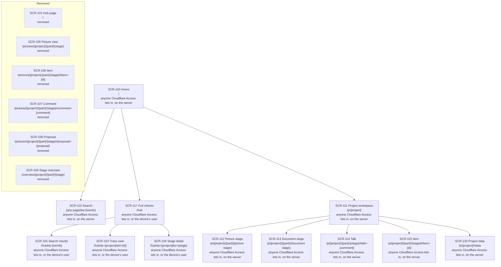

# NEXUS: sitemap

[한국어](nexus.ko.md)

Stage 07 of CORTHEX's own project, for NEXUS 0.2: the screens of the hub page and of the NEXUS server, in [nexus.yaml](nexus.yaml), and in this file what each screen shows, the board and the list drawn from that file, and the steps of the user flows that each screen shows. Status: drafted on 2026-11-03, while the memory plugin is being built, as the maintainer chose on 2026-11-02, on the recommendations of the user flows, the functional spec, the server's data and the interfaces. The maintainer passed its checkpoint the same day, together with stages 03 to 06 and 08. The maintainer's choice of 2026-11-03 to hold stage 01's event storming in NEXUS added the step view and the workshop of phase ② to the picture view, with no new screen, which the maintainer passed the same day ([For the checkpoint](#for-the-checkpoint)). The YAML is the source of the screens; this file explains them and is the source of the rest. The maintainer's redesign of 2026-11-06 added a second tree, SCR-110 to SCR-117, in which the first page gathers what waits for the user and each project opens as a workspace with its stages, its pictures and its talk; its checkpoint 1 passed at 17:44 KST that day ([For the checkpoint](#for-the-checkpoint)). Its screens stay `planned` until they are built, and SCR-101 to SCR-109 then become addresses that lead to them ([The redesign's screens](#the-redesigns-screens)). The design revision of 2026-11-11, which answers the review of that day, makes the two trees one, from SCR-110, with SCR-101 `removed`; adds the project's data, SCR-130; gives each screen the flows whose steps name it; and says where phase ②'s editor and work board go in the picture stage ([choices 15 to 19](#choices-this-stage-made)). It builds no screen and changes none, and its checkpoint passed on 2026-11-12 ([For the checkpoint](#for-the-checkpoint)). When this file and its Korean translation differ, this file is the source.

Inputs: the user flows in [docs/03-user-flow/nexus/](../03-user-flow/nexus/README.md) (FL-101 to FL-116); the functional spec in [docs/04-functional-spec/nexus.md](../04-functional-spec/nexus.md) (SPEC-101 to SPEC-142), above all its [notes for stages 07 and 08](../04-functional-spec/nexus.md#stages-07-and-08-screens); the interfaces in [docs/06-api/nexus.md](../06-api/nexus.md), with the pages' requests API-101 to API-103, the form of a sitemap's picture source and the [notes for stages 07 and 08](../06-api/nexus.md#stages-07-and-08-screens); the server's data in [docs/05-erd/nexus.md](../05-erd/nexus.md), with its [notes for stages 07 and 08](../05-erd/nexus.md#stages-07-and-08-screens); the DDD board and the glossary in [docs/01-domain/nexus.md](../01-domain/nexus.md), whose read models the screens name and whose words this file keeps; and phase 1's hub page as it runs, [hub.html](https://github.com/kodonghui/corthex/blob/76508243558abaedcc15bb422c454341845fcabd/plugins/corthex-nexus/skills/corthex-hub/assets/hub.html), whose views have addresses of their own. The memory plugin has no screens, so this stage has no file for it. For the redesign: the requirements REQ-219 to REQ-237, the flows FL-117 to FL-119 and the rows SPEC-143 to SPEC-156, with the structure that the maintainer passed at its checkpoint 1. For the design revision of 2026-11-11: [the review's map](../reviews/2026-11-11-design-review.md), above all the review's findings 12, 15 and 18; the flows as the revision left them, FL-101 to FL-119 and FL-125 to FL-127; the rows SPEC-115, SPEC-146, SPEC-147, SPEC-153, SPEC-154, SPEC-188, SPEC-201 to SPEC-203, SPEC-209 and SPEC-210; the requests API-108, API-177 and API-178; and what the revision's stages 04 and 06 noted for this stage.

The stage's default human view is a page of three views drawn from the YAML: a board, a list and slides. Here this file holds the board and the list, drawn from nexus.yaml, and people read them in the Korean copy in the project's Notion records, with the list as a database. There are no slides, since one person checks the sitemap rather than a meeting ([choice 8](#choices-this-stage-made)). From NEXUS 0.2, NEXUS draws this sitemap itself from nexus.yaml (REQ-142). `.corthex/project.json` records the choice.

## How to read this file

- The screens are SCR-101 to SCR-109, and the redesign's SCR-110 to SCR-117, defined in [nexus.yaml](nexus.yaml). Each has its parent, from the nesting under `children`, its path, who can see it, its flows, its terms and its status. From the design revision of 2026-11-11 they are one tree, from SCR-110, which also holds the project's data, SCR-130, and SCR-101 stands after the tree, `removed`. Since TASK-278 SCR-105 to SCR-109 stand there too, `removed`.
- A path is the page's address on the server, written as the contract [nexus.openapi.yaml](../06-api/nexus.openapi.yaml) writes its requests, with `{project}`, `{part}` and `{stage}` as there. What follows `#` is the page's own address of a view or a panel, which the browser keeps and never sends ([Addresses](#addresses)).
- A screen's flows are the flows with a step that the screen shows. Each such step names the screen's ID in the flow, after its requirements, as `REQ-102 · SCR-101` ([The flows on the screens](#the-flows-on-the-screens)). From the design revision of 2026-11-11 that step reads `REQ-102 · SCR-117`, and a screen's flows are exactly the flows whose steps name it ([choice 17](#choices-this-stage-made)).
- A screen's terms are its context and the TERM IDs of the DDD board's read models that it stands for, or `none` ([Terms](#terms)).
- Status: `built` for a view of phase 1 that NEXUS 0.2 leaves as it is, and `active` for one that 0.2 adds or changes, as in stages 04 to 06; `planned` for a screen of the redesign that is not built yet. From the design revision of 2026-11-11, `removed` for a screen that is no longer a route: it keeps its ID and the flows that last named it, says `terms: none`, stands after the tree without a parent or a child, and no flow's step names it ([choice 19](#choices-this-stage-made)).
- A state of a screen, such as empty, loading or stale, is not a screen of its own: stage 08 defines the states of each screen.

## The screens

- **SCR-101 Hub page**, `/`: every project with its current stage and next action first, then its 13 stages with their states, item counts and checks, and when and from which commit each snapshot was made (SPEC-122, built in phase 1). NEXUS 0.2 adds each part's states, the counts of what is open, the checkpoints that wait for their records, the actions to ask about first and the explanation on an empty server (SPEC-123 to SPEC-125). The hub builds the same page on a device as a file, `~/.corthex/hub/index.html` by default, without the server's links and counts.
- **SCR-102 Search results**, `/#q={words}`: the items that match an ID or the words of a title (SPEC-122).
- **SCR-103 Trace view**, `/#p={project}&id={id}`: what one item comes from and what it leads to, through all stages (SPEC-122).
- **SCR-104 Stage detail**, `/#p={project}&s={stage}`: one stage of a project, with its state, last checkpoint, next action, checks and items, and the link to its human view (SPEC-122). NEXUS 0.2 shows them for each part and, on the server, links each part's picture view and stage overview (SPEC-123, SPEC-138).
- **SCR-105 Picture view**, `/pictures/{project}/{part}/{stage}`: one part's picture of a stage, the DDD board, the ERD or the sitemap, with its document version and the open comments, proposals and discrepancies on its items, and apart the open comments whose item is gone (SPEC-119). It links the part's stage overview. A DDD board can be gone through here step by step, from its timeline to the whole board (SPEC-141). On a PC, phase ② edits the picture here (SPEC-134) and holds stage 01's workshop on a work board, apart from the DDD board (SPEC-142).
- **SCR-106 Item**, `/pictures/{project}/{part}/{stage}#item={id}`: one item of the picture, by its trace ID, with its comments, proposals and discrepancies, where the user leaves a comment (SPEC-119, SPEC-126).
- **SCR-107 Comment**, `/pictures/{project}/{part}/{stage}#comment={comment}`: one comment, by its `nc_` ID, with all its replies and its decision, where the user replies, marks it answered, settles it or opens it again (SPEC-127, SPEC-132).
- **SCR-108 Proposal**, `/pictures/{project}/{part}/{stage}#proposal={proposal}`: one proposal, by its `np_` ID, with its reason and the stage source text that it changes, where the user accepts or dismisses it, and the state of its reflection, which the user dismisses when it needs them (SPEC-131, SPEC-133).
- **SCR-109 Stage overview**, `/overview/{project}/{part}/{stage}`: what is left in one part's stage, its open discrepancies, comments and pending reflections together, with its recorded state, checkpoints and checks, where the user passes the checkpoint or withdraws one passed in NEXUS (SPEC-138, SPEC-139). Each entry links to its item, comment or proposal in the picture view.

From the design revision of 2026-11-11 the list above reads as follows, since the redesign's first tasks are built. SCR-101 is `removed`: `/` is the first page (SCR-110), and the hub page is the full checks (SCR-117), on the server at `/hub` and on a device as the file that the hub builds. SCR-102 to SCR-104 are still the hub page's three views, now under SCR-117: at `/hub#q={words}`, `/hub#p={project}&id={id}` and `/hub#p={project}&s={stage}` on the server, and after the same `#` in the device's file. SCR-105 to SCR-109 are served at their paths until TASK-278 answers those with redirects ([The redesign's screens](#the-redesigns-screens)). TASK-278 did so on 2026-11-13, and they are `removed`.

## The redesign's screens

NEXUS 0.2 opens on a table of 13 stages and their checks, keeps each picture at an address of its own, and shows the talk with the agent as small marks on a picture (the diagnosis of 2026-11-06). The redesign puts the picture in the middle and what waits for the user on one page:

- **SCR-110 Home**, `/`: "my turn" first, what waits for the user's answer in every project, the open proposals, the comments whose last entry is the agent's and the checkpoints that the agent asks for, each answered in place or opened at its place (SPEC-143); then how many entries of each project's agent to-do wait, with when the agent reads them (SPEC-144); then a card for each project with its current stage and next action, a small view of each picture and its 13 stages as shapes (SPEC-145). On an empty server it says how a project gets pushed, as the hub page does.
- **SCR-116 Search**, a field at the top of every page, with its words after `#` as `q`: items by ID or the words of their titles in every project, each opening in its project's workspace (SPEC-152). It moves phase 1's search results (SCR-102) to every page.
- **SCR-117 Full checks**, `/hub`: the hub page as it is, the 13 stages and their checks for every project, which the first page links (SPEC-153). SCR-101's table moves here, unchanged.
- **SCR-111 Project workspace**, `/p/{project}`: opens the project's current stage (SPEC-146), with the 13 stages in their six groups in a list on the left, the stage in the middle and the talk on the right.
- **SCR-112 Picture stage**, `/p/{project}/{part}/{stage}` for 01, 05 and 07: the stage's head, with its recorded state, its last checkpoint and the commit that it shows, and the stage record behind it, where the user passes the checkpoint (SPEC-147); the picture, as SPEC-119 draws it, with where the view is in the whole picture (SPEC-156); and a tab for the stage's items as a list (SPEC-148). It takes in SCR-104's stage detail, SCR-105's picture view and SCR-109's stage overview, whose "what is left" becomes the list's filters.
- **SCR-113 Document stage**, `/p/{project}/{part}/{stage}` for the other ten stages: the same head, and the stage's items as a list, whose items the user can now talk about (SPEC-148, SPEC-151).
- **SCR-114 Talk**, `#talk={comment}` beside any stage: the stage's talk by turn, what waits for the user first, then what waits for the agent with whether it has taken each, and the closed talk folded; it narrows to an item that is selected, and a comment left with nothing selected is on the stage as a whole (SPEC-150, SPEC-151). It takes in SCR-107's comment and SCR-108's proposal.
- **SCR-115 Item**, `#item={id}` beside any stage: one item with its fields in words, the place of its source, the items that it comes from and leads to in other stages, and its talk (SPEC-149). It takes in SCR-106's item and SCR-103's trace view.
- **SCR-130 Project data**, `/p/{project}#data`, from the design revision of 2026-11-11: a panel of the workspace, over the stage, with what the server holds of the project and Git does not, each kind with its count; above them when the project was last pushed, with the commit, and when the agent last read its agent to-do; and below them the user's own two acts, the export of the project space as one file and the removal of the project (SPEC-201 to SPEC-203). The workspace's head opens it (SPEC-146), and so does the address that the hub's dry run of a removal gives (SPEC-115). Under 1024 pixels it is a sheet over the tabs.

Under 1024 pixels the workspace shows the stage, the talk and the item as tabs, and the stage list from the stage's title (SPEC-155). Phase ② keeps two places switched off: "Edit" in the stage's head and a work board tab beside the picture. From the design revision of 2026-11-11 neither place shows until a release includes editing (SPEC-147), and both are views of the picture stage, which take the picture's place in the stage's column: `view=edit` for the editor and `view=board` for a part's work board on stage 01 ([Addresses](#addresses), [choice 18](#choices-this-stage-made)).

When the redesign is built, SCR-101 to SCR-109 keep their IDs and lead to their new places: SCR-101 to SCR-117, SCR-102 to SCR-116, SCR-103 and SCR-106 to SCR-115, SCR-104 to the head of SCR-112 or SCR-113, SCR-105 to SCR-112, SCR-107 and SCR-108 to SCR-114, and SCR-109 to the list of SCR-112 or SCR-113 (SPEC-154). Their status then says `removed`, as a screen that is no longer a route, and this file says where each went. From the design revision of 2026-11-11, which reads this paragraph against what is built (the review, finding 18): SCR-101 is `removed` now, since its page left `/` with TASK-271 and TASK-273, and SCR-117 stands for the hub page wherever it is built, on the server and on a device, as SCR-101 did. The hub page's three views are not removed: REQ-233 keeps the hub page whole, so SCR-102 to SCR-104 stay its views, under SCR-117, while the hub page's old addresses on `/` lead into the redesign, to the search (SCR-116), the item (SCR-115) and the stage (SCR-112 or SCR-113). SCR-105 to SCR-109 turn `removed` with TASK-278, each with `terms: none` and with where it went ([choice 15](#choices-this-stage-made)). They are `removed` since 2026-11-13.

## Board

Drawn from nexus.yaml on 2026-11-03, and again on 2026-11-07 with the redesign's tree from SCR-110: each screen with its ID, name, path and who can see it, and an arrow from each parent to each child. Drawn again on 2026-11-11, with the design revision, as one tree: a removed screen stands apart, in a box named Removed, with a dashed outline, no arrow and `removed` in place of who can see it. Drawn again on 2026-11-13 with TASK-278, which turned SCR-105 to SCR-109 `removed`: they stand apart with SCR-101.

<!-- board: drawn from nexus.yaml -->

<!-- end of board -->

## List

Drawn from nexus.yaml on 2026-11-03, and again on 2026-11-07, one row for each screen in the order of the trees. Drawn again on 2026-11-11, in the order of the one tree, with a removed screen last. Drawn again on 2026-11-13 with TASK-278, with SCR-105 to SCR-109 last, after SCR-101.

<!-- list: drawn from nexus.yaml -->
| Screen | Name | Parent | Path | Who can see it | Flows | Terms | Status |
| --- | --- | --- | --- | --- | --- | --- | --- |
| SCR-110 | Home | none | `/` | anyone Cloudflare Access lets in, on the server | FL-114, FL-117, FL-118 | CTX-014, TERM-121 | active |
| SCR-116 | Search | SCR-110 | `{any page}#q={words}` | anyone Cloudflare Access lets in, on the server | FL-118 | `none` | active |
| SCR-117 | Full checks | SCR-110 | `/hub` | anyone Cloudflare Access lets in, or the device's user | FL-105, FL-113, FL-118 | `none` | active |
| SCR-102 | Search results | SCR-117 | `/hub#q={words}` | anyone Cloudflare Access lets in, or the device's user | FL-105 | `none` | built |
| SCR-103 | Trace view | SCR-117 | `/hub#p={project}&id={id}` | anyone Cloudflare Access lets in, or the device's user | FL-105 | `none` | built |
| SCR-104 | Stage detail | SCR-117 | `/hub#p={project}&s={stage}` | anyone Cloudflare Access lets in, or the device's user | FL-105, FL-113 | `none` | active |
| SCR-111 | Project workspace | SCR-110 | `/p/{project}` | anyone Cloudflare Access lets in, on the server | FL-117, FL-118 | `none` | active |
| SCR-112 | Picture stage | SCR-111 | `/p/{project}/{part}/{picture stage}` | anyone Cloudflare Access lets in, on the server | FL-106, FL-110, FL-113, FL-115, FL-116, FL-118, FL-119, FL-125 | CTX-014, TERM-111 | active |
| SCR-113 | Document stage | SCR-111 | `/p/{project}/{part}/{document stage}` | anyone Cloudflare Access lets in, on the server | FL-113, FL-118, FL-119 | CTX-007, TERM-120 | active |
| SCR-114 | Talk | SCR-111 | `/p/{project}/{part}/{stage}#talk={comment}` | anyone Cloudflare Access lets in, on the server | FL-106, FL-107, FL-109, FL-110, FL-117, FL-119 | CTX-014, TERM-111 | active |
| SCR-115 | Item | SCR-111 | `/p/{project}/{part}/{stage}#item={id}` | anyone Cloudflare Access lets in, on the server | FL-106, FL-107, FL-118, FL-119 | CTX-014, TERM-111 | active |
| SCR-130 | Project data | SCR-111 | `/p/{project}#data` | anyone Cloudflare Access lets in, on the server | FL-114, FL-118, FL-127 | `none` | active |
| SCR-101 | Hub page | none | `/` | anyone Cloudflare Access lets in, or the device's user | FL-105, FL-113 | `none` | removed |
| SCR-105 | Picture view | none | `/pictures/{project}/{part}/{stage}` | anyone Cloudflare Access lets in, on the server | FL-106, FL-110 | `none` | removed |
| SCR-106 | Item | none | `/pictures/{project}/{part}/{stage}#item={id}` | anyone Cloudflare Access lets in, on the server | FL-106, FL-107 | `none` | removed |
| SCR-107 | Comment | none | `/pictures/{project}/{part}/{stage}#comment={comment}` | anyone Cloudflare Access lets in, on the server | FL-107, FL-109 | `none` | removed |
| SCR-108 | Proposal | none | `/pictures/{project}/{part}/{stage}#proposal={proposal}` | anyone Cloudflare Access lets in, on the server | FL-110 | `none` | removed |
| SCR-109 | Stage overview | none | `/overview/{project}/{part}/{stage}` | anyone Cloudflare Access lets in, on the server | FL-113 | `none` | removed |
<!-- end of list -->

## The flows on the screens

Every step that shows the user something on a screen names that screen. A flow that runs on a device, on the server or in a session shows nothing on a screen of its own: the hub reports it in the session, through the outcomes of its commands (API-133 to API-150), and the screens show its results the next time they are opened. A step that only hands over to another flow, such as "Open the picture view, FL-106", names no screen, since that flow names it. From the design revision of 2026-11-11 the table is drawn from the `flows` of the screens that are not removed and holds every flow, FL-125 to FL-127 too. Where a flow runs is the table's own, and FL-114 now runs in a session and in a browser, since the user removes a project in NEXUS (SPEC-202). Drawn again on 2026-11-13 with TASK-278: FL-106, FL-107, FL-109, FL-110 and FL-113 name the redesign's screens where they named SCR-105 to SCR-109.

<!-- flows: drawn from nexus.yaml -->
| Flow | Where it runs | Screens of its steps |
| --- | --- | --- |
| FL-101 | on a device, in the hub | none: the hub reports in the session |
| FL-102 | on a device, in the hub | none: the hub reports in the session |
| FL-103 | on the server | none: the hub reports in the session |
| FL-104 | on the server | none: the hub reports in the session |
| FL-105 | in a browser, and on a device | SCR-102, SCR-103, SCR-104, SCR-117 |
| FL-106 | in a browser | SCR-112, SCR-114, SCR-115 |
| FL-107 | in a browser | SCR-114, SCR-115 |
| FL-108 | in a session | none: the hub reports in the session |
| FL-109 | in a session; the comment shows its answers and decisions | SCR-114 |
| FL-110 | in a browser | SCR-112, SCR-114 |
| FL-111 | in a session | none: the hub reports in the session |
| FL-112 | in a session | none: the hub reports in the session |
| FL-113 | in a browser, and in a session | SCR-104, SCR-112, SCR-113, SCR-117 |
| FL-114 | in a session, and in a browser | SCR-110, SCR-130 |
| FL-115 | in a browser on a PC, phase ② | SCR-112 |
| FL-116 | in a browser on a PC, phase ② | SCR-112 |
| FL-117 | in a browser, the redesign | SCR-110, SCR-111, SCR-114 |
| FL-118 | in a browser, the redesign | SCR-110, SCR-111, SCR-112, SCR-113, SCR-115, SCR-116, SCR-117, SCR-130 |
| FL-119 | in a browser, the redesign | SCR-112, SCR-113, SCR-114, SCR-115 |
| FL-125 | in a browser, and in a session, phase ② | SCR-112 |
| FL-126 | in a session, phase ② | none: the hub reports in the session |
| FL-127 | in a browser | SCR-130 |
<!-- end of flows -->

## Addresses

- The three pages are those of the contract: the hub page (API-101), the picture view (API-102) and the stage overview (API-103). The server serves no other page.
- The hub page keeps phase 1's addresses after `#`: `q` for a search, `p` with `id` for the trace view and `p` with `s` for the stage detail, in the form of a URL's query.
- The picture view's panels get addresses in the same form: `item` with a trace ID, `comment` with an `nc_` ID and `proposal` with an `np_` ID. A link with one, from the stage overview, from the hub page or in the agent's message in a session, opens the panel at once, on a phone too. Closing the panel leaves the picture's address, and the browser's back button closes it. The server never sees what follows `#`, so no request changes.
- A DDD board's step gets `step` with the step's key, from `1-b` to `9`, as `#step=6`, and keeps it beside an open panel, as `#step=6&item=CTX-012`. Without it, or with a key that the board does not have, the view shows the whole board (SPEC-141).
- An address whose item, comment or proposal the picture does not hold opens the picture view, which says so; stage 08 draws that state.
- In a path, `{part}` is `_` for the project as a whole, as in the contract's requests.

The redesign's addresses, once it is built. Since TASK-271 the server answers its pages at them: `/` and a stage's address with the frame that TASK-272 draws, `/p/{project}` with its redirect, and `/hub` with the hub page, so SCR-117 is active; since TASK-273 `/` is the first page, so SCR-110 is active too; since TASK-274 a stage's address shows the workspace with the stage's list, so SCR-111 and SCR-113 are active, and a pictured stage showed its list until TASK-275 drew its picture; since TASK-275 to TASK-277 the picture stage, the talk, the item and the search are built, so SCR-112, SCR-114, SCR-115 and SCR-116 are active too; since TASK-278 the server answers 0.2's two paths with the redirects below, so SCR-105 to SCR-109 are `removed`; and since TASK-312 `data` opens the project's data over the stage, so SCR-130 is active too:

- The pages are the first page `/` (API-155), a project `/p/{project}`, which leads to its current stage (API-153), a stage `/p/{project}/{part}/{stage}` (API-154) and the hub page, now at `/hub` (API-101). `{stage}` is a stage's key, such as `02-prd`; SCR-112 and SCR-113 share the form and differ by whether the stage has a picture.
- After `#`, in the same form as 0.2's: `talk` alone opens the stage's talk, and with an `nc_` or `np_` ID opens that comment or proposal in it; `item` with a trace ID opens the item; `view=list` shows a picture stage's list instead of its picture; `step` keeps a DDD board's step, as in 0.2; `q` holds the search's words on any page.
- NEXUS 0.2's addresses lead to the same place (SPEC-154): `/pictures/{project}/{part}/{stage}` to the stage, with `#item=` kept, `#comment=` and `#proposal=` as `#talk=`, and `#step=` kept; `/overview/{project}/{part}/{stage}` to the stage with `#view=list`; and on `/`, the hub page's `#q={words}` to the same search, `#p={project}&id={id}` to the item in its stage, and `#p={project}&s={stage}` to that stage of the project's first part. The server answers the two old paths with a redirect, and the browser keeps what follows `#`; the first page's script reads the hub page's old addresses.

From the design revision of 2026-11-11, which adds one key, `data`, keeps two values of `view` for phase ② and adds no page:

- The hub page's three views keep phase 1's addresses after `#`, at `/hub` and in the file that the hub builds on a device: `/hub#q={words}`, `/hub#p={project}&id={id}` and `/hub#p={project}&s={stage}` (SCR-102 to SCR-104). On `/` the first page reads the same three and leads them into the redesign, as above, `#q=` opening the search (SCR-116). SCR-116's `{any page}` is any page of the redesign, SCR-110 to SCR-115, and `/hub` keeps the hub page's own search.
- `data`, a key without a value, opens the project's data (SCR-130) over the stage. `/p/{project}#data` leads to the project's current stage with the panel open, since the browser keeps what follows `#` through the redirect, and beside other keys it reads as `#item=REQ-107&data`. Closing the panel takes `data` out of the address and leaves the rest, and the browser's back button closes it (SPEC-203).
- `view` says which view the stage's column of a picture stage shows, one at a time: none for the picture, `list` for the list, and two values kept for phase ②, `edit` for the editor, in the picture's place, and `board` for the part's work board on stage 01. Until a release includes editing they show the picture, as any value that the page does not know does (SPEC-147, [choice 18](#choices-this-stage-made)).
- `filter=left` opens a stage's list narrowed to what is left, on a pictured stage too. The first page's agent to-do links it, and picking a filter in the page takes it out of the address. It is built since TASK-274 and defined in stage 08 (SCR-113); this list had left it out.
- The pages stay the four above: the project's data is a panel of the stage's page (API-154) that reads API-177, and the export is a download (API-178).

## Who can see what

- On the server every page is behind Cloudflare Access, which refuses anyone else with a page of its own before NEXUS answers (FL-105, FL-106). That page is Cloudflare's, not a screen of NEXUS.
- The hub page and its three views are also built on a device, as a file that its user opens, without the server's links and counts (SPEC-123).
- The picture view, its three panels and the stage overview are on the server only, since only the server holds the project spaces. So are all the redesign's screens: the hub page that the hub builds on a device stays as it is, without a first page or a workspace.
- What a screen lets the user do follows the contract's sign-ins: accepting or dismissing a proposal, dismissing a reflection and passing or withdrawing a checkpoint need a person's own sign-in (API-124, API-125, API-127 to API-129), while comments, replies and marking a comment answered take either sign-in (API-118 to API-120). A screen shows the same to everyone it shows, and stage 08 draws what a refusal shows.
- From the design revision of 2026-11-11: the full checks, SCR-117, with its three views, SCR-102 to SCR-104, is the only screen of the tree that is also built on a device, where the file stands alone, without the first page above it; the sentence above counted it among the screens of the server only. The project's data, SCR-130, shows with either sign-in (API-177), while the export and the removal are the user's own and are refused from the service token (API-178, API-108).

## Terms

NEXUS pairs each read model on a part's DDD board with the screens of the part's sitemap that name the read model's term, and opens a discrepancy where they disagree (D10 of stage 02, REQ-153, SPEC-120, SPEC-121). The stage skill has the agent name the terms (REQ-154, SPEC-137), here in each screen's `terms`:

- The picture view and its three panels name Picture view (TERM-111) in Discussion (CTX-014), the context whose command rows read it before the user comments or accepts or dismisses a proposal.
- The stage overview names Stage overview (TERM-120) in Stage progress (CTX-007).
- The hub page and its views say `terms: none`. The hub's contexts, CTX-006, CTX-008 and CTX-009, have no read models on the board, so a term would open a discrepancy, as stage 05's tables of those contexts say `terms: none` (its choice 7).
- The agent to-do (TERM-121) has no screen: the agent reads it through the hub (SPEC-135). The YAML lists it after `# without a screen:`, so no discrepancy waits for a screen that names it.

- The redesign's screens: the picture stage, the talk and the item name Picture view (TERM-111) in Discussion, as the picture view and its panels do. The document stage names Stage overview (TERM-120) in Stage progress, since a stage without a picture shows what it holds and what is left in it, and the user passes its checkpoint there. The first page names the agent to-do (TERM-121) in Discussion, whose counts it shows, so the YAML no longer lists the agent to-do after `# without a screen:`. The workspace, the search and the full checks say `terms: none`. My turn (TERM-135), the user's side of the open talk, is a word of the glossary and not yet a read model of the board, so no screen names it; stage 01's next change of the board can add it.
- Phase ②'s read models, Work board view (TERM-148) and List of changes (TERM-149), have no screen yet: the YAML lists them after `# without a screen:` until phase ②'s screens name them, on the picture stage (SCR-112) and its talk, as stage 05's nexus.sql lists phase ②'s aggregates after `without a table:` (its choice 19), so no discrepancy waits for them meanwhile.
- From the design revision of 2026-11-11: the project's data, SCR-130, says `terms: none`. Project data (TERM-154) is a word of the glossary in Sharing (CTX-009), a context without a read model on the board, so naming it would open a discrepancy, as for the hub page. A removed screen says `terms: none` too, since NEXUS's cross-check opens a discrepancy for a removed screen that still names a read model: SCR-101 named none, and SCR-105 to SCR-109 take their terms out when TASK-278 removes them, from when the redesign's screens alone name those read models. They have since TASK-278.

NEXUS's cross-check of its own pictures should then find no discrepancy between this sitemap and the board, which stage 12 checks. [Change 3](#changes-to-earlier-stages) concerns the read models that are read in more than one context.

## Outside the sitemap

- Cloudflare Access's sign-in page and its refusals.
- The stages' human views in other tools, such as Notion and Miro, which the stage detail links (REQ-095).
- What the hub says in a session, which the outcomes of its commands define (API-133 to API-150).
- Editing on a PC and the workshop on a work board, phase ② (FL-115, FL-116, SPEC-134, SPEC-142), in the picture view at widths of 1024 pixels and more; phase ② decides whether they need screens of their own. The tool links of phase ③ have no screen yet. From the design revision of 2026-11-11 their place is the picture stage, SCR-112, as two views of its column, `view=edit` and `view=board`, which do not show until a release includes editing; phase ②'s own stage 07, which D20 puts right after the redesign's build, decides whether they become screens of their own, and names their read models then ([choice 18](#choices-this-stage-made)).
- From the design revision of 2026-11-11, the server's own state, for which the review found no screen: when a project was last pushed and when the agent last read its agent to-do show on the first page, in the workspace's head and in the project's data (REQ-271, SPEC-188, SPEC-203), so they need no screen of their own. The backup and its copy on another machine are checked on the server each day (REQ-291) and show on no screen, and no requirement asks a screen for the server's version.

## Changes to earlier stages

The redesign changed the earlier stages in the same pull request as this tree, on 2026-11-07, as its checkpoint 1 listed them: stage 01's glossary gains my turn, workspace, talk and turn (TERM-135 to TERM-138), and a comment may be on any stage's item or on a stage as a whole (TERM-114, CTX-014's rule, choice ② A); stage 02 gains problem 14 and REQ-219 to REQ-237 and changes REQ-158 and REQ-162; stage 03 gains FL-117 to FL-119; stage 04 gains SPEC-143 to SPEC-156; stage 05 plans the changes of comments and checkpoints (TBL-105, TBL-110) and stage 06 the pages and requests API-151 to API-159 with the changes of API-101 to API-103, API-118, API-119 and the hub's `comment` and `reply`, which their files and the code take when the redesign is built. The flows of 0.2, FL-105 to FL-110 and FL-113, keep naming SCR-101 to SCR-109 until then.

Applied on 2026-11-03, when the checkpoint passed: 1 and 2 to the user flows, and 3 to the functional spec and, with the maintainer's yes in the same answer, to stage 01's command row. The SCR IDs in the flows' steps are this stage's own step and are already in the flows. Stage 06's two examples of a sitemap changed with this stage too: once the hub read the sitemap, it reported the template's two example screen IDs there as mentioned but not defined. Now the example of the YAML shows two screens of nexus.yaml, and the contract's example `picture_data_sitemap` leaves its screens' IDs out; neither changes a rule.

1. FL-105 gains a branch from "What does the user do?": the user opens a stage's overview, FL-113. SPEC-138 opens the overview from the hub page as well as from a picture view, and the stage detail links it.
2. FL-107 gains a step after the comment shows on its item: the user and the agent reply under it, and the user can mark it answered, settle it or open it again (REQ-163, REQ-166), on SCR-107. Only SPEC-127 holds this now, and no step of FL-107 shows a comment's replies, so SCR-107's flows hold only FL-109; with the step, FL-107 joins them.
3. The board has read models that are read in more than one context: the picture view in Discussion (CTX-014) and in Editing (CTX-010), and the agent to-do in both, while a screen names one context. SPEC-121 gains a rule: a pair's contexts agree when the screen names any context whose command rows read the read model, so that the picture view's screens, which name CTX-014, open no discrepancy with Editing's picture view. Today stage 01's command row of Edit picture in CTX-010 names its read model "Picture view; on a conflict, the user's edit over the new picture", which no glossary row has, so the hub of NEXUS 0.2 would warn `board-term-missing` for it and pair it with nothing (SPEC-106). Written "Picture view", as the board's table of read models already says what the view shows on an edit conflict, it would pair as well; stage 01 is confirmed, so that line changes only with the maintainer's yes.

The design revision of 2026-11-11 made three changes more, in the same pull request as this tree, which passed its checkpoint with it on 2026-11-12. The SCR IDs in the flows' steps are this stage's own step, as on 2026-11-03.

4. The flows' steps name the screens as the tree now stands. FL-105 and FL-113 name SCR-117 where they named SCR-101, since the full checks stands for the hub page on the server and on a device. Eleven steps that showed something without naming a screen name it now: the stage as it is now after a refused pass, in FL-113 (SCR-109, SCR-112, SCR-113); the refusal of a removal, in FL-114 (SCR-130); what changed on a work board since the agent last read it and a sticky as it is now after a refused change, in FL-116 (SCR-112); my turn's entries and its saying that nothing waits, in FL-117 (SCR-110); the tabs under 1024 pixels (SCR-111) and the list's filters (SCR-112, SCR-113), in FL-118; the comments whose items are gone, in FL-119 (SCR-114); and the export's refusal and its saying that there is nothing to export, in FL-127 (SCR-130).
5. FL-114's last step says what the user sees after a removal: the page leads to the first page, which says that the project was removed (SPEC-202), on SCR-110. The step said only that the project's sources and the device's files stay, which it still says.
6. Stage 08's definitions follow in the revision's stage 08: SCR-130 gets its definition, SCR-117's stands for the hub page on a device too, SCR-102 to SCR-104 take their paths under `/hub`, and SCR-101's says `removed` and stays as the text that SCR-117's states name ([notes for stage 08](#stage-08-screen-states)).

## Choices this stage made

The flows, the spec and the interfaces left these to stage 07. The checkpoint of 2026-11-03 kept each as it is.

1. Nine screens: the hub page with the three views to which phase 1 already gives addresses, the search results, the trace view and the stage detail; and NEXUS 0.2's two pages, the picture view with three panels, the item, the comment and the proposal, and the stage overview. A state of a screen, such as an empty server or a picture left out, is not a screen; stage 08 draws it.
2. The panels get addresses after `#` in the hub page's form, so that a link from the stage overview, the hub page or a session opens the item, the comment or the proposal at once, and the browser's back button closes it. The server never sees them, so no request changes.
3. The picture view and the stage overview hang under the stage detail, where the hub page links them for each part; the panels hang under the picture view, since a comment or a proposal whose item is gone still opens there.
4. Paths as the contract writes them, with `{project}` in braces, in place of the template's `:id`, so that a screen's path and its page's request read the same.
5. One screen for the hub page on the server and on a device, where the hub builds it as a file without the server's links and counts.
6. Only the board's read models as terms, as stage 05's tables name only its aggregates: Picture view for the picture view and its panels, Stage overview for the overview, `none` for the hub page and its views, and the agent to-do listed without a screen.
7. A `status` for each screen, as for the items of stages 04 to 06. The hub reads it as a field, as its reading rules read statuses, and a removed screen will say `removed` there instead of losing its ID; the template has no field for it yet ([notes for stage 10](#stage-10-work-breakdown)).
8. The human view: this file with the board and the list, and the Korean copy in Notion with the list as a database, instead of the stage's default page of three views. There are no slides, since one person checks it; from NEXUS 0.2, NEXUS draws the sitemap itself.
9. Editing on a PC, phase ②, has no screen of its own now: FL-115 runs in the picture view, and so does the workshop on a work board (FL-116), apart from the DDD board, until phase ② draws the work board's steps (hotspot 14 of stage 01). The step view of 0.2 is a way of showing the picture view's DDD board, not a screen (SPEC-141).

The redesign's choices, passed at its checkpoint 1 on 2026-11-06:

10. Eight screens in a second tree, from the first page: one page for what waits for the user and the projects, one workspace for each project, and the hub page kept whole as the full checks. Every screen of 0.2 has a place in it, so none is lost.
11. Two screens for a stage, by whether it has a picture: three stages show a picture with a list tab, and ten show their items as a list. They share one form of address and differ by the stage.
12. The talk and the item as screens of their own, panels beside any stage with addresses after `#`, as 0.2's panels were, so that a link from the first page or from a session opens one at once.
13. A status `planned` for a screen that is approved and not built, so that the sitemap can hold both trees until the build, and `removed` for 0.2's screens after it, with where each went.
14. The search as a field on every page instead of a view of the hub page, since the first page is no longer the hub page.

The design revision's choices, of 2026-11-11, which passed its checkpoint on 2026-11-12:

15. One tree, from SCR-110. SCR-101 is `removed` now and not after TASK-278, since its page left `/` when the hub page moved to `/hub` and the first page took its place (TASK-271, TASK-273); until now two screens shared `/` (the review, finding 18). SCR-117 stands for the hub page on the server and on a device, as SCR-101 did by choice 5, so the file that the hub builds has a screen. The hub page's three views stay screens, SCR-102 to SCR-104, under SCR-117, at `/hub`'s addresses after `#`. That changes choice 13 for those three, which it would have removed: the hub page stays whole (REQ-233), the hub still builds it on a device, and FL-105 still runs on it. SCR-105 to SCR-109 stay under SCR-104, as they were, until TASK-278 removes them.
16. The project's data as a screen of its own, SCR-130: a panel of the workspace with an address after `#`, as the talk and the item are (choice 12). The hub's dry run of a removal gives its address, and the user's two acts on a project's data, the export and the removal, need a place that a link opens (SPEC-201 to SPEC-203; the review, finding 15). The number leaves SCR-118 to SCR-129 for the screens that phase ② may add after SCR-117.
17. A screen's `flows` are exactly the flows whose steps name it, which a script checks in English and Korean (the stage's first check), and the table of flows is drawn from them, to FL-127. So FL-115, FL-116 and FL-125 are SCR-112's and no longer SCR-105's, as their steps have named SCR-112 since phase ②'s design; FL-113 is also SCR-112's and SCR-113's, where the user passes a checkpoint in the redesign; and FL-126, whose steps run in a session, is no screen's. A removed screen keeps the flows that last named it, as its history, and the check does not read them.
18. Phase ②'s editor and work board are views of the picture stage, SCR-112, and not screens of their own for now (the review, finding 12). The stage's column shows one view at a time, the picture, the list, the editor in the picture's place or the part's work board on stage 01, and `view` after `#` names it, with `edit` and `board` kept for the last two, the two parts of phase ②. Nothing of them shows until a release includes editing (SPEC-147). So TASK-275 builds the picture as one view of that column and not as the column itself: stage 08 keeps the two places in the head and the tools, and stage 09 draws them on one sheet of grey wireframes before TASK-275 finishes. Phase ②'s own stage 07, which D20 puts right after the redesign's build, decides whether they become screens of their own, and then names TERM-148 and TERM-149, which wait after `# without a screen:` meanwhile.
19. A removed screen stands after the tree as a root without children, keeps its ID, name, path and the flows that last named it, and says `terms: none`. The board draws it apart, in a box named Removed, with a dashed outline, no arrow and `removed` in place of who can see it, and the list keeps its row, last. The stage's checks of the root and of the paths read only the screens that are not removed, so that SCR-101 and SCR-110 can both say `/`. The hub at the pinned commit already reads the status so: it notes no missing screen definition for a removed screen.

## Checks run

On 2026-11-03, on nexus.yaml, this file, its translation and the flows:

- The stage's four checks, by a script that stays outside the repository: every step that shows something names its screen, checked by hand on a list of the steps that name none, and the SCR IDs in each flow equal the flows that nexus.yaml gives each screen, in English and Korean; every screen is reachable from SCR-101, and no two share a path; every screen says who can see it; and each screen appears once in the board and once in the list of this file and of its translation, both equal to a fresh drawing from nexus.yaml.
- The form of a sitemap's picture source in stage 06: every screen has `id`, `name`, `path`, `access`, `flows`, `terms` and `status`; every term is a CTX or TERM ID that the DDD board's document defines, and each screen's context has a command row that reads the read model (change 3); and every read model of the board has a screen that names its term or is listed after `# without a screen:`.
- The hub's snapshot of this repository reads SCR-101 to SCR-109 once each, each with its parent, and adds no check.
- Mermaid 11 draws the board and the seven changed flows, in English and in Korean, in Chromium, with the paths' `#`, `&` and braces as written.
- The repository's checks, with these files in place: `python -m unittest discover -s tests`, `claude plugin validate --strict` for the marketplace and its three plugins and `node --test nexus/test/*.test.js` pass, and every link of this file and its translation resolves. Stage 06's contract, with its changed example, still passes the OpenAPI 3.1 validator, and each of its examples its schema.

Again on 2026-11-03, after the maintainer's choice to hold stage 01's event storming in NEXUS, with the same script:

- The stage's four checks pass with FL-116, which shows SCR-105: 9 screens and 16 flows, and this file and its translation each equal a fresh drawing from nexus.yaml.
- The step view and the workshop add no screen, so the board and the tree stay as drawn; the step's address is the picture view's, after `#`.
- The repository's checks pass, with 756 tests (12 skipped), the hub's snapshot of this repository reads 1014 items with no checks, and every link of this file and its translation resolves.

On 2026-11-07, after the redesign's tree and its changes to the earlier stages, with the same checks:

- The stage's four checks on the second tree: every step of FL-117 to FL-119 that shows something names its screen, and the SCR IDs in each of them equal the flows that nexus.yaml gives each screen, in English and Korean, once FL-117 named SCR-111, FL-118 SCR-110, and FL-119 SCR-112 and SCR-113 where an item is chosen; every screen of the tree is reachable from SCR-110 and says who can see it; and the board, the list and the table of flows in this file and its translation equal a fresh drawing from nexus.yaml. The two trees share one path, `/`: SCR-101's until the build, then SCR-110's, when the hub page moves to `/hub` (SCR-117).
- The hub at the pinned commit builds this repository's snapshot with 0 errors and the 628 warnings of main, and notes the eight screens that stage 08 has not defined yet. With the pictures drawn from these files, NEXUS's cross-check of the board and this sitemap opens no discrepancy, as on main.
- Mermaid 11.17.2 parses and draws FL-117 to FL-119, in English and Korean, in Chromium.
- The repository's checks pass: `python -m unittest discover -s tests` with the pinned hub, `node --test nexus/test/*.test.js` (264 tests, on Node 22, since the container has no Node 24), the Worker's dry-run build and `git diff --check`; every link of the changed documents resolves.

On 2026-11-11, for the design revision, which changes nexus.yaml, this file, its translation and the steps of eight flows, and no code:

- The stage's four checks on the one tree, by the script, which stays outside the repository until the test that stage 10 plans: every step that shows something names its screen, checked by hand on the list of the steps that name none, where eleven steps gained one (change 4); the SCR IDs in the steps of each of the 22 flows equal, in English and Korean, the `flows` of the screens that are not removed, and no step names a removed screen; every screen that is not removed is reachable from SCR-110, the one root, and no two of them share a path; every screen says who can see it; and the board, the list and the table of flows of this file and of its translation equal a fresh drawing from nexus.yaml, with each of the 18 screens, 1 of them removed, once in the board and once in the list.
- The form of a sitemap's picture source: every screen has `id`, `name`, `path`, `access`, `flows`, `terms` and `status`, the status is `active` for 10 screens, `planned` for 5, `built` for 2 and `removed` for 1, and the removed screen says `terms: none` and stands after the tree. On the sources of the three pictures as the hub's code reads them from these files, that code adds no check, and NEXUS's cross-check opens no discrepancy between the board's read models and the screens, or between its aggregates and the tables; TERM-148 and TERM-149 stay listed without a screen.
- The hub at the pinned commit builds this repository's snapshot with 1442 items, no error and 600 warnings, one fewer than before this stage: the warning for SCR-130, which the revision's flows, spec rows and contract named before this stage defined it, is gone. The hub reads the 18 screens once each, with parent and status, and notes the one screen that stage 08 has not defined yet, SCR-130.
- Mermaid 11.4.1 draws the board in Chromium, in English and Korean, with 18 boxes, 16 arrows and the removed screen in a box of its own, and all 44 drawings of the flows.
- The repository's checks pass: `python -m unittest discover -s tests` with the pinned hub (13 tests), `node --test nexus/test/*.test.js` (337 tests, on Node 22, since the container has no Node 24), the Worker's dry-run build and `git diff --check`. Every link of the changed documents resolves, and each changed line has the same IDs, code and links as its translation, apart from two lines that differed before this stage.

Since TASK-281 of 2026-11-12, `tests/test_sitemap.py` runs these checks as the repository's test, reading nexus.yaml with the pinned hub's own code: the second, the third and the fourth as written, and the first on the steps of the 22 flows in both languages, while whether each step that shows something names its screen stays a check by hand. It also takes this repository's snapshot with the pinned hub and runs NEXUS's cross-check on it (TC-1768), and `nexus/test/hub-regression.mjs` opens the hub page's three views at `/hub` and in the file that the hub builds on a device (TC-1766).

On 2026-11-13, with TASK-278, which turns SCR-105 to SCR-109 `removed` and has five flows name the redesign's screens in their place:

- `tests/test_sitemap.py` passes its four checks and its cross-check: the SCR IDs in the steps of each of the 22 flows equal, in English and Korean, the `flows` of the screens that are not removed, once FL-106, FL-107, FL-109, FL-110 and FL-113 name SCR-112, SCR-114 and SCR-115 where they named SCR-105 to SCR-109; nexus.yaml holds 18 screens, 9 `active`, 1 `planned`, 2 `built` and 6 `removed`, each removed one after the tree with `terms: none`; and this file and its translation equal a fresh drawing. With the pictures drawn from these files, NEXUS's cross-check of the board and this sitemap opens no discrepancy, since SCR-112 to SCR-115 name the read models that the removed screens named.
- The pinned hub builds this repository's snapshot with 1903 items, no error and the 601 warnings that `tests/hub_warnings.json` lists by rule and ID, as before, and reads the 18 screens with the six removed ones apart.
- Mermaid 11.17.2 draws the board in Playwright's Chromium, in English and Korean, with 18 boxes, 11 arrows and the six removed screens in the Removed box, and the five changed flows in both languages.
- The repository's checks pass: `python -m unittest discover -s tests` with the pinned hub (39 tests), `node --test nexus/test/*.test.js` (368 tests, Node 24), the Worker's dry-run build and `git diff --check`.

## For the checkpoint

The design revision of 2026-11-11 passed its checkpoint on 2026-11-12, in the maintainer's own words ([the review's map](../reviews/2026-11-11-design-review.md)). It builds no screen and changes none: the YAML, this file and the steps of eight flows change, and the pages answer as before. The first thing to look at is the [board](#board). The revision changes this stage as follows, one line for each thing that changes for the maintainer:

1. The screens are one tree, from the first page, and SCR-101 is `removed`: the full checks, SCR-117, is the hub page on the server and on a device, with its three views under it (choice 15).
2. The project's data is a screen, SCR-130, at `/p/{project}#data`: what the server holds of a project and Git does not, the last push and the last read, the export and the removal (choice 16).
3. Each screen's flows are the flows whose steps name it, and the table of flows holds all 22 (choice 17, changes 4 and 5).
4. Phase ②'s editor and work board get their place before TASK-275 finishes: two views of the picture stage, `view=edit` and `view=board`, of which nothing shows until a release includes editing. Phase ②'s own stage 07, which D20 puts right after the redesign's build, decides whether they become screens (choice 18).
5. The only new addresses are `data` and the two kept values of `view`, and no page is added ([Addresses](#addresses)).

The redesign's checkpoint 1 passed on 2026-11-06 at 17:44 KST: on a decision card in the project's thread the maintainer chose to go ahead as drawn ("이대로 진행"), with the talk on the items of every stage (choice ② A) and the three questions of phase ② as recommended. It covered the eight screens and their places in grey wireframes at 1440 and 390 pixels (choices 10 to 14), where each screen of 0.2 goes, how talk passes between the user and the agent, and which stages change. Its checkpoint 2, the look, passed on 2026-11-07 at 05:45 KST with candidate A, "Drawing sheet" (stage 09). Its checkpoint 3 will cover each screen's states (stage 08) and the tokens' freeze.

The maintainer's choice of 2026-11-03, to hold stage 01's event storming in NEXUS, passed at 16:54 KST the same day, together with the changes that it made to the other stages: on a decision card in the project's thread the maintainer chose to pass the step view and the work board as drawn ("모두 그린 대로 통과", pass all as drawn). The checkpoint covered: the step view and the workshop of phase ② stay in the picture view, with no screen of their own (choice 9), and the step goes in the address after `#` as `step`.

Passed on 2026-11-03 at 11:39 KST, together with stages 03 to 06 and 08: on a decision card in the project's thread the maintainer chose all the recommendations ("모두 추천대로", all as recommended), so the screens and their addresses stand as drawn. The checkpoint covered:

1. The nine screens and their tree (choices 1 and 3), above all the picture view's three panels as screens of their own, which stage 08 then draws state by state.
2. The addresses after `#` (choice 2), which let a link open a panel directly, from the stage overview or from a session.
3. The terms (choice 6), so that NEXUS's cross-check of its own pictures finds no discrepancy, with change 3.
4. The two new steps of the flows (changes 1 and 2).

## Notes for later stages

### Stage 08: screen states

- For the design revision of 2026-11-11: a definition for SCR-130, with the states that the spec's notes name, loading, no space yet, the removal's confirmation before and after the name is typed, refused, and removed, and with its sheet under 1024 pixels (SPEC-201 to SPEC-203); on SCR-110, the notice that a project was removed (SPEC-202); SCR-117's definition stands for the hub page on the server and on a device, and SCR-102 to SCR-104 take their paths under `/hub`; SCR-101's says `removed` and stays as the text of the hub page's states, which SCR-117's states name; SCR-112 keeps the two places of choice 18, in the head and in the tools, and shows neither; and the README's list and counts of screens follow.
- For the redesign, at its checkpoint 3: one definition for each of SCR-110 to SCR-117, with normal, loading, empty, error, permission and stale, at 1440 and 390 pixels and in both themes. What the rows already name: an empty my turn and an empty server on SCR-110 (SPEC-143, SPEC-145); a project without recorded progress on SCR-111 (SPEC-146); a picture not current, left out or not drawn yet on SCR-112, as on SCR-105; a stage that the project does not read on SCR-113 (SPEC-148); a comment that was not saved, one closed in another tab and an entry the agent has taken on SCR-114 (SPEC-150, SPEC-151); an item that is gone on SCR-115 (SPEC-149); no match on SCR-116 (SPEC-152).
- One definition for each screen, SCR-101 to SCR-109, with the states that the functional spec's [notes](../04-functional-spec/nexus.md#stages-07-and-08-screens) list: normal, loading, empty, error, permission and stale; the marks that the server's data gives; and each screen's requests and the states that their errors lead to, from stage 06's [notes](../06-api/nexus.md#stages-07-and-08-screens). The hub page and its views keep phase 1's states and add those of 0.2.
- What the spec already names: an empty server (SPEC-124) and a project without a snapshot on SCR-101; a picture link that is not current and a checkpoint that waits for its record on SCR-104; on SCR-105 a picture not drawn yet or left out, with why, one that is not current, one of more than 300 elements, no connection, an expired sign-in and code that fails to load, which shows the items as a list (SPEC-119), and a DDD board's steps, or a board without a timeline (SPEC-141); a comment that was not saved and an item that is gone on SCR-106 (SPEC-126); a comment or a proposal closed in another tab on SCR-107 and SCR-108; nothing left and a checkpoint passed but not recorded on SCR-109 (SPEC-138); and an address whose item, comment or proposal is gone.
- Each state at 320 and 1440 pixels (REQ-101, REQ-146).

### Stage 09: mockups

- For the design revision of 2026-11-11: one sheet of grey wireframes of the picture stage's column with the four views of choice 18, the picture, the list, the editor and the work board, at 1,280 and 1,440 pixels, with the columns of SPEC-210 open and folded, before TASK-275 finishes (the review, findings 11 and 12). It is a skeleton without the look: it shows where the views' controls go in the head and the tools, and it decides nothing of phase ②'s own screens.
- For the redesign: candidate A of checkpoint 2, painted on the screens of checkpoint 1; [the mockup's notes](../09-mockup/nexus/README.md#the-redesigns-look) hold its tokens until checkpoint 3 freezes them.

Two candidates for each new screen, SCR-105 to SCR-109, the phone first, at 320 pixels. The picture view draws with the read-only editors of D11, Excalidraw for the DDD board and the sitemap and ERD Editor for the ERD. The hub page keeps phase 1's design, with the additions of 0.2 on SCR-101 and SCR-104.

### Stage 10: work breakdown

- For the design revision of 2026-11-11: a task for SCR-130, with API-177, API-178 and the user's removal by API-108, and with the first page's notice after a removal; TASK-275 builds the picture as one view of the stage's column, after stage 09's sheet of choice 18; TASK-278 turns SCR-105 to SCR-109 `removed` with `terms: none`, moves them after the tree, draws the three views again and has FL-106, FL-107, FL-109, FL-110 and FL-113 name the redesign's screens in their place; a test in the repository keeps this stage's checks, which a script outside it ran until now; and the pass that names what the user saw (stage 06's breaking change 9, under D17, decided on 2026-11-12 as recommended) is built after TASK-278's redirects or together with a change of 0.2's stage overview, so that no page that is still served sends a pass without the commit.
- For the redesign: the tokens and the hub page's copy of them first, with the hub's `comment` for any stage and `--asks` on its `comment` and `reply`; then the requests API-151 to API-159 and the changed API-101 to API-103, API-118 and API-119, with the changes of comments and checkpoints; then the first page, the workspace with its panels, and the redirects; the hub page last, which only moves.
- The views come last, after the server and the hub, as stage 06 orders them: the hub page's additions in [hub.html](https://github.com/kodonghui/corthex/blob/76508243558abaedcc15bb422c454341845fcabd/plugins/corthex-nexus/skills/corthex-hub/assets/hub.html), which [nexus/src/hub.html](../../nexus/src/hub.html) copies, then the picture view with its panels, then the stage overview.
- The release carries `terms` and `status` into the stage 07 template, the core plugin's [07-sitemap.md](https://github.com/kodonghui/corthex/blob/76508243558abaedcc15bb422c454341845fcabd/plugins/corthex/skills/corthex-screen/references/07-sitemap.md), with the step of SPEC-137 that has the agent write the terms.

### Stage 11: development

The view's code reads the address after `#` when the page opens and writes it when a panel opens or closes; a test opens each panel from its address, and one whose comment is gone. For the design revision of 2026-11-11: the stage's page reads `data` and `view` too. `data` opens and closes the project's data beside whatever else the address holds, and a `view` that the page does not know, or whose view the release does not include, shows the picture.

### Stage 12: QA

- For the design revision of 2026-11-11: each address of the revision opened, `/p/{project}#data`, `#item={id}&data`, `#view=edit`, `#view=board` and `/hub`'s three; SCR-130 walked at 1440 and 390 pixels on synthetic data, with the export, the removal's refusals and the first page's notice after a removal; and NEXUS's cross-check with SCR-101 `removed` and SCR-130 in the tree, which opens no discrepancy.
- For the redesign: FL-117 to FL-119 walked at 1440 and 390 pixels in both themes, each panel opened from its address, and every address of 0.2 opened to see where it leads.
- Every flow that runs in a browser walked over these screens at 320 and 1440 pixels by the stage's browser agents, with each panel opened from its address.
- NEXUS's cross-check of its own pictures: the picture view's screens pair with Picture view and the stage overview with Stage overview, the agent to-do has no screen, and no discrepancy opens. The hub's `board-term-missing` warning for Editing's picture view stays until change 3.
