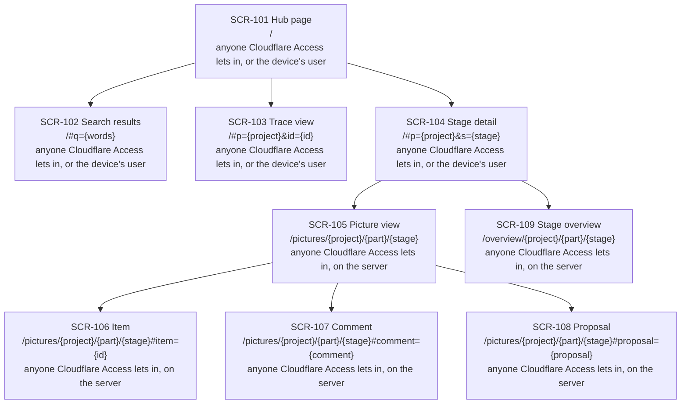

# NEXUS: sitemap

[한국어](nexus.ko.md)

Stage 07 of CORTHEX's own project, for NEXUS 0.2: the screens of the hub page and of the NEXUS server, in [nexus.yaml](nexus.yaml), and in this file what each screen shows, the board and the list drawn from that file, and the steps of the user flows that each screen shows. Status: draft of 2026-11-03, written while the memory plugin is being built, as the maintainer chose on 2026-11-02, and on the recommendations of the user flows, the functional spec, the server's data and the interfaces, whose checkpoint is still open. The maintainer checks it together with them. The YAML is the source of the screens; this file explains them and is the source of the rest. When this file and its Korean translation differ, this file is the source.

Inputs: the user flows in [docs/03-user-flow/nexus/](../03-user-flow/nexus/README.md) (FL-101 to FL-115); the functional spec in [docs/04-functional-spec/nexus.md](../04-functional-spec/nexus.md) (SPEC-101 to SPEC-140), above all its [notes for stages 07 and 08](../04-functional-spec/nexus.md#stages-07-and-08-screens); the interfaces in [docs/06-api/nexus.md](../06-api/nexus.md), with the pages' requests API-101 to API-103, the form of a sitemap's picture source and the [notes for stages 07 and 08](../06-api/nexus.md#stages-07-and-08-screens); the server's data in [docs/05-erd/nexus.md](../05-erd/nexus.md), with its [notes for stages 07 and 08](../05-erd/nexus.md#stages-07-and-08-screens); the DDD board and the glossary in [docs/01-domain/nexus.md](../01-domain/nexus.md), whose read models the screens name and whose words this file keeps; and phase 1's hub page as it runs, [hub.html](../../plugins/corthex-nexus/skills/corthex-hub/assets/hub.html), whose views have addresses of their own. The memory plugin has no screens, so this stage has no file for it.

The stage's default human view is a page of three views drawn from the YAML: a board, a list and slides. Here this file holds the board and the list, drawn from nexus.yaml, and people read them in the Korean copy in the project's Notion records, with the list as a database. There are no slides, since one person checks the sitemap rather than a meeting ([choice 8](#choices-this-stage-made)). From NEXUS 0.2, NEXUS draws this sitemap itself from nexus.yaml (REQ-142). `.corthex/project.json` records the choice.

## How to read this file

- The screens are SCR-101 to SCR-109, defined in [nexus.yaml](nexus.yaml). Each has its parent, from the nesting under `children`, its path, who can see it, its flows, its terms and its status.
- A path is the page's address on the server, written as the contract [nexus.openapi.yaml](../06-api/nexus.openapi.yaml) writes its requests, with `{project}`, `{part}` and `{stage}` as there. What follows `#` is the page's own address of a view or a panel, which the browser keeps and never sends ([Addresses](#addresses)).
- A screen's flows are the flows with a step that the screen shows. Each such step names the screen's ID in the flow, after its requirements, as `REQ-102 · SCR-101` ([The flows on the screens](#the-flows-on-the-screens)).
- A screen's terms are its context and the TERM IDs of the DDD board's read models that it stands for, or `none` ([Terms](#terms)).
- Status: `built` for a view of phase 1 that NEXUS 0.2 leaves as it is, and `active` for one that 0.2 adds or changes, as in stages 04 to 06.
- A state of a screen, such as empty, loading or stale, is not a screen of its own: stage 08 defines the states of each screen.

## The screens

- **SCR-101 Hub page**, `/`: every project with its current stage and next action first, then its 13 stages with their states, item counts and checks, and when and from which commit each snapshot was made (SPEC-122, built in phase 1). NEXUS 0.2 adds each part's states, the counts of what is open, the checkpoints that wait for their records, the actions to ask about first and the explanation on an empty server (SPEC-123 to SPEC-125). The hub builds the same page on a device as a file, `~/.corthex/hub/index.html` by default, without the server's links and counts.
- **SCR-102 Search results**, `/#q={words}`: the items that match an ID or the words of a title (SPEC-122).
- **SCR-103 Trace view**, `/#p={project}&id={id}`: what one item comes from and what it leads to, through all stages (SPEC-122).
- **SCR-104 Stage detail**, `/#p={project}&s={stage}`: one stage of a project, with its state, last checkpoint, next action, checks and items, and the link to its human view (SPEC-122). NEXUS 0.2 shows them for each part and, on the server, links each part's picture view and stage overview (SPEC-123, SPEC-138).
- **SCR-105 Picture view**, `/pictures/{project}/{part}/{stage}`: one part's picture of a stage, the DDD board, the ERD or the sitemap, with its document version and the open comments, proposals and discrepancies on its items, and apart the open comments whose item is gone (SPEC-119). It links the part's stage overview. On a PC, phase ② edits the picture here (SPEC-134).
- **SCR-106 Item**, `/pictures/{project}/{part}/{stage}#item={id}`: one item of the picture, by its trace ID, with its comments, proposals and discrepancies, where the user leaves a comment (SPEC-119, SPEC-126).
- **SCR-107 Comment**, `/pictures/{project}/{part}/{stage}#comment={comment}`: one comment, by its `nc_` ID, with all its replies and its decision, where the user replies, marks it answered, settles it or opens it again (SPEC-127, SPEC-132).
- **SCR-108 Proposal**, `/pictures/{project}/{part}/{stage}#proposal={proposal}`: one proposal, by its `np_` ID, with its reason and the stage source text that it changes, where the user accepts or dismisses it, and the state of its reflection, which the user dismisses when it needs them (SPEC-131, SPEC-133).
- **SCR-109 Stage overview**, `/overview/{project}/{part}/{stage}`: what is left in one part's stage, its open discrepancies, comments and pending reflections together, with its recorded state, checkpoints and checks, where the user passes the checkpoint or withdraws one passed in NEXUS (SPEC-138, SPEC-139). Each entry links to its item, comment or proposal in the picture view.

## Board

Drawn from nexus.yaml on 2026-11-03: each screen with its ID, name, path and who can see it, and an arrow from each parent to each child.

<!-- board: drawn from nexus.yaml -->

<!-- end of board -->

## List

Drawn from nexus.yaml on 2026-11-03, one row for each screen in the order of the tree.

<!-- list: drawn from nexus.yaml -->
| Screen | Name | Parent | Path | Who can see it | Flows | Terms | Status |
| --- | --- | --- | --- | --- | --- | --- | --- |
| SCR-101 | Hub page | none | `/` | anyone Cloudflare Access lets in, or the device's user | FL-105, FL-113 | `none` | active |
| SCR-102 | Search results | SCR-101 | `/#q={words}` | anyone Cloudflare Access lets in, or the device's user | FL-105 | `none` | built |
| SCR-103 | Trace view | SCR-101 | `/#p={project}&id={id}` | anyone Cloudflare Access lets in, or the device's user | FL-105 | `none` | built |
| SCR-104 | Stage detail | SCR-101 | `/#p={project}&s={stage}` | anyone Cloudflare Access lets in, or the device's user | FL-105, FL-113 | `none` | active |
| SCR-105 | Picture view | SCR-104 | `/pictures/{project}/{part}/{stage}` | anyone Cloudflare Access lets in, on the server | FL-106, FL-110, FL-115 | CTX-014, TERM-111 | active |
| SCR-106 | Item | SCR-105 | `/pictures/{project}/{part}/{stage}#item={id}` | anyone Cloudflare Access lets in, on the server | FL-106, FL-107 | CTX-014, TERM-111 | active |
| SCR-107 | Comment | SCR-105 | `/pictures/{project}/{part}/{stage}#comment={comment}` | anyone Cloudflare Access lets in, on the server | FL-109 | CTX-014, TERM-111 | active |
| SCR-108 | Proposal | SCR-105 | `/pictures/{project}/{part}/{stage}#proposal={proposal}` | anyone Cloudflare Access lets in, on the server | FL-110 | CTX-014, TERM-111 | active |
| SCR-109 | Stage overview | SCR-104 | `/overview/{project}/{part}/{stage}` | anyone Cloudflare Access lets in, on the server | FL-113 | CTX-007, TERM-120 | active |
<!-- end of list -->

## The flows on the screens

Every step that shows the user something on a screen names that screen. A flow that runs on a device, on the server or in a session shows nothing on a screen of its own: the hub reports it in the session, through the outcomes of its commands (API-133 to API-150), and the screens show its results the next time they are opened. A step that only hands over to another flow, such as "Open the picture view, FL-106", names no screen, since that flow names it.

<!-- flows: drawn from nexus.yaml -->
| Flow | Where it runs | Screens of its steps |
| --- | --- | --- |
| FL-101 | on a device, in the hub | none: the hub reports in the session |
| FL-102 | on a device, in the hub | none: the hub reports in the session |
| FL-103 | on the server | none: the hub reports in the session |
| FL-104 | on the server | none: the hub reports in the session |
| FL-105 | in a browser, and on a device | SCR-101, SCR-102, SCR-103, SCR-104 |
| FL-106 | in a browser | SCR-105, SCR-106 |
| FL-107 | in a browser | SCR-106 |
| FL-108 | in a session | none: the hub reports in the session |
| FL-109 | in a session; the comment shows its answers and decisions | SCR-107 |
| FL-110 | in a browser | SCR-105, SCR-108 |
| FL-111 | in a session | none: the hub reports in the session |
| FL-112 | in a session | none: the hub reports in the session |
| FL-113 | in a browser, and in a session | SCR-101, SCR-104, SCR-109 |
| FL-114 | on a device, in the hub | none: the hub reports in the session |
| FL-115 | in a browser on a PC, phase ② | SCR-105 |
<!-- end of flows -->

## Addresses

- The three pages are those of the contract: the hub page (API-101), the picture view (API-102) and the stage overview (API-103). The server serves no other page.
- The hub page keeps phase 1's addresses after `#`: `q` for a search, `p` with `id` for the trace view and `p` with `s` for the stage detail, in the form of a URL's query.
- The picture view's panels get addresses in the same form: `item` with a trace ID, `comment` with an `nc_` ID and `proposal` with an `np_` ID. A link with one, from the stage overview, from the hub page or in the agent's message in a session, opens the panel at once, on a phone too. Closing the panel leaves the picture's address, and the browser's back button closes it. The server never sees what follows `#`, so no request changes.
- An address whose item, comment or proposal the picture does not hold opens the picture view, which says so; stage 08 draws that state.
- In a path, `{part}` is `_` for the project as a whole, as in the contract's requests.

## Who can see what

- On the server every page is behind Cloudflare Access, which refuses anyone else with a page of its own before NEXUS answers (FL-105, FL-106). That page is Cloudflare's, not a screen of NEXUS.
- The hub page and its three views are also built on a device, as a file that its user opens, without the server's links and counts (SPEC-123).
- The picture view, its three panels and the stage overview are on the server only, since only the server holds the project spaces.
- What a screen lets the user do follows the contract's sign-ins: accepting or dismissing a proposal, dismissing a reflection and passing or withdrawing a checkpoint need a person's own sign-in (API-124, API-125, API-127 to API-129), while comments, replies and marking a comment answered take either sign-in (API-118 to API-120). A screen shows the same to everyone it shows, and stage 08 draws what a refusal shows.

## Terms

NEXUS pairs each read model on a part's DDD board with the screens of the part's sitemap that name the read model's term, and opens a discrepancy where they disagree (D10 of stage 02, REQ-153, SPEC-120, SPEC-121). The stage skill has the agent name the terms (REQ-154, SPEC-137), here in each screen's `terms`:

- The picture view and its three panels name Picture view (TERM-111) in Discussion (CTX-014), the context whose command rows read it before the user comments or accepts or dismisses a proposal.
- The stage overview names Stage overview (TERM-120) in Stage progress (CTX-007).
- The hub page and its views say `terms: none`. The hub's contexts, CTX-006, CTX-008 and CTX-009, have no read models on the board, so a term would open a discrepancy, as stage 05's tables of those contexts say `terms: none` (its choice 7).
- The agent to-do (TERM-121) has no screen: the agent reads it through the hub (SPEC-135). The YAML lists it after `# without a screen:`, so no discrepancy waits for a screen that names it.

NEXUS's cross-check of its own pictures should then find no discrepancy between this sitemap and the board, which stage 12 checks. [Change 3](#changes-to-earlier-stages) concerns the read models that are read in more than one context.

## Outside the sitemap

- Cloudflare Access's sign-in page and its refusals.
- The stages' human views in other tools, such as Notion and Miro, which the stage detail links (REQ-095).
- What the hub says in a session, which the outcomes of its commands define (API-133 to API-150).
- Editing on a PC, phase ② (FL-115, SPEC-134), in the picture view at widths of 1024 pixels and more; phase ② decides whether it needs a screen of its own. The tool links of phase ③ have no screen yet.

## Changes to earlier stages

They wait for the checkpoint together with this stage, and the earlier files change once it is passed. The SCR IDs in the flows' steps are this stage's own step and are already in the flows. Stage 06's two examples of a sitemap changed with this stage too: once the hub read the sitemap, it reported the template's example IDs there, SCR-001 and SCR-002, as mentioned but not defined. Now the example of the YAML shows two screens of nexus.yaml, and the contract's example `picture_data_sitemap` leaves its screens' IDs out; neither changes a rule.

1. FL-105 gains a branch from "What does the user do?": the user opens a stage's overview, FL-113. SPEC-138 opens the overview from the hub page as well as from a picture view, and the stage detail links it.
2. FL-107 gains a step after the comment shows on its item: the user and the agent reply under it, and the user can mark it answered, settle it or open it again (REQ-163, REQ-166), on SCR-107. Only SPEC-127 holds this now, and no step of FL-107 shows a comment's replies, so SCR-107's flows hold only FL-109; with the step, FL-107 joins them.
3. The board has read models that are read in more than one context: the picture view in Discussion (CTX-014) and in Editing (CTX-010), and the agent to-do in both, while a screen names one context. SPEC-121 gains a rule: a pair's contexts agree when the screen names any context whose command rows read the read model, so that the picture view's screens, which name CTX-014, open no discrepancy with Editing's picture view. Today stage 01's command row of Edit picture in CTX-010 names its read model "Picture view; on a conflict, the user's edit over the new picture", which no glossary row has, so the hub of NEXUS 0.2 would warn `board-term-missing` for it and pair it with nothing (SPEC-106). Written "Picture view", as the board's table of read models already says what the view shows on an edit conflict, it would pair as well; stage 01 is confirmed, so that line changes only with the maintainer's yes.

## Choices this stage made

The flows, the spec and the interfaces left these to stage 07. Each can change at the checkpoint.

1. Nine screens: the hub page with the three views to which phase 1 already gives addresses, the search results, the trace view and the stage detail; and NEXUS 0.2's two pages, the picture view with three panels, the item, the comment and the proposal, and the stage overview. A state of a screen, such as an empty server or a picture left out, is not a screen; stage 08 draws it.
2. The panels get addresses after `#` in the hub page's form, so that a link from the stage overview, the hub page or a session opens the item, the comment or the proposal at once, and the browser's back button closes it. The server never sees them, so no request changes.
3. The picture view and the stage overview hang under the stage detail, where the hub page links them for each part; the panels hang under the picture view, since a comment or a proposal whose item is gone still opens there.
4. Paths as the contract writes them, with `{project}` in braces, in place of the template's `:id`, so that a screen's path and its page's request read the same.
5. One screen for the hub page on the server and on a device, where the hub builds it as a file without the server's links and counts.
6. Only the board's read models as terms, as stage 05's tables name only its aggregates: Picture view for the picture view and its panels, Stage overview for the overview, `none` for the hub page and its views, and the agent to-do listed without a screen.
7. A `status` for each screen, as for the items of stages 04 to 06. The hub reads it as a field, as its reading rules read statuses, and a removed screen will say `removed` there instead of losing its ID; the template has no field for it yet ([notes for stage 10](#stage-10-work-breakdown)).
8. The human view: this file with the board and the list, and the Korean copy in Notion with the list as a database, instead of the stage's default page of three views. There are no slides, since one person checks it; from NEXUS 0.2, NEXUS draws the sitemap itself.
9. Editing on a PC, phase ②, has no screen of its own now: FL-115 runs in the picture view.

## Checks run

On 2026-11-03, on nexus.yaml, this file, its translation and the flows:

- The stage's four checks, by a script that stays outside the repository: every step that shows something names its screen, checked by hand on a list of the steps that name none, and the SCR IDs in each flow equal the flows that nexus.yaml gives each screen, in English and Korean; every screen is reachable from SCR-101, and no two share a path; every screen says who can see it; and each screen appears once in the board and once in the list of this file and of its translation, both equal to a fresh drawing from nexus.yaml.
- The form of a sitemap's picture source in stage 06: every screen has `id`, `name`, `path`, `access`, `flows`, `terms` and `status`; every term is a CTX or TERM ID that the DDD board's document defines, and each screen's context has a command row that reads the read model (change 3); and every read model of the board has a screen that names its term or is listed after `# without a screen:`.
- The hub's snapshot of this repository reads SCR-101 to SCR-109 once each, each with its parent, and adds no check.
- Mermaid 11 draws the board and the seven changed flows, in English and in Korean, in Chromium, with the paths' `#`, `&` and braces as written.
- The repository's checks, with these files in place: `python -m unittest discover -s tests`, `claude plugin validate --strict` for the marketplace and its three plugins and `node --test nexus/test/*.test.js` pass, and every link of this file and its translation resolves. Stage 06's contract, with its changed example, still passes the OpenAPI 3.1 validator, and each of its examples its schema.

## For the checkpoint

Waiting, together with the checkpoint of the user flows, the functional spec, the server's data and the interfaces. Most worth a look:

1. The nine screens and their tree (choices 1 and 3), above all the picture view's three panels as screens of their own, which stage 08 then draws state by state.
2. The addresses after `#` (choice 2), which let a link open a panel directly, from the stage overview or from a session.
3. The terms (choice 6), so that NEXUS's cross-check of its own pictures finds no discrepancy, with change 3.
4. The two new steps of the flows (changes 1 and 2).

## Notes for later stages

### Stage 08: screen states

- One definition for each screen, SCR-101 to SCR-109, with the states that the functional spec's [notes](../04-functional-spec/nexus.md#stages-07-and-08-screens) list: normal, loading, empty, error, permission and stale; the marks that the server's data gives; and each screen's requests and the states that their errors lead to, from stage 06's [notes](../06-api/nexus.md#stages-07-and-08-screens). The hub page and its views keep phase 1's states and add those of 0.2.
- What the spec already names: an empty server (SPEC-124) and a project without a snapshot on SCR-101; a picture link that is not current and a checkpoint that waits for its record on SCR-104; on SCR-105 a picture not drawn yet or left out, with why, one that is not current, one of more than 300 elements, no connection, an expired sign-in and code that fails to load, which shows the items as a list (SPEC-119); a comment that was not saved and an item that is gone on SCR-106 (SPEC-126); a comment or a proposal closed in another tab on SCR-107 and SCR-108; nothing left and a checkpoint passed but not recorded on SCR-109 (SPEC-138); and an address whose item, comment or proposal is gone.
- Each state at 320 and 1440 pixels (REQ-099, REQ-146).

### Stage 09: mockups

Two candidates for each new screen, SCR-105 to SCR-109, the phone first, at 320 pixels. The picture view draws with the read-only editors of D11, Excalidraw for the DDD board and the sitemap and ERD Editor for the ERD. The hub page keeps phase 1's design, with the additions of 0.2 on SCR-101 and SCR-104.

### Stage 10: work breakdown

- The views come last, after the server and the hub, as stage 06 orders them: the hub page's additions in [hub.html](../../plugins/corthex-nexus/skills/corthex-hub/assets/hub.html), which [nexus/src/hub.html](../../nexus/src/hub.html) copies, then the picture view with its panels, then the stage overview.
- The release carries `terms` and `status` into the stage 07 template, the core plugin's [07-sitemap.md](../../plugins/corthex/skills/corthex-screen/references/07-sitemap.md), with the step of SPEC-137 that has the agent write the terms.

### Stage 11: development

The view's code reads the address after `#` when the page opens and writes it when a panel opens or closes; a test opens each panel from its address, and one whose comment is gone.

### Stage 12: QA

- Every flow that runs in a browser walked over these screens at 320 and 1440 pixels by the stage's browser agents, with each panel opened from its address.
- NEXUS's cross-check of its own pictures: the picture view's screens pair with Picture view and the stage overview with Stage overview, the agent to-do has no screen, and no discrepancy opens. The hub's `board-term-missing` warning for Editing's picture view stays until change 3.
