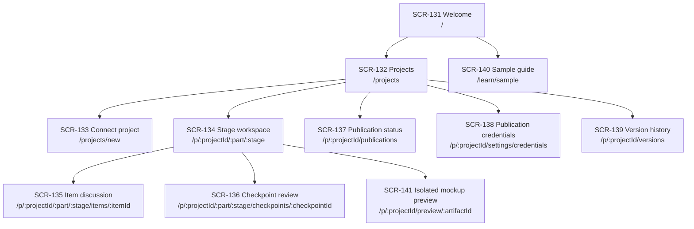

# 재설계 사이트맵

[English](rebuild.md)

상태: [YAML](sources/rebuild.yaml)을 기준으로 화면 11개를 정의하고 [보드·목록·슬라이드](rebuild/index.html)를 생성했습니다. 운영 라우트가 아닌 설계이며 실제 화면·상태는 08·09에서 작성합니다.

| Screen | Path | Access | Flows |
| --- | --- | --- | --- |
| SCR-131 시작 | / | 공개 예제 또는 인증한 소유자만; YAML의 정확한 조건 적용 | FL-128, FL-129, FL-130, FL-131, FL-132, FL-133, FL-135, FL-136 |
| SCR-132 프로젝트 | /projects | 공개 예제 또는 인증한 소유자만; YAML의 정확한 조건 적용 | FL-128, FL-129, FL-130, FL-135 |
| SCR-133 프로젝트 연결 | /projects/new | 공개 예제 또는 인증한 소유자만; YAML의 정확한 조건 적용 | FL-129, FL-135 |
| SCR-134 단계 작업 화면 | /p/:projectId/:part/:stage | 공개 예제 또는 인증한 소유자만; YAML의 정확한 조건 적용 | FL-130, FL-131, FL-132, FL-133, FL-136 |
| SCR-135 항목 대화 | /p/:projectId/:part/:stage/items/:itemId | 공개 예제 또는 인증한 소유자만; YAML의 정확한 조건 적용 | FL-130, FL-131 |
| SCR-136 체크포인트 검토 | /p/:projectId/:part/:stage/checkpoints/:checkpointId | 공개 예제 또는 인증한 소유자만; YAML의 정확한 조건 적용 | FL-132, FL-133 |
| SCR-137 게시 상태 | /p/:projectId/publications | 공개 예제 또는 인증한 소유자만; YAML의 정확한 조건 적용 | FL-129, FL-133, FL-135 |
| SCR-138 게시·에이전트 권한 | /p/:projectId/settings/credentials | 공개 예제 또는 인증한 소유자만; YAML의 정확한 조건 적용 | FL-129, FL-135 |
| SCR-139 버전 이력 | /p/:projectId/versions | 공개 예제 또는 인증한 소유자만; YAML의 정확한 조건 적용 | FL-130, FL-132, FL-133 |
| SCR-140 샘플 가이드 | /learn/sample | 공개 예제 또는 인증한 소유자만; YAML의 정확한 조건 적용 | FL-128, FL-129, FL-136 |
| SCR-141 격리된 목업 미리보기 | /p/:projectId/preview/:artifactId | 공개 예제 또는 인증한 소유자만; YAML의 정확한 조건 적용 | FL-130, FL-136 |

체크포인트·항목 대화·미리보기는 작업 화면의 자식이며 직접 주소로 열어도 프로젝트·단계·버전 맥락을 보존합니다. 프로젝트 전환은 같은 소유자의 선택만 복원합니다. 로그인 성공은 검증한 원래 주소로 복귀하고 잘못된 복귀 주소는 프로젝트 목록으로 제한합니다. 새 창의 HTML 실행은 미리보기 내부로 격리합니다. 운영자 이전·복구 FL-134에는 공개 화면을 만들지 않으며 API-237부터 API-240까지의 보호된 명령으로 처리합니다.

모든 화면은 루트에서 접근할 수 있고 경로가 고유합니다. 화면에 표시되는 플로우 단계마다 SCR ID를 다시 연결했습니다. 등록한 기존 사이트맵 YAML 사본은 원본과 같고 기존 화면 ID·상태를 유지합니다. 실제 제품 브라우저 QA·포커스·접근성 검증은 후속 단계이며 이 사이트맵 생성으로 통과했다고 보지 않습니다.

## 읽기 모델 연결 수정

초안은 화면 표현의 연결에 애그리게이트 식별 용어를 섞었습니다. 실제 자동 대조는 읽기 모델을 비교하므로 YAML에 각 화면의 실제 읽기 모델·소유 컨텍스트를 명시했습니다. 화면에 다른 컨텍스트의 관련 필드를 표시할 수 있지만 그 애그리게이트를 소유한다고 선언하지 않습니다. 공개 샘플 검토는 CTX-033에 속하며 운영자 전용 표현은 공개 화면이 없음을 명시합니다. 경로·표시 데이터·권한은 유지합니다. 일관되지 않은 연결을 대체하고 실제 보드·사이트맵 대조로 검사합니다.
