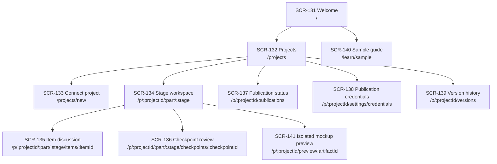

# Rebuild sitemap

[한국어](rebuild.ko.md)

Status: eleven screens defined in the [YAML](sources/rebuild.yaml), with generated [board, list and slides](rebuild/index.html). These are design routes; stages 08–09 supply the actual screen states and mockups.

| Screen | Path | Access | Flows |
| --- | --- | --- | --- |
| SCR-131 Welcome | / | everyone; private project data requires owner session | FL-128, FL-129, FL-130, FL-131, FL-132, FL-133, FL-135, FL-136 |
| SCR-132 Projects | /projects | authenticated owner; own projects only | FL-128, FL-129, FL-130, FL-135 |
| SCR-133 Connect project | /projects/new | authenticated owner | FL-129, FL-135 |
| SCR-134 Stage workspace | /p/:projectId/:part/:stage | authenticated project owner | FL-130, FL-131, FL-132, FL-133, FL-136 |
| SCR-135 Item discussion | /p/:projectId/:part/:stage/items/:itemId | authenticated project owner; exact item/version scope | FL-130, FL-131 |
| SCR-136 Checkpoint review | /p/:projectId/:part/:stage/checkpoints/:checkpointId | authenticated owning human session; never machine role | FL-132, FL-133 |
| SCR-137 Publication status | /p/:projectId/publications | authenticated project owner | FL-129, FL-133, FL-135 |
| SCR-138 Publication credentials | /p/:projectId/settings/credentials | authenticated project owner; credential value only at issuance | FL-129, FL-135 |
| SCR-139 Version history | /p/:projectId/versions | authenticated project owner | FL-130, FL-132, FL-133 |
| SCR-140 Sample guide | /learn/sample | everyone for synthetic sample; owner session to create private copy | FL-128, FL-129, FL-136 |
| SCR-141 Isolated mockup preview | /p/:projectId/preview/:artifactId | owner-authorized parent; opaque credential-free child sandbox | FL-130, FL-136 |

Checkpoint, item discussion and preview are children of the workspace; deep links preserve project, stage and version. Project switching restores only this owner’s choices. Sign-in returns to a validated original address, otherwise to the project list. HTML execution remains confined to the preview. Operator migration/recovery FL-134 has no public screen and uses protected API-237 through API-240 commands.

Every screen is reachable from the root and paths are unique. Visible flow steps now name their SCR IDs. The registered historical YAML copy is identical to its original and preserves old screen IDs/status. Full product browser QA, focus and accessibility verification remain later work; sitemap generation does not pass them.

## Read-model annotation correction

The first draft mixed aggregate identity terms into screen projection annotations. The live crosscheck compares read models, so the YAML now names the actual read model and its owning context for each screen. A screen may display related fields from other contexts without declaring that it owns their aggregate. Public sample review belongs to CTX-033; operator-only projections remain explicitly without a public screen. Routes, visible data and permissions are unchanged. This replaces the inconsistent annotations and is checked with the real board/sitemap comparison.
