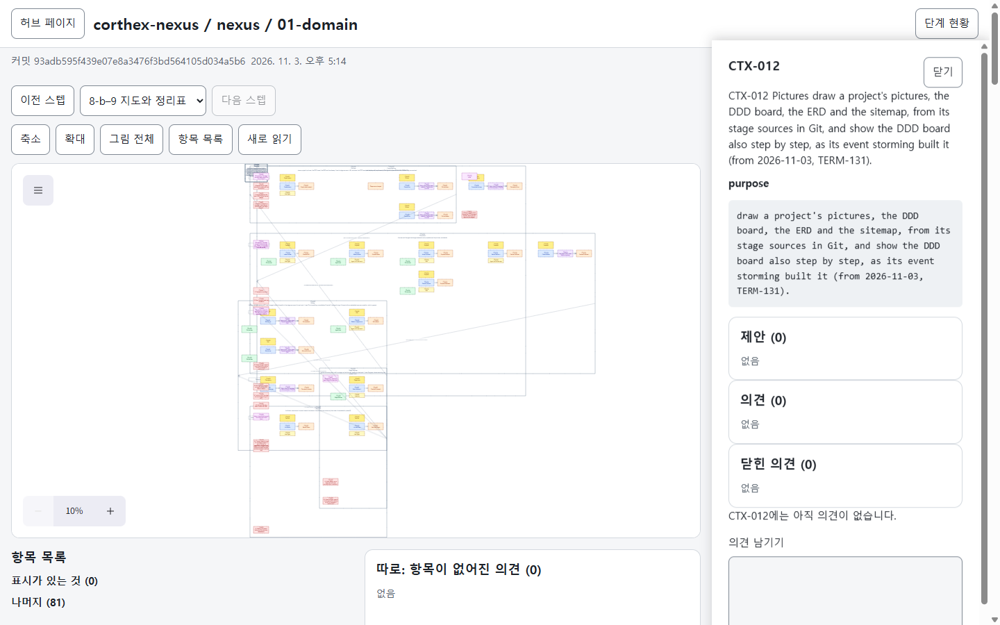
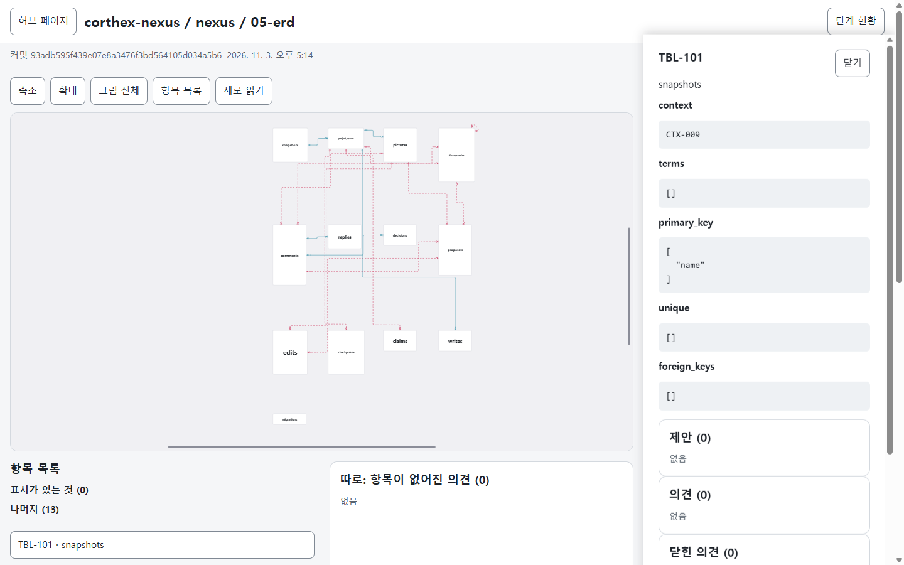
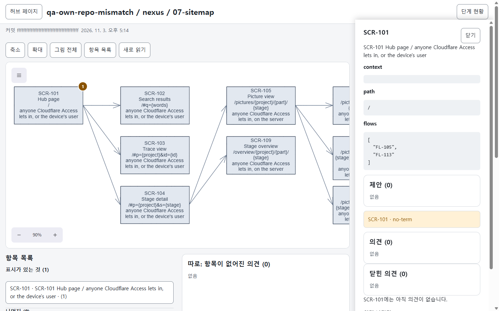

# TC-1268 공개용 로컬 근거

공개 `kodonghui/corthex-nexus`의 실제 fetched default `main` `93adb595f439e07e8a3476f3bd564105d034a5b6`를 E7 허브 `e7ff3947017703128df4c9e4e1b26b0d912eaa70`로 읽었습니다. public Git에는 등록 설정과 stage 기계기록이 없어 소유 등록 overlay를 사용했습니다. 원 `.md` ERD 등록은 2그림만 생성했고, 보조 `.sql` 등록에서는 같은 Git 객체로 3그림이 생성됐습니다. 이 둘은 별도 결과이며 full TC 승격은 부모 판단 대기입니다.

D802 뷰를 실제 localhost handler/SQLite와 합성 Access, 새 격리 Chrome에서 KO1440으로 열어 DDD·ERD·Sitemap 항목 패널과 API source SHA를 확인했습니다. 논리 장면은112/13/9노드, 선택 목록은81/13/9항목이며 서로 다른 분모입니다. 세 화면의 document 가로 overflow는0px입니다. 실제 `#items button,.panel-head button` 측정은 최소56×44px였으며 native 내부 도구 전체의 접근성 통과를 뜻하지 않습니다.

원본의 `terms:none`(ERD4/화면4)과 TERM-122/TERM-121 예외를 유지했을 때 DB 어긋남은0개였습니다. 명시된 합성 복사본에서 네 억제 표기를 제거하자 no-term2/no-table1/no-screen1의4개가 실제 DB에 생겼고, 마지막 캡처는 그 합성 Sitemap의 SCR-101 경고입니다. `f` 반복 커밋은 합성 표시이며 공개 Git 커밋이 아닙니다.

실제 계정·인증 정보는 사용하지 않았고 외부 NEXUS 업로드, 브라우저 쓰기, 의견/제안/확인 지점 생성은0입니다. Chrome/fixture/SQLite는 닫혔습니다. DDD 전체맞춤에서는 글자가 작고 일부 장면은 캔버스 범위 밖이므로 전체 동시 가독성,300요소 성능/P95, 전체710 QA 통과를 주장하지 않습니다. 공개 선택본은 page-only PNG3장과 이 요약/results/hash manifest뿐이며 raw profile/SQLite는 포함하지 않습니다.
