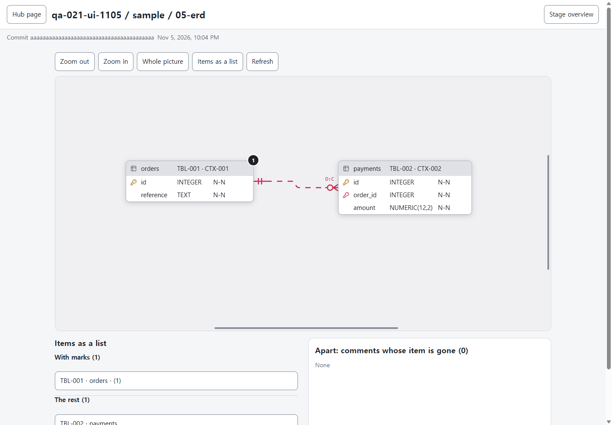
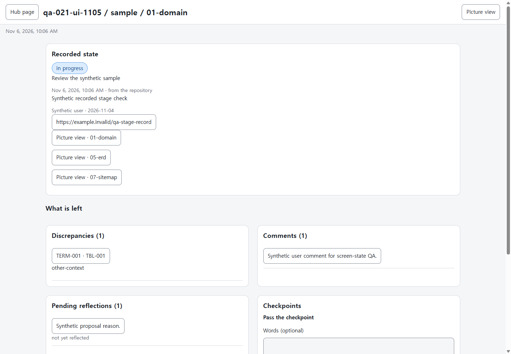
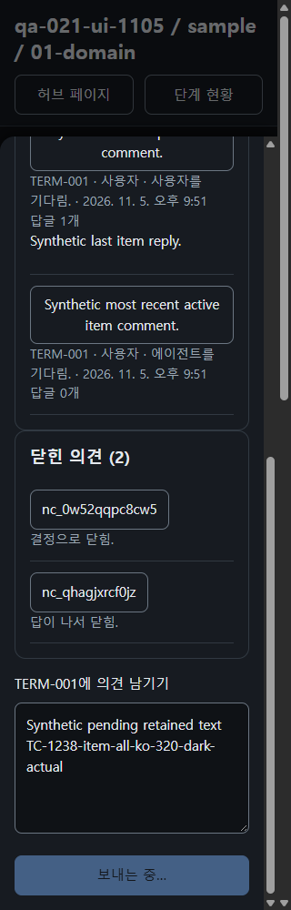
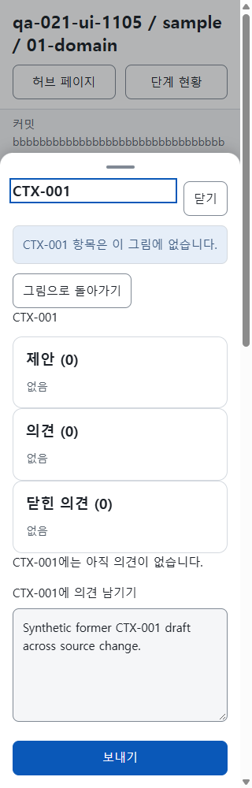

# 원래 화면 절차 43건

후보 판정, 최종 판정, 이미지 검토와 Linux 브라우저 시험 8개의 근거를 모았습니다. [근거 목록](browser.json)

부분 화면은 TC-1221·1237·1242·1248·1254·1261입니다. TC-1272는 실제 세션의 결합 복구 절차입니다. 모의 외부 오류 수용은 승인된 조건 5건에만 적용했습니다.

실제합성ERD의편집기전환뒤공개viewport x165.5/y197.75/확대1.25정확보존.

합성 프로젝트의 1440px 단계 현황에서 저장소 출처, 확인 지점 승인 기록과 남은 일을 표시합니다.

실제합성항목의전송응답대기: 글유지/보내는중/보내기꺼짐·닫힘2종문구.

실제합성원본변경/실제재열기: 없어진고정ID항목의의미있는초안+쓰기ID보존·돌아가기유지.

