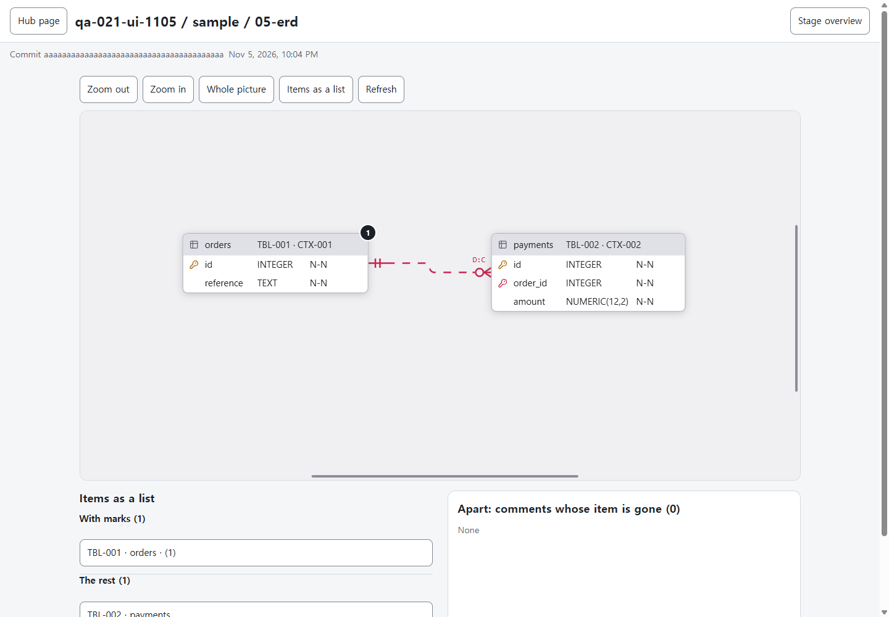
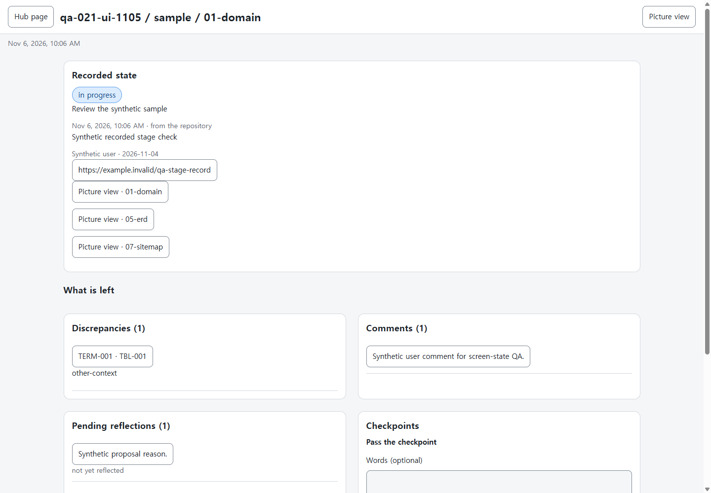
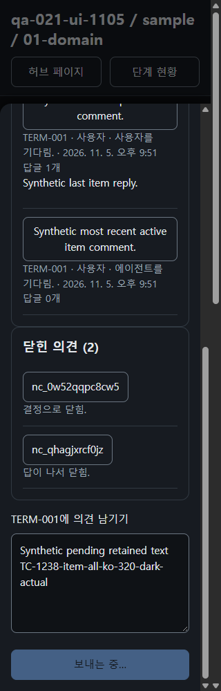
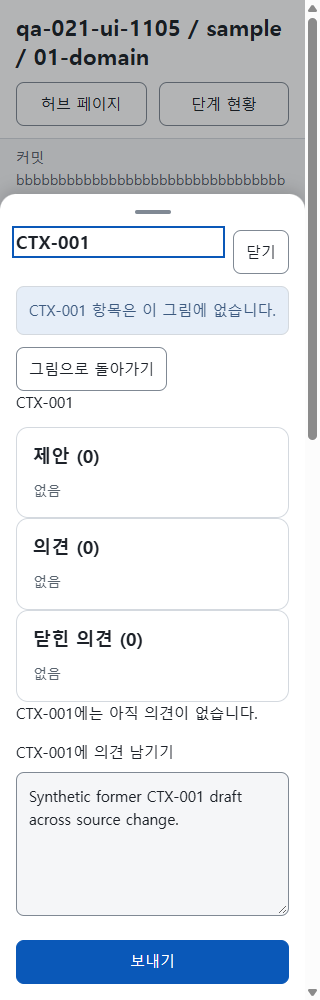

# The 43 original browser procedures

The evidence index records the original candidate, the final decisions, the direct image review and the Linux eight-suite run. [Evidence index](browser.json)

The six partial screen cases are TC-1221, TC-1237, TC-1242, TC-1248, TC-1254 and TC-1261. The separate TC-1272 covers combined real-session recovery. Mock 429/503 responses cover the five approved external provider clauses.

Actual synthetic ERD after native handoff: public viewport x165.5/y197.75/zoom1.25 is preserved exactly.

Stage overview of the synthetic project showing the repository record, checkpoint approval metadata and remaining work at 1440 px.

Actual synthetic item comment held at response boundary: retained draft and localized Sending, disabled Send; two visible closed outcomes.

Actual synthetic changed-source/native reload: removed stable item keeps meaningful unsent draft and its write ID; Back remains.

