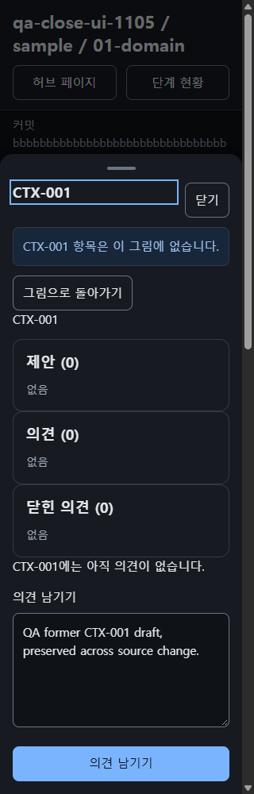
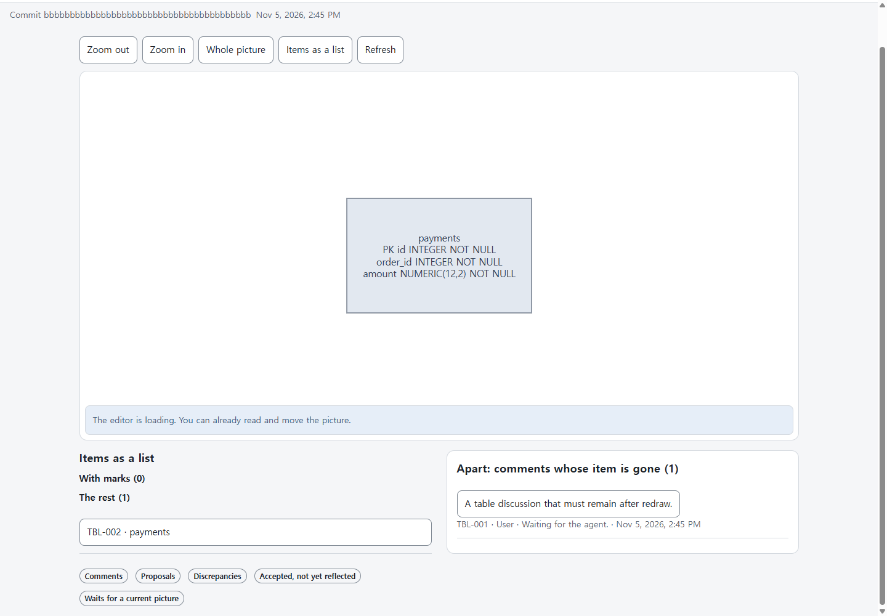
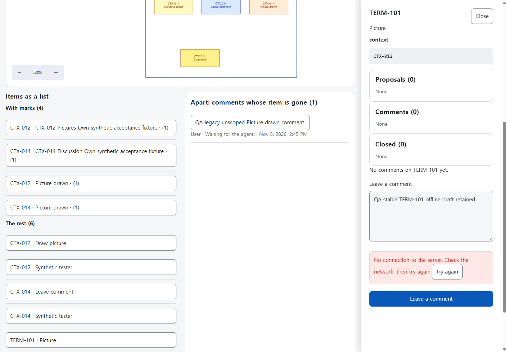
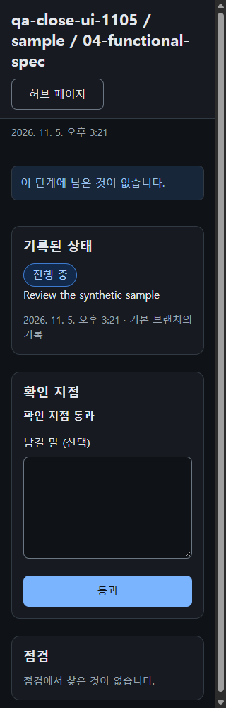

# NEXUS 0.2 브라우저 QA — 범위를 명시한 마무리

최종48개 원TC의 제안은 전체 조건 통과 후보5개와 화면 부분 검증43개입니다. 통과 후보는 TC651·TC682·TC684·TC1223·TC1258이며 원 기준은 바꾸지 않았습니다. 나머지43개에서 아직 실행하지 않은 정확한 절은 `candidate-final-v5.safe.json`과 `remaining-43-exact-clauses.final.safe.json`에 적었습니다.

설치된 Chrome·CDP와 격리된 실제 Node 처리기·SQLite, 서명된 합성 Access 역할로 검사했습니다. 앞서 Aside로 실행한 개발 서버 흐름과 운영 읽기 전용 확인은 별도 보존했습니다. 운영 쓰기·공유 개발 환경 변경·계정이나 정책 변경·새 의존성 설치는 없었습니다. 복사 소스의 판과 모든 증거SHA를 명부에 남겼으며 이 결과로 배포를 검증했다고 하지 않습니다.

| 근거 | 수 | 증명하는 범위 |
| --- | ---: | --- |
| 지정 화면 상태 |45개 상태 ×8설정 =360관측 |도구 중단을 보존·보완한320/1440픽셀 × EN/KO × 라이트/다크. 각 원TC의 남은 절은 별도 |
| 첫 전체 page-check |352개 |코어를 대기시킨8개는 원 도구가 문서 글꼴을 기다려 전체 계측 미실행 |
| 직접 본 원 화면 |45개 |원KO320·다크 상태 각각.360개 전체 검토로 확대하지 않음 |
| Prism 이름 붙은 HTTP 응답 |411/411개 |고정 Prism5.16.0의 응답·스키마 근거 |
| 별도 Problem UI |157개 |제품 렌더러의 KO320·다크 모의 표시만 |
| 읽기 전용 수정 상태 |8/8개 |실제 전송 대기, 도구 오류0개, 화면8개 직접 검토 |
| 사라진 항목 수정 분기 |v2의32개 +v3 영향 회귀8개 |실제 원본 전송·전체 새로고침. 댓글만·초안만·둘 다 없음·닫힌 댓글만의 효과이며 TC1243 전체는 부분 검증 |
| 검색 빈 상태 TC1223 |모의8개 다음 실제8개 |상태16개 직접 검토. 실제8개에서 다른 검색어 입력·닫기 후 SQL·쓰기 불변 |
| 단계 빈 상태 TC1258 |모의8개 다음 실제8개 |빈 목록 없음, 기록·점검·활성 통과 유지. 상태16개와 모바일 하단8개 직접 검토 |
| 현재 복사본 사용자 회귀 |11단계 |소유ID·인용 분리, 오프라인 초안·실제 새로고침, 안정 ID 전송, 확인 지점 통과·철회. v4의선별4개와 별도 v3의11개를 직접 검토 |

처음 발견한 소유ID·인용 실패와 BUG565~572의 원 증거를 보존했습니다. 이번 수정 범위는 거절 페이지 스타일·문구, 화면 상태 이름, 검색 종류·단계, 사라진 항목의 의견·초안, 읽기 전용 초안 대비, 따로 목록의 표ID, 빈 단계의 목록 대체입니다. 별도 HTTP 어댑터 BUG564의 통과를 이 보고서로 주장하지 않습니다.

TC651은 실제 ERD·테이블 연쇄입니다. 사용자가 TBL-001에 의견을 보낸 뒤 그 표 없는 스냅샷을 실제 전송하고 전체 새로고침했습니다. API·SQLite·할 일이 일치하며 대화를 선택하기 전 따로 목록에 표ID가 보입니다. TC682는 정확한 Picture drawn 인용을 CTX-012에 저장하고 동명 CTX-014와 분리합니다. TC684는 소유 댓글 POST 하나만 전송 단계에서 실패시켰습니다. 글·write ID가 남고 API·SQL은 불변이며, timeOrigin이 바뀌는 실제 Page.reload에서 같은 초안을 복원했습니다. 이후 명시적으로 온라인 전송했을 때 한 행이 생겼습니다.

TC1258은 성공한 Prism 단계 뒤에 선택한 실제 Node 단계를 실행했습니다. 실제8개 설정 각각에서 통과·철회를 눌러 SQL 한 행이 passed→withdrawn, 할 일이1→0으로 바뀌고 저장소 기록은 불변임을 확인했습니다. 남은 의견이 있는 정상 현황은8개 설정에서 목록3개를 그대로 유지합니다. 앞선 Prism 시작 시도 한 번은 화면을 그리기 전0개에서 준비 실패로 멈췄습니다. 정확한 원인은 미확정으로 보존했고, 재시도 성공 뒤 실제 단계를 다시 실행했습니다.

원 page-check 오류97개는 지우지 않았습니다. 거절 스타일68개, 읽기 전용 대비8개, 체크박스 입력만 잰 대상 크기15개, 닫기 content-box6개입니다. 현재 읽기 전용 계측 오류는0개입니다.16×16 체크박스 밖이면서352×44 라벨 안인 지점을 실제 클릭해 값이 바뀜을 확인했습니다. 계측한 TC1223 KO320 닫기 글자는44×44 버튼 안에 있고 client=scroll42이지만 원6픽셀 오류는 남겼습니다. 영어320픽셀 검색 빈 화면의 Close 줄바꿈은 버튼 안에서 모두 보이고 동작하는 사용 인상으로 기록했습니다.

최종 v5 canonical-LF 복사 소스 digest는 `7b3de16f769bc90c53cb1d38c2cbccfb7336e4c8c89582ee93babb7c2f26685d`, bundle manifest SHA는 `1d641b51c92c31c30a365122d569b0cfae9b3671d5c3ec42282ab31c83491d68`, sizes SHA는 `21f7ba71f24405beb6780aae418df927212a06f1c857739bc3da8fd55380d8b7`입니다. v3의 표·소유ID·오프라인·검색 통과는 해당 원 소스 범위를 유지하며, v4는 단계 현황의 빈 목록 조건, v5는 점검 목록에만 정확한 빈 점검 문구를 주는 변경이며 다른 빈 목록의 없음은 유지합니다.

마지막 v5는 Prism empty8개 다음 실제 normal8개·empty8개를 확인했습니다.24개 문구 상태의 도구 오류는0개이며 정확한 EN/KO 빈 점검 문구와 다른 빈 목록의 없음 유지가 맞았습니다. 정상 점검 화면8개, 빈 상태16개, 모바일 하단8개, 선별 실제 조작4개로 총36개 파일을 직접 보았습니다. 첫 v5 normal의8개 중단은 제 검사기 정규식 escape 오류였으며 고친 실행은16/16개 완료했습니다. 원 제품 실패와 도구 중단을 분리해 보존했습니다. TC1257은 나머지 원문 절 때문에 부분 검증을 유지합니다.

43개 원 화면의 전체 세부 절, 실제 Cloudflare 세션 만료·opaque redirect·제공자429503의 백엔드 경로, 배포 환경의 전체 행렬과3초 성능은 이 실행으로 증명하지 않았습니다. 캡처만 한 화면과 실제 본 화면을 구분했습니다. 소유 탭·서버·Prism 세션을 닫은 뒤 읽기 전용 프로세스 확인에서 소유 Chrome·Node0개를 확인했습니다. 비공개 프로필 폴더는 증거로 남겼습니다.

TC1243의 v3 영향 회귀: 실제 원본 재전송·전체 새로고침 뒤 초안을 보존합니다. write ID는 그림에서 추정하지 않고 영수증으로 확인했습니다.

TC651 v3: 표가 사라져도 의견은 열려 있고 대화를 선택하기 전 따로 목록에 TBL-001이 보입니다.

TC684 v3: 소유 POST 하나만 실패했으며 연결 안내와 원래 초안이 남고 API·SQL은 불변입니다.

TC1258 v5: 안내가 빈 목록을 대신하며 모바일에서 기록·점검·활성 통과 버튼이 보입니다.

그림4장은 모두 합성 localhost 자료입니다. 정확한 SHA와 소스 범위는 `figures.release.safe.json`에 있습니다. 최종 QA 적용·배포·출시 판단은 총괄이 맡습니다.
