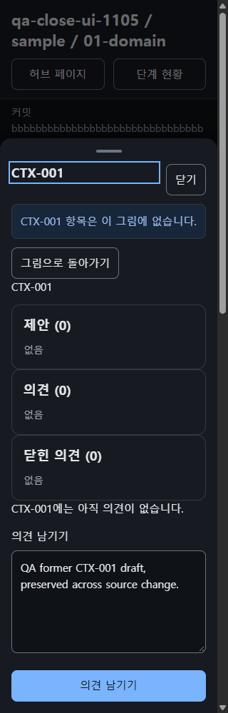
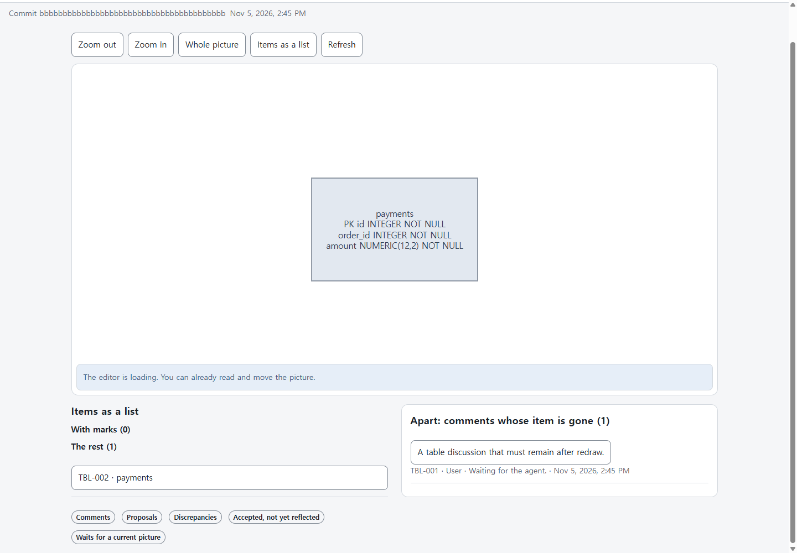
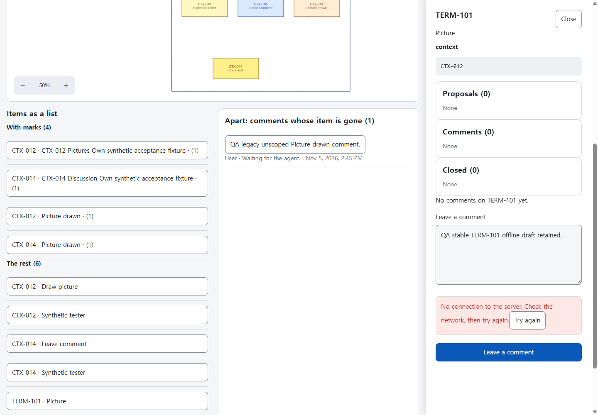
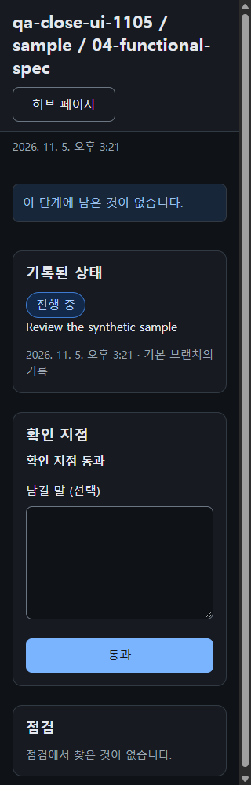

# NEXUS 0.2 browser QA — bounded closeout

The final48-case proposal contains5 whole-criterion local pass candidates and43 partial screen cases. The passes are TC651, TC682, TC684, TC1223 and TC1258. Original criteria are unchanged. The43 remaining cases list the exact untried clauses in `candidate-final-v5.safe.json` and `remaining-43-exact-clauses.final.safe.json`.

This tester used installed Chrome/CDP against an isolated actual Node handler and SQLite, with signed synthetic Access roles. Aside's earlier deployed-development flow evidence and production read-only checks are preserved separately. No production write, shared-development reconfiguration, account/policy change or new dependency was used. Copied source revisions and all artifact hashes are retained in the manifests; these results do not certify deployment.

| Evidence | Count | What it proves |
| --- | ---: | --- |
| Named screen states |45 states ×8 settings =360 observations |320/1440 px × EN/KO × light/dark, after retained harness corrections; per-case remaining clauses still apply |
| Initial full page-checks |352 |The pending core's8 full checks remain unrun because the unchanged checker waits for document fonts |
| Original images independently inspected |45 |Each original KO320/dark state; this does not expand to all360 captures |
| Prism named HTTP responses |411/411 |Pinned Prism5.16.0 response/schema evidence |
| Separate Problem UI variants |157 |Actual product renderer, KO320/dark only; mock presentation evidence |
| Fixed readonly state |8/8 |Actual pending send, checker0errors, all8 PNGs independently inspected |
| Fixed Gone branches |32 v2 cells +8 bounded v3 cells |Actual source push/full reload, open-comment/draft/neither/closed-only effects; TC1243 stays partial |
| Empty search, TC1223 |8 mock then8 actual cells |All16 primary state PNGs inspected; eight actual native other-word searches/Close actions leave SQL/writes unchanged |
| Empty overview, TC1258 |8 mock then8 actual cells |No zero-entry lists; record,Checks and enabled Pass remain; all16 primary and8 mobile lower-control files inspected |
| Current-copy user regression |11 steps |Owner/quote isolation, offline draft/true reload, stable-ID send and checkpoint pass/withdraw; selected4 v4 PNGs inspected, all11 v3 PNGs inspected separately |

The initial owner/quote failure and BUG565–572 remain in their original evidence. The bounded fixes cover refusal-page styling/messages, screen-state labels, search kind/stage, disappeared-item comments/drafts, readonly draft contrast, visible Apart table ID and the empty-overview list replacement. This report does not certify the separate HTTP-adapter BUG564 test.

TC651 uses the literal ERD/table path: a native user comment on TBL-001, an actual snapshot without that table, a full reload, and matching API/SQLite/to-do state. Apart shows the table ID before selecting the thread. TC682 stores the exact Picture drawn quote on CTX-012 and isolates identically named CTX-014. TC684 fails only one owned comment POST at browser transport; the text/write ID stay, API/SQL do not change, and a genuine Page.reload with a changed timeOrigin restores the same draft. Explicit online send creates one row.

For TC1258, the successful Prism phase precedes the chosen actual-node phase. Every actual setting passes and withdraws a checkpoint through native UI: one SQL row moves passed→withdrawn, to-do moves1→0, and the repository record stays unchanged. The nonempty overview separately preserves all3 lists in8 settings. One earlier Prism startup attempt stopped before rendering, with0 cells; its exact readiness cause is unconfirmed, its receipt is retained, and the actual phase was repeated after the successful retry.

The original97 checker errors remain intact:68 refusal-style findings,8 readonly-contrast findings,15 input-only checkbox target measurements and6 Close content-box measurements. Current readonly checks report0errors. A native click outside the16×16 checkbox but inside its352×44 label toggles it. The measured TC1223 KO320 Close text fits within its44×44 button and client=scroll42; raw6px reports remain. On English320px empty search, Close wraps within its button and still works; this is an impression.

The final v5 canonical-LF copied-source digest is `7b3de16f769bc90c53cb1d38c2cbccfb7336e4c8c89582ee93babb7c2f26685d`; bundle manifest SHA is `1d641b51c92c31c30a365122d569b0cfae9b3671d5c3ec42282ab31c83491d68`; sizes SHA is `21f7ba71f24405beb6780aae418df927212a06f1c857739bc3da8fd55380d8b7`. The v3 literal/owner/offline/search passes retain their exact earlier source scopes; v4 changed the overview empty-list condition; v5 supplies the exact empty-checks message only to the overview Checks list, preserving default None elsewhere.

The final v5 followup checks normal8 and empty8 actual settings, preceded by Prism empty8. All24 message-state page-checks report0 errors. Exact EN/KO empty-checks text is present and other zero-entry lists retain None. All8 normal Checks captures and16 empty primary plus8 mobile lower-control captures were independently viewed;4 selected native-write images were also viewed (36 files total). The first v5 normal run had8 test-matcher escape stops; the corrected runner completed16/16. Those tooling stops are preserved separately from the original product failure. TC1257 remains partial for its other original branches.

The43 complete original screen procedures, real Cloudflare session expiry/opaque redirect/provider429503 backend paths, a deployed full matrix and the3-second performance criterion remain unproven by this run. Captured-only images are distinct from actually viewed files. All owned tabs/servers/Prism sessions were closed; a read-only process inventory then found0 owned Chrome/Node processes. Private profile directories remain as evidence.

TC1243 bounded v3 regression: actual source redraw/full reload preserves the stored draft. Its write ID is checked through receipts, not inferred from the picture.

TC651 v3: the open comment remains after table removal, with TBL-001 visible in Apart before selection.

TC684 v3: only the owned POST failed; the original draft remains with a connection message and unchanged API/SQL.

TC1258 v5: the empty notice replaces the lists; record,Checks and enabled Pass remain visible on the phone viewport.

All four figures contain synthetic localhost data. Exact SHA and source scopes are in `figures.release.safe.json`. The orchestrator owns final QA application, deployment and release decisions.
