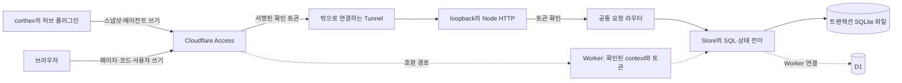

# 구조

[English](architecture.md)

제품 저장소에는 서버·화면·단계 원본을, 하네스 저장소에는 허브 플러그인·코어 스킬을 둡니다. 경계는 OpenAPI·스냅샷 형식과 전체 SHA를 적은 `hub-ref.json`입니다. 제품 CI가 그 공개 허브 사본을 명시적으로 준비한 뒤 시험은 네트워크 없이 씁니다.

2026-11-04에 고른 기본 배포는 관리자의 기존 VPS입니다. 독립 실행부는 Node 내장 모듈과 D1 형태의 SQLite 연결부를 씁니다. batch는 한 트랜잭션이고 데이터 SQL은 `store.js`에 둡니다. Workers 빌드·시험도 다른 경로로 유지합니다. 실행 위치가 바뀐다고 전송 형식·쓰기 ID·응답·확정 토큰을 바꾸지 않습니다.

원 서버는 JWT 서명, 설정된 팀 발급자·대상과 유효 시각을 확인합니다. 독립 서버에는 Worker의 `ctx.access`가 없으며 Tunnel 뒤 loopback에서만 듣습니다. Worker는 확인된 context도 계속 요구하므로 확인 안 된 Worker가 자동으로 공개되지 않습니다.

SQLite 백업은 서버에서 매일과 이주·배포 전에 만들고, 보관 기간과 실제 복구 대조를 기록합니다. 전용 사용자·폴더·systemd로 다른 작업과 분리합니다. SSH·배포 접속값과 자격은 Git 밖에 둡니다. 승인된 리허설은 운영 D1을 읽기 전용으로 내보내 독립 개발 사본에서 실행합니다. 마지막 출시 결정 전까지 운영은 기존 Worker·D1에 둡니다.

이주·독립 서버 계획은 [WBS](10-wbs/nexus.ko.md)와 [QA](12-qa/nexus.ko.md)에 있습니다. 실행부·백업·실제 OVH 근거는 해당 작업에서 확인합니다. 예전 Worker CPU, 시제품 모바일 시험과 미완성 화면의 결함을 최종 배포 인수와 구별합니다.

## 2단계 편집기

**Excalidraw 0.18.1.** 편집 모드에서는 `onChange`가 요소·앱 상태·파일을 전달합니다. `serializeAsJSON`으로 장면을 JSON으로 내보내고 `initialData`로 불러올 수 있습니다. 편집기 안의 작업은 자체 실행 취소·다시 실행을 지원합니다. 앱에서 `updateScene`으로 적용하는 변경은 `captureUpdate: CaptureUpdateAction.IMMEDIATELY`로 그 이력에 넣을 수 있습니다. 기본 이동·확대·맞춤 기능의 최소 배율은 10%입니다. 현재 NEXUS는 보기 모드로 띄우고 장면을 배열 순서에서 얻은 ID의 도형으로 바꿉니다. [고정 패키지](https://www.npmjs.com/package/@excalidraw/excalidraw/v/0.18.1) · [NEXUS 연결부](../nexus/ui/editor-excalidraw.js)

**ERD Editor 5.1.0.** 편집용 `<erd-editor>`는 `change` 이벤트를 내고, `.value`에 엔터티·순서·설정을 담은 파일 형식의 ERD JSON을 제공합니다. 이벤트에서 값을 읽어 스키마와 배치 변경을 화면 이동·배율과 따로 비교할 수 있습니다. 자체 실행 취소·다시 실행은 열려 있는 편집기에 적용되며 `setInitialValue`로 기준본을 불러오면 이력이 초기화됩니다. 캔버스의 이동·맞춤 배율은 10~150%입니다. 현재 NEXUS는 별도 `<erd-viewer>`에 장면을 스키마 3.0.0으로 변환해 주고, 고정 버전에 적용한 패치로 화면을 이동합니다. [고정 패키지](https://www.npmjs.com/package/@dineug/erd-editor/v/5.1.0) · [NEXUS 연결부](../nexus/ui/editor-erd.js) · [뷰어 패치](../nexus/ui/editor-patches.mjs)

**편집을 붙일 자리.** 단계 화면에서 초안의 수명을 관리하고, 처음 표시한 SVG를 내장 편집기로 넘기는 그림 연결부에서 초안에 들어갈 때 편집 모드를 선택할 수 있습니다. 원본에 편집을 되돌려 쓰려면 요소를 단계 원본의 고정 ID에 연결해야 합니다. 화면 이동·배율은 변경 비교에서 빼고, 새로고침이나 새 스냅샷을 받았을 때도 초안과 기준 커밋을 보존합니다. FL-115 설계에는 편집 필드를 검토 가능한 단계 원본 변경으로 옮기는 규칙, 기준이 바뀐 초안 처리, 저장본 복원이 필요합니다. FL-116의 도형과 연결선은 Excalidraw를 쓸 수 있습니다. 이벤트 유형·순서·검증 규칙·저장 형식은 NEXUS에서 정합니다. 큰 단계 그림의 전체 맞춤과 초안 실행 취소·저장본 복원은 각각 시험합니다. [단계 화면](../nexus/ui/core.js) · [그림 연결부](../nexus/ui/picture.js) · [장면 생성](../nexus/src/preview.js)
