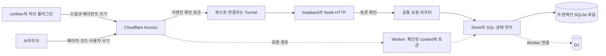

# 구조

[English](architecture.md)

제품 저장소에는 서버·화면·단계 원본을, 하네스 저장소에는 허브 플러그인·코어 스킬을 둡니다. 경계는 OpenAPI·스냅샷 형식과 전체 SHA를 적은 `hub-ref.json`입니다. 제품 CI가 그 공개 허브 사본을 명시적으로 준비한 뒤 시험은 네트워크 없이 씁니다.

2026-11-04에 고른 기본 배포는 관리자의 기존 VPS입니다. 독립 실행부는 Node 내장 모듈과 D1 형태의 SQLite 연결부를 씁니다. batch는 한 트랜잭션이고 데이터 SQL은 `store.js`에 둡니다. Workers 빌드·시험도 다른 경로로 유지합니다. 실행 위치가 바뀐다고 전송 형식·쓰기 ID·응답·확정 토큰을 바꾸지 않습니다.

원 서버는 JWT 서명, 설정된 팀 발급자·대상과 유효 시각을 확인합니다. 독립 서버에는 Worker의 `ctx.access`가 없으며 Tunnel 뒤 loopback에서만 듣습니다. Worker는 확인된 context도 계속 요구하므로 확인 안 된 Worker가 자동으로 공개되지 않습니다.

SQLite 백업은 서버에서 매일과 이주·배포 전에 만들고, 보관 기간과 실제 복구 대조를 기록합니다. 전용 사용자·폴더·systemd로 다른 작업과 분리합니다. SSH·배포 접속값과 자격은 Git 밖에 둡니다. 승인된 리허설은 운영 D1을 읽기 전용으로 내보내 독립 개발 사본에서 실행합니다. 마지막 출시 결정 전까지 운영은 기존 Worker·D1에 둡니다.

이주·독립 서버 계획은 [WBS](10-wbs/nexus.ko.md)와 [QA](12-qa/nexus.ko.md)에 있습니다. 실행부·백업·실제 OVH 근거는 해당 작업에서 확인합니다. 예전 Worker CPU, 시제품 모바일 시험과 미완성 화면의 결함을 최종 배포 인수와 구별합니다.
