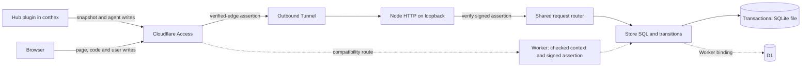

# Architecture

[한국어](architecture.ko.md)

The product repository owns the server, views and their stage sources. The harness repository owns the hub plugin and core skills. OpenAPI/snapshot formats and a full-SHA `hub-ref.json` are their boundary. Product CI obtains that immutable public hub checkout explicitly, then tests use it offline.

The default deployment choice of2026-11-04 is the maintainer's existing VPS. The standalone runtime uses Node built-ins and a D1-shaped SQLite adapter; batch execution remains one transaction and all data SQL remains in `store.js`. Workers retain their build/tests as an alternative path. No upload format, write ID, API response or frozen token changes merely because the runtime changes.

Origin JWT verification checks signature, configured team issuer, configured audience and validity times. Standalone requires no Worker `ctx.access`; its server listens only on loopback behind the Tunnel. Workers continue to require their checked context too. No implicit fallback makes an unchecked Worker public.

SQLite backups are server-local, daily and before migrations/deployments, with documented retention and an actual restore comparison. Dedicated user/folders/systemd isolate this service from other workloads. Exact SSH/deployment coordinates and all credentials remain outside Git. The approved rehearsal exports production D1 read-only to an isolated development copy. Production remains on the existing Worker/D1 until the final release decision.

The migration/standalone plan is recorded in [WBS](10-wbs/nexus.md) and [QA](12-qa/nexus.md). Runtime, backup and live OVH evidence are pending their implementation tasks. Historic Worker CPU results, prototype mobile batches and retained incomplete-view findings remain distinct from final deployment acceptance.
