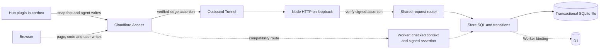

# Architecture

[한국어](architecture.ko.md)

The product repository owns the server, views and their stage sources. The harness repository owns the hub plugin and core skills. OpenAPI/snapshot formats and a full-SHA `hub-ref.json` are their boundary. Product CI obtains that immutable public hub checkout explicitly, then tests use it offline.

The default deployment choice of2026-11-04 is the maintainer's existing VPS. The standalone runtime uses Node built-ins and a D1-shaped SQLite adapter; batch execution remains one transaction and all data SQL remains in `store.js`. Workers retain their build/tests as an alternative path. No upload format, write ID, API response or frozen token changes merely because the runtime changes.

Origin JWT verification checks signature, configured team issuer, configured audience and validity times. Standalone requires no Worker `ctx.access`; its server listens only on loopback behind the Tunnel. Workers continue to require their checked context too. No implicit fallback makes an unchecked Worker public.

SQLite backups are server-local, daily and before migrations/deployments, with documented retention and an actual restore comparison. Dedicated user/folders/systemd isolate this service from other workloads. Exact SSH/deployment coordinates and all credentials remain outside Git. The approved rehearsal exports production D1 read-only to an isolated development copy. Production remains on the existing Worker/D1 until the final release decision.

The migration/standalone plan is recorded in [WBS](10-wbs/nexus.md) and [QA](12-qa/nexus.md). Runtime, backup and live OVH evidence are pending their implementation tasks. Historic Worker CPU results, prototype mobile batches and retained incomplete-view findings remain distinct from final deployment acceptance.

## Phase 2 editor

**Excalidraw 0.18.1.** An editable mount reports elements, app state and files through `onChange`. Scene JSON can be serialized with `serializeAsJSON` and loaded through `initialData`. Native undo/redo covers changes made in the editor. Host changes made through `updateScene` can opt into that history with `captureUpdate: CaptureUpdateAction.IMMEDIATELY`. The editor can pan, zoom and fit content within its native zoom range, whose lower bound is 10%. NEXUS currently mounts it in view mode and converts the scene to shapes with IDs derived from array positions. [Pinned package](https://www.npmjs.com/package/@excalidraw/excalidraw/v/0.18.1) · [NEXUS adapter](../nexus/ui/editor-excalidraw.js)

**ERD Editor 5.1.0.** The editable `<erd-editor>` emits `change` and exposes `.value` as file-format ERD JSON, including entities, ordering and settings. Read the value on change and compare the schema and layout fields separately from the camera. Native undo/redo belongs to the open editor and `setInitialValue` loads a baseline and resets its history. The canvas supports pan and fit with a 10–150% zoom range. NEXUS mounts the separate `<erd-viewer>`, projects the stage scene to vendor schema version 3.0.0 and uses a pinned viewer patch for camera controls. [Pinned package](https://www.npmjs.com/package/@dineug/erd-editor/v/5.1.0) · [NEXUS adapter](../nexus/ui/editor-erd.js) · [Viewer bridge](../nexus/ui/editor-patches.mjs)

**Where to connect editing.** The stage view owns the draft lifecycle. Its picture mount already hands off the first SVG to a native adapter and can select an editable mount when the user enters a draft. Give elements stable stage IDs before mapping edits back to the source. Keep camera changes out of the edit diff, and retain the draft and its base commit across refresh or snapshot changes. For FL-115, the design needs a mapping from edited vendor fields to a reviewable stage-source change, a rule for stale drafts and a way to revert saved changes. For FL-116, Excalidraw provides an editable board with shapes and connections. NEXUS needs to define the event types, order, rules and saved board format. Check whole-picture fit on large stage fixtures and test undo within a draft separately from restoring a saved revision. [Stage view](../nexus/ui/core.js) · [Picture handoff](../nexus/ui/picture.js) · [Scene generation](../nexus/src/preview.js)
